## Diapositiva 1: INTRODUCCION.

**Tema 1**

# INTRODUCCION.

Fundamentos de Computadores

*Pie de página:* Tema 1 | 1

---

## Diapositiva 2: Tema 1

**Tema 1**

1. ¿Qué es un computador?
2. Ciclo de instrucción
3. Programación de un procesador
4. Ejecución de un programa

*Pie de página:* Tema 1 | 2

---

## Diapositiva 3: ¿QUÉ ES UN COMPUTADOR?

**Tema 1**

# ¿QUÉ ES UN COMPUTADOR?

*Pie de página:* Tema 1 | 3

---

## Diapositiva 4: 1. ¿Qué es un Computador?

- Máquina (sistema) en la que se distinguen dos elementos:
  - **HW:** Circuitos y cableado.
  - **SW:** Información que modifica la función del HW sin realizar una reconfiguración de la circuitería para la resolución del problema.

*Pie de página:* Tema 1 | 4

---

## Diapositiva 5: 1. ¿Qué es un Computador?

- Máquina (sistema) en la que se distinguen dos elementos:
  - **HW:** Circuitos y cableado.
  - **SW:** Información que modifica la función del HW sin realizar una reconfiguración de la circuitería para la resolución del problema.

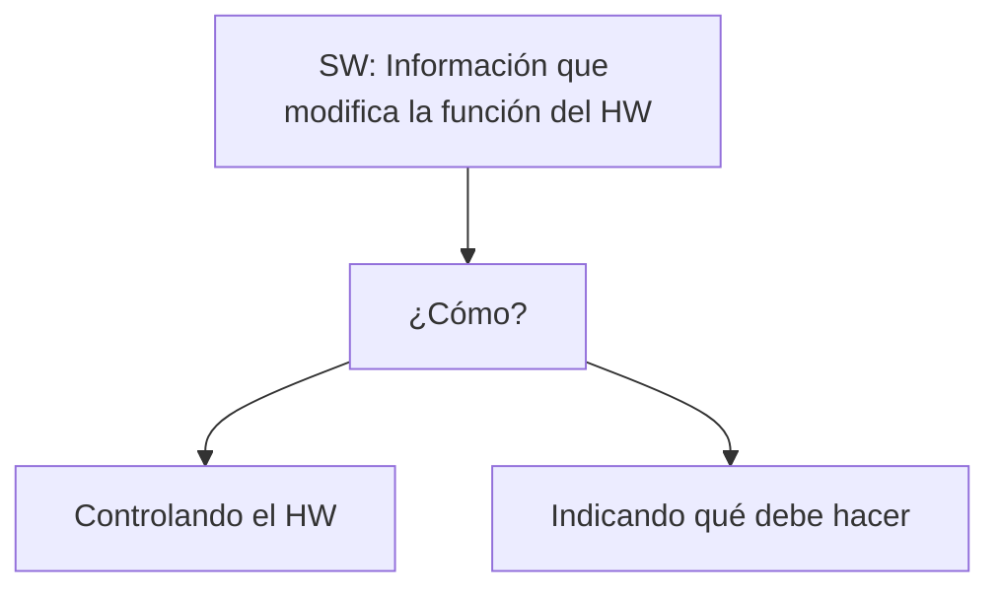

*Pie de página:* Tema 1 | 5

---

## Diapositiva 6: 1. ¿Qué es un Computador?

- Máquina (sistema) en la que se distinguen dos elementos:
  - **HW:** Circuitos y cableado.
  - **SW:** Información que modifica la función del HW sin realizar una reconfiguración de la circuitería para la resolución del problema.

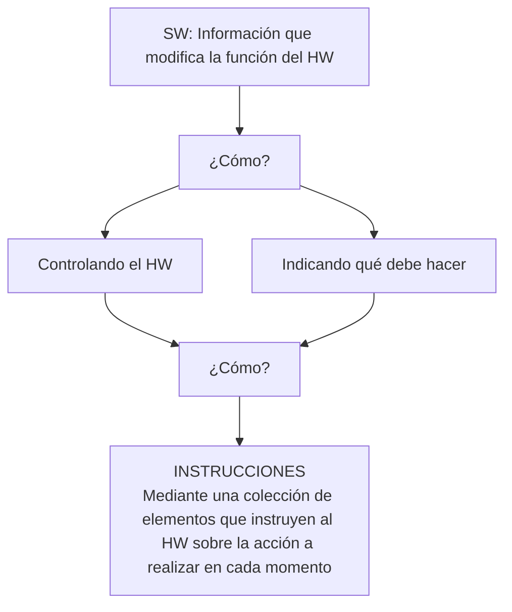

- **INSTRUCCIONES:** Mediante una colección de elementos que instruyen al HW sobre la acción a realizar en cada momento.

*Pie de página:* 6

---

## Diapositiva 7: 1. ¿Qué es un Computador?

- Máquina (sistema) en la que se distinguen dos elementos:
  - **HW:** Circuitos y cableado.
  - **SW:** Información que modifica la función del HW sin realizar una reconfiguración de la cirucuitería *(sic)* para la resolución del problema.

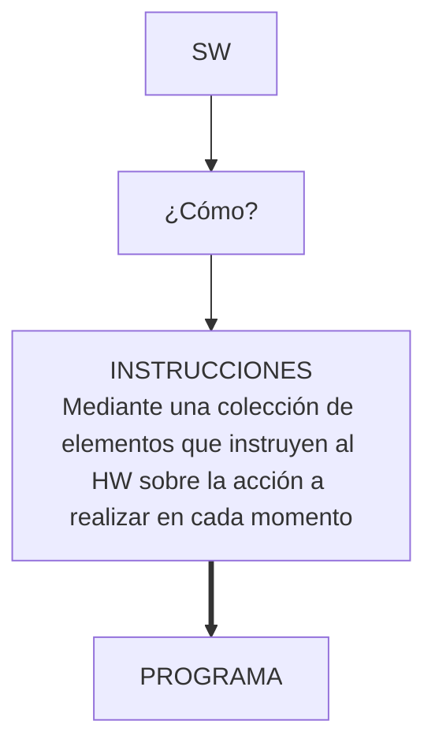

- **Descripción visual:** Una flecha descendente gruesa de color violeta señala desde el bloque de **INSTRUCCIONES** hacia un recuadro destacado con texto en rojo y mayúsculas: **PROGRAMA**.

*Pie de página:* Tema 1 | 7

---

## Diapositiva 8: 1. ¿Qué es un Computador?

**TIPOS DE PROPOSITO**

- **Específico:** Diseñado para una tarea determinada.
- **General:** Máquina destinada a ejecutar cualquier tipo de algoritmo

*Pie de página:* Tema 1 | 8

---

## Diapositiva 9: 1. ¿Qué es un Computador?

**TIPOS DE PROPOSITO**

- **Específico:** Diseñado para una tarea determinada.
- **General:** Máquina destinada a ejecutar cualquier tipo de algoritmo
- **Programa almacenado:** Establecido por John Von Neumann ($1945$) $\Rightarrow$
  - El almacenamiento de los programas en memoria.
  - Las instrucciones se codifican de forma numérica (secuencias binarias)

*Pie de página:* Tema 1 | 9

---

## Diapositiva 10: 1. ¿Qué es un Computador?

- Por tanto:
  > "Un computador es un sistema electrónico digital usado para la manipulación de información digital (datos binarios), de acuerdo a una lista de Instrucciones conocida como programa"
- Tipo de manipulación:
  - Almacenar
  - Transmitir
  - Procesar

*Pie de página:* Tema 1 | 10

---

## Diapositiva 11: Tema 1

**Tema 1**

1. ¿Qué es un computador?
2. **Ciclo de instrucción**
3. Programación de un procesador
4. Ejecución de un programa

*Pie de página:* Tema 1 | 11

---

## Diapositiva 12: CICLO DE INSTRUCCION

**Tema 1**

# CICLO DE INSTRUCCION

*Pie de página:* Tema 1 | 12

---

## Diapositiva 13: Arquitectura de un computador de programa almacenado

$$CPU = UC + UD + \text{Registros}$$

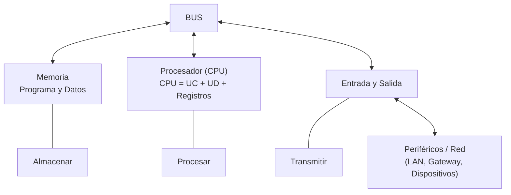

- **Conexiones y correspondencias clave del diagrama:**
  - Un **BUS** común interconecta de forma bidireccional los tres subsistemas principales: **Memoria (Programa y Datos)**, **Procesador (CPU)** y **Entrada y Salida**.
  - **Memoria Programa y Datos** se asocia a la operación **Almacenar**.
  - **Procesador (CPU)** se asocia a la operación **Procesar** y se detalla mediante la expresión $CPU = UC + UD + \text{Registros}$.
  - **Entrada y Salida** se asocia a la operación **Transmitir** y enlaza con elementos externos de comunicación y periféricos (`LAN`, `Gateway`, `D`).

*Pie de página:* Tema 1 | 13

---

## Diapositiva 14: Partes de un procesador

**Estructura general**

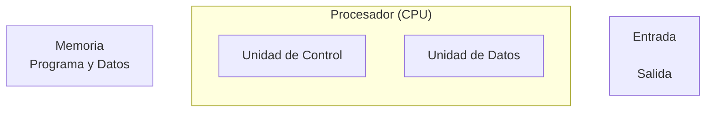

- **Descripción visual:** Se presentan los tres bloques estructurales principales sin flechas de conexión aún: a la izquierda `Memoria Programa y Datos`; en el centro `Procesador (CPU)` dividido verticalmente en `Unidad de Control` (parte superior) y `Unidad de Datos` (parte inferior); a la derecha el bloque `Entrada` / `Salida`.

*Pie de página:* Tema 1 | 14

---

## Diapositiva 15: Partes de un procesador

**Estructura general**

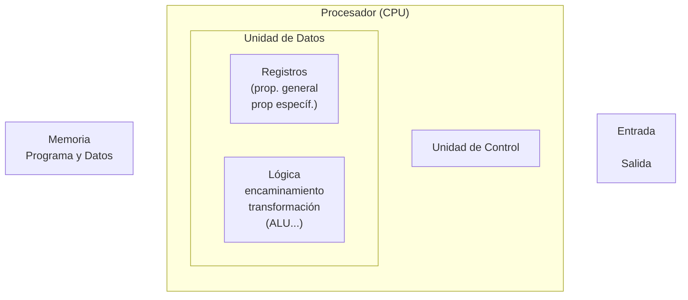

- **Descripción visual:** Respecto a la diapositiva 14, se detalla el interior de la **Unidad de Datos** dentro del **Procesador (CPU)**, que contiene dos sub-bloques con borde verde:
  - `Registros (prop. general / prop específ.)`
  - `Lógica encaminamiento transformación (ALU...)`

*Pie de página:* Tema 1 | 15

---

## Diapositiva 16: Partes de un procesador

**Estructura general**

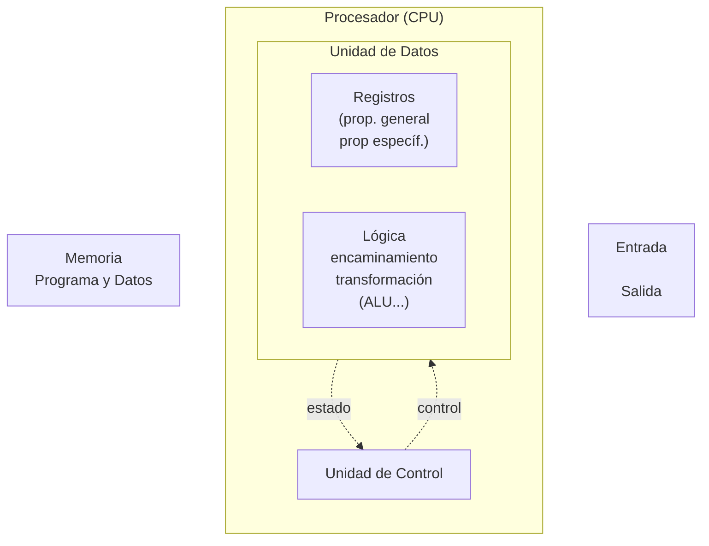

- **Conexiones y señales internas añadidas en la CPU:**
  - **Unidad de Control $\rightarrow$ Unidad de Datos:** flecha discontinua descendente de color rojo/naranja etiquetada `control`.
  - **Unidad de Datos $\rightarrow$ Unidad de Control:** flecha discontinua ascendente de color azul oscuro etiquetada `estado`.

*Pie de página:* Tema 1 | 16

---

## Diapositiva 17: Partes de un procesador

**Estructura general**

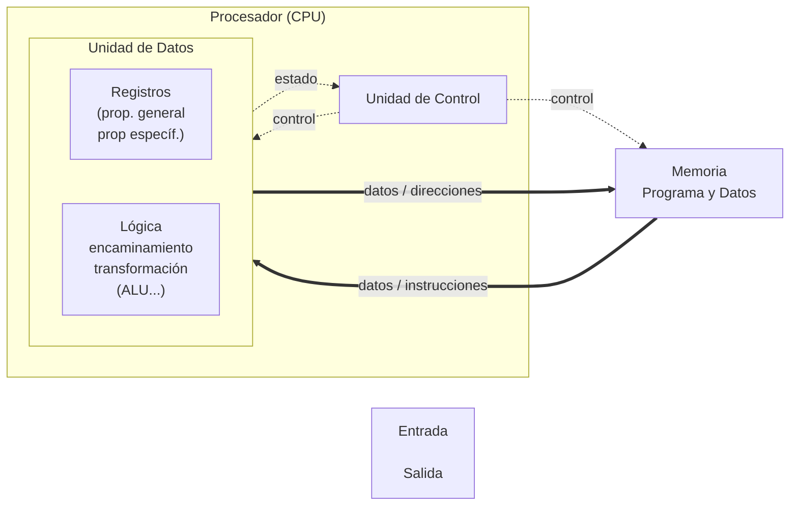

- **Conexiones y señales clave añadidas con Memoria:**
  - **Unidad de Control $\rightarrow$ Memoria Programa y Datos:** flecha discontinua roja etiquetada `control`.
  - **Memoria Programa y Datos $\rightarrow$ Unidad de Datos:** flecha verde gruesa etiquetada `datos` e `instrucciones`.
  - **Unidad de Datos $\rightarrow$ Memoria Programa y Datos:** flecha verde gruesa etiquetada `datos` y `direcciones`.
  - Se mantienen las señales internas `control` (UC $\rightarrow$ UD) y `estado` (UD $\rightarrow$ UC).

*Pie de página:* Tema 1 | 17

---

## Diapositiva 18: Partes de un procesador

**Estructura general**

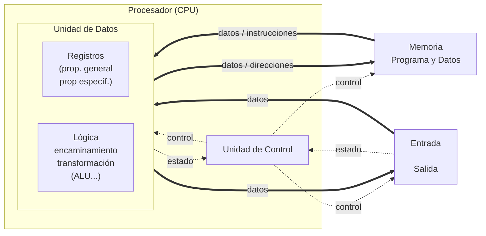

- **Resumen completo de conexiones y señales del diagrama general:**
  - **Entre UC y UD (internas a la CPU):**
    - `control` (discontinua roja): UC $\rightarrow$ UD.
    - `estado` (discontinua azul): UD $\rightarrow$ UC.
  - **Entre CPU y Memoria (Programa y Datos):**
    - `control` (discontinua roja): UC $\rightarrow$ Memoria.
    - `datos`, `instrucciones` (flecha verde gruesa): Memoria $\rightarrow$ UD.
    - `datos`, `direcciones` (flecha verde gruesa): UD $\rightarrow$ Memoria.
  - **Entre CPU y Entrada/Salida:**
    - `control` (discontinua roja): UC $\rightarrow$ Entrada/Salida.
    - `estado` (discontinua azul): Entrada/Salida $\rightarrow$ UC.
    - `datos` (flecha verde gruesa): Entrada/Salida $\rightarrow$ UD.
    - `datos` (flecha verde gruesa): UD $\rightarrow$ Entrada/Salida.

*Pie de página:* Tema 1 | 18

---

## Diapositiva 19: 2. Ciclo de instrucción

- Pasos en los que se divide la ejecución de una instrucción
- Ciclo de instrucción (general)
  - **Búsqueda de la instrucción (fetching):** el procesador lee de memoria la instrucción a ejecutar. Debe conocer la posición de memoria donde se encuentra dicha instrucción (PC – Program Counter).
  - **Decodificación de la instrucción:** Debe determinar el tipo de instrucción y los operandos que utiliza.
  - **Ejecución de la instrucción:** Ejecuta la acción expresada por la instrucción.

*Pie de página:* Tema 1 | 19

---

## Diapositiva 20: 2. Ciclo de instrucción

**Fase de Búsqueda (fetching)**

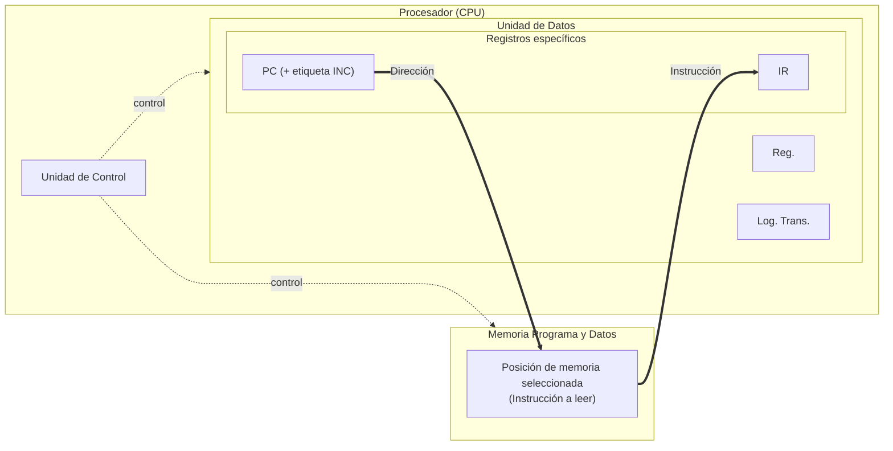

- **Detalles y señales clave de la fase de Búsqueda (fetching):**
  - La **Unidad de Control** envía señales de `control` (flechas discontinuas rojas) tanto a la **Memoria Programa y Datos** como a la **Unidad de Datos**.
  - En la **Unidad de Datos** se distinguen cuatro elementos: `PC` (Program Counter), `IR` (Instruction Register), `Reg.` y `Log. Trans.`.
  - Desde el registro `PC` sale una flecha verde curva etiquetada `Dirección` que apunta a una celda concreta resaltada en verde oscuro dentro de `Memoria Programa y Datos`.
  - Sobre el registro `PC` aparece una etiqueta naranja destacada con el texto `INC`, indicando el incremento del contador de programa.
  - Desde la celda seleccionada de memoria sale una flecha verde curva etiquetada `Instrucción` que carga la instrucción leída en el registro `IR`.

*Pie de página:* Tema 1 | 20

---

## Diapositiva 21: 2. Ciclo de instrucción

**Decodificación**

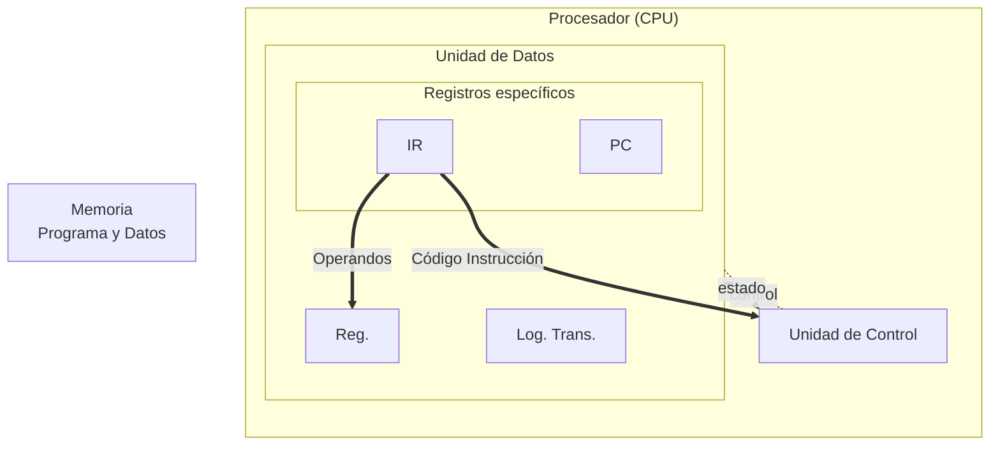

- **Detalles y señales clave de la fase de Decodificación:**
  - `Memoria Programa y Datos` permanece sin accesos activos durante esta fase.
  - Desde el registro `IR` (Instruction Register) salen dos flechas verdes gruesas:
    - Una flecha etiquetada `Código Instrucción` que sube hacia la **Unidad de Control** para identificar la operación a realizar.
    - Una flecha etiquetada `Operandos` dirigida hacia el banco de registros `Reg.` para seleccionar/acceder a los operandos especificados en la instrucción.
  - Se muestran las señales internas `control` (discontinua roja, UC $\rightarrow$ UD) y `estado` (discontinua azul, UD $\rightarrow$ UC).

*Pie de página:* Tema 1 | 21

---

## Diapositiva 22: 2. Ciclo de instrucción

- **Ejecución**

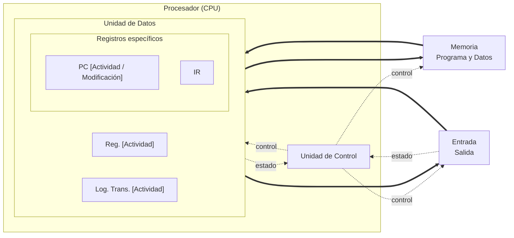

- **Detalles y señales clave de la fase de Ejecución:**
  - La **Unidad de Control** dirige mediante señales `control` (discontinuas rojas) a la **Unidad de Datos**, a la **Memoria Programa y Datos** y a **Entrada/Salida**.
  - La **Unidad de Control** recibe señales `estado` (discontinuas azules) desde la **Unidad de Datos** y desde **Entrada/Salida**.
  - Existen flujos bidireccionales de datos (pares de flechas verdes curvas) entre la **Unidad de Datos** y **Memoria Programa y Datos**, así como entre la **Unidad de Datos** y **Entrada/Salida**.
  - Visualmente se resaltan con destellos/estrellas de color naranja con borde azul oscuro los bloques donde se produce actividad de ejecución:
    - Detrás de `PC` (posible modificación del flujo de control / saltos).
    - Detrás de `Reg.` y `Log. Trans.` (operaciones aritmético-lógicas y lecturas/escrituras en registros).

*Pie de página:* Tema 1 | 22

---

## Diapositiva 23: Tema 1

**Tema 1**

1. ¿Qué es un computador?
2. Ciclo de instrucción
3. **Programación de un procesador**
4. Ejecución de un programa

*Pie de página:* Tema 1 | 23

---

## Diapositiva 24: PROGRAMACION DE UN COMPUTADOR

**Tema 1**

# PROGRAMACION DE UN COMPUTADOR

*Pie de página:* Tema 1 | 24

---

## Diapositiva 25: 3 Programación de un computador

- ¿Cómo se define qué tarea debe realizar un computador? - **PROGRAMA**
- **Programa:** Algoritmo escrito mediante un lenguaje de programación.
- **Algoritmo:** Secuencia de pasos a seguir para resolver un problema.
- **Lenguaje de programación:** Conjunto de reglas y símbolos que permiten escribir algoritmos formalmente para que un computador los pueda entender.

*Pie de página:* Tema 1 | 25

---

## Diapositiva 26: Instrucciones y datos (información) están contenidos en memoria

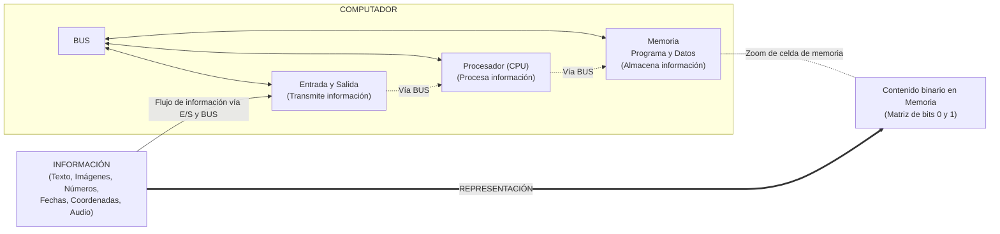

- **Descripción visual del panel `INFORMACIÓN` (derecha):**
  - Muestra ejemplos heterogéneos de información del mundo real:
    - **Texto impreso / periódico:** recorte de prensa titulado `POST-OCH INRIKES TIDNINGAR` (`Viktigt meddelande`, `Prenumeration`, `Post- och Inrikes Tidningar`, `Kort historik`, `Annonser`, `Redaktion`).
    - **Imágenes / fotografías:** cuatro miniaturas fotográficas en color (paisaje con tormenta, aves volando, barco pesquero y cielo con nubes).
    - **Números, medidas, fechas, monedas, coordenadas y códigos:**
      - `1,234,567.89`
      - `#101` $6'' \times 2\frac{3}{4}''$ ($152 \times 70$) $\ast$ `1895`
      - `№.6755` — `(4-8-2)` $31\frac{1}{2}$, `22,090;` $4'\ 8\frac{1}{2}''$
      - `345678910JQK` — `2♥ 3♦ 8♣ Q♠ K♠ 10♣ 25♦ $150 ✪ $2,000`
      - `10.25.1917-1990` — `1234567890 1234567890 1234567890`
      - `6414123196` — `₩200 ฿35⅝ ₡25 ₱75 ₨15 ₦50 ₪450`
      - $47^\circ 30' \times 19^\circ 05'$ — `997 1526 1867 1918 1949 1989`
      - `10036-11367` — `26:7750-7859/28:7860-7959/29:8570-8805`
    - **Audio:** representación gráfica de dos canales de forma de onda sonora (estéreo).
- **Flecha `REPRESENTACIÓN`:** Una flecha gruesa de color azul/violeta con borde verde señala desde el bloque `INFORMACIÓN` hacia la matriz binaria extraída mediante líneas punteadas de zoom desde una porción de `Memoria Programa y Datos`.
- **Flujo interno en el `COMPUTADOR`:** Dos flechas curvas rojas/naranjas muestran cómo la información entra desde el exterior a través de `Entrada y Salida`, recorre el `BUS` hasta el `Procesador (CPU)` y se intercambia a través del `BUS` entre el `Procesador (CPU)` y `Memoria Programa y Datos`.

- **Matriz binaria ampliada desde `Memoria Programa y Datos` (8 bits por fila):**

| Fila | Bit 7 | Bit 6 | Bit 5 | Bit 4 | Bit 3 | Bit 2 | Bit 1 | Bit 0 | Secuencia binaria |
| :---: | :---: | :---: | :---: | :---: | :---: | :---: | :---: | :---: | :---: |
| 1 | `1` | `0` | `0` | `1` | `1` | `0` | `0` | `0` | `10011000` |
| 2 | `0` | `0` | `1` | `1` | `0` | `1` | `1` | `1` | `00110111` |
| 3 | `0` | `0` | `0` | `1` | `0` | `0` | `0` | `1` | `00010001` |
| 4 | `1` | `1` | `0` | `0` | `1` | `1` | `0` | `0` | `11001100` |
| 5 | `0` | `1` | `0` | `0` | `1` | `0` | `1` | `1` | `01001011` |
| 6 | `1` | `1` | `0` | `1` | `1` | `0` | `0` | `0` | `11011000` |
| 7 | `0` | `0` | `1` | `1` | `0` | `0` | `0` | `1` | `00110001` |
| 8 | `1` | `0` | `1` | `1` | `0` | `0` | `1` | `0` | `10110010` |

*Pie de página:* Tema 1 | 26

---

## Diapositiva 27: 3 Tipos de lenguajes

- **Lenguaje de alto nivel**
  Lenguaje de Programación con instrucciones de alto contenido semántico comprensibles por los humanos. (ejm: C, C++, Java, Pascal).

```c
#define vueltas 4
int suma = 0;
int V[4] = {0, 1, 2, 3};
main () {
    register int suma_parcial = 0;
    register int i = 0;
    while (i < vueltas) {
        suma_parcial += V[i];
        i++;
    }
    suma = suma_parcial;
}
```

*Pie de página:* Tema 1 | 27

---

## Diapositiva 28: 3 Tipos de lenguajes

- **Lenguaje ensamblador**
  Lenguaje de Programación con instrucciones de bajo contenido semántico comprensibles por los humanos. (ejm: Intel 386, Alpha, MIPS)

```asm
.text
main:
        MOVI R3,0               ; R3 es suma_parcial
        MOVI R1,0               ; R1 es i
        MOVI R4, LO(V)          ; R4 carga 1er elem. vector V
        MOVHI R4, HÌ(V)
        MOVI R0,0               ; para el salto incondicional
        MOVI R2, Vueltas
while:  CMPLT R5, R1,r2         ; ¿ < Vueltas?
        BZ R5, fiwhile          ; si (R5==0) fin bucle
        ADDI R1, R1,1           ; i++
        BZ RO, while            ; salto incondicional bucle
Fiwhile:
```

*Nota de transcripción literal:* En la transparencia original figuran exactamente `HÌ(V)`, `r2` en minúsculas, `¿ < Vueltas?`, `RO` en `BZ RO, while`, y las etiquetas `fiwhile` / `Fiwhile:`.

*Pie de página:* Tema 1 | 28

---

## Diapositiva 29: 3 Tipos de lenguajes

- **Lenguaje máquina**
  Lenguaje de Programación con instrucciones de bajo contenido semántico comprensible por el computador.

```text
0010100101101001
1010001001001011
1111010100111010
0010010101000010
1110010100101001
0101000001000011
1110010010000010
0001000010101110
1001000101010000
1110100100100100
0010101001011110
1100101000000010
```

*Pie de página:* Tema 1 | 29

---

## Diapositiva 30: 3 Proceso de traducción

- El procesador **SOLO** entiende lenguaje máquina (instrucciones máquina).
- Existe un proceso de "traducción desde el lenguaje de alto nivel hasta el lenguaje máquina.

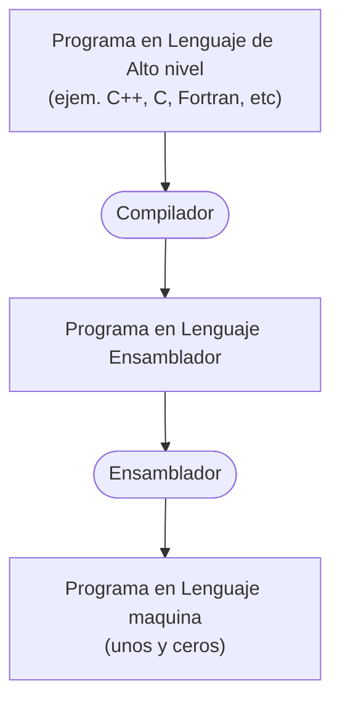

- **Ejemplos de código asociados a cada nivel del diagrama:**
  - **Programa en Lenguaje de Alto nivel:**
    ```c
    Main(){
        int a, b, c
        c = a + b
    ```
  - **Programa en Lenguaje Ensamblador:**
    ```asm
    ADD R1, Ro, a
    ADD R1, R3, R2
    ```
  - **Programa en Lenguaje maquina (unos y ceros):**
    ```text
    00100010100
    001111110000
    ```

*Pie de página:* Tema 1 | 30

---

## Diapositiva 31: 3 Proceso de traducción

- Carga en memoria requiere proceso de enlazado
  - Resuelve referencias de direcciones de memoria entre módulos objeto
- Cargador (loader) asigna direcciones físicas de memoria a las direcciones lógicas usadas en el código objeto

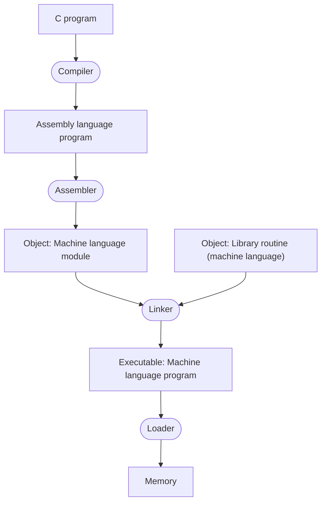

- **Descripción de las etapas del diagrama:**
  1. `C program` (rectángulo) pasa al `Compiler` (óvalo azul) generando el `Assembly language program`.
  2. `Assembly language program` pasa al `Assembler` (óvalo azul) generando `Object: Machine language module`.
  3. El `Linker` (óvalo azul) combina `Object: Machine language module` junto con `Object: Library routine (machine language)` para producir `Executable: Machine language program`.
  4. El `Loader` (óvalo azul) carga el ejecutable en `Memory`.

*Pie de página:* Tema 1 | 31

---

## Diapositiva 32: Tema 1

**Tema 1**

1. ¿Qué es un computador?
2. Ciclo de instrucción
3. Programación de un procesador
4. **Ejecución de un programa**

*Pie de página:* Tema 1 | 32

---

## Diapositiva 33: 4. Ejecución de un programa

- El procesador lee y ejecuta secuencialmente y en orden las instrucciones que forman un programa (almacenadas en memoria).
- Ejecución de una instrucción (ciclo de instrucción):
  - **Búsqueda de la instrucción:** el procesador lee de memoria la instrucción a ejecutar. Debe conocer la posición de memoria donde se encuentra dicha instrucción (PC – Program Counter).

*Pie de página:* Tema 1 | 33

---

## Diapositiva 34: 4. Ejecución de un programa

- El procesador lee y ejecuta secuencialmente y en orden las instrucciones que forman un programa (almacenadas en memoria).
- Ejecución de una instrucción (ciclo de instrucción):
  - **Búsqueda de la instrucción:** el procesador lee de memoria la instrucción a ejecutar. Debe conocer la posición de memoria donde se encuentra dicha instrucción (PC – Program Counter).
  - **Decodificación de la instrucción:** Debe determinar el tipo de instrucción y los operandos que utiliza.

*Pie de página:* Tema 1 | 34

---

## Diapositiva 35: 4. Ejecución de un programa

- El procesador lee y ejecuta secuencialmente y en orden las instrucciones que forman un programa (almacenadas en memoria).
- Ejecución de una instrucción (ciclo de instrucción):
  - **Búsqueda de la instrucción:** el procesador lee de memoria la instrucción a ejecutar. Debe conocer la posición de memoria donde se encuentra dicha instrucción (PC – Program Counter).
  - **Decodificación de la instrucción:** Debe determinar el tipo de instrucción y los operandos que utiliza.
  - **Ejecución de la instrucción:** Ejecuta la acción expresada por la instrucción.

*Pie de página:* Tema 1 | 35