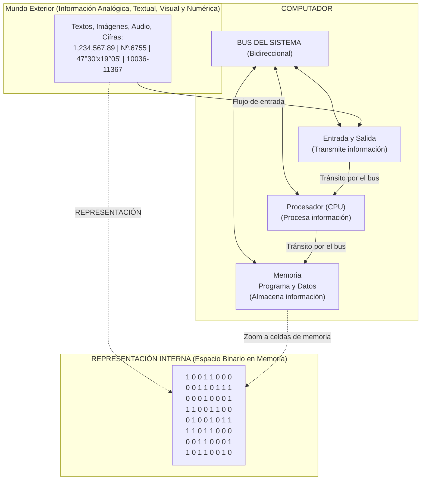
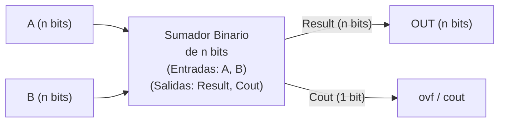
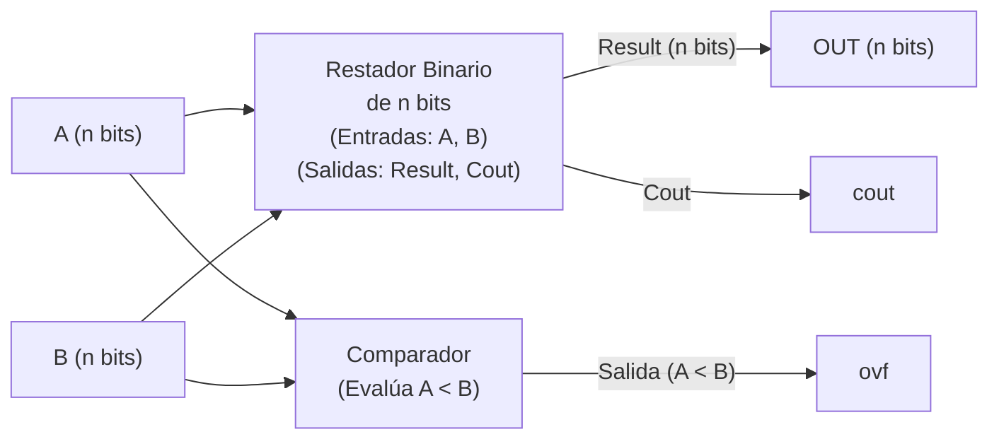
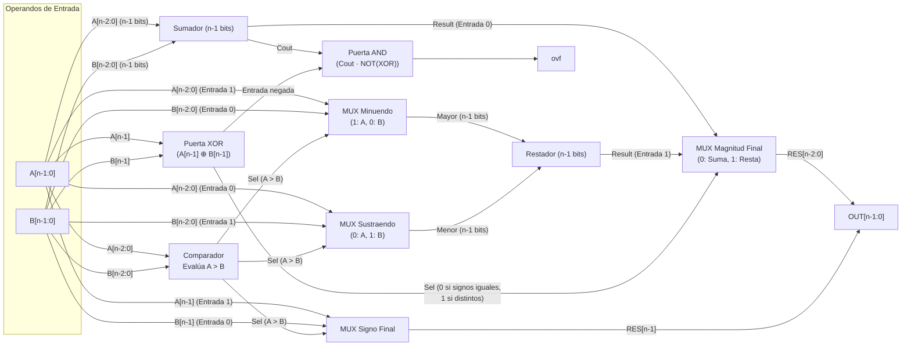
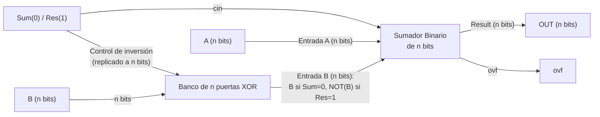
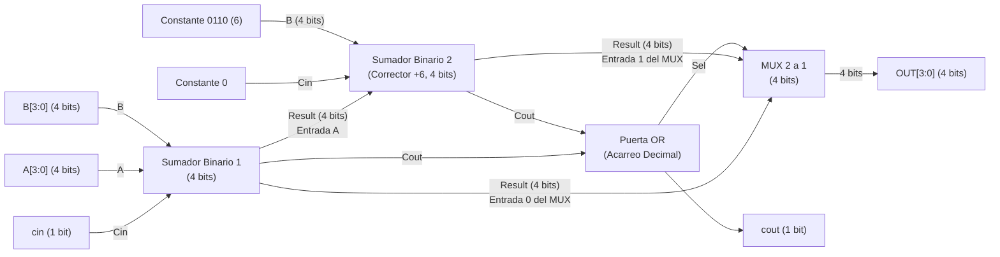
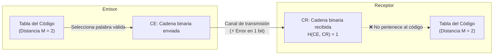
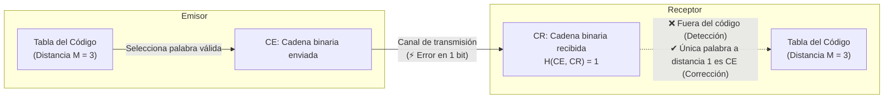

	# Tema 2: Representación de la Información — Fundamentos de Computadores

## Diapositiva 1: Portada del Tema 2
* **Asignatura:** Fundamentos de Computadores
* **Unidad:** Tema 2 — Representación de la información

---

## Diapositiva 2: Índice General del Tema 2
1. **Introducción**
   * Principios de representación de la información en sistemas digitales.
2. **Información no numérica**
   * Codificación y representación de cadenas alfanuméricas.
3. **Información numérica**
   * **Representación de números enteros:**
     * Sistemas posicionales: Binario sin signo (natural), Signo-Magnitud (SM) y Complemento a 2 (C2).
     * Sistemas no posicionales: Exceso a $M$ y Decimal Codificado en Binario (BCD).
   * **Representación de números reales:**
     * Coma o punto fijo.
     * Coma o punto flotante: Estándar IEEE 754.
4. **Representaciones redundantes: detección y corrección de errores**
   * Códigos basados en bits de paridad.
   * Códigos de Hamming: SEC (*Single Error Correction*) y SEC/DED (*Single Error Correction / Double Error Detection*).

---

## Diapositiva 3: Sección 1 — Introducción
* Portada de sección: **INTRODUCCIÓN**.

---

## Diapositiva 4: 1. Introducción — Flujo y Representación de la Información en el Computador
* **Concepto visual:** Un computador procesa, almacena y transmite información heterogénea del mundo exterior (textos periodísticos, fotografías, ondas de audio, cifras financieras, coordenadas geográficas y códigos numéricos). Toda esta información externa ingresa a través del subsistema de Entrada/Salida, viaja por el bus del sistema hacia el Procesador (CPU) y la Memoria de Programa y Datos, donde se codifica internamente como secuencias o matrices de dígitos binarios (`0` y `1`).



* **Funciones de los bloques principales del computador:**
  * **Memoria (Programa y Datos):** Almacena la información codificada en binario.
  * **Procesador (CPU):** Procesa y transforma la información.
  * **Entrada y Salida:** Transmite la información entre el computador y el exterior.

---

## Diapositiva 5: 1. Introducción — Espacio Material de la Representación
* **Características del espacio físico de representación en un computador:**
  * **Naturaleza binaria:** El hardware digital únicamente distingue entre $2$ estados físicos estables (representados lógicamente como $0$ y $1$).
  * **Naturaleza finita:** La capacidad de almacenamiento es limitada, lo que obliga a trabajar con representaciones acotadas en longitud y rango.
  * **Agrupación en cadenas de longitud fija ($n$):** Las unidades funcionales del procesador y la memoria operan sobre vectores o cadenas de bits de un tamaño predeterminado $n$.
* **Tamaños privilegiados:**
  * Constituyen una propiedad arquitectónica esencial del espacio físico de representación.
  * Cada arquitectura define varias longitudes estándar de trabajo.
  * **Nomenclatura habitual:**
    * **Byte (octeto):** $8\text{ bits}$.
    * **Palabra (*Word*):** Típicamente $16$, $32$ o $64\text{ bits}$ según la arquitectura.
    * **Doble palabra (*Double word*):** Múltiplo superior de la palabra base.

---

## Diapositiva 6: 1. Introducción — Tipos de Representaciones a Estudiar
* **Objetivo de la representación:** Definir reglas formales para codificar distintos tipos de datos dentro de un vector finito de $n\text{ bits}$.
* **Clasificación de las representaciones abordadas en este tema:**
  * **Información no numérica:** Codificación de caracteres y cadenas alfanuméricas.
  * **Información numérica:**
    * *Números enteros:* Sistemas posicionales y no posicionales.
    * *Números reales:* Formatos en punto fijo y en punto flotante.
* **Relación con los próximos temas:**
  * Más adelante se estudiará cómo se codifican en binario las **instrucciones de un programa**, las cuales se estructuran mediante campos de bits con significado específico (código de operación, registros, desplazamientos) utilizando estas mismas representaciones numéricas.

---

## Diapositiva 7: Índice — Progreso a Información No Numérica
* Transición en el índice general hacia el apartado **2. Información no numérica (Representación de cadenas alfanuméricas)**.

---

## Diapositiva 8: Sección 2 — Representación Alfanumérica
* Portada de sección: **REPRESENTACIÓN ALFANUMÉRICA**.

---

## Diapositiva 9: 2. Representación Alfanumérica — Estándares de Codificación
* **Principio de codificación:** Cada símbolo o carácter individual se asocia a un patrón binario de $n\text{ bits}$ mediante una tabla de correspondencia (código).
  * El parámetro $n$ fija el cardinal máximo del alfabeto representable ($2^n$ caracteres posibles).
* **Principales estándares históricos y actuales:**
  * **ASCII (*American Standard Code for Information Interchange*):** Utiliza $7\text{ bits}$ ($2^7 = 128$ códigos) para representar caracteres de control, letras del alfabeto inglés (mayúsculas y minúsculas), dígitos del `0` al `9` y signos de puntuación básicos.
  * **ASCII extendido:** Amplía el código a $8\text{ bits}$ ($2^8 = 256$ códigos) para incorporar signos diacríticos y caracteres propios de otros idiomas (como `ñ`, `á`, `é`, `ö`) y símbolos gráficos.
  * **UNICODE:** Estándar universal (originalmente de $16\text{ bits}$, $65536$ puntos de código en su plano básico) diseñado para abarcar la práctica totalidad de los alfabetos vivos e históricos.
  * **UTF-8 (*8-bit Unicode Transformation Format*):** Esquema de codificación de longitud variable (utiliza de $1$ a $4\text{ bytes}$ por carácter) para representar puntos de código Unicode.
    * Es retrocompatible de forma exacta con el código ASCII de $7\text{ bits}$ y con las bibliotecas estándar del lenguaje C para manipulación de cadenas.

---

## Diapositiva 10: Código ASCII (Tabla Estándar de 7 bits)
* **Estructura de la tabla ASCII estándar ($0$ a $127$ en decimal / `0x00` a `0x7F` en hexadecimal):**

| Rango Decimal | Rango Hexadecimal | Rango Octal | Categoría / Símbolos Representados | Ejemplos Clave (Dec / Hex : Carácter) |
| :--- | :--- | :--- | :--- | :--- |
| $0 \dots 31$ | `0x00` $\dots$ `0x1F` | `000` $\dots$ `037` | Caracteres de control no imprimibles | $0$ (`0x00`): `NUL` (nulo)<br/>$7$ (`0x07`): `BEL` (campana)<br/>$8$ (`0x08`): `BS` (retroceso)<br/>$9$ (`0x09`): `TAB` (tabulador horizontal)<br/>$10$ (`0x0A`): `LF` (salto de línea)<br/>$12$ (`0x0C`): `FF` (avance de página)<br/>$13$ (`0x0D`): `CR` (retorno de carro)<br/>$27$ (`0x1B`): `ESC` (escape) |
| $32 \dots 47$ | `0x20` $\dots$ `0x2F` | `040` $\dots$ `057` | Espacio y signos de puntuación / operadores | $32$ (`0x20`): `Space` (espacio en blanco)<br/>$33$ (`0x21`): `!` \| $34$ (`0x22`): `"` \| $35$ (`0x23`): `#`<br/>$36$ (`0x24`): `$` \| $37$ (`0x25`): `%` \| $38$ (`0x26`): `&`<br/>$40$ (`0x28`): `(` \| $41$ (`0x29`): `)` \| $42$ (`0x2A`): `*`<br/>$43$ (`0x2B`): `+` \| $44$ (`0x2C`): `,` \| $45$ (`0x2D`): `-`<br/>$46$ (`0x2E`): `.` \| $47$ (`0x2F`): `/` |
| $48 \dots 57$ | `0x30` $\dots$ `0x39` | `060` $\dots$ `071` | Dígitos numéricos (`'0'` a `'9'`) | $48$ (`0x30`): `'0'` \| $49$ (`0x31`): `'1'` \| $\dots$ \| $57$ (`0x39`): `'9'` |
| $58 \dots 64$ | `0x3A` $\dots$ `0x40` | `072` $\dots$ `100` | Signos de puntuación y símbolos | $58$ (`0x3A`): `:` \| $59$ (`0x3B`): `;` \| $60$ (`0x3C`): `<`<br/>$61$ (`0x3D`): `=` \| $62$ (`0x3E`): `>` \| $63$ (`0x3F`): `?`<br/>$64$ (`0x40`): `@` |
| $65 \dots 90$ | `0x41` $\dots$ `0x5A` | `101` $\dots$ `132` | Letras mayúsculas (`'A'` a `'Z'`) | $65$ (`0x41`): `'A'` \| $66$ (`0x42`): `'B'` \| $72$ (`0x48`): `'H'`<br/>$76$ (`0x4C`): `'L'` \| $79$ (`0x4F`): `'O'` \| $90$ (`0x5A`): `'Z'` |
| $91 \dots 96$ | `0x5B` $\dots$ `0x60` | `133` $\dots$ `140` | Corchetes y símbolos | $91$ (`0x5B`): `[` \| $92$ (`0x5C`): `\` \| $93$ (`0x5D`): `]`<br/>$94$ (`0x5E`): `^` \| $95$ (`0x5F`): `_` \| $96$ (`0x60`): `` ` `` |
| $97 \dots 122$ | `0x61` $\dots$ `0x7A` | `141` $\dots$ `172` | Letras minúsculas (`'a'` a `'z'`) | $97$ (`0x61`): `'a'` \| $98$ (`0x62`): `'b'` \| $108$ (`0x6C`): `'l'`<br/>$111$ (`0x6F`): `'o'` \| $122$ (`0x7A`): `'z'` |
| $123 \dots 127$ | `0x7B` $\dots$ `0x7F` | `173` $\dots$ `177` | Llaves, símbolos y control `DEL` | $123$ (`0x7B`): `{` \| $124$ (`0x7C`): `\|` \| $125$ (`0x7D`): `}`<br/>$126$ (`0x7E`): `~` \| $127$ (`0x7F`): `DEL` (borrar) |

---

## Diapositiva 11: ASCII Extendido (Páginas de Códigos de 8 bits)
* **Problemática de las páginas de códigos (*codepages*):**
  * Para aprovechar el octavo bit (valores decimales del $128$ al $255$, con el bit más significativo a $1$), se definieron múltiples páginas de códigos regionales incompatibles entre sí.
  * Esta diversidad provoca errores de visualización (*mojibake*) al intercambiar ficheros de texto entre programas o sistemas configurados con distinta página de códigos.
* **Resumen de la página de códigos IBM PC / CP437 ($128$ a $255$) mostrada en la transparencia:**

| Rango Decimal | Rango Hexadecimal | Tipos de Caracteres Asignados | Ejemplos Representativos (Decimal : Carácter) |
| :--- | :--- | :--- | :--- |
| $128 \dots 175$ | `0x80` $\dots$ `0xAF` | Letras latinas acentuadas, eñe, monedas y signos internacionales | $128$: `Ç` \| $129$: `ü` \| $130$: `é` \| $144$: `É`<br/>$160$: `á` \| $161$: `í` \| $162$: `ó` \| $163$: `ú`<br/>$164$: `ñ` \| $165$: `Ñ` \| $168$: `¿` \| $173$: `¡`<br/>$156$: `£` \| $157$: `¥` \| $171$: `½` \| $172$: `¼` |
| $176 \dots 223$ | `0xB0` $\dots$ `0xDF` | Símbolos semigráficos para dibujo de cajas y bordes de tablas | $176 \dots 178$: Bloques sombreados<br/>$179 \dots 218$: Líneas simples y dobles, esquinas y cruces<br/>$219 \dots 223$: Bloques sólidos completos y parciales |
| $224 \dots 255$ | `0xE0` $\dots$ `0xFF` | Letras del alfabeto griego y operadores matemáticos | $224$: $\alpha$ \| $225$: $\beta$ \| $226$: $\Gamma$ \| $227$: $\pi$ \| $228$: $\Sigma$<br/>$229$: $\sigma$ \| $230$: $\mu$ \| $234$: $\Omega$ \| $236$: $\infty$<br/>$241$: $\pm$ \| $242$: $\ge$ \| $243$: $\le$ \| $246$: $\div$ \| $247$: $\approx$ \| $251$: $\sqrt{}$ |

---

## Diapositiva 12: UNICODE / UTF-8 — Estructura de Bytes
* **Comparativa entre Unicode puro y UTF-8:**
  * **Unicode (UCS-2):** Codificación de tamaño uniforme que emplea sistemáticamente $2\text{ bytes}$ ($16\text{ bits}$) por cada carácter.
  * **UTF-8:** Esquema de longitud variable que emplea entre $1$ y $5\text{ bytes}$ (en el estándar actual acotado de $1$ a $4\text{ bytes}$) para codificar cada carácter Unicode.
  * Los primeros $128$ caracteres (`0x00` a `0x7F`) coinciden bit a bit con el estándar ASCII y ocupan exactamente $1\text{ byte}$.
* **Mapa de prefijos hexadecimales del primer byte en UTF-8 (según la tabla de la diapositiva):**

| Filas Hexadecimales (Bits Superiores) | Columnas `0` a `F` (Contenido / Significado en UTF-8) | Longitud de la Secuencia |
| :--- | :--- | :--- |
| `0x` a `1x` (`0x00` – `0x1F`) | Caracteres de control ASCII (`NUL`, `SOH`, ..., `US`) | $1\text{ byte}$ |
| `2x` a `7x` (`0x20` – `0x7F`) | Caracteres imprimibles ASCII (`SP`, `!`, dígitos `0`-`9`, letras `A`-`Z`, `a`-`z`, símbolos y `DEL`) | $1\text{ byte}$ |
| `8x` a `Bx` (`0x80` – `0xBF`) | Marcados con `•` (fondo rosado): Bytes de continuación (nunca pueden ser el primer byte de un carácter) | Byte intermedio/final |
| `Cx` a `Dx` (`0xC0` – `0xDF`) | Marcados con `2` (fondo verde claro; `0xC0` y `0xC1` en gris por sobre-codificación): Cabecera de carácter multibyte | $2\text{ bytes}$ |
| `Ex` (`0xE0` – `0xEF`) | Marcados con `3` (fondo verde): Cabecera de carácter multibyte | $3\text{ bytes}$ |
| `Fx` (`0xF0` – `0xF4`) | Marcados con `4` (fondo verde): Cabecera de carácter multibyte válido en Unicode | $4\text{ bytes}$ |
| `Fx` (`0xF5` – `0xFD`) | Marcados con `4`, `5` y `6` (fondo gris): Secuencias de $4$, $5$ y $6\text{ bytes}$ de la especificación original (fuera del rango Unicode actual) | $4 \dots 6\text{ bytes}$ |

---

## Diapositiva 13: UNICODE / UTF-8 — Uso en Internet y Web
* **Predominio de UTF-8:** Es el estándar hegemónico en protocolos de Internet y desarrollo web.
* **Declaración explícita en HTML:** Todo documento HTML especifica en la sección `<head>` la codificación de caracteres empleada para que el navegador interprete correctamente los bytes recibidos.
* **Descripción de la captura de pantalla:**
  * Se muestra una ventana del visor de código fuente del navegador *Pale Moon* inspeccionando la página del Campus Virtual de la asignatura (`https://eii.cv.uma.es/course/view.php?id=3635`).
  * Un recuadro rojo resalta la línea 7 dentro del bloque `<head>`, donde aparece la etiqueta `<meta>` que define el tipo de contenido y fija el juego de caracteres en `utf-8`:

```html
<meta http-equiv="Content-Type" content="text/html; charset=utf-8" />
```

---

## Diapositiva 14: 2. Representación Alfanumérica — Longitud de Cadenas
* **Determinación de la longitud de una cadena de texto en memoria:**
  * **Enfoque mediante carácter centinela o delimitador (lenguaje C):**
    * Las cadenas ASCII se almacenan como un vector contiguo de bytes terminado con un carácter nulo cuyo código numérico es cero ($0\text{h} = \text{0x00}$).
    * Para conocer el tamaño de la cadena es obligatorio recorrer secuencialmente todos sus caracteres desde el inicio hasta encontrar el byte delimitador `0x00`.
  * **Enfoque mediante cabecera o metadato de longitud (lenguajes orientados a objetos como C++, Java, C#):**
    * La estructura u objeto cadena almacena en una cabecera previa un número entero con la cantidad exacta de caracteres o bytes que componen el texto.
    * Permite conocer inmediatamente cuántos bytes ocupa la cadena en memoria sin necesidad de recorrerla carácter a carácter.

---

## Diapositiva 15: 2. Representación Alfanumérica — Ejemplo de Codificación de Cadena
* **Problema:** Obtener la representación binaria en memoria de la cadena `"Hola"` utilizando codificación ASCII.
  * **Códigos hexadecimales individuales (según tabla ASCII):**
    * `'H'` $= 48\text{h} = 01001000_2$
    * `'o'` $= 6\text{Fh} = 01101111_2$
    * `'l'` $= 6\text{Ch} = 01101100_2$
    * `'a'` $= 61\text{h} = 01100001_2$
  * **Longitud de los caracteres útiles:** $4\text{ bytes}$.
* **Caso 1: Cadena terminada en carácter nulo delimitador (`00h`, estilo C):**
  * Se añade un quinto byte con valor `00000000` al final. Total: $5\text{ bytes}$:
    $$\text{01001000 01101111 01101100 01100001 00000000}$$
* **Caso 2: Objeto cadena con longitud en cabecera (suponiendo cabecera de $1\text{ byte}$):**
  * El primer byte almacena la longitud ($4_{10} = 00000100_2$) seguido de los $4\text{ bytes}$ de texto. Total: $5\text{ bytes}$:
    $$\text{00000100 01001000 01101111 01101100 01100001}$$

---

## Diapositiva 16: 2. Representación Alfanumérica — Diferencia entre Carácter y Valor Numérico
* **Advertencia fundamental:** Nunca debe confundirse el código ASCII que representa a un dígito tipográfico con el valor matemático de dicho número.
  * *Ejemplo:* El valor matemático cero se representa en binario puro como $0$ (`00000000`), mientras que el carácter imprimible `'0'` en código ASCII tiene el valor hexadecimal $30\text{h}$ ($48_{10} = 00110000_2$).
* **Conversión entre cadenas de texto y tipos numéricos:**
  * Cuando una aplicación lee un número introducido por teclado o desde un fichero de texto, recibe una secuencia de códigos ASCII que debe transformarse a formato numérico binario antes de operar aritméticamente con ella.
  * Los lenguajes de programación proporcionan rutinas estándar de conversión en ambas direcciones:
    * **De cadena ASCII a número:** `atoi` (*ASCII to integer*), `atof` (*ASCII to float*), `parseInt()`, `parseFloat()`.
    * **De número a cadena ASCII:** `itoa` (*integer to ASCII*), `.toString()`.

---

## Diapositiva 17: Índice — Progreso a Información Numérica
* Transición en el índice general hacia el apartado **3. Información numérica**.

---

## Diapositiva 18: Sección 3.1 — Representación de Enteros Posicionales
* Portada de sección: **INFORMACIÓN NUMÉRICA — REPRESENTACIÓN DE ENTEROS POSICIONALES**.

---

## Diapositiva 19: Enteros Posicionales — Definición Matemática
* **Concepto de sistema numérico posicional:**
  * Un número entero se expresa mediante un vector ordenado de dígitos (valores numéricos de los dígitos, no sus caracteres ASCII).
  * La contribución o peso de cada dígito al valor total depende de su índice de posición dentro de la secuencia y de la base de numeración $b$ elegida.
* **Formulación general:**
  * Dado un número $X$ expresado por la cadena de dígitos $x_n \dots x_1 x_0$ en base $b$:
    $$\text{Valor}(X) = \sum_{i=0}^{n} x_i \cdot b^i$$
  * Donde cada dígito pertenece al conjunto finito:
    $$x_i \in \{0, 1, \dots, b-1\}$$

---

## Diapositiva 20: Enteros Posicionales — Ejemplo en Base Decimal
* **Ejemplo numérico:**
  * **Cadena de dígitos:** $3241$
  * **Base de numeración:** $b = 10$ (sistema decimal).
  * **Cálculo polinómico del valor numérico:**
    $$3 \cdot 10^3 + 2 \cdot 10^2 + 4 \cdot 10^1 + 1 \cdot 10^0 = 3000 + 200 + 40 + 1 = 3241$$

---

## Diapositiva 21: Enteros Posicionales — Binario y Hexadecimal
* **Base nativa del computador:**
  * El almacenamiento y procesamiento interno en la memoria del computador se realiza invariablemente en base $b = 2$ (sistema binario).
* **Uso de la notación hexadecimal ($b = 16$):**
  * Se utiliza ampliamente como representación externa abreviada para facilitar la lectura y escritura por parte de ingenieros y programadores.
  * Aporta una notación compacta y directa (cada dígito hexadecimal agrupa exactamente $4\text{ bits}$), evitando errores humanos al manipular cadenas binarias superiores a $8\text{ bits}$.
  * **Ejemplo de equivalencia entre bases:**
    $$5420_{10} = 0001\,0101\,0010\,1100_2 = \text{152C}_{16}$$
    *(Nota técnica: En la diapositiva original aparece una errata tipográfica con un `1` extra en el último cuarteto binario `11100`, siendo el cuarteto correcto `1100` para el dígito hexadecimal `C`).*

---

## Diapositiva 22: Enteros Posicionales — Tipos de Interpretación Binaria
* **Principio común:** Aunque la memoria siempre almacena bits en base $b = 2$, existen diferentes convenios para interpretar el valor numérico asociado a un mismo patrón binario:
  1. **Sin signo (Binario puro o natural).**
  2. **Signo-Magnitud (SM).**
  3. **Complemento a 2 (C2).**

---

## Diapositiva 23: Enteros Posicionales: Sin Signo (Binario Puro)
* **Definición:** Todos los $n\text{ bits}$ del vector contribuyen positivamente como potencias de base $b = 2$:
  * **Cadena binaria:** $X = x_{n-1} x_{n-2} \dots x_1 x_0$
  * **Valor representado:**
    $$V(X) = 2^{n-1}x_{n-1} + \dots + 2x_1 + x_0 = \sum_{i=0}^{n-1} x_i \cdot 2^i$$
* **Procedimiento de representación:** Convertir el número natural directamente a base $2$ y completar con ceros a la izquierda hasta alcanzar $n\text{ bits}$.
* **Rango de representación con $n\text{ bits}$:**
  * **Valor mínimo:** $0\dots00_2 = 0$
  * **Valor máximo:** $1\dots11_2 = 2^n - 1$
  * **Intervalo completo:** $[0, 2^n - 1]$
  * **Ejemplo para $n = 8\text{ bits}$:** Rango $= [0, 255]$.

---

## Diapositiva 24: Enteros Posicionales: Sin Signo — Operación de Suma
* **Suma de enteros sin signo ($A + B$):**
  * Se aplica el algoritmo de suma binaria convencional bit a bit desde el menos significativo al más significativo.
  * **Desbordamiento (*Overflow*):** Ocurre cuando el resultado verdadero excede el límite superior $2^n - 1$ y no cabe en $n\text{ bits}$.
  * **Condición de desbordamiento:** Coincide directamente con el acarreo de salida ($C_{\text{out}}$) generado por la etapa del bit más significativo ($n-1$):
    $$\text{ovf} = C_{\text{out}}$$



---

## Diapositiva 25: Enteros Posicionales: Sin Signo — Operación de Resta
* **Resta de enteros sin signo ($A - B$):**
  * Dado que el formato sin signo no admite números negativos, una resta solo produce un resultado representable si se cumple que $A \ge B$.
  * **Condición de desbordamiento (*Overflow*):**
    * Si $A < B$, el indicador `ovf` se activa a `1` señalando que el resultado no es válido en binario sin signo.
    * Si $A \ge B$, el indicador `ovf` permanece a `0`.
  * **Implicación hardware:** Requiere un circuito restador específico (diferente del sumador) acompañado de un bloque comparador de magnitud.



---

## Diapositiva 26: Enteros Posicionales: Signo-Magnitud (SM)
* **Estructura del formato Signo-Magnitud con $n\text{ bits}$:**
  * El bit más significativo ($x_{n-1}$) se reserva exclusivamente para codificar el **signo ($S$)**: `0` para positivo, `1` para negativo.
  * Los $n-1\text{ bits}$ restantes ($x_{n-2} \dots x_0$) codifican la **magnitud ($M$)** o valor absoluto en binario puro.

| Bit $n-1$ | Bits $n-2 \dots 0$ ($n-1\text{ bits}$) |
| :---: | :---: |
| **S** (Signo) | **M** (Magnitud o valor absoluto) |

* **Expresión matemática del valor representado:**
  * Dada la cadena $X = x_{n-1} x_{n-2} \dots x_1 x_0$:
    $$V(X) = (-1)^{x_{n-1}} \times \left( 2^{n-2}x_{n-2} + \dots + 2x_1 + x_0 \right) = (-1)^{x_{n-1}} \times \sum_{i=0}^{n-2} x_i \cdot 2^i$$
* **Procedimiento de codificación:**
  1. Expresar el valor absoluto $|X|$ en binario natural empleando $n-1\text{ bits}$.
  2. Anteporner el bit de signo $x_{n-1}$ (`0` si $X \ge 0$, `1` si $X < 0$).
* **Ejemplos con $n = 4\text{ bits}$:**

| Valor Decimal | Signo ($1\text{ bit}$) | Magnitud ($3\text{ bits}$) | Cadena SM ($4\text{ bits}$) |
| :---: | :---: | :---: | :---: |
| $+7$ | `0` | `111` | `0111` |
| $-3$ | `1` | `011` | `1011` |

* **Nota crítica:** El bit de signo $x_{n-1}$ **no** aporta peso posicional al valor absoluto del número.

---

## Diapositiva 27: Enteros Posicionales: Signo-Magnitud — Rango y Extensión de Bits
* **Rango de representación con $n\text{ bits}$:**
  * **Valor mínimo:** $11\dots11_2 = -(2^{n-1} - 1)$
  * **Valor máximo:** $01\dots11_2 = 2^{n-1} - 1$
  * **Intervalo completo:** $[-(2^{n-1} - 1), 2^{n-1} - 1]$
  * **Ejemplo para $n = 8\text{ bits}$:** Rango $= [-127, +127]$.
  * **Inconveniente del formato:** Existencia de una **doble representación para el cero**:
    * $+0 \rightarrow 00\dots00_2$
    * $-0 \rightarrow 10\dots00_2$
* **Extensión de tamaño de $n\text{ bits}$ (dato $A$) a $m\text{ bits}$ (dato $B$, con $m > n$):**
  * Se traslada el bit de signo a la nueva posición más significativa: $B_{m-1} = A_{n-1}$.
  * Se rellenan con ceros las nuevas posiciones intermedias de magnitud: $B_{m-2} \dots B_{n-1} = 0$.
  * Se copian intactos los $n-1\text{ bits}$ originales de magnitud: $B[n-2:0] = A[n-2:0]$.
  * **Ejemplo (de $8$ a $16\text{ bits}$):**
    $$10001110_2 \implies 1000000000001110_2$$

---

## Diapositiva 28: Enteros Posicionales: Signo-Magnitud — Algoritmos de Suma y Resta
* **Algoritmo de Suma ($A + B$):**
  1. Analizar los bits de signo de ambos operandos ($S_A = A_{n-1}$ y $S_B = B_{n-1}$).
  2. **Caso 1: Mismo signo ($S_A = S_B$):**
     * Se suman en binario natural las magnitudes de $n-1\text{ bits}$: $M_{\text{res}} = M_A + M_B$.
     * El signo del resultado coincide con el de los operandos: $S_{\text{res}} = S_A = S_B$.
     * **Overflow:** Se produce si aparece acarreo de salida al sumar la posición de bit $n-2$.
  3. **Caso 2: Distinto signo ($S_A \ne S_B$):**
     * Se comparan las magnitudes y se resta en binario la magnitud menor de la mayor ($|A| - |B|$ si $|A| > |B|$, o $|B| - |A|$ en caso contrario).
     * El signo del resultado toma el signo del operando que tenga mayor valor absoluto.
     * **Overflow:** Imposible que ocurra ($0$).
* **Algoritmo de Resta ($A - B$):**
  * Se transforma en la suma $A + (-B)$ invirtiendo previamente el bit de signo del sustraendo $B$ ($S_B \leftarrow \overline{S_B}$) y aplicando a continuación el algoritmo de suma.

---

## Diapositiva 29: Enteros Posicionales: Signo-Magnitud — Esquema del Circuito Sumador
* **Arquitectura del sumador en Signo-Magnitud:**



* **Detalle de funcionamiento y señales de control del circuito:**
  * **Rama superior (Suma de magnitudes):** Un sumador de $n-1\text{ bits}$ calcula continuamente $A[n-2:0] + B[n-2:0]$.
  * **Rama central (Resta de magnitudes):** Un comparador de magnitud evalúa si $A[n-2:0] > B[n-2:0]$. Su salida gobierna dos multiplexores que encaminan la magnitud mayor hacia la entrada $A$ (minuendo) del restador de $n-1\text{ bits}$ y la menor hacia la entrada $B$ (sustraendo).
  * **Control de operación por signos:** Una puerta XOR compara los bits de signo $A[n-1]$ y $B[n-1]$:
    * Si $A[n-1] \oplus B[n-1] = 0$ (signos iguales), el multiplexor de salida selecciona el resultado del **Sumador**, y la puerta AND habilita el paso de `Cout` hacia la salida `ovf`.
    * Si $A[n-1] \oplus B[n-1] = 1$ (signos distintos), el multiplexor de salida selecciona el resultado del **Restador**, e inhibe (fuerza a `0`) la salida `ovf`.
  * **Determinación del signo final (`RES[n-1]`):** El multiplexor inferior selecciona $A[n-1]$ si $|A| > |B|$ (lo que también cubre el caso de signos iguales) o $B[n-1]$ si $|A| \le |B|$.

---

## Diapositiva 30: Enteros Posicionales: Complemento a 2 (C2)
* **Regla de representación con $n\text{ bits}$:**
  * **Números positivos o cero ($X \ge 0$):** Se expresan en binario natural asegurándose de que el bit más significativo ($x_{n-1}$) sea `0`.
  * **Números negativos ($X < 0$):** Se parte de la representación en binario natural de su valor absoluto $|X|$ (con un `0` en el bit $n-1$) y se calcula su complemento a 2 (invirtiendo todos los bits y sumando $1$, o conservando los bits desde la derecha hasta el primer `1` inclusive e invirtiendo los restantes a la izquierda).
  * **Peso posicional en C2:** El bit más significativo tiene peso negativo $-2^{n-1}$:
    $$V(X) = -2^{n-1}x_{n-1} + \sum_{i=0}^{n-2} x_i \cdot 2^i$$
* **Ejemplos con $n = 4\text{ bits}$:**

| Valor Decimal | Representación de $\|X\|$ | Representación en C2 ($4\text{ bits}$) |
| :---: | :---: | :---: |
| $+7$ | `0111` | `0111` |
| $-3$ | `0011` | `1101` |

* **Rango de valores representables con $n\text{ bits}$:**
  * **Valor mínimo:** $10\dots00_2 = -2^{n-1}$
  * **Valor máximo:** $01\dots11_2 = 2^{n-1} - 1$
  * **Intervalo completo (asimétrico):** $[-2^{n-1}, 2^{n-1} - 1]$
  * **Ventaja clave:** Representación única para el número cero ($00\dots00_2$).
  * **Ejemplo para $n = 8\text{ bits}$:** Rango $= [-128, +127]$.

---

## Diapositiva 31: Enteros Posicionales: Complemento a 2 — Extensión de Signo
* **Extensión de longitud de $n\text{ bits}$ (dato $A$) a $m\text{ bits}$ (dato $B$, con $m > n$):**
  * Se aplica la **extensión de signo**, que consiste en replicar el bit de signo original $A_{n-1}$ en todas las nuevas posiciones más significativas:
    $$B_{m-1} = B_{m-2} = \dots = B_n = A_{n-1}$$
    $$B[n-1:0] = A[n-1:0]$$
  * **Ejemplo numérico (de $8$ a $16\text{ bits}$):**
    $$10001110_2 \implies 1111111110001110_2$$

---

## Diapositiva 32: Enteros Posicionales: Complemento a 2 — Operaciones de Suma y Resta
* **Suma en Complemento a 2 ($A + B$):**
  * Se suman directamente los $n\text{ bits}$ de ambos operandos (incluyendo el bit de signo) mediante un sumador binario convencional y **se descarta el acarreo final** de la posición $n-1$.
  * **Detección de Desbordamiento (*Overflow*):**
    * **Criterio de acarreos:** Ocurre si y solo si el acarreo de entrada al bit más significativo ($C_{n-2}$, generado al sumar el bit $n-2$) difiere del acarreo de salida del bit más significativo ($C_{n-1}$):
      $$\text{ovf} = C_{n-2} \oplus C_{n-1}$$
    * **Criterio de signos:** Se produce desbordamiento cuando se suman dos operandos del mismo signo y el resultado presenta el signo opuesto.
    * Al sumar dos números de distinto signo **jamás** puede producirse desbordamiento.
* **Resta en Complemento a 2 ($A - B$):**
  * Se realiza como la suma $A + (-B)$, donde obtener $-B$ equivale a calcular el complemento a 2 de $B$ ($\overline{B} + 1$).

---

## Diapositiva 33: Enteros Posicionales: Complemento a 2 — Circuito Sumador-Restador y Ejemplos
* **Esquema del Sumador-Restador unificado en Complemento a 2:**



* **Funcionamiento del circuito:**
  * Cuando la línea de control `Sum(0)/Res(1)` vale `0` (Suma), las puertas XOR dejan pasar $B$ sin cambios y `cin = 0`, calculando $A + B$.
  * Cuando la línea vale `1` (Resta), las puertas XOR invierten todos los bits de $B$ ($\overline{B}$) y `cin = 1` suma una unidad adicional, calculando $A + \overline{B} + 1 = A - B$.
* **Ejemplos numéricos con $n = 4\text{ bits}$:**
  * **Operación 1: Suma de $-2$ y $+3$ ($-2 + 3$):**
    * $-2 \implies \text{C2}(0010_2) = 1110_2$
    * $+3 \implies 0011_2$
    * Suma binaria:
      $$\begin{array}{r@{\quad}l} & 1110 \\ + & 0011 \\ \hline (1) & 0001 \end{array}$$
    * Descartando el acarreo final `(1)`, el resultado es $0001_2$ (positivo) $= +1$.
  * **Operación 2: Resta de $-2$ y $+3$ ($-2 - 3 = -2 + (-3)$):**
    * $-2 \implies 1110_2$
    * $-3 \implies \text{C2}(0011_2) = 1101_2$
    * Suma binaria:
      $$\begin{array}{r@{\quad}l} & 1110 \\ + & 1101 \\ \hline (1) & 1011 \end{array}$$
    * Descartando el acarreo final `(1)`, el resultado es $1011_2$ (negativo) $\implies -\text{C2}(1011_2) = -(0101_2) = -5$.

---

## Diapositiva 34: Sección 3.2 — Representación de Enteros No Posicionales
* Portada de sección: **INFORMACIÓN NUMÉRICA — REPRESENTACIÓN DE ENTEROS NO POSICIONALES**.

---

## Diapositiva 35: Enteros No Posicionales: Exceso a $M$
* **Definición del sistema en Exceso a $M$ ($n\text{ bits}$):**
  * Un número entero $X$ se codifica sumándole un desplazamiento o sesgo constante positivo $M$ (*bias*).
  * Dada una cadena de $n\text{ bits}$ $X = x_{n-1} x_{n-2} \dots x_1 x_0$, el valor entero que representa se obtiene restando $M$ a su interpretación en binario natural:
    $$V(X) = \left( 2^{n-1}x_{n-1} + \dots + 2x_1 + x_0 \right) - M = \left( \sum_{i=0}^{n-1} x_i \cdot 2^i \right) - M$$
* **Procedimiento de codificación:**
  * Calcular la suma $X + M$ y expresar dicho resultado positivo en binario natural con $n\text{ bits}$.
* **Ejemplos con $n = 4\text{ bits}$ y exceso $M = 7$:**

| Valor Decimal ($X$) | Valor Desplazado ($X + 7$) | Cadena en Exceso $7$ ($4\text{ bits}$) |
| :---: | :---: | :---: |
| $+7$ | $7 + 7 = 14$ | `1110` |
| $-3$ | $-3 + 7 = 4$ | `0100` |

---

## Diapositiva 36: Enteros No Posicionales: Exceso a $M$ — Rango y Extensión
* **Rango de valores representables con $n\text{ bits}$:**
  * **Valor mínimo:** $00\dots00_2 = 0 - M = -M$
  * **Valor máximo:** $11\dots11_2 = 2^n - 1 - M$
  * **Intervalo completo:** $[-M, 2^n - 1 - M]$
  * **Ejemplo para $n = 8\text{ bits}$ y $M = 127$:** Rango $= [-127, +128]$.
  * **Efecto del parámetro $M$:**
    * Incrementar $M$ desplaza el intervalo destinando más combinaciones a números negativos.
    * Reducir $M$ desplaza el intervalo destinando más combinaciones a números positivos.
* **Extensión de tamaño de $n\text{ bits}$ (dato $A$) a $m\text{ bits}$ (dato $B$, con $m > n$, manteniendo el mismo exceso $M$):**
  * Dado que $X + M$ está codificado como un número binario natural positivo, se amplía rellenando con ceros a la izquierda:
    $$B_{m-1} \dots B_n = 0$$
    $$B[n-1:0] = A[n-1:0]$$
  * **Ejemplo (de $8$ a $16\text{ bits}$):**
    $$10001110_2 \implies 0000000010001110_2$$

---

## Diapositiva 37: Enteros No Posicionales: BCD (*Binary-Coded Decimal*)
* **Definición del formato BCD:**
  * Cada dígito decimal individual ($0$ al $9$) de una cifra en base $10$ se codifica por separado utilizando su equivalente en binario natural de $4\text{ bits}$ (un cuarteto o *nibble*).
* **Ejemplos de conversión:**
  * $3248_{10} \implies \underbrace{0011}_{3}\,\underbrace{0010}_{2}\,\underbrace{0100}_{4}\,\underbrace{1000}_{8}$
  * $\underbrace{0101}_{5}\,\underbrace{1001}_{9}\,\underbrace{0000}_{0} \implies 590_{10}$
* **Eficiencia y aplicaciones:**
  * **Baja densidad de almacenamiento:** De las $2^4 = 16$ combinaciones posibles en cada grupo de $4\text{ bits}$, solo se utilizan $10$ ($0000_2$ a $1001_2$), desaprovechando $6$ combinaciones ($1010_2$ a $1111_2$), lo que supone un desperdicio del $37.5\%$ de las combinaciones por cuarteto.
  * **Ámbitos de uso:** Protocolos específicos de comunicación de datos e interfaces directas con visualizadores (*displays*) numéricos de $7$ segmentos LED/LCD.

---

## Diapositiva 38: Enteros No Posicionales: BCD — Algoritmo de Suma
* **Reglas de la suma aritmética en BCD:**
  * Se opera siguiendo la aritmética decimal tradicional, sumando independientemente cada pareja de dígitos decimales (en bloques de $4\text{ bits}$) de derecha a izquierda.
  * **Detección de acarreo decimal hacia el siguiente dígito:** Se produce cuando al sumar dos cuartetos ocurre cualquiera de estas dos situaciones:
    1. Se genera un **acarreo binario** de salida ($C_{\text{out}} = 1$) en el sumador de $4\text{ bits}$ (la suma supera $15$).
    2. El resultado binario de $4\text{ bits}$ es estrictamente **mayor que $9$** (valores entre $10_{10} = 1010_2$ y $15_{10} = 1111_2$).
  * **Corrección del dígito BCD:**
    * Siempre que exista acarreo decimal, se debe corregir el cuarteto resultante **sumándole $6$** ($0110_2$), ya que $16 - 10 = 6$ compensa las $6$ combinaciones binarias no válidas en BCD.

---

## Diapositiva 39: Enteros No Posicionales: BCD — Ejemplo de Suma (Planteamiento)
* **Planteamiento del ejemplo paso a paso:** Realizar la suma en BCD de $1329 + 2817 = 4146$.
  * Representación de los sumandos en cuartetos BCD:
    * $1329_{10} \implies 0001\;\;0011\;\;0010\;\;1001$
    * $2817_{10} \implies 0010\;\;1000\;\;0001\;\;0111$

---

## Diapositiva 40: Enteros No Posicionales: BCD — Ejemplo de Suma (Paso 1: Unidades)
* **Paso 1 (Dígito de las unidades: $9 + 7 = 16$):**
  * Suma binaria de cuartetos: $1001_2 + 0111_2 = 1\,0000_2$.
  * Al producirse acarreo binario (`1`), se propaga un **acarreo decimal** (`1`) a la columna de las decenas y se corrige el cuarteto sumando $0110_2$:
    $$0000_2 + 0110_2 = 0110_2 \quad (6_{10})$$

---

## Diapositiva 41: Enteros No Posicionales: BCD — Ejemplo de Suma (Paso 2: Decenas)
* **Paso 2 (Dígito de las decenas: $2 + 1 + 1_{\text{acarreo}} = 4$):**
  * Suma binaria incluyendo el acarreo decimal previo: $0010_2 + 0001_2 + 1_2 = 0100_2$.
  * Como no hay acarreo binario y $0100_2 = 4 \le 9$, el dígito es directamente válido y no requiere corrección.

---

## Diapositiva 42: Enteros No Posicionales: BCD — Ejemplo de Suma (Paso 3: Centenas)
* **Paso 3 (Dígito de las centenas: $3 + 8 = 11$):**
  * Suma binaria de cuartetos: $0011_2 + 1000_2 = 1011_2$ ($11_{10}$).
  * Aunque el acarreo binario es `0`, el resultado cumple $1011_2 > 9$. Por tanto, se genera un **acarreo decimal** (`1`) hacia los millares y se suma el factor de corrección $0110_2$:
    $$1011_2 + 0110_2 = (1)\,0001_2 \quad (\text{dígito corregido } 0001_2 = 1_{10})$$

---

## Diapositiva 43: Enteros No Posicionales: BCD — Ejemplo de Suma (Paso 4: Millares y Resultado Final)
* **Paso 4 (Dígito de los millares: $1 + 2 + 1_{\text{acarreo}} = 4$):**
  * Suma binaria con el acarreo decimal entrante: $0001_2 + 0010_2 + 1_2 = 0100_2$ ($4_{10} \le 9$, sin corrección).
* **Tabla resumen completa de la operación BCD ($1329 + 2817 = 4146$):**

| Etapa | Millares | Centenas | Decenas | Unidades |
| :--- | :---: | :---: | :---: | :---: |
| **Acarreo decimal entrante** | $+1$ | $0$ | $+1$ | $0$ |
| **Operando A ($1329$)** | `0001` ($1$) | `0011` ($3$) | `0010` ($2$) | `1001` ($9$) |
| **Operando B ($2817$)** | `0010` ($2$) | `1000` ($8$) | `0001` ($1$) | `0111` ($7$) |
| **Suma binaria inicial** | `0100` ($4$) | `1011` ($11 > 9$) | `0100` ($4$) | `1 0000` ($\text{Cout}=1$) |
| **¿Requiere corrección?** | No | Sí ($+0110$) | No | Sí ($+0110$) |
| **Resultado BCD final ($4146$)** | **`0100`** ($4$) | **`0001`** ($1$) | **`0100`** ($4$) | **`0110`** ($6$) |

---

## Diapositiva 44: Enteros No Posicionales: BCD — Circuito Sumador BCD de 1 Dígito
* **Esquema en bloques del sumador BCD para un dígito ($4\text{ bits}$):**



* **Explicación técnica del circuito:**
  * El **Sumador 1** realiza la suma binaria inicial de los dígitos $A[3:0] + B[3:0] + \text{cin}$.
  * El **Sumador 2** suma permanentemente la constante $0110_2$ ($6$) al resultado del Sumador 1 (con `Cin = 0`).
  * Si el resultado del Sumador 1 es mayor que $9$ ($10 \dots 15$), al sumarle $6$ en el Sumador 2 se supera $15$, activando el `Cout` del Sumador 2.
  * La **puerta OR** combina el `Cout` del Sumador 1 (suma inicial $\ge 16$) y el `Cout` del Sumador 2 (suma inicial $\in [10, 15]$) para generar el acarreo decimal `cout`.
  * Dicha señal `cout` controla el multiplexor: si `cout = 0`, selecciona la salida directa del Sumador 1; si `cout = 1`, selecciona la salida corregida ($+6$) del Sumador 2.

---

## Diapositiva 45: Enteros: Ejemplos de Interpretación (Enunciado)
* **Ejercicio 1:** Determinar el valor decimal que representan las cuatro cadenas binarias de $8\text{ bits}$ indicadas bajo los sistemas Binario Natural, Signo-Magnitud (SM), Complemento a 2 (C2), Exceso $128$ y BCD. *(Se resuelve en la Diapositiva 46).*

---

## Diapositiva 46: Enteros: Ejemplos de Interpretación (Solución)
* **Tabla resuelta de interpretación de cadenas de $8\text{ bits}$:**

| Cadena Binaria | Natural (Sin signo) | Signo-Magnitud (SM) | Complemento a 2 (C2) | Exceso $128$ ($V_{\text{nat}} - 128$) | BCD (2 dígitos) |
| :---: | :---: | :---: | :---: | :---: | :---: |
| `01111111` | $127$ | $+127$ | $+127$ | $127 - 128 = -1$ | **X** (`0111 1111`: `1111` $> 9$, no válido) |
| `10000000` | $128$ | $-0$ | $-128$ | $128 - 128 = 0$ | $80$ (`1000` $=8$, `0000` $=0$) |
| `00000001` | $1$ | $+1$ | $+1$ | $1 - 128 = -127$ | $01$ (`0000` $=0$, `0001` $=1$) |
| `10000001` | $129$ | $-1$ | $-127$ | $129 - 128 = +1$ | $81$ (`1000` $=8$, `0001` $=1$) |

---

## Diapositiva 47: Enteros: Ejemplos de Codificación (Enunciado)
* **Ejercicio 2:** Obtener las cadenas binarias de $8\text{ bits}$ que codifican los valores decimales $25$, $-10$, $0$ y $-99$ en los sistemas Natural, SM, C2, Exceso $128$ y BCD. *(Se resuelve en la Diapositiva 48).*

---

## Diapositiva 48: Enteros: Ejemplos de Codificación (Solución)
* **Tabla resuelta de codificación en cadenas de $8\text{ bits}$:**

| Valor Decimal | Natural (Sin signo) | Signo-Magnitud (SM) | Complemento a 2 (C2) | Exceso $128$ ($X + 128$) | BCD (2 dígitos) |
| :---: | :---: | :---: | :---: | :---: | :---: |
| **$25$** | `00011001` | `00011001` | `00011001` | `10011001` ($153_{10}$) | `00100101` (`0010` $=2$, `0101` $=5$) |
| **$-10$** | **X** (Fuera de rango) | `10001010` | `11110110` | `01110110` ($118_{10}$) | **X** (Sin signo en BCD puro) |
| **$0$** | `00000000` | `00000000` (o `10000000`) | `00000000` | `10000000` ($128_{10}$) | `00000000` |
| **$-99$** | **X** (Fuera de rango) | `11100011` | `10011101` | `00011101` ($29_{10}$) | **X** (Sin signo en BCD puro) |

---

## Diapositiva 49: Sección 3.3 — Representación de Reales en Punto Fijo
* Portada de sección: **INFORMACIÓN NUMÉRICA — REPRESENTACIÓN DE VALORES REALES CON NÚMERO FIJO DE DECIMALES (PUNTO FIJO)**.

---

## Diapositiva 50: Reales: Punto Fijo — Definición y Estructura
* **Representación en punto fijo en base $b = 2$ con $n\text{ bits}$:**
  * La posición de la coma o punto fraccionario es implícita e invariable dentro de la palabra de $n\text{ bits}$:
    * $e\text{ bits}$ destinados a la **parte entera**.
    * $d\text{ bits}$ destinados a la **parte fraccionaria (decimal)**.
    * Longitud total: $e + d = n$.

| Parte Entera ($e\text{ bits}$) | Punto Implícito | Parte Fraccionaria ($d\text{ bits}$) |
| :---: | :---: | :---: |
| $x_{e-1} \dots x_1 x_0$ | $.$ | $x_{-1} x_{-2} \dots x_{-d}$ |

* **Valor matemático de la cadena $X = x_{e-1}\dots x_1 x_0 . x_{-1} x_{-2}\dots x_{-d}$:**
  $$\text{Valor}(X) = \sum_{i=-d}^{e-1} x_i \cdot 2^i$$
* **Ejemplo numérico:**
  * Cadena $1000.101_2$ ($n = 7$, $e = 4$, $d = 3$):
    $$1 \cdot 2^3 + 1 \cdot 2^{-1} + 1 \cdot 2^{-3} = 8 + 0.5 + 0.125 = 8.625_{10}$$

---

## Diapositiva 51: Reales: Punto Fijo — Signo y Rango
* **Codificación del signo en punto fijo:**
  * Se aplican exactamente las mismas técnicas estudiadas para enteros posicionales (Signo-Magnitud o Complemento a 2) sobre la cadena completa de $n = e + d\text{ bits}$.
* **Ejemplo: Representar $-19.325$ con $e = 6$ y $d = 4$ ($n = 10\text{ bits}$):**
  * Conversión a binario de la magnitud (aproximada a $4\text{ bits}$ fraccionarios, ya que $19.3125_{10} = 19 + 5/16$):
    $$-10011.0101_2$$
  * **En Signo-Magnitud (SM):** Bit de signo `1`, parte entera `10011` ($5\text{ bits}$ de magnitud entera) y parte fraccionaria `0101`:
    $$\text{SM} = 1100110101_2$$
  * **En Complemento a 2 (C2):** Complemento a 2 de `0100110101`:
    $$\text{C2} = 1011001011_2$$
* **Rango de valores representables en Complemento a 2 (con $e = 6, d = 4$):**
  * **Valor mínimo:** $1000000000_2 = -(100000.0000_2) = -2^{e-1} = -2^5 = -32$
  * **Valor máximo:** $0111111111_2 = 011111.1111_2 = 2^{e-1} - 2^{-d} = 32 - 0.0625 = 31.9375$
  * **Intervalo completo:** $[-32, 31.9375]$.

---

## Diapositiva 52: Reales: Punto Fijo — Resolución y Error de Representación
* **Resolución o Precisión:**
  * Es el salto o distancia constante entre dos números consecutivos representables en la recta real, determinado por el peso del bit menos significativo (LSB):
    $$\text{Resolución} = 2^{-d}$$
  * Es **uniforme** (idéntica) a lo largo de todo el intervalo de representación.
* **Error absoluto de representación ($e_a$):**
  * Al aproximar cualquier número real dentro del rango mediante una cadena de punto fijo, el error cometido nunca supera la resolución del formato (o la mitad de la resolución si se aplica redondeo al más cercano):
    $$e_a \le 2^{-d}$$

```tikz
\begin{tikzpicture}[scale=1.2]
  % Recta real de resolución uniforme
  \draw[thick, -] (-5,1.5) -- (5,1.5);
  \foreach \x in {-4,-3,-2,-1,0,1,2,3,4} {
    \draw[thick] (\x,1.3) -- (\x,1.7);
  }
  \node[below] at (0,1.3) {$0$};
  \draw[decorate,decoration={brace,amplitude=6pt},thick,green!60!black] (0,1.75) -- (1,1.75) node[midway,above=6pt] {$2^{-d}$};
  \node[below right] at (1.2,1.2) {Valores representables sobre la recta real};

  % Recta real de error de truncamiento / redondeo
  \draw[thick, -] (-5,0) -- (5,0);
  \foreach \x in {-4,-3,-2,-1,0,1,2,3,4} {
    \draw[thick] (\x,-0.2) -- (\x,0.2);
  }
  \node[below] at (0,-0.2) {$0$};
  \fill[red!80!black] (0.4,0) circle (2.5pt);
  \draw[->,thick,blue!70!black] (0.4,0.1) to[out=120,in=60] (0,0.1);
  \draw[->,thick,green!60!black] (0.4,0.1) to[out=60,in=120] (1,0.1);
  \node[below,blue!70!black] at (0.2,-0.25) {$err$};
  \node[below,green!60!black] at (0.7,-0.25) {$err$};
\end{tikzpicture}
```

---

## Diapositiva 53: Sección 3.4 — Representación de Reales en Coma Flotante
* Portada de sección: **INFORMACIÓN NUMÉRICA — REPRESENTACIÓN DE VALORES REALES EN COMA FLOTANTE**.

---

## Diapositiva 54: Reales: Punto Flotante — Motivación
* **Limitación del formato en punto fijo:**
  * Al poseer una resolución constante, resulta ineficiente e incapaz de representar simultáneamente magnitudes astronómicas y cantidades infinitesimales con un número reducido de dígitos.
  * *Ejemplo con $N = 10$ dígitos decimales:*
    * Con resolución $10^{10}$ se puede representar $2\,000\,000\,000$, pero se pierde toda precisión fraccionaria.
    * Con resolución $10^{-10}$ se puede representar $0.0000000002$, pero es imposible almacenar números enteros grandes.
    * Si un cálculo científico requiere operar con ambos valores a la vez, el punto fijo fracasa.
* **Solución mediante punto flotante:**
  * Codificación compacta inspirada en la **notación científica** ($\text{Mantisa} \times \text{Base}^{\text{Exponente}}$) operando en base $b = 2$.

---

## Diapositiva 55: Reales: Punto Flotante — Campos de la Representación
* **Ejemplos de notación científica en base $10$:**
  * $20\,000\,000\,000 = 2 \cdot 10^{10} \implies \text{Mantisa} = 2,\; \text{Base} = 10,\; \text{Exponente} = 10$
  * $0.0000000002 = 2 \cdot 10^{-10} \implies \text{Mantisa} = 2,\; \text{Base} = 10,\; \text{Exponente} = -10$
* **Estructura en el computador:**
  * Aunque el valor queda definido por tres parámetros (mantisa, base y exponente), al fijar por convenio la base en $b = 2$ no es necesario almacenarla en memoria.
  * Los $n\text{ bits}$ de la palabra se dividen para codificar las otras dos magnitudes:
    * **Característica:** Representación entera del exponente.
    * **Mantisa:** Número real codificado en punto fijo.

| Bits Superiores $\dots$ | $\dots$ Bits Inferiores (Bit $0$) |
| :---: | :---: |
| **Característica** (Exponente codificado) | **Mantisa** (Punto fijo) |

---

## Diapositiva 56: Reales: Punto Flotante — Normalización
* **Problema de ambigüedad (múltiples representaciones):**
  * Sin una restricción adicional, un mismo número real admite infinitas parejas de mantisa y exponente en base $2$:
    $$10000000000_2 = 1 \cdot 2^{10} = 10 \cdot 2^9 = 100 \cdot 2^8 = 0.1 \cdot 2^{11} = 0.001 \cdot 2^{13} = \dots$$
* **Concepto de Normalización:**
  * Regla que impone una forma canónica para la mantisa, garantizando que cada valor real distinto de cero tenga una **única** combinación válida de mantisa y exponente.
  * *Ejemplo de criterio de normalización:* Imponer que $0.5 \le \text{Mantisa} < 1$ en base $10$ (es decir, $0.1_2 \le \text{Mantisa} < 1_2$ en binario), lo que selecciona de forma única la expresión $0.1_2 \cdot 2^{11}$.
* **Elementos que definen por completo un formato en punto flotante:**
  1. Reparto del número de bits entre característica (exponente) y mantisa.
  2. Sistemas de codificación elegidos para el exponente y para la mantisa.
  3. Regla de normalización adoptada.

---

## Diapositiva 57: Reales: Punto Flotante — Ejemplo de Formato Académico de 16 bits
* **Especificación del formato de ejemplo ($16\text{ bits}$):**
  * **Longitud total:** $16\text{ bits}$ ($5\text{ bits}$ para la característica $C$ y $11\text{ bits}$ para la mantisa con signo).
  * **Característica ($C$, bits $14 \dots 10$):** Exponente $E$ codificado en **Exceso $16$** ($C = E + 16$).
  * **Mantisa ($S$ y $M$, bit $15$ y bits $9 \dots 0$):** Mantisa fraccionaria normalizada expresada en **Signo-Magnitud (SM)**, situando el bit de signo $S$ en el bit $15$ y la magnitud fraccionaria $M$ en los bits $9 \dots 0$.
  * **Regla de normalización:** $0.5 \le |M| < 1$.
    * Se desplaza el punto binario ajustando el exponente hasta que la magnitud de la mantisa adopte el patrón $0.1\dots_2$ (el bit `1` más significativo queda inmediatamente a la derecha del punto fraccionario).
  * **Fórmula de evaluación:**
    $$\text{Valor} = (-1)^S \times M \times 2^{C - 16}$$

| Bit $15$ ($1\text{ bit}$) | Bits $14 \dots 10$ ($5\text{ bits}$) | Bits $9 \dots 0$ ($10\text{ bits}$) |
| :---: | :---: | :---: |
| **S** (Signo de la mantisa) | **C** (Característica en Exceso $16$) | **M** (Magnitud fraccionaria $0.1\dots$) |

---

## Diapositiva 58: Reales: Punto Flotante — Ejemplo de Codificación (Planteamiento)
* **Enunciado:** Utilizando el formato de $16\text{ bits}$ definido en la diapositiva anterior, calcular la cadena binaria que representa al número real $-17.171875_{10}$.
* **Metodología en 3 pasos:**
  1. Convertir el valor absoluto a binario en punto fijo.
  2. Normalizar la expresión para cumplir $0.5 \le \text{Mantisa} < 1$.
  3. Codificar cada campo ($S$, $C$, $M$) en el registro de $16\text{ bits}$.

---

## Diapositiva 59: Reales: Punto Flotante — Ejemplo de Codificación (Resolución)
* **Resolución paso a paso para $-17.171875_{10}$:**
  1. **Conversión a binario:**
     * Parte entera: $17_{10} = 10001_2$
     * Parte fraccionaria: $0.171875_{10} = 11/64 = 2^{-3} + 2^{-5} + 2^{-6} = 0.001011_2$
     * Magnitud en binario: $10001.001011_2$
  2. **Normalización ($0.5 \le \text{Mantisa} < 1$, patrón $0.1\dots_2$):**
     * Se desplaza el punto $5$ posiciones a la izquierda:
       $$0.10001001011_2 \times 2^5$$
  3. **Codificación de los campos:**
     * **Signo ($S$):** $1$ (por ser un número negativo).
     * **Característica ($C$):** $C = E + 16 = 5 + 16 = 21_{10} \implies 10101_2$.
     * **Magnitud de la mantisa ($M$, $10\text{ bits}$):** En este formato explícito donde el campo $M$ almacena un bit entero y $9$ fraccionarios (o truncando los $10\text{ bits}$ tras el punto según el convenio de la diapositiva: `0100010010`, donde el primer `0` corresponde a la posición $2^0$ y `100010010` a los $9\text{ bits}$ fraccionarios más significativos, truncando los dos últimos `11`):
       $$M = 0100010010_2$$

| Bit $15$ ($S$) | Bits $14 \dots 10$ ($C$) | Bits $9 \dots 0$ ($M$) |
| :---: | :---: | :---: |
| `1` | `10101` | `0100010010` |

---

## Diapositiva 60: Reales: Punto Flotante — Ejemplo de Interpretación (Planteamiento)
* **Presentación de una nueva cadena binaria de $16\text{ bits}$ en el mismo formato:**
  * Cadena de $16\text{ bits}$: `1001000110100000`
  * *(Nota: El texto de la transparencia conserva por arrastre el pie de la diapositiva previa, pero el registro superior introduce el nuevo patrón binario `1 00100 0110100000` que se decodifica en la Diapositiva 61).*

| Bit $15$ ($S$) | Bits $14 \dots 10$ ($C$) | Bits $9 \dots 0$ ($M$) |
| :---: | :---: | :---: |
| `1` | `00100` | `0110100000` |

---

## Diapositiva 61: Reales: Punto Flotante — Ejemplo de Interpretación (Resolución)
* **Problema:** Determinar el valor decimal representado por la palabra de $16\text{ bits}$ `1001000110100000`.
  1. **Extracción e interpretación de cada campo:**
     * **Signo ($S$):** $S = 1$ (valor negativo).
     * **Característica ($C$):** $C = 00100_2 = 4_{10} \implies E = C - 16 = 4 - 16 = -12$.
     * **Mantisa ($M$):** $M = 0110100000_2 \implies 0.1101_2$ (tomando el primer bit como parte entera $0.$ y el resto como fracción).
  2. **Cálculo del valor real representado:**
     $$V = (-1)^S \times M \times 2^{C - 16} = (-1)^1 \times 0.1101_2 \times 2^{-12}$$
     $$V = -1101_2 \times 2^{-16} = -13 \times 2^{-16} \approx -1.98 \times 10^{-4}$$

---

## Diapositiva 62: Reales: Punto Flotante — Optimización y Casos Especiales
* **Deficiencias del formato académico anterior:**
  1. **Desperdicio de $2\text{ bits}$ en el campo de mantisa $M$:**
     * Al exigir la normalización $0.1\dots_2$, todas las mantisas válidas comienzan invariablemente por el prefijo fijo `01`.
     * **Mejora (bits implícitos):** Si el prefijo `0.1` se da por supuesto (implícito en el hardware) y no se almacena en memoria, se ganan $2\text{ bits}$ adicionales de precisión fraccionaria en el campo $M$:
       $$\text{Valor} = (-1)^S \times 0.1M \times 2^{C - 16}$$
  2. **Imposibilidad de representar el número cero ($0$):**
     * Ninguna potencia de $2$ multiplicada por una mantisa que empieza por $0.1\dots$ puede anularse.
     * Requiere reservar un patrón especial no normalizado (por ejemplo, $M = 0000000000_2$, que incumple $0.5 \le \text{Mantisa} < 1$) para codificar el cero.

---

## Diapositiva 63: Reales: Punto Flotante — Resolución No Uniforme
* **Dependencia entre resolución y magnitud:**
  * En punto flotante, el peso del bit menos significativo de la mantisa queda multiplicado por el factor de escala $2^E$. Por consiguiente, **la resolución no es uniforme**:
    * **Alta resolución (gran densidad de números representables):** En las proximidades del $0$ (exponentes muy negativos).
    * **Baja resolución (grandes saltos entre números consecutivos):** Para valores de gran magnitud (exponentes positivos elevados).
* **Comparativa en el formato de $16\text{ bits}$ ($10\text{ bits}$ fraccionarios en $M \implies 2^{10} = 1024$ valores equidistantes dentro de cada intervalo entre dos potencias consecutivas de $2$):**

| Intervalo de Magnitud (Exponentes) | Número de Valores en el Intervalo | Cálculo de la Resolución | Diferencia entre Representaciones Consecutivas |
| :---: | :---: | :---: | :---: |
| $[2^{-15}, 2^{-14}]$ | $2^{10}$ equidistantes | $2^{-15} \cdot 2^{-10} = 2^{-25}$ | $0.0000000298$ |
| $[2^{13}, 2^{14}]$ | $2^{10}$ equidistantes | $2^{13} \cdot 2^{-10} = 2^3$ | $8$ |

```tikz
\begin{tikzpicture}[scale=1.0]
  \draw[thick] (-3,0) -- (0,0);
  \draw[thick,dashed] (0,0) -- (1.5,0);
  \draw[thick] (1.5,0) -- (3,0);
  \draw[thick,dashed] (3,0) -- (5,0);
  \draw[thick] (5,0) -- (8.5,0);

  % Marcas eje
  \draw[thick] (2.2,-0.3) -- (2.2,0.3) node[below=10pt] {$0$};
  \fill[blue!35] (2.5,-0.25) rectangle (3.1,0.25);
  \draw[thick] (2.5,-0.3) -- (2.5,0.3) node[above=6pt] {$2^{-15}$};
  \draw[thick] (3.1,-0.3) -- (3.1,0.3) node[above=6pt] {$2^{-14}$};

  \fill[blue!60!black!60] (5.0,-0.25) rectangle (7.8,0.25);
  \draw[thick] (5.0,-0.3) -- (5.0,0.3) node[above=6pt] {$2^{13}$};
  \draw[thick] (7.8,-0.3) -- (7.8,0.3) node[above=6pt] {$2^{14}$};

  \node[above,green!50!black] at (4.5,1.1) {$2^{10}$ representaciones equidistantes en cada tramo};
  \draw[->,thick,green!50!black] (2.8,0.6) -- (2.8,1.1);
  \draw[->,thick,green!50!black] (6.4,0.6) -- (4.8,1.1);
\end{tikzpicture}
```

---

## Diapositiva 64: Reales: Estándar IEEE 754 (Simple Precisión)
* **Motivación del estándar:** Homogeneizar la representación y aritmética en coma flotante para garantizar la portabilidad de datos numéricos entre procesadores y arquitecturas de distintos fabricantes.
* **Especificación del formato IEEE 754 de simple precisión (`float`, $32\text{ bits}$):**
  * **Longitud total:** $32\text{ bits}$, distribuidos en $1\text{ bit}$ de signo ($S$), $8\text{ bits}$ de característica ($C$) y $23\text{ bits}$ de parte fraccionaria de la mantisa ($M$). (La mantisa completa equivale a $24\text{ bits}$ de magnitud más $1\text{ bit}$ de signo).
  * **Característica ($C$, bits $30 \dots 23$):** Exponente codificado en **Exceso $127$** ($C = E + 127$, reservando $C = 0$ y $C = 255$ para casos especiales).
  * **Mantisa ($S$ y $M$, bit $31$ y bits $22 \dots 0$):** Expresada en **Signo-Magnitud (SM)**.
  * **Criterio de normalización:** $1 \le \text{Mantisa} < 2$.
    * Se ajusta el exponente hasta que la mantisa tenga la forma $1.M_2$ (un único bit `1` entero a la izquierda del punto binario).
    * **Bit entero `1` implícito:** Ese `1.` inicial no se almacena en los $23\text{ bits}$ del campo $M$.
  * **Fórmula del valor para números normalizados ($0 < C < 255$):**
    $$\text{Valor} = (-1)^S \times 1.M \times 2^{C - 127}$$

| Bit $31$ ($1\text{ bit}$) | Bits $30 \dots 23$ ($8\text{ bits}$) | Bits $22 \dots 0$ ($23\text{ bits}$) |
| :---: | :---: | :---: |
| **S** (Signo) | **C** (Característica en Exceso $127$) | **M** (Fracción de la mantisa tras `1.`) |

---

## Diapositiva 65: Reales: Estándar IEEE 754 — Casos Especiales y Números Desnormalizados
* **Tabla de interpretaciones especiales en IEEE 754 simple precisión:**

| Característica ($C$) en Decimal (Binario) | Fracción de Mantisa ($M$) | Valor / Significado Representado |
| :---: | :---: | :--- |
| **$255$** (`11111111`) | $M = 0$ | **Infinito:** $+\infty$ si $S = 0$; $-\infty$ si $S = 1$ |
| **$255$** (`11111111`) | $M \ne 0$ | **NaN (*Not a Number*):** Indeterminaciones matemáticas ($0/0$, $\infty - \infty$, $\sqrt{-1}$, etc.) |
| **$0$** (`00000000`) | $M = 0$ | **Cero ($0$):** $+0$ si $S = 0$; $-0$ si $S = 1$ |
| **$0$** (`00000000`) | $M \ne 0$ | **Números desnormalizados (subnormales):** $V = (-1)^S \times 0.M \times 2^{-126}$ |

* **Propósito de los números desnormalizados ($C = 0, M \ne 0$):**
  * Permiten representar magnitudes extremadamente pequeñas cercanas al cero (menores que el mínimo número normalizado $1.0_2 \times 2^{-126}$), proporcionando un subdesbordamiento gradual (*gradual underflow*).
  * Se almacenan **sin normalizar** (el bit implícito a la izquierda del punto pasa a ser `0.` en lugar de `1.`, y el exponente se fija en $-126$).
  * El bit `1` más significativo puede ubicarse en cualquiera de las $23$ posiciones del campo $M$.

---

## Diapositiva 66: IEEE 754: Ejemplos (Enunciado)
* **Ejercicios propuestos en IEEE 754 simple precisión:**
  1. Decodificar el valor real representado por la cadena hexadecimal $\text{80280000}_{16}$.
  2. Decodificar el valor real representado por la cadena hexadecimal $\text{41200000}_{16}$.
  3. Codificar en IEEE 754 simple precisión el valor real $13 \times 2^{-132}$.

---

## Diapositiva 67: IEEE 754: Ejemplos (Resolución de $\text{80280000}_{16}$)
* **Decodificación de $\text{80280000}_{16}$:**
  * **Conversión a binario ($32\text{ bits}$):**
    $$\text{80280000}_{16} = \underbrace{1}_{S}\;\underbrace{00000000}_{C}\;\underbrace{01010000000000000000000}_{M}$$
  * **Identificación de campos:** $S = 1$, $C = 0$, $M = 010100\dots0_2$.
  * **Análisis:** Al ser $C = 0$ y $M \ne 0$, se trata del caso especial de un **número desnormalizado**:
    $$V = (-1)^S \times 0.M \times 2^{-126} = (-1)^1 \times 0.0101_2 \times 2^{-126}$$
    $$V = -101_2 \times 2^{-130} = -5 \times 2^{-130}$$

---

## Diapositiva 68: IEEE 754: Ejemplos (Resolución de $\text{41200000}_{16}$)
* **Decodificación de $\text{41200000}_{16}$:**
  * **Conversión a binario ($32\text{ bits}$):**
    $$\text{41200000}_{16} = \underbrace{0}_{S}\;\underbrace{10000010}_{C}\;\underbrace{01000000000000000000000}_{M}$$
  * **Identificación de campos:**
    * $S = 0$ (positivo).
    * $C = 10000010_2 = 130_{10}$ ($0 < C < 255 \implies$ número normalizado).
    * $M = 0100\dots0_2$.
  * **Cálculo del valor:**
    $$V = (-1)^S \times 1.M \times 2^{C - 127} = (-1)^0 \times 1.01_2 \times 2^{130 - 127} = 1.01_2 \times 2^3 = 1010_2 = 10_{10}$$

---

## Diapositiva 69: IEEE 754: Ejemplos (Resolución de $13 \times 2^{-132}$)
* **Codificación de $13 \times 2^{-132}$ en IEEE 754 simple precisión:**
  1. **Conversión a binario e intento de normalización:**
     $$13 \times 2^{-132} = 1101_2 \times 2^{-132} = 1.101_2 \times 2^{-129}$$
  2. **Verificación del rango del exponente normalizado:**
     * Para un exponente $E = -129$, la característica en exceso $127$ sería $C = -129 + 127 = -2 < 1$, lo cual **no es representable** como número normalizado (el exponente mínimo normalizado es $-126$).
  3. **Representación mediante número desnormalizado ($C = 0$, exponente fijo $-126$):**
     * Reescribimos el número forzando la potencia $2^{-126}$:
       $$1101_2 \times 2^{-132} = 0.001101_2 \times 2^{-126}$$
     * De aquí extraemos directamente los campos para formato desnormalizado ($0.M \times 2^{-126}$):
       * $S = 0$ (positivo)
       * $C = 00000000_2$
       * $M = 00110100000000000000000_2$
  4. **Palabra resultante de $32\text{ bits}$:**
     $$0\;00000000\;00110100000000000000000_2 \quad (\text{001A0000}_{16})$$

---

## Diapositiva 70: Ejercicio de Punto Flotante (Formato EJ1)
* **Especificación del formato de ejercicio `EJ1` ($16\text{ bits}$):**
  * **Estructura:** $16\text{ bits}$ ($1\text{ bit}$ de signo $S$ en posición $15$, $5\text{ bits}$ de característica $C$ en posiciones $14 \dots 10$, y $10\text{ bits}$ de magnitud de mantisa $M$ en posiciones $9 \dots 0$, sumando $11\text{ bits}$ para la mantisa con signo).
  * **Característica ($C$):** Exponente ($E$) codificado en **Complemento a 2 (C2)**.
  * **Mantisa:** Fraccionaria normalizada en **Signo-Magnitud (SM)**.
  * **Normalización:** $0.5 \le \text{Mantisa} < 1$, ajustando el exponente para dejar la mantisa con la forma explícita $0.1\dots_2$ ($M = 01\text{xxxxxxxx}_2$).
  * **Expresión del valor:**
    $$\text{Valor} = (-1)^S \times M \times 2^E$$

| Bit $15$ ($1\text{ bit}$) | Bits $14 \dots 10$ ($5\text{ bits}$) | Bits $9 \dots 0$ ($10\text{ bits}$) |
| :---: | :---: | :---: |
| **S** (Signo) | **C** (Exponente $E$ en C2) | **M** ($01\text{xxxxxxxx}_2$) |

---

## Diapositiva 71: Índice — Progreso a Representaciones Redundantes
* Transición en el índice general hacia el apartado **4. Representaciones redundantes: detección y corrección de errores**.

---

## Diapositiva 72: Detección y Corrección de Errores — Concepto de Redundancia
* **Propósito de las representaciones redundantes:**
  * Proteger la integridad de la información digital frente a fallos fortuitos durante su almacenamiento en memoria o transmisión por un canal.
* **Mecanismo de funcionamiento:**
  * Se concatenan bits adicionales (**redundancia**) a cada palabra de datos, empleando más bits de los estrictamente indispensables para codificar el mensaje.
  * El conjunto formado por $\text{Dato} + \text{Redundancia}$ se construye para satisfacer una relación matemática o **ley de paridad** conocida:
    * **Detección:** Si una perturbación altera algún bit, la palabra recibida incumple dicha ley y el receptor advierte la presencia del fallo.
    * **Corrección:** Si se incorpora suficiente redundancia estructurada, es posible localizar la posición exacta del bit alterado e invertirlo para restaurar el dato original.

---

## Diapositiva 73: Distancia de Hamming
* **Definición:**
  * La **distancia de Hamming** entre dos vectores o cadenas binarias $A$ y $B$ de igual longitud, denotada como $H(A, B)$, es el número de posiciones de bit en las que ambas cadenas difieren (equivale al número de unos de la operación $A \oplus B$).
* **Ejemplo:**
  $$H(100010_2, 010010_2) = 2$$
  *(Difieren en los dos bits más significativos).*

---

## Diapositiva 74: Códigos de Distancia $M$
* **Definición de código de distancia $M$:**
  * Un código binario tiene distancia $M$ cuando la **distancia de Hamming mínima** entre cualquier par de palabras válidas pertenecientes al código es igual a $M$:
    $$M = \min_{i \ne j} H(C_i, C_j)$$
* **Ejemplo de cálculo de la distancia de un código de $4$ palabras ($A, B, C, D$):**

| Palabra del Código | Cadena Binaria ($4\text{ bits}$) | Distancias entre Pares de Palabras |
| :---: | :---: | :--- |
| **A** | `0101` | $H(A, B) = 4$ \| $H(A, C) = 2$ \| $H(A, D) = 2$ |
| **B** | `1010` | $H(B, C) = 2$ \| $H(B, D) = 2$ |
| **C** | `0000` | $H(C, D) = 4$ |
| **D** | `1111` | **Mínimo global:** $M = 2 \implies$ **Código de distancia $2$** |

---

## Diapositiva 75: Códigos de Distancia $M$ — Capacidad de Detección y Corrección
* **Teorema fundamental de los códigos de distancia $M$:**
  * Un código con distancia mínima $M$ es capaz de **detectar hasta $D\text{ bits}$ erróneos** y simultáneamente **corregir hasta $C\text{ bits}$ erróneos** siempre que se verifiquen las desigualdades:
    $$M \ge C + D + 1 \quad \text{con} \quad D \ge C$$
* **Tabla de capacidades según la distancia $M$:**

| Distancia del Código ($M$) | Bits Corregibles ($C$) | Bits Detectables ($D$) | Capacidad Funcional del Código |
| :---: | :---: | :---: | :--- |
| **$1$** | $0$ | $0$ | No puede detectar ni corregir ningún error (todas las cadenas son válidas). |
| **$2$** | $0$ | $1$ | Detecta errores simples ($1\text{ bit}$), pero no puede corregirlos. |
| **$3$** | $1$ | $1$ | Detecta y corrige errores simples ($1\text{ bit}$). |
| **$3$** | $0$ | $2$ | Si se renuncia a corregir, puede dedicarse a detectar errores de hasta $2\text{ bits}$. |

---

## Diapositiva 76: Códigos de Distancia $M$ — Funcionamiento para $M = 2$ (Detección)
* **Análisis de la detección de errores simples con distancia $M = 2$:**
  * **Hipótesis de trabajo:** La probabilidad de que ocurran dos o más errores simultáneos en la misma palabra es despreciable.



* **Justificación matemática:**
  * Al alterarse $1\text{ bit}$ durante la transmisión, la distancia entre la cadena enviada ($CE$) y la recibida ($CR$) es $H(CE, CR) = 1$.
  * Dado que en un código de distancia $M = 2$ cualquier par de palabras válidas dista al menos $2$ bits ($H(CE, C_i) \ge 2$), la palabra recibida $CR$ **no puede coincidir con ninguna palabra válida del código**.
  * El receptor comprueba que $CR$ está fuera del código y **detecta el error** (aunque no puede saber a qué palabra válida original correspondía, pues $CR$ podría estar a distancia $1$ de dos palabras válidas distintas).

---

## Diapositiva 77: Códigos de Distancia $M$ — Funcionamiento para $M = 3$ (Detección y Corrección)
* **Análisis de la detección y corrección de errores simples con distancia $M = 3$:**
  * **Hipótesis de trabajo:** Probabilidad de error doble despreciable.



* **Justificación matemática:**
  * Al igual que en el caso $M = 2$, un fallo de $1\text{ bit}$ hace que $CR$ no pertenezca al código, garantizando la **detección**.
  * Además, como cualquier otra palabra válida $C_i \ne CE$ cumple $H(CE, C_i) \ge 3$, por desigualdad triangular se verifica que:
    $$H(CR, C_i \ne CE) \ge 2 \quad \text{mientras que} \quad H(CR, CE) = 1$$
  * Por tanto, permite la **corrección automática**: el receptor reemplaza $CR$ por $CE$, ya que $CE$ es la única palabra válida del código situada a distancia $1$ de la cadena recibida.

---

## Diapositiva 78: Sección 4.1 — Códigos con Paridad
* Portada de sección: **REPRESENTACIONES REDUNDANTES — CÓDIGOS CON PARIDAD**.

---

## Diapositiva 79: Códigos con Paridad — Definición y Modalidades
* **Método sencillo para construir un código de distancia $M = 2$:**
  * Concatenar a la palabra de datos original $1\text{ bit}$ adicional denominado **bit de paridad** (redundancia).
* **Criterio de asignación del bit de paridad:**
  * Su valor (`0` o `1`) se elige para forzar que el conjunto total de bits de la palabra resultante (datos + bit de paridad) contenga una cantidad par o impar de unos o de ceros:
    1. **Paridad par de unos:** Fuerza a que el número total de bits a `1` sea **par**.
    2. **Paridad impar de unos:** Fuerza a que el número total de bits a `1` sea **impar**.
    3. **Paridad par de ceros:** Fuerza a que el número total de bits a `0` sea **par**.
    4. **Paridad impar de ceros:** Fuerza a que el número total de bits a `0` sea **impar**.
  * **Convenio por defecto:** La modalidad más extendida en arquitectura de computadores (y la que se asume por defecto en los ejercicios si no se especifica otra) es la **paridad par de unos**.

---

## Diapositiva 80: Códigos con Paridad — Demostración de Distancia $M = 2$
* **¿Por qué añadir un bit de paridad transforma un código de distancia $M = 1$ en uno de distancia $M = 2$?**
  * Consideremos dos palabras cualesquiera $A$ y $B$ del código original de datos ($M = 1$) situadas a la mínima distancia posible, es decir, que difieren en un único bit ($H(A, B) = 1$):
    * Si $A$ posee una cantidad **par** de unos ($P_A = 0$), entonces $B$ (al diferir en un solo bit) tendrá necesariamente una cantidad **impar** de unos ($P_B = 1$). Sus bits de paridad serán distintos ($P_A \ne P_B$).
    * Análogamente, si $A$ posee una cantidad **impar** de unos ($P_A = 1$), $B$ tendrá una cantidad **par** ($P_B = 0$), resultando nuevamente $P_A \ne P_B$.
    * Al diferir tanto en el bit de datos original como en su bit de paridad, las palabras extendidas cumplen:
      $$H(A_{\text{Paridad}}, B_{\text{Paridad}}) = 1 + 1 = 2$$
  * Por otro lado, si dos palabras originales $A$ y $B$ ya diferían en $2\text{ bits}$ ($H(A, B) = 2$), ambas tendrán la misma paridad ($P_A = P_B$), por lo que su distancia tras añadir el bit de paridad sigue siendo $2$:
    $$H(A_{\text{Paridad}}, B_{\text{Paridad}}) = 2 + 0 = 2$$
  * En consecuencia, la distancia mínima global del nuevo código es $M = 2$.

---

## Diapositiva 81: Códigos con Paridad — Circuito Generador del Bit de Paridad
* **Generación de paridad par de unos para un dato $C$ de $8\text{ bits}$ ($C_0 \dots C_7$):**
  * Se forma una palabra $D$ de $9\text{ bits}$ añadiendo el bit de paridad $P$:
    * $P = 0$ si el número de unos en $C$ ya es par.
    * $P = 1$ si el número de unos en $C$ es impar.
  * **Ecuación lógica mediante suma módulo 2 (puertas XOR):**
    $$P = C_0 \oplus C_1 \oplus C_2 \oplus C_3 \oplus C_4 \oplus C_5 \oplus C_6 \oplus C_7$$
* **Ejemplos de generación:**

| Dato Original $C$ ($8\text{ bits}$) | Número de `1`s en $C$ | Bit $P$ | Palabra Transmitida $D = C \Vert P$ ($9\text{ bits}$) |
| :---: | :---: | :---: | :---: |
| `10111001` | $5$ (impar) | `1` | `101110011` |
| `00000000` | $0$ (par) | `0` | `000000000` |
| `10000000` | $1$ (impar) | `1` | `100000001` |

* **Esquema electrónico del árbol de puertas XOR generador de paridad:**

```tikz
\begin{circuitikz}[scale=0.85, transform shape]
  % Nivel 1 de puertas XOR
  \node[xor port] (xor1) at (2, 4.5) {};
  \node[xor port] (xor2) at (2, 2.5) {};
  \node[xor port] (xor3) at (2, 0.5) {};
  \node[xor port] (xor4) at (2,-1.5) {};

  % Nivel 2 de puertas XOR
  \node[xor port] (xor5) at (5, 3.5) {};
  \node[xor port] (xor6) at (5,-0.5) {};

  % Nivel 3 de puerta XOR (Salida P)
  \node[xor port] (xor7) at (8, 1.5) {};

  % Entradas C0..C7
  \draw (xor1.in 1) -- ++(-0.8,0) node[left] {$C_0$};
  \draw (xor1.in 2) -- ++(-0.8,0) node[left] {$C_1$};
  \draw (xor2.in 1) -- ++(-0.8,0) node[left] {$C_2$};
  \draw (xor2.in 2) -- ++(-0.8,0) node[left] {$C_3$};
  \draw (xor3.in 1) -- ++(-0.8,0) node[left] {$C_4$};
  \draw (xor3.in 2) -- ++(-0.8,0) node[left] {$C_5$};
  \draw (xor4.in 1) -- ++(-0.8,0) node[left] {$C_6$};
  \draw (xor4.in 2) -- ++(-0.8,0) node[left] {$C_7$};

  % Conexiones Nivel 1 a Nivel 2
  \draw (xor1.out) -| (xor5.in 1);
  \draw (xor2.out) -| (xor5.in 2);
  \draw (xor3.out) -| (xor6.in 1);
  \draw (xor4.out) -| (xor6.in 2);

  % Conexiones Nivel 2 a Nivel 3
  \draw (xor5.out) -| (xor7.in 1);
  \draw (xor6.out) -| (xor7.in 2);

  % Salida P
  \draw (xor7.out) -- ++(0.8,0) node[right] {$\mathbf{P}$};
\end{circuitikz}
```

* **Descripción técnica del esquema:** Árbol combinacional balanceado de $3$ niveles compuesto por $7$ puertas lógicas XOR de dos entradas. El primer nivel opera sobre los pares $(C_0, C_1)$, $(C_2, C_3)$, $(C_4, C_5)$ y $(C_6, C_7)$; el segundo nivel combina las salidas dos a dos; y la puerta XOR final entrega el bit de paridad par $P$.

---

## Diapositiva 82: Códigos con Paridad — Circuito Detector de Error
* **Comprobación de paridad par de unos en recepción (palabra de $8\text{ bits}$ de datos $C + 1\text{ bit}$ de paridad $P$):**
  * Se evalúa la paridad total de los $9\text{ bits}$ recibidos:
    * Si el número total de unos en $C + P$ es **par** $\implies \text{Error} = 0$ (recepción correcta).
    * Si el número total de unos en $C + P$ es **impar** $\implies \text{Error} = 1$ (fallo detectado).
  * **Ecuación lógica de la señal de error:**
    $$\text{Error} = C_0 \oplus C_1 \oplus C_2 \oplus C_3 \oplus C_4 \oplus C_5 \oplus C_6 \oplus C_7 \oplus P$$
* **Ejemplos de detección:**

| Palabra Recibida ($C+P$, $9\text{ bits}$) | Número Total de `1`s | ¿Existe Error? |
| :---: | :---: | :---: |
| `101110010` | $5$ (impar) | **Sí** ($\text{Error} = 1$) |
| `000000001` | $1$ (impar) | **Sí** ($\text{Error} = 1$) |
| `100000001` | $2$ (par) | **No** ($\text{Error} = 0$) |

* **Esquema electrónico del árbol de puertas XOR detector de error:**

```tikz
\begin{circuitikz}[scale=0.85, transform shape]
  % Nivel 1
  \node[xor port] (xor1) at (2, 4.5) {};
  \node[xor port] (xor2) at (2, 2.5) {};
  \node[xor port] (xor3) at (2, 0.5) {};
  \node[xor port] (xor4) at (2,-1.5) {};

  % Nivel 2
  \node[xor port] (xor5) at (5, 3.5) {};
  \node[xor port] (xor6) at (5,-0.5) {};

  % Nivel 3
  \node[xor port] (xor7) at (8, 1.5) {};

  % Nivel 4 (Comparación con P recibido)
  \node[xor port] (xor8) at (11, 0.8) {};

  % Entradas C0..C7
  \draw (xor1.in 1) -- ++(-0.8,0) node[left] {$C_0$};
  \draw (xor1.in 2) -- ++(-0.8,0) node[left] {$C_1$};
  \draw (xor2.in 1) -- ++(-0.8,0) node[left] {$C_2$};
  \draw (xor2.in 2) -- ++(-0.8,0) node[left] {$C_3$};
  \draw (xor3.in 1) -- ++(-0.8,0) node[left] {$C_4$};
  \draw (xor3.in 2) -- ++(-0.8,0) node[left] {$C_5$};
  \draw (xor4.in 1) -- ++(-0.8,0) node[left] {$C_6$};
  \draw (xor4.in 2) -- ++(-0.8,0) node[left] {$C_7$};

  % Conexiones internas
  \draw (xor1.out) -| (xor5.in 1);
  \draw (xor2.out) -| (xor5.in 2);
  \draw (xor3.out) -| (xor6.in 1);
  \draw (xor4.out) -| (xor6.in 2);
  \draw (xor5.out) -| (xor7.in 1);
  \draw (xor6.out) -| (xor7.in 2);
  \draw (xor7.out) -| (xor8.in 1);

  % Entrada P y salida Error
  \draw (xor8.in 2) -- ++(-1.0,0) node[left] {$P$};
  \draw (xor8.out) -- ++(0.8,0) node[right,red!80!black] {$\mathbf{Error}$};
\end{circuitikz}
```

* **Descripción técnica del esquema:** Al árbol generador de $7$ puertas XOR que recalcula la paridad de los bits recibidos $C_0 \dots C_7$ se le añade una octava puerta XOR en cascada cuya segunda entrada recibe el bit de paridad transmitido $P$. Su salida `Error` vale `1` si la paridad recalculada discrepa de $P$.

---

## Diapositiva 83: Sección 4.2 — Códigos Hamming SEC y SEC/DED
* Portada de sección: **REPRESENTACIONES REDUNDANTES — CÓDIGOS HAMMING SEC Y SEC/DED**.

---

## Diapositiva 84: Códigos Hamming SEC — Fundamento
* **Objetivo:** Diseñar un código de distancia mínima $M = 3$.
  * Permite **detectar y corregir errores simples de $1\text{ bit}$** (*SEC: Single Error Correction*), asumiendo que la probabilidad de un fallo simultáneo en $2\text{ bits}$ es despreciable.
* **Estrategia:**
  * Insertar múltiples bits de **paridad parcial**, cada uno de los cuales supervisa la paridad de un subconjunto específico y solapado de bits de la cadena de datos, en lugar de vigilar la cadena completa.

---

## Diapositiva 85: Códigos Hamming SEC — Dimensionamiento y Posición de los Bits
* **Cálculo del número de bits de paridad ($P$):**
  * Para proteger un bloque de datos de $N\text{ bits}$, se deben añadir $P\text{ bits}$ de paridad que satisfagan la relación:
    $$2^P \ge N + P + 1$$
    *(El término $N + P$ representa las posibles posiciones de fallo en un bit de la palabra compuesta, y el $+1$ corresponde al estado sin error).*
* **Ubicación de los bits dentro de la cadena resultante $R$ ($N + P\text{ bits}$, indexados desde la posición $1$):**
  * **Bits de paridad ($P_i$):** Se sitúan exclusivamente en los índices que son **potencias de $2$** ($i = 1, 2, 4, 8, \dots$):
    $$\dots D_{10}\, D_9\, P_8\, D_7\, D_6\, D_5\, P_4\, D_3\, P_2\, P_1$$
  * **Bits de datos ($D_j$):** Ocupan el resto de posiciones $j$ ($j = 3, 5, 6, 7, 9, 10, \dots$).
* **Ley de asignación de grupos de paridad:**
  * El bit de paridad situado en la posición potencia de dos $i$ (que tiene un único `1` en el bit de peso $i$ de su representación binaria) protege a todos aquellos bits de datos $D_j$ cuyo índice de posición $j$, expresado en binario natural, contenga un `1` en ese mismo bit de peso $i$.

---

## Diapositiva 86: Códigos Hamming SEC — Ejemplo Completo para $N = 4$ bits de Datos
* **Dimensionamiento para $N = 4\text{ bits}$ de datos:**
  * Se requieren $P = 3\text{ bits}$ de paridad, ya que $2^3 = 8 \ge 4 + 3 + 1 = 8$.
  * **Formato de la palabra SEC ($7\text{ bits}$):**
    $$D_7\, D_6\, D_5\, P_4\, D_3\, P_2\, P_1$$
* **Tabla de descomposición binaria de las posiciones $j$ ($1$ a $7$):**

| Bit de la Palabra | Índice Decimal ($j$) | Índice en Binario ($b_4 b_2 b_1$) | Bits de Paridad que Intervienen |
| :---: | :---: | :---: | :--- |
| **$P_1$** | $1$ | `001` | Bit de paridad de peso $1$ ($b_1 = 1$) |
| **$P_2$** | $2$ | `010` | Bit de paridad de peso $2$ ($b_2 = 1$) |
| **$D_3$** | $3$ | `011` | Protegido por $P_1$ y $P_2$ |
| **$P_4$** | $4$ | `100` | Bit de paridad de peso $4$ ($b_4 = 1$) |
| **$D_5$** | $5$ | `101` | Protegido por $P_1$ y $P_4$ |
| **$D_6$** | $6$ | `110` | Protegido por $P_2$ y $P_4$ |
| **$D_7$** | $7$ | `111` | Protegido por $P_1$, $P_2$ y $P_4$ |

* **Ecuaciones de generación de paridad (en el emisor, paridad par de unos):**
  $$P_1 = D_3 \oplus D_5 \oplus D_7$$
  $$P_2 = D_3 \oplus D_6 \oplus D_7$$
  $$P_4 = D_5 \oplus D_6 \oplus D_7$$
* **Ecuaciones de chequeo o síndrome (en el receptor):**
  $$C_1 = P_1 \oplus D_3 \oplus D_5 \oplus D_7$$
  $$C_2 = P_2 \oplus D_3 \oplus D_6 \oplus D_7$$
  $$C_4 = P_4 \oplus D_5 \oplus D_6 \oplus D_7$$
  * **Detección:** Si algún bit de síndrome $C_i = 1$, se ha producido un error.
  * **Corrección:** El número binario de $3\text{ bits}$ formado por el síndrome $\mathbf{C_4 C_2 C_1}$ apunta directamente al índice decimal ($1 \dots 7$) del bit erróneo que debe invertirse.

---

## Diapositiva 87: Códigos Hamming SEC/DED — Fundamento
* **Objetivo:** Alcanzar un código de distancia mínima $M = 4$.
  * Permite **corregir errores simples ($1\text{ bit}$) y detectar errores dobles ($2\text{ bits}$)** (*SEC/DED: Single Error Correction / Double Error Detection*).
  * Se emplea en sistemas donde la probabilidad de que ocurra un fallo doble no es despreciable (por ejemplo, módulos de memoria RAM ECC de servidores).
* **Construcción:**
  * Se parte del código Hamming SEC y se le añade **$1\text{ bit}$ adicional de paridad global ($P$)** que evalúa la paridad de toda la palabra SEC.
* **Formato de la palabra SEC/DED para $4\text{ bits}$ de datos ($8\text{ bits}$ en total):**
  $$D_7\, D_6\, D_5\, P_4\, D_3\, P_2\, P_1\, P$$

---

## Diapositiva 88: Códigos Hamming SEC/DED — Ecuaciones y Diagnóstico de Errores
* **Generación de bits de paridad en código SEC/DED ($D_7 D_6 D_5 P_4 D_3 P_2 P_1 P$):**
  * Los bits de paridad parcial $P_1, P_2, P_4$ se calculan igual que en SEC:
    $$P_1 = D_3 \oplus D_5 \oplus D_7$$
    $$P_2 = D_3 \oplus D_6 \oplus D_7$$
    $$P_4 = D_5 \oplus D_6 \oplus D_7$$
  * El bit de paridad total $P$ se calcula sobre los $7\text{ bits}$ del bloque SEC:
    $$P = D_7 \oplus D_6 \oplus D_5 \oplus P_4 \oplus D_3 \oplus P_2 \oplus P_1$$
* **Cálculo de bits de chequeo en recepción:**
  $$C_1 = P_1 \oplus D_3 \oplus D_5 \oplus D_7$$
  $$C_2 = P_2 \oplus D_3 \oplus D_6 \oplus D_7$$
  $$C_4 = P_4 \oplus D_5 \oplus D_6 \oplus D_7$$
  $$C = P \oplus D_7 \oplus D_6 \oplus D_5 \oplus P_4 \oplus D_3 \oplus P_2 \oplus P_1$$
* **Tabla de diagnóstico de errores en recepción según $C$ y el síndrome $C_4 C_2 C_1$:**

| Paridad Global ($C$) | Síndrome SEC ($C_4 C_2 C_1$) | Diagnóstico y Acción del Receptor |
| :---: | :---: | :--- |
| **$C = 0$** | $C_4 C_2 C_1 = 000$ | **Sin error:** La palabra recibida es válida. |
| **$C = 1$** | Algún $C_i = 1$ ($C_4 C_2 C_1 \ne 000$) | **Error simple ($1\text{ bit}$):** Se corrige invirtiendo el bit de la posición indicada en binario por $C_4 C_2 C_1$. |
| **$C = 0$** | Algún $C_i = 1$ ($C_4 C_2 C_1 \ne 000$) | **Error doble ($2\text{ bits}$):** Se detecta la presencia del fallo doble, pero **no se puede corregir**. |
| **$C = 1$** | Todos $C_i = 0$ ($C_4 C_2 C_1 = 000$) | **Error simple en el propio bit de paridad global $P$:** Los bits de datos y de paridad SEC están intactos. |

---

## Diapositiva 89: Códigos Detectores/Correctores: Ejemplos (Enunciado)
* **Ejercicio 1 (Generación):** Codificar los bloques de $4\text{ bits}$ de datos `0110` y `1101` en Paridad par de unos, Paridad impar de ceros, Hamming SEC y Hamming SEC/DED.
* **Ejercicio 2 (Detección/Corrección):** Analizar las cadenas recibidas `0110010` (con `P = 0` para SEC/DED) y `1101100` (con `P = 0` para SEC/DED) bajo los cuatro códigos anteriores, indicando si existe fallo y cuál es el dato correcto cuando sea recuperable. *(Ambos ejercicios se resuelven en la Diapositiva 90).*

---

## Diapositiva 90: Códigos Detectores/Correctores: Ejemplos (Solución)
* **Solución Ejercicio 1: Generación de palabras codificadas:**

| Dato ($D_7 D_6 D_5 D_3$) | Paridad Par de `1`s ($D_7 D_6 D_5 D_3 P$) | Paridad Impar de `0`s ($D_7 D_6 D_5 D_3 P$) | Hamming SEC ($D_7 D_6 D_5 P_4 D_3 P_2 P_1$) | Hamming SEC/DED ($D_7 D_6 D_5 P_4 D_3 P_2 P_1 P$) |
| :---: | :---: | :---: | :---: | :---: |
| **`0110`** | `01100` (tiene dos `1`s $\implies P=0$) | `01100` (tiene dos `0`s $\implies P=0$ para sumar tres `0`s) | **`0110011`** ($P_4=0, P_2=1, P_1=1$) | **`01100110`** (cuatro `1`s en SEC $\implies P=0$) |
| **`1101`** | `11011` (tiene tres `1`s $\implies P=1$) | `11011` (tiene un `0` $\implies P=1$ para mantener un `0`) | **`1100110`** ($P_4=0, P_2=1, P_1=0$) | **`11001100`** (cuatro `1`s en SEC $\implies P=0$) |

* **Solución Ejercicio 2: Análisis de palabras recibidas:**

| Cadena Recibida ($7\text{ bits}$ / $8\text{ bits}$ con $/P$) | Paridad Par de `1`s ($D_5 D_4 D_3 D_2 D_1 D_0 P$) | Paridad Impar de `0`s ($D_5 D_4 D_3 D_2 D_1 D_0 P$) | Hamming SEC ($D_7 D_6 D_5 P_4 D_3 P_2 P_1$) | Hamming SEC/DED ($D_7 D_6 D_5 P_4 D_3 P_2 P_1 / P$) |
| :---: | :---: | :---: | :--- | :--- |
| **`0110010/0`** | **Error** (contiene tres `1`s en los $7\text{ bits}$, número impar) | **Correcto** (contiene cuatro `0`s en los primeros $7\text{ bits}$; *nota: en la tabla del profesor figura "Correcto" evaluando paridad par de ceros o incluyendo `/0`*) | **Error en $P_1$** ($C_4 C_2 C_1 = 001_2 = 1$). Dato original intacto: **`0110`** | **Error simple en $P_1$** ($C=1, C_4 C_2 C_1 = 001_2$). Dato correcto: **`0110`** |
| **`1101100/0`** | **Correcto** (contiene cuatro `1`s en los $7\text{ bits}$, número par) | **Error** (contiene tres `0`s en los $7\text{ bits}$) | **Error en $D_6$** ($C_4 C_2 C_1 = 110_2 = 6$). Invirtiendo $D_6$: dato correcto **`1001`** | **Error doble detectado** ($C=0$, pero $C_4 C_2 C_1 = 110_2 \ne 000$). No corregible. |

---

## Diapositiva 91: Bibliografía del Tema 2
* **Referencias bibliográficas recomendadas:**
  1. **Anasagasti, P. M. (1998):** *Fundamentos de los computadores* (8.ª edición). Madrid: Editorial Thomson. (Capítulo 2).
  2. **Bandera, G., Corbera, F. J. y otros (2000):** *Tecnología de computadores* (1.ª edición). Málaga: Servicio de Publicaciones de la Universidad de Málaga (UMA). (Capítulo 2).
  3. **Ercegovac, M. D. y Lang, T. (2003):** *Digital Arithmetic* (1.ª edición). Editorial Morgan Kaufmann. (Capítulo 8).