## Diapositiva 1: Tema 3 — Instrucciones de un procesador. Programación en ensamblador.

**Tema 3**

# Instrucciones de un procesador. Programación en ensamblador.

Fundamentos de Computadores

*Pie de diapositiva:* Tema 3 | 1

---

## Diapositiva 2: Tema 3 (I)

1. Instrucciones de un procesador
   1. Conjunto de instrucciones
   2. Formato de instrucción
   3. Modos de direccionamiento
   4. Ejemplo de formato de instrucción
2. Programación en ensamblador
   1. Lenguaje ensamblador MIPS
3. Tiempo de ciclo en procesador monociclo

*Pie de diapositiva:* Tema 3 | 2

---

## Diapositiva 3: Tema 3 (II)

4. Segmentación
   1. Implementación monociclo y tiempo de ejecución
   2. Como reducir el tiempo de ejecución de un programa
5. Dependencias y riesgos entre instrucciones
   1. Tipos de dependencias
   2. Riesgos entre instrucciones: estructurales, de control, de datos
6. Tiempo de ejecución de un programa en un cauce segmentado

*Pie de diapositiva:* Tema 3 | 3

---

## Diapositiva 4: INSTRUCCIONES DE UN PROCESADOR

**Tema 3**

# INSTRUCCIONES DE UN PROCESADOR

*Pie de diapositiva:* 4

---

## Diapositiva 5: Tipos de lenguajes

- **Lenguaje máquina**
  - Lenguaje de Programación con instrucciones de bajo contenido semántico comprensible por el computador.

Ejemplo de código en lenguaje máquina (palabras de $16$ bits):

```text
0010100101101001
1010001001001011
1111010100111010
0010010101000010
1110010100101001
0101000001000011
1110010010000010
0001000010101110
1001000101010000
1110100100100100
0010101001011110
1100101000000010
```

*Pie de diapositiva:* Tema 3 | 5

---

## Diapositiva 6: Proceso de traducción

- El procesador **SOLO** entiende lenguaje máquina (instrucciones máquina).
- Existe un proceso de "traducción" desde el lenguaje de alto nivel hasta el lenguaje máquina.

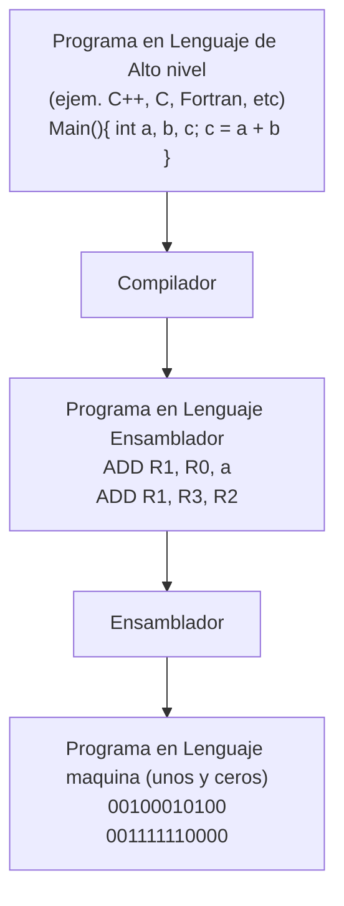

Fragmentos de código mostrados en cada nivel del diagrama:

- **Lenguaje de Alto nivel:**
```c
Main(){
    int a, b, c
    c = a + b
}
```
- **Lenguaje Ensamblador:**
```asm
ADD R1, R0, a
ADD R1, R3, R2
```
- **Lenguaje máquina:**
```text
00100010100
001111110000
```

*Pie de diapositiva:* Tema 3 | 6

---

## Diapositiva 7: Instrucciones y datos (información) están contenidos en memoria

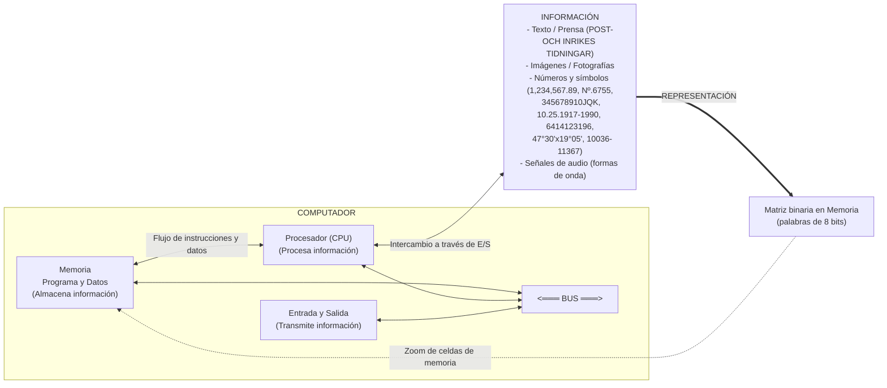

**Detalle de las conexiones y elementos visuales:**
- **COMPUTADOR:** Engloba un `BUS` bidireccional común al que se conectan tres subsistemas:
  - **Memoria Programa y Datos:** *Almacena información*.
  - **Procesador (CPU):** *Procesa información*.
  - **Entrada y Salida:** *Transmite información*.
- Una flecha curva naranja bidireccional muestra el intercambio entre `Memoria Programa y Datos` y `Procesador (CPU)` a través del `BUS`, y otra flecha curva naranja conecta `Procesador (CPU)` pasando por `Entrada y Salida` con el bloque externo `INFORMACIÓN`.
- Una flecha gruesa etiquetada como **REPRESENTACIÓN** apunta desde el bloque **INFORMACIÓN** hacia una ampliación en formato de matriz binaria de las celdas contenidas dentro de `Memoria Programa y Datos`:

| Bit 7 | Bit 6 | Bit 5 | Bit 4 | Bit 3 | Bit 2 | Bit 1 | Bit 0 |
| :---: | :---: | :---: | :---: | :---: | :---: | :---: | :---: |
| 1 | 0 | 0 | 1 | 1 | 0 | 0 | 0 |
| 0 | 0 | 1 | 1 | 0 | 1 | 1 | 1 |
| 0 | 0 | 0 | 1 | 0 | 0 | 0 | 1 |
| 1 | 1 | 0 | 0 | 1 | 1 | 0 | 0 |
| 0 | 1 | 0 | 0 | 1 | 0 | 1 | 1 |
| 1 | 1 | 0 | 1 | 1 | 0 | 0 | 0 |
| 0 | 0 | 1 | 1 | 0 | 0 | 0 | 1 |
| 1 | 0 | 1 | 1 | 0 | 0 | 1 | 0 |

*Pie de diapositiva:* Tema 3 | 7

---

## Diapositiva 8: Conjunto de instrucciones

- Cada procesador está diseñado para entender un conjunto de instrucciones
- **Tipos de instrucciones**
  - **Transferencia:** copian información de un lugar a otro (memoria, registros)
  - **Transformación:** transforman la información
    - Aritméticas, Lógicas, Desplazamiento, Comparación, ...
  - **Control:** controlan el flujo de instrucciones del programa

*Pie de diapositiva:* Tema 3 | 8

---

## Diapositiva 9: Formato de instrucción

- Las instrucciones se almacenan en memoria $\rightarrow$ Codificación en binario ($n$-bits)
  - En procesadores reales, $n =$ múltiplo de $8$ ($8, 16, 32, 64$ bits)
- Instrucción $=$ conjunto de campos de bits
  - Codifican información en forma de enteros
  - Utilizan las representaciones de enteros vistas en el Tema 2
- **ISA (Instruction Set Architecture)** de un procesador $=$ estándar que define cómo interpretar esos campos de bits
- **Ejemplo:** Formatos de instrucción para un procesador MIPS

**Register format**

| Campo | Op-code | Rs | Rt | Rd | *(shamt)* | Function code |
| :--- | :---: | :---: | :---: | :---: | :---: | :---: |
| **Bits (rango)** | $31\text{--}26$ ($6$ bits) | $25\text{--}21$ ($5$ bits) | $20\text{--}16$ ($5$ bits) | $15\text{--}11$ ($5$ bits) | $10\text{--}6$ ($5$ bits) | $5\text{--}0$ ($6$ bits) |
| **Codificación** | `000000` | `sssss` | `ttttt` | `ddddd` | `00000` | `ffffff` |

**Immediate format**

| Campo | Op-code | Rs | Rt | Immediate |
| :--- | :---: | :---: | :---: | :---: |
| **Bits (rango)** | $31\text{--}26$ ($6$ bits) | $25\text{--}21$ ($5$ bits) | $20\text{--}16$ ($5$ bits) | $15\text{--}0$ ($16$ bits) |
| **Codificación** | `ffffff` | `sssss` | `ttttt` | `iiiiiiiiiiiiiiii` |

**Jump format**

| Campo | Op-code | Target |
| :--- | :---: | :---: |
| **Bits (rango)** | $31\text{--}26$ ($6$ bits) | $25\text{--}0$ ($26$ bits) |
| **Codificación** | `000010` | `tttttttttttttttttttttttttt` |

*Pie de diapositiva:* Tema 3 | 9

---

## Diapositiva 10: 2. Formato de instrucción

- **Elementos de una instrucción:**
  - **Código de operación (OPCODE):** Identificador único de la instrucción cuya ejecución se requiere.
  - **Operandos (direcciones):** Argumentos necesarios para la ejecución de la instrucción
    - Interpretación del valor del operando depende del modo de direccionamiento de ese operando
- **Formato:**

Estructura general de $n$-bits:

| Campo | OPCODE | OP1 | OP2 | $\dots$ | OPn |
| :--- | :---: | :---: | :---: | :---: | :---: |
| **Descripción** | código de operación | operandos o direcciones | operandos o direcciones | $\dots$ | operandos o direcciones |

*Nota visual:* Una llave superior abarca la totalidad de los campos indicando longitud **$n$-bits**. Debajo, una llave abarca `OPCODE` con la etiqueta **código de operación**, y una segunda llave abarca conjuntamente desde `OP1` hasta `OPn` con la etiqueta **operandos o direcciones**.

*Pie de diapositiva:* Tema 3 | 10

---

## Diapositiva 11: Modos de direccionamiento

- ¿Cómo interpretar los bits del campo operando para obtener el valor a usar?
  - *(Nota: Ejemplo ficticio)*

```text
ADD A, B, C  →  0100 1001 0010 0101    (A ← B + C)
```

| Campo simbólico | `ADD` | `A` | `B` | `C` |
| :--- | :---: | :---: | :---: | :---: |
| **Bits (4 bits c/u)** | `0100` | `1001` | `0010` | `0101` |

- **Ej:** ¿Qué dato concreto hay que sumar a $C$ para calcular el valor a almacenar en $A$?
  - La respuesta la da el modo de direccionamiento del operando $B$
  - Significado de `0010`

*Pie de diapositiva:* Tema 3 | 11

---

## Diapositiva 12: Modos de direccionamiento

- **Inmediato**
- **Directo**
  - **Absoluto**
    - A registro
    - A memoria
  - **Relativo**
    - Registro implícito (PC, base, índice, SP, ...)
    - Registro explícito
- **Indirecto**
  - Por registro
  - Por memoria

*Pie de diapositiva:* Tema 3 | 12

---

## Diapositiva 13: Taxonomía de los modos de direccionamiento

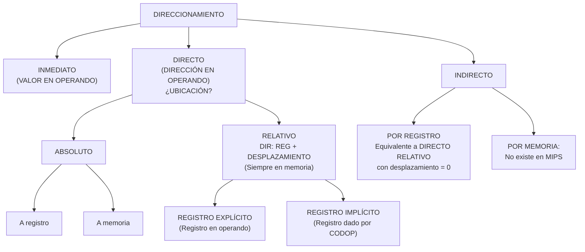

*Nota visual:* El esquema original es un mapa conceptual manuscrito que organiza los modos de direccionamiento en tres ramas principales: `INMEDIATO` (valor en operando), `DIRECTO` (dirección en operando, planteando la pregunta `¿UBICACIÓN?`, que se bifurca en `ABSOLUTO` —a registro / a memoria— y `RELATIVO` —siempre en memoria, $DIR = REG + DESPLAZAMIENTO$, con registro explícito en operando o registro implícito dado por CODOP—) e `INDIRECTO` (por registro, anotado como equivalente a directo relativo con desplazamiento $= 0$, y por memoria, anotado como que no existe en MIPS).

*Pie de diapositiva:* Tema 3 | 13

---

## Diapositiva 14: Modos de direccionamiento (I)

- **Inmediato**
  - "El campo operando es el propio VALOR del operando"
  - El operando está en la propia instrucción
  - Codificación en binario del tipo de dato del operando (natural, entero, real, ...)

*Pie de diapositiva:* Tema 3 | 14

---

## Diapositiva 15: Modos de direccionamiento (I)

- **Inmediato**
  - "El campo operando es el propio VALOR del operando"
  - El operando está en la propia instrucción
  - Codificación en binario del tipo de dato del operando (binario puro, entero, real, ...)
- **Ejemplo:** $B$ operando binario puro y direccionamiento inmediato:
  - $A = ? + C$

```text
ADD A, B, C → 0100100100100101
```

*Pie de diapositiva:* Tema 3 | 15

---

## Diapositiva 16: Modos de direccionamiento (I)

- **Inmediato**
  - "El campo operando es el propio VALOR del operando"
  - El operando está en la propia instrucción
  - Codificación en binario del tipo de dato del operando (binario puro, entero, real, ...)
- **Ejemplo:** $B$ operando binario puro y direccionamiento inmediato:
  - $A = 2 + C$

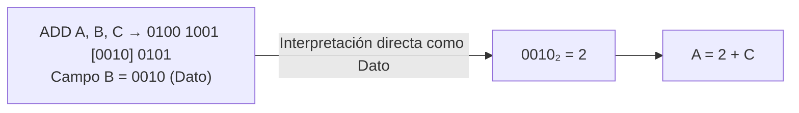

**Desglose visual de la instrucción:**
- `ADD` (rojo) $\rightarrow$ `0100`
- `A` (azul oscuro) $\rightarrow$ `1001`
- `B` (verde) $\rightarrow$ `0010` (llave inferior etiquetada como **Dato**; flecha verde con `0010 = 2` que sustituye al `?` en $A = 2 + C$)
- `C` (amarillo) $\rightarrow$ `0101`

*Pie de diapositiva:* Tema 3 | 16

---

## Diapositiva 17: Modos de direccionamiento (II)

- **Directo**
  - "El campo operando indica DONDE está el valor a usar"
  - El valor puede estar en un registro o en una posición de memoria
  - Dos modos distintos de interpretar el operando:
    - **ABSOLUTO:** Operando proporciona la dirección completa del valor
    - **RELATIVO:** Operando da información parcial de direccionamiento $\Rightarrow$ requiere cálculo previo para conocer la dirección final donde está el valor

*Pie de diapositiva:* Tema 3 | 17

---

## Diapositiva 18: Modos de direccionamiento (III)

- **Directo Absoluto**
  - **Directo a Registro:** valor está en un registro (operando $=$ índice en binario del registro)
  - **Directo a Memoria:** valor está en una posición de memoria (operando $=$ dirección de memoria)
- **Ej. Directo a Registro**
  - $A = ? + C$

```text
ADD A, B, C → 0100100100100101
```

**Estado de Memoria y Registros mostrados:**

| Dirección (Memoria) | Contenido |
| :---: | :---: |
| `0000` | `0010` |
| `0001` | `0100` |
| `0010` | `0000` |
| $\dots$ | $\dots$ |
| `1111` | `0101` |

| Registro (Índice) | Contenido |
| :---: | :---: |
| `R0 (0000)` | `0110` |
| `R1 (0001)` | `0001` |
| `R2 (0010)` | `0111` |
| $\dots$ | $\dots$ |
| `R15 (1111)` | `0000` |

*Pie de diapositiva:* Tema 3 | 18

---

## Diapositiva 19: Modos de direccionamiento (III)

- **Directo Absoluto**
  - **Directo a Registro:** valor está en un registro (operando $=$ índice en binario del registro)
  - **Directo a Memoria:** valor está en una posición de memoria (operando $=$ dirección de memoria)
- **Ej. Directo a Registro**
  - $A = 7 + C$

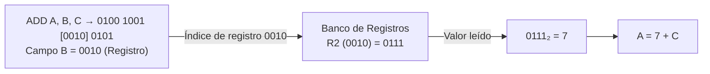

**Estado de Memoria y Registros:**

| Dirección (Memoria) | Contenido |
| :---: | :---: |
| `0000` | `0010` |
| `0001` | `0100` |
| `0010` | `0000` |
| $\dots$ | $\dots$ |
| `1111` | `0101` |

| Registro (Índice) | Contenido |
| :---: | :---: |
| `R0 (0000)` | `0110` |
| `R1 (0001)` | `0001` |
| **`R2 (0010)`** | **`0111`** |
| $\dots$ | $\dots$ |
| `R15 (1111)` | `0000` |

*Pie de diapositiva:* Tema 3 | 19

---

## Diapositiva 20: Modos de direccionamiento (III)

- **Directo Absoluto**
  - **Directo a Registro:** valor está en un registro (operando $=$ índice en binario del registro)
  - **Directo a Memoria:** valor está en una posición de memoria (operando $=$ dirección de memoria)
- **Ej. Directo a Memoria**
  - $A = ? + C$

```text
ADD A, B, C → 0100100100100101
```

**Estado de Memoria y Registros:**

| Dirección (Memoria) | Contenido |
| :---: | :---: |
| `0000` | `0010` |
| `0001` | `0100` |
| `0010` | `0000` |
| $\dots$ | $\dots$ |
| `1111` | `0101` |

| Registro (Índice) | Contenido |
| :---: | :---: |
| `R0 (0000)` | `0110` |
| `R1 (0001)` | `0001` |
| `R2 (0010)` | `0111` |
| $\dots$ | $\dots$ |
| `R15 (1111)` | `0000` |

*Pie de diapositiva:* Tema 3 | 20

---

## Diapositiva 21: Modos de direccionamiento (III)

- **Directo Absoluto**
  - **Directo a Registro:** valor está en un registro (operando $=$ índice en binario del registro)
  - **Directo a Memoria:** valor está en una posición de memoria (operando $=$ dirección de memoria)
- **Ej. Directo a Memoria**
  - $A = 0 + C$

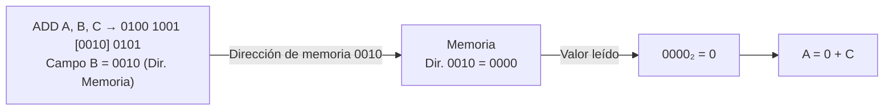

**Estado de Memoria y Registros:**

| Dirección (Memoria) | Contenido |
| :---: | :---: |
| `0000` | `0010` |
| `0001` | `0100` |
| **`0010`** | **`0000`** |
| $\dots$ | $\dots$ |
| `1111` | `0101` |

| Registro (Índice) | Contenido |
| :---: | :---: |
| `R0 (0000)` | `0110` |
| `R1 (0001)` | `0001` |
| `R2 (0010)` | `0111` |
| $\dots$ | $\dots$ |
| `R15 (1111)` | `0000` |

*Pie de diapositiva:* Tema 3 | 21

---

## Diapositiva 22: Modos de direccionamiento (IV)

- **Directo Relativo**
  - El valor está en una posición de memoria
  - **Dirección Efectiva (DE):** Dirección de memoria donde se encuentra el operando
  - La DE se calcula sumando un desplazamiento al contenido de un registro:
    - **Con registro explícito:** Operandos de la instrucción especifican desplazamiento y registro.
    - **Con registro implícito:** El registro no se especifica explícitamente con un operando. La instrucción (CODOP) da por convenio el registro.

*Pie de diapositiva:* Tema 3 | 22

---

## Diapositiva 23: Modos de direccionamiento (IV)

- **Directo Relativo con registro implícito:**
  - El registro no se especifica explícitamente en el formato de la instrucción
  - Sólo se especifica el desplazamiento
    - Relativo a PC (Program Counter), Relativo a Base, Indexado (relativo a registro índice), Relativo a SP (Stack Pointer) ...
- **Ej. Relativo a Base**
  - $A = ? + C$

```text
ADD A, B, C → 0100100100100101
```

**Estado del registro Base, Memoria y Registros:**
- **Registro `Base`:** `1101`

| Dirección (Memoria) | Contenido |
| :---: | :---: |
| `0000` | `0010` |
| `0001` | `0100` |
| `0010` | `0000` |
| $\dots$ | $\dots$ |
| `1111` | `0101` |

| Registro (Índice) | Contenido |
| :---: | :---: |
| `R0 (0000)` | `0110` |
| `R1 (0001)` | `0001` |
| `R2 (0010)` | `0111` |
| $\dots$ | $\dots$ |
| `R15 (1111)` | `0000` |

*Pie de diapositiva:* Tema 3 | 23

---

## Diapositiva 24: Modos de direccionamiento (IV)

- **Directo Relativo con registro implícito:**
  - El registro no se especifica explícitamente en el formato de la instrucción
  - Sólo se especifica el desplazamiento
    - Relativo a PC (Program Counter), Relativo a Base, Indexado (relativo a registro índice), Relativo a SP (Stack Pointer) ...
- **Ej. Relativo a Base**
  - $A = 5 + C$

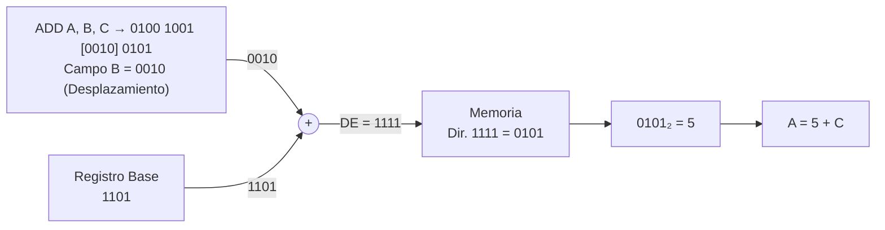

**Cálculo de la Dirección Efectiva:**
$$DE = \text{Base} + \text{Desplazamiento} = 1101_2 + 0010_2 = 1111_2$$
$$\text{Memoria}[1111_2] = 0101_2 = 5 \implies A = 5 + C$$

*Pie de diapositiva:* Tema 3 | 24

---

## Diapositiva 25: Modos de direccionamiento (IV)

- **Directo Relativo con registro explícito:**
  - El registro se especifica explícitamente en el formato de la instrucción
  - En el formato de instrucción al operando se le asocian dos campos: registro y desplazamiento
- **Ejemplo:**
  - $A = ? + C$

```text
ADD A, B(D), C → 0100 1001 1111 0001 0101
```

| Campo simbólico | `ADD` | `A` | `B` (Registro) | `D` (Desplazamiento) | `C` |
| :--- | :---: | :---: | :---: | :---: | :---: |
| **Bits** | `0100` | `1001` | `1111` | `0001` | `0101` |

**Estado de Memoria y Registros:**

| Dirección (Memoria) | Contenido |
| :---: | :---: |
| `0000` | `0010` |
| `0001` | `0100` |
| `0010` | `0000` |
| $\dots$ | $\dots$ |
| `1111` | `0101` |

| Registro (Índice) | Contenido |
| :---: | :---: |
| `R0 (0000)` | `0110` |
| `R1 (0001)` | `0001` |
| `R2 (0010)` | `0111` |
| $\dots$ | $\dots$ |
| `R15 (1111)` | `0000` |

*Pie de diapositiva:* Tema 3 | 25

---

## Diapositiva 26: Modos de direccionamiento (IV)

- **Directo Relativo con registro explícito:**
  - El registro se especifica explícitamente en el formato de la instrucción
  - En el formato de instrucción al operando se le asocian dos campos: registro y desplazamiento
- **Ejemplo:**
  - $A = 4 + C$

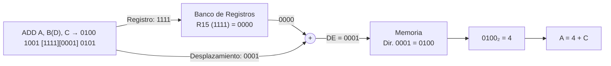

**Cálculo de la Dirección Efectiva:**
$$DE = R[15] + \text{Desplazamiento} = 0000_2 + 0001_2 = 0001_2$$
$$\text{Memoria}[0001_2] = 0100_2 = 4 \implies A = 4 + C$$

*Pie de diapositiva:* Tema 3 | 26

---

## Diapositiva 27: Modos de direccionamiento (IV)

- **Directo Relativo con registro explícito:**
  - Principal utilidad: recorrer conjunto de direcciones de memoria con una misma instrucción.

```asm
Bucle:
    ...
    ADD A,R0(0),B
    INC R0
    ...
    JUMP Bucle
```

**Memoria:**

| Dirección | Contenido |
| :---: | :---: |
| `0000` | `0010` |
| `0001` | `0100` |
| `0010` | `0000` |
| $\dots$ | $\dots$ |
| `1111` | `0101` |

*Pie de diapositiva:* Tema 3 | 27

---

## Diapositiva 28: Modos de direccionamiento (IV)

- **Directo Relativo con registro explícito:**
  - Principal utilidad: recorrer conjunto de direcciones de memoria con una misma instrucción.

```asm
Bucle:
    ...
    ADD A,R0(0),B
    INC R0
    ...
    JUMP Bucle
```

*(Nota visual: en el código se resalta el desplazamiento `0` en verde y la instrucción `INC R0` en rojo).*

**Iteración 1 del bucle:**

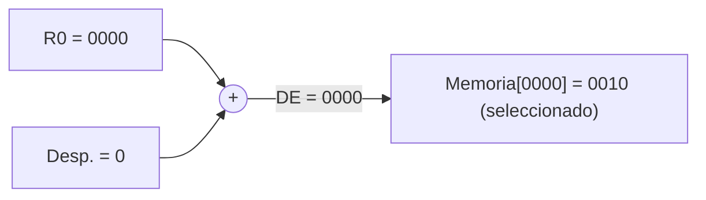

| Dirección (Memoria) | Contenido | Estado |
| :---: | :---: | :---: |
| **`0000`** | **`0010`** | **Accedido (verde)** |
| `0001` | `0100` | |
| `0010` | `0000` | |
| $\dots$ | $\dots$ | |
| `1111` | `0101` | |

*Pie de diapositiva:* Tema 3 | 28

---

## Diapositiva 29: Modos de direccionamiento (IV)

- **Directo Relativo con registro explícito:**
  - Principal utilidad: recorrer conjunto de direcciones de memoria con una misma instrucción.

```asm
Bucle:
    ...
    ADD A,R0(0),B
    INC R0
    ...
    JUMP Bucle
```

**Iteración 2 del bucle (tras ejecutar `INC R0`):**

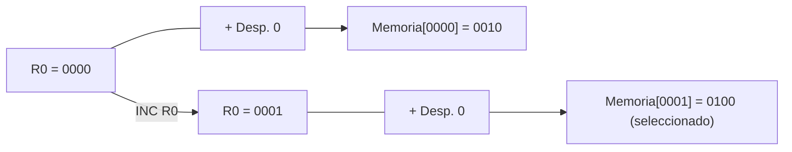

| Dirección (Memoria) | Contenido | Estado |
| :---: | :---: | :---: |
| `0000` | `0010` | Iteración anterior |
| **`0001`** | **`0100`** | **Accedido (verde)** |
| `0010` | `0000` | |
| $\dots$ | $\dots$ | |
| `1111` | `0101` | |

*Pie de diapositiva:* Tema 3 | 29

---

## Diapositiva 30: Modos de direccionamiento (IV)

- **Directo Relativo con registro explícito:**
  - Principal utilidad: recorrer conjunto de direcciones de memoria con una misma instrucción.

```asm
Bucle:
    ...
    ADD A,R0(0),B
    INC R0
    ...
    JUMP Bucle
```

**Iteración 3 del bucle (tras ejecutar de nuevo `INC R0`):**

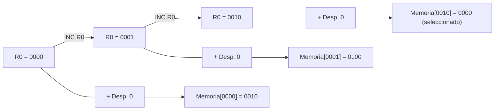

| Dirección (Memoria) | Contenido | Estado |
| :---: | :---: | :---: |
| `0000` | `0010` | Iteración 1 |
| `0001` | `0100` | Iteración 2 |
| **`0010`** | **`0000`** | **Accedido (verde)** |
| $\dots$ | $\dots$ | |
| `1111` | `0101` | |

*Pie de diapositiva:* Tema 3 | 30

---

## Diapositiva 31: Modos de direccionamiento (IV)

- **Directo Relativo con registro explícito y Autoindexado:**
  - Incremento/decremento automático del registro
  - Útil en bucles como el anterior (ahorro instrucción `INC`)

```asm
ADD A,R0(0),B
```

- **Preautoincrementado:** $R0 = R0 + 1;\; DE = R0 + 0;$
- **Preautodecrementado:** $R0 = R0 - 1;\; DE = R0 + 0;$
- **Postautoincrementado:** $DE = R0 + 0;\; R0 = R0 + 1;$
- **Postautodecrementado:** $DE = R0 + 0;\; R0 = R0 - 1;$

*Pie de diapositiva:* Tema 3 | 31

---

## Diapositiva 32: Modos de direccionamiento (V)

- **Indirecto**
  - "El campo operando indica DONDE está la DIRECCIÓN del valor"
  - El valor está en una posición de memoria
  - La dirección de memoria donde está el valor puede darse en dos formas distintas:
    - **Registro:** el campo operando es el índice del registro cuyo contenido apunta al valor
    - **Memoria:** el campo operando apunta a la dirección de memoria cuyo contenido apunta a su vez al valor

*Pie de diapositiva:* Tema 3 | 32

---

## Diapositiva 33: Modos de direccionamiento (V)

- **Indirecto por registro:**
  - El formato de instrucción da el índice al registro donde se almacena la dirección de la posición de memoria donde está el valor.
- **Ejemplo:**
  - $A = ? + C$

```text
ADD A, B, C → 0100100100100101
```

**Estado de Memoria y Registros:**

| Dirección (Memoria) | Contenido |
| :---: | :---: |
| `0000` | `0010` |
| `0001` | `0100` |
| `0010` | `0000` |
| $\dots$ | $\dots$ |
| `1111` | `0101` |

| Registro (Índice) | Contenido |
| :---: | :---: |
| `R0 (0000)` | `0110` |
| `R1 (0001)` | `0001` |
| `R2 (0010)` | `1111` |
| $\dots$ | $\dots$ |
| `R15 (1111)` | `0000` |

*Pie de diapositiva:* Tema 3 | 33

---

## Diapositiva 34: Modos de direccionamiento (V)

- **Indirecto por registro:**
  - El formato de instrucción da el índice al registro donde se almacena la dirección de la posición de memoria donde está el valor.
- **Ejemplo:**
  - $A = 5 + C$

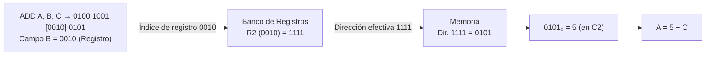

**Estado de Memoria y Registros:**

| Dirección (Memoria) | Contenido |
| :---: | :---: |
| `0000` | `0010` |
| `0001` | `0100` |
| `0010` | `0000` |
| $\dots$ | $\dots$ |
| **`1111`** | **`0101`** |

| Registro (Índice) | Contenido |
| :---: | :---: |
| `R0 (0000)` | `0110` |
| `R1 (0001)` | `0001` |
| **`R2 (0010)`** | **`1111`** |
| $\dots$ | $\dots$ |
| `R15 (1111)` | `0000` |

*Pie de diapositiva:* Tema 3 | 34

---

## Diapositiva 35: Modos de direccionamiento (V)

- **Indirecto por memoria:**
  - El formato de instrucción da la dirección de memoria (puntero) donde se almacena la dirección de memoria donde está el valor.
- **Ejemplo:**
  - $A = ? + C$

```text
ADD A, B, C → 0100100100100101
```

**Estado de Memoria y Registros:**

| Dirección (Memoria) | Contenido |
| :---: | :---: |
| `0000` | `0010` |
| `0001` | `0100` |
| `0010` | `0000` |
| $\dots$ | $\dots$ |
| `1111` | `0101` |

| Registro (Índice) | Contenido |
| :---: | :---: |
| `R0 (0000)` | `0110` |
| `R1 (0001)` | `0001` |
| `R2 (0010)` | `1111` |
| $\dots$ | $\dots$ |
| `R15 (1111)` | `0000` |

*Pie de diapositiva:* Tema 3 | 35

---

## Diapositiva 36: Modos de direccionamiento (V)

- **Indirecto por memoria:**
  - El formato de instrucción da la dirección de memoria (puntero) donde se almacena la dirección de memoria donde está el valor.
- **Ejemplo:**
  - $A = 2 + C$

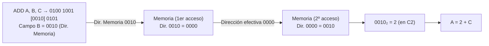

**Estado de Memoria y Registros:**

| Dirección (Memoria) | Contenido |
| :---: | :---: |
| **`0000`** | **`0010`** *(dato final)* |
| `0001` | `0100` |
| **`0010`** | **`0000`** *(puntero)* |
| $\dots$ | $\dots$ |
| `1111` | `0101` |

| Registro (Índice) | Contenido |
| :---: | :---: |
| `R0 (0000)` | `0110` |
| `R1 (0001)` | `0001` |
| `R2 (0010)` | `1111` |
| $\dots$ | $\dots$ |
| `R15 (1111)` | `0000` |

*Pie de diapositiva:* Tema 3 | 36

---

## Diapositiva 37: Ejemplo formato instrucción

- Diseñar el formato de instrucción para un procesador con las siguientes características:
  - $64$ instrucciones de $32$ bits
  - $32$ registros de $32$ bits
  - $3$ modos de direccionamiento: Directo a registro, y directo a memoria o relativo a PC
  - Instrucciones con $2$ operandos:
    - 1er operando especifica un registro
    - 2º operando una posición de memoria o un desplazamiento

**Esquema de la palabra de instrucción (paso 0 — vacío):**

| Bits | $31 \dots 0$ |
| :--- | :---: |
| **Campo** | *(32 bits sin asignar)* |

*Pie de diapositiva:* Tema 3 | 37

---

## Diapositiva 38: Ejemplo formato instrucción

- Diseñar el formato de instrucción para un procesador con las siguientes características:
  - $64$ instrucciones de $32$ bits
  - $32$ registros de $32$ bits
  - $3$ modos de direccionamiento: Directo a registro, y directo a memoria o relativo a PC
  - Instrucciones con $2$ operandos:
    - 1er operando especifica un registro
    - 2º operando una posición de memoria o un desplazamiento

**Esquema de la palabra de instrucción (paso 1 — ubicación de OPCODE):**

| Campo | OPCODE | *(resto de bits)* |
| :--- | :---: | :---: |
| **Bits** | $31 \dots$ | $\dots 0$ |

*Pie de diapositiva:* Tema 3 | 38

---

## Diapositiva 39: Ejemplo formato instrucción

- Diseñar el formato de instrucción para un procesador con las siguientes características:
  - $64$ instrucciones de $32$ bits $\Rightarrow 64 = 2^6 \Rightarrow 6\text{ bits (OPCODE)}$
  - $32$ registros de $32$ bits
  - $3$ modos de direccionamiento: Directo a registro, y directo a memoria o relativo a PC
  - Instrucciones con $2$ operandos:
    - 1er operando especifica un registro
    - 2º operando una posición de memoria o un desplazamiento

**Esquema de la palabra de instrucción (paso 2 — tamaño de OPCODE):**

| Campo | OPCODE (6) | *(resto de bits)* |
| :--- | :---: | :---: |
| **Bits** | $31\text{--}26$ | $25\text{--}0$ |

*Pie de diapositiva:* Tema 3 | 39

---

## Diapositiva 40: Ejemplo formato instrucción

- Diseñar el formato de instrucción para un procesador con las siguientes características:
  - $64$ instrucciones de $32$ bits $\Rightarrow 64 = 2^6 \Rightarrow 6\text{ bits (OPCODE)}$
  - $32$ registros de $32$ bits
  - $3$ modos de direccionamiento: Directo a registro, y directo a memoria o relativo a PC
  - Instrucciones con $2$ operandos:
    - 1er operando especifica un registro
    - 2º operando una posición de memoria o un desplazamiento

**Esquema de la palabra de instrucción (paso 3 — ubicación de OP1):**

| Campo | OPCODE (6) | OP1 | *(resto de bits)* |
| :--- | :---: | :---: | :---: |
| **Bits** | $31\text{--}26$ | $25\text{--}\dots$ | $\dots\text{--}0$ |

*Pie de diapositiva:* Tema 3 | 40

---

## Diapositiva 41: Ejemplo formato instrucción

- Diseñar el formato de instrucción para un procesador con las siguientes características:
  - $64$ instrucciones de $32$ bits $\Rightarrow 64 = 2^6 \Rightarrow 6\text{ bits (OPCODE)}$
  - $32$ registros de $32$ bits
  - $3$ modos de direccionamiento: Directo a registro, y directo a memoria o relativo a PC
  - Instrucciones con $2$ operandos:
    - 1er operando especifica un registro $\Rightarrow 32 = 2^5 \Rightarrow 5\text{ bits (OP1)}$
    - 2º operando una posición de memoria o un desplazamiento

**Esquema de la palabra de instrucción (paso 4 — tamaño de OP1):**

| Campo | OPCODE (6) | OP1 (5) | *(resto de bits)* |
| :--- | :---: | :---: | :---: |
| **Bits** | $31\text{--}26$ | $25\text{--}21$ | $20\text{--}0$ |

*Pie de diapositiva:* Tema 3 | 41

---

## Diapositiva 42: Ejemplo formato instrucción

- Diseñar el formato de instrucción para un procesador con las siguientes características:
  - $64$ instrucciones de $32$ bits $\Rightarrow 64 = 2^6 \Rightarrow 6\text{ bits (OPCODE)}$
  - $32$ registros de $32$ bits
  - $3$ modos de direccionamiento: Directo a registro, y directo a memoria o relativo a PC
  - Instrucciones con $2$ operandos:
    - 1er operando especifica un registro $\Rightarrow 32 = 2^5 \Rightarrow 5\text{ bits (OP1)}$
    - 2º operando una posición de memoria o un desplazamiento

**Esquema de la palabra de instrucción (paso 5 — ubicación de $MD_{op2}$ y OP2):**

| Campo | OPCODE (6) | OP1 (5) | $MD_{op2}$ | OP2 |
| :--- | :---: | :---: | :---: | :---: |
| **Bits** | $31\text{--}26$ | $25\text{--}21$ | $20$ | $19\text{--}0$ |

*Pie de diapositiva:* Tema 3 | 42

---

## Diapositiva 43: Ejemplo formato instrucción

- Diseñar el formato de instrucción para un procesador con las siguientes características:
  - $64$ instrucciones de $32$ bits $\Rightarrow 64 = 2^6 \Rightarrow 6\text{ bits (OPCODE)}$
  - $32$ registros de $32$ bits
  - $3$ modos de direccionamiento: Directo a registro, y directo a memoria o relativo a PC $\Rightarrow 2 = 2^1 \Rightarrow 1\text{ bit } (MD_{op2})$
  - Instrucciones con $2$ operandos:
    - 1er operando especifica un registro $\Rightarrow 32 = 2^5 \Rightarrow 5\text{ bits (OP1)}$
    - 2º operando una posición de memoria o un desplazamiento

**Esquema final de la palabra de instrucción (32 bits):**

| Campo | OPCODE (6) | OP1 (5) | $MD_{op2}$ (1) | OP2 (20) |
| :--- | :---: | :---: | :---: | :---: |
| **Rango de bits** | $31\text{--}26$ | $25\text{--}21$ | $20$ | $19\text{--}0$ |
| **Anchura** | $6$ bits | $5$ bits | $1$ bit | $20$ bits |

*Pie de diapositiva:* Tema 3 | 43

---

## Diapositiva 44: Tema 3

1. Instrucciones de un procesador
   1. Conjunto de instrucciones
   2. Formato de instrucción
   3. Modos de direccionamiento
   4. Ejemplo de formato de instrucción
2. **Programación en ensamblador** *(sección destacada)*
   1. Lenguaje ensamblador MIPS
3. Tiempo de ciclo en procesador monociclo

*Pie de diapositiva:* Tema 3 | 44

---

## Diapositiva 45: PROGRAMACION EN ENSAMBLADOR

**Tema 3**

# PROGRAMACION EN ENSAMBLADOR

*Pie de diapositiva:* 45

---

## Diapositiva 46: Introducción arquitectura MIPS

- Se basa en una arquitectura **RISC**
  - **Reduced Instruction Set Computer (RISC)**, con un pequeño número de instrucciones simples
  - Otras arquitecturas, como la familia de Intel x86, son **CISC (Complex Instruction Set Computers)**
- MIPS incluye solo instrucciones simples y comunes (que se usan frecuentemente)
- Esto implica un **HARDWARE** simple y rápido a la hora de decodificar y ejecutar instrucciones
- Instrucciones más complejas (y menos frecuentes) se realizan usando secuencias de instrucciones simples

*Pie de diapositiva:* Tema 3 | 46

---

## Diapositiva 47: Introducción arquitectura MIPS

- Procesador de $32$ bits
- $32$ Registros de propósito general
  - Referenciados por nombre o por número
  - `$0` siempre vale $0$

**REGISTER NAME, NUMBER, USE, CALL CONVENTION**

| NAME | NUMBER | USE | PRESERVED ACROSS A CALL? |
| :--- | :---: | :--- | :---: |
| `$zero` | 0 | The Constant Value 0 | N.A. |
| `$at` | 1 | Assembler Temporary | No |
| `$v0`-`$v1` | 2-3 | Values for Function Results and Expression Evaluation | No |
| `$a0`-`$a3` | 4-7 | Arguments | No |
| `$t0`-`$t7` | 8-15 | Temporaries | No |
| `$s0`-`$s7` | 16-23 | Saved Temporaries | Yes |
| `$t8`-`$t9` | 24-25 | Temporaries | No |
| `$k0`-`$k1` | 26-27 | Reserved for OS Kernel | No |
| `$gp` | 28 | Global Pointer | Yes |
| `$sp` | 29 | Stack Pointer | Yes |
| `$fp` | 30 | Frame Pointer | Yes |
| `$ra` | 31 | Return Address | Yes |

*Pie de diapositiva:* Tema 3 | 47

---

## Diapositiva 48: Introducción arquitectura MIPS

- **Arquitectura Load-Store**
  - Operaciones aritméticas o lógicas requieren valores en registros

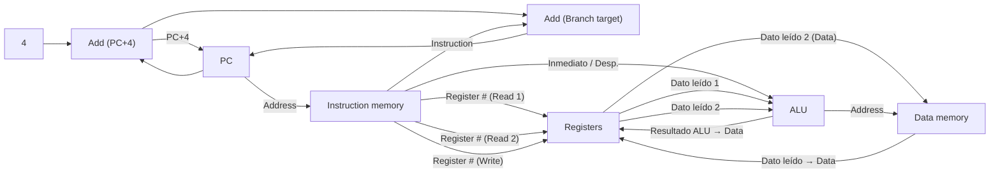

**Detalle de conexiones clave del esquema básico de la ruta de datos MIPS:**
1. **`PC` (Program Counter):** Su salida proporciona la dirección (`Address`) a la `Instruction memory` y también entra al primer sumador (`Add`), que le suma la constante `4`.
2. **Sumadores de `PC` (`Add` y `Add`):** La salida del primer sumador (`PC + 4`) se realimenta hacia la entrada de `PC` y entra también al segundo sumador (`Add`), cuya otra entrada proviene de la salida `Instruction` de la `Instruction memory` (desplazamiento de salto). La salida del segundo sumador se une igualmente al lazo de retorno hacia `PC`.
3. **`Instruction memory`:** Recibe `Address` y entrega `Instruction`, cuyos campos se distribuyen hacia: el segundo sumador `Add`, los tres puertos de selección `Register #` del banco `Registers`, y la segunda entrada de la `ALU`.
4. **`Registers`:** Posee una entrada de escritura `Data` y tres entradas `Register #`. Sus dos salidas de lectura se conectan a las dos entradas de la `ALU`; adicionalmente, la segunda salida de lectura se deriva hacia la entrada `Data` de `Data memory`.
5. **`ALU`:** Recibe los dos operandos y produce una salida que va tanto a la entrada `Address` de `Data memory` como de vuelta a la entrada `Data` del banco `Registers`.
6. **`Data memory`:** Recibe `Address` y `Data`, y su salida de lectura se realimenta a la entrada `Data` del banco `Registers`.

*Pie de diapositiva:* Tema 3 | 48

---

## Diapositiva 49: Introducción arquitectura MIPS

- **Arquitectura Load-Store**
  - Necesario transferencias `Memoria -> Registro` para almacenar valores en registros antes de ejecutar la operación
  - Necesario transferencia `Registro -> Memoria` para almacenar resultado de la operación, si se necesita dejar libre el registro
    - Realizadas por instrucciones de transferencia de datos

*(Nota visual: Incluye exactamente el mismo diagrama de bloques de la ruta de datos básica MIPS de la Diapositiva 48, con `PC`, dos sumadores `Add` con constante `4`, `Instruction memory`, `Registers`, `ALU` y `Data memory`, mostrando la separación entre el acceso a memoria y la ejecución en la ALU).*

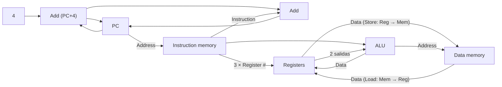

*Pie de diapositiva:* Tema 3 | 49

---

## Diapositiva 50: Introducción arquitectura MIPS

- **Soporta cinco modos de direccionamiento (I)**

### 1. Immediate addressing

| Campo | `op` | `rs` | `rt` | `Immediate` |
| :--- | :---: | :---: | :---: | :---: |
| **Descripción** | Código de operación | Registro fuente | Registro destino | Valor constante incluido directamente en la instrucción |

### 2. Register addressing

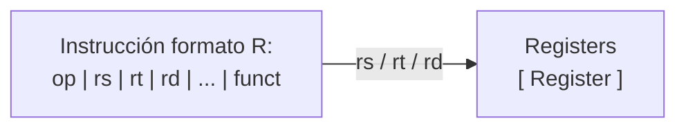

### 3. Base addressing

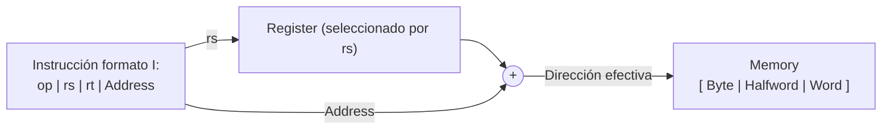

*Pie de diapositiva:* Tema 3 | 50

---

## Diapositiva 51: Introducción arquitectura MIPS

- **Soporta cinco modos de direccionamiento (II)**

### 4. PC-relative addressing

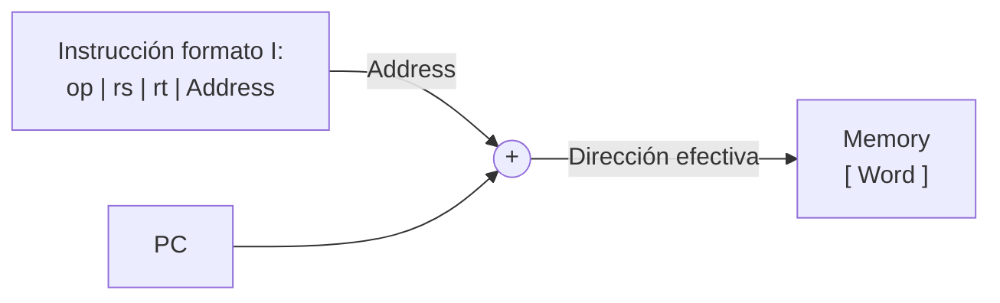

### 5. Pseudodirect addressing

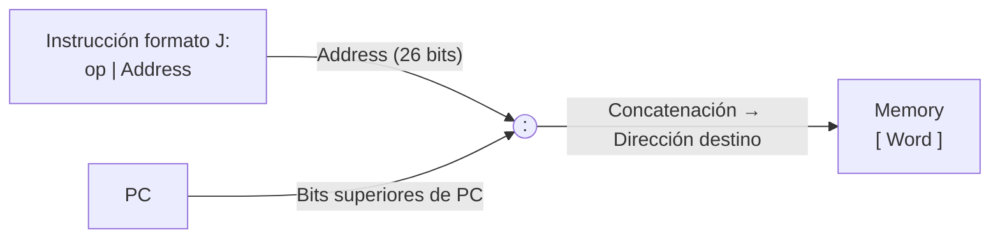

*Nota visual:* El círculo con `:` representa la operación de concatenación entre los bits más significativos del registro `PC` y el campo `Address` de la instrucción para apuntar a una palabra (`Word`) en `Memory`.

*Pie de diapositiva:* Tema 3 | 51

---

## Diapositiva 52: Introducción arquitectura MIPS

- Instrucciones de $32$ bits
- Deben ajustarse a uno de tres posibles formatos

**Register format**

| Campo | Op-code | Rs | Rt | Rd | *(shamt)* | Function code |
| :--- | :---: | :---: | :---: | :---: | :---: | :---: |
| **Bits (rango)** | $31\text{--}26$ ($6$ bits) | $25\text{--}21$ ($5$ bits) | $20\text{--}16$ ($5$ bits) | $15\text{--}11$ ($5$ bits) | $10\text{--}6$ ($5$ bits) | $5\text{--}0$ ($6$ bits) |
| **Codificación** | `000000` | `sssss` | `ttttt` | `ddddd` | `00000` | `ffffff` |

**Immediate format**

| Campo | Op-code | Rs | Rt | Immediate |
| :--- | :---: | :---: | :---: | :---: |
| **Bits (rango)** | $31\text{--}26$ ($6$ bits) | $25\text{--}21$ ($5$ bits) | $20\text{--}16$ ($5$ bits) | $15\text{--}0$ ($16$ bits) |
| **Codificación** | `ffffff` | `sssss` | `ttttt` | `iiiiiiiiiiiiiiii` |

**Jump format**

| Campo | Op-code | Target |
| :--- | :---: | :---: |
| **Bits (rango)** | $31\text{--}26$ ($6$ bits) | $25\text{--}0$ ($26$ bits) |
| **Codificación** | `000010` | `tttttttttttttttttttttttttt` |

*Pie de diapositiva:* Tema 3 | 52

---

## Diapositiva 53: Introducción arquitectura MIPS

- **Resumen de instrucciones (I)**

| Category | Instruction | Example | Meaning | Comments |
| :--- | :--- | :--- | :--- | :--- |
| **Arithmetic** | add | `add $s1, $s2, $s3` | $\$s1 = \$s2 + \$s3$ | Three register operands |
| **Arithmetic** | subtract | `sub $s1, $s2, $s3` | $\$s1 = \$s2 - \$s3$ | Three register operands |
| **Arithmetic** | add immediate | `addi $s1, $s2, 20` | $\$s1 = \$s2 + 20$ | Used to add constants |
| **Data transfer** | load word | `lw $s1, 20($s2)` | $\$s1 = \text{Memory}[\$s2 + 20]$ | Word from memory to register |
| **Data transfer** | store word | `sw $s1, 20($s2)` | $\text{Memory}[\$s2 + 20] = \$s1$ | Word from register to memory |
| **Data transfer** | load half | `lh $s1, 20($s2)` | $\$s1 = \text{Memory}[\$s2 + 20]$ | Halfword memory to register |
| **Data transfer** | load half unsigned | `lhu $s1, 20($s2)` | $\$s1 = \text{Memory}[\$s2 + 20]$ | Halfword memory to register |
| **Data transfer** | store half | `sh $s1, 20($s2)` | $\text{Memory}[\$s2 + 20] = \$s1$ | Halfword register to memory |
| **Data transfer** | load byte | `lb $s1, 20($s2)` | $\$s1 = \text{Memory}[\$s2 + 20]$ | Byte from memory to register |
| **Data transfer** | load byte unsigned | `lbu $s1, 20($s2)` | $\$s1 = \text{Memory}[\$s2 + 20]$ | Byte from memory to register |
| **Data transfer** | store byte | `sb $s1, 20($s2)` | $\text{Memory}[\$s2 + 20] = \$s1$ | Byte from register to memory |
| **Data transfer** | load linked word | `ll $s1, 20($s2)` | $\$s1 = \text{Memory}[\$s2 + 20]$ | Load word as 1st half of atomic swap |
| **Data transfer** | store condition. word | `sc $s1, 20($s2)` | $\text{Memory}[\$s2 + 20] = \$s1;\; \$s1 = 0 \text{ or } 1$ | Store word as 2nd half of atomic swap |
| **Data transfer** | load upper immed. | `lui $s1, 20` | $\$s1 = 20 \times 2^{16}$ | Loads constant in upper 16 bits |
| **Logical** | and | `and $s1, $s2, $s3` | $\$s1 = \$s2 \mathbin{\&} \$s3$ | Three reg. operands; bit-by-bit AND |
| **Logical** | or | `or $s1, $s2, $s3` | $\$s1 = \$s2 \mid \$s3$ | Three reg. operands; bit-by-bit OR |
| **Logical** | nor | `nor $s1, $s2, $s3` | $\$s1 = \sim(\$s2 \mid \$s3)$ | Three reg. operands; bit-by-bit NOR |
| **Logical** | and immediate | `andi $s1, $s2, 20` | $\$s1 = \$s2 \mathbin{\&} 20$ | Bit-by-bit AND reg with constant |
| **Logical** | or immediate | `ori $s1, $s2, 20` | $\$s1 = \$s2 \mid 20$ | Bit-by-bit OR reg with constant |
| **Logical** | shift left logical | `sll $s1, $s2, 10` | $\$s1 = \$s2 \ll 10$ | Shift left by constant |
| **Logical** | shift right logical | `srl $s1, $s2, 10` | $\$s1 = \$s2 \gg 10$ | Shift right by constant |

*Pie de diapositiva:* Tema 3 | 53

---

## Diapositiva 54: Introducción arquitectura MIPS

- **Resumen de instrucciones (II)**

| Category | Instruction | Example | Meaning | Comments |
| :--- | :--- | :--- | :--- | :--- |
| **Conditional branch** | branch on equal | `beq $s1, $s2, 25` | $\text{if } (\$s1 == \$s2) \text{ go to } PC + 4 + 100$ | Equal test; PC-relative branch |
| **Conditional branch** | branch on not equal | `bne $s1, $s2, 25` | $\text{if } (\$s1 \neq \$s2) \text{ go to } PC + 4 + 100$ | Not equal test; PC-relative |
| **Conditional branch** | set on less than | `slt $s1, $s2, $s3` | $\text{if } (\$s2 < \$s3)\; \$s1 = 1; \text{ else } \$s1 = 0$ | Compare less than; for beq, bne |
| **Conditional branch** | set on less than unsigned | `sltu $s1, $s2, $s3` | $\text{if } (\$s2 < \$s3)\; \$s1 = 1; \text{ else } \$s1 = 0$ | Compare less than unsigned |
| **Conditional branch** | set less than immediate | `slti $s1, $s2, 20` | $\text{if } (\$s2 < 20)\; \$s1 = 1; \text{ else } \$s1 = 0$ | Compare less than constant |
| **Conditional branch** | set less than immediate unsigned | `sltiu $s1, $s2, 20` | $\text{if } (\$s2 < 20)\; \$s1 = 1; \text{ else } \$s1 = 0$ | Compare less than constant unsigned |
| **Unconditional jump** | jump | `j 2500` | $\text{go to } 10000$ | Jump to target address |
| **Unconditional jump** | jump register | `jr $ra` | $\text{go to } \$ra$ | For switch, procedure return |
| **Unconditional jump** | jump and link | `jal 2500` | $\$ra = PC + 4;\; \text{go to } 10000$ | For procedure call |

*Pie de diapositiva:* Tema 3 | 54

---

## Diapositiva 55: Introducción arquitectura MIPS

- Ver las descripciones detalladas de las instrucciones y sus interpretaciones en los diversos materiales de referencia disponibles en el Campus Virtual de la asignatura
- Uso y ejemplos de programación en ensamblador se ven en el material de prácticas

*Pie de diapositiva:* Tema 3 | 55

---

	**[PAUSA EN DIAPOSITIVA 55 — Escribe "Continúa" para extraer el resto]**