## Diapositiva 56: Tema 3

1. Instrucciones de un procesador
   1. Conjunto de instrucciones
   2. Formato de instrucción
   3. Modos de direccionamiento
   4. Ejemplo de formato de instrucción
2. Programación en ensamblador
   1. Lenguaje ensamblador MIPS
3. **Tiempo de ciclo en procesador monociclo** *(sección destacada)*

*Pie de diapositiva:* Tema 3 | 56

---

## Diapositiva 57: TIEMPO DE CICLO EN PROCESADOR MONOCICLO

**Tema 3**

# TIEMPO DE CICLO EN PROCESADOR MONOCICLO

*Pie de diapositiva:* 57

---

## Diapositiva 58: Partes de un procesador

- Estructura general

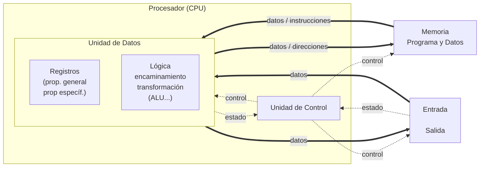

**Detalle de las conexiones del esquema:**
- **Líneas de control (flechas discontinuas rojas):** Salen desde la `Unidad de Control` hacia la `Memoria Programa y Datos`, la `Unidad de Datos` y el bloque `Entrada / Salida`.
- **Líneas de estado (flechas discontinuas azules):** Entran a la `Unidad de Control` procedentes de la `Unidad de Datos` y de `Entrada / Salida`.
- **Buses de información (flechas gruesas verdes):**
  - De `Memoria Programa y Datos` a `Unidad de Datos`: **datos** e **instrucciones**.
  - De `Unidad de Datos` a `Memoria Programa y Datos`: **datos** y **direcciones**.
  - De `Entrada / Salida` a `Unidad de Datos`: **datos**.
  - De `Unidad de Datos` a `Entrada / Salida`: **datos**.

*Pie de diapositiva:* Tema 3 | 58

---

## Diapositiva 59: Implementación básica de arquitectura MIPS

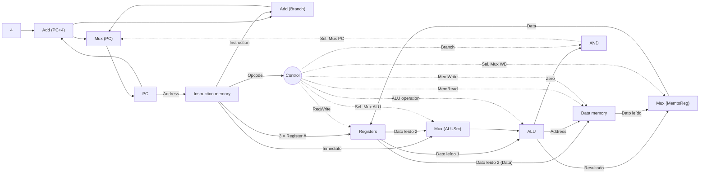

**Conexiones clave y señales de control (líneas en azul):**
1. **`Instruction` $\rightarrow$ `Control`:** La unidad `Control` decodifica la instrucción leída de `Instruction memory`.
2. **`RegWrite`:** Señal desde `Control` hacia `Registers` que habilita la escritura del registro destino.
3. **Selección de `Mux` de la `ALU`:** Señal desde `Control` que elige como segundo operando de la `ALU` entre la segunda salida de `Registers` y el campo inmediato de `Instruction`.
4. **`ALU operation`:** Señal desde `Control` hacia la `ALU` para seleccionar la operación a ejecutar.
5. **`MemRead` y `MemWrite`:** Señales desde `Control` hacia `Data memory` para habilitar lectura o escritura en memoria de datos.
6. **Selección de `Mux` de escritura a registros:** Señal desde `Control` que elige el dato a escribir en el puerto `Data` de `Registers` entre el resultado de la `ALU` y el dato leído de `Data memory`.
7. **`Branch` y `Zero` (puerta `AND`):** La señal `Branch` procedente de `Control` y la salida `Zero` de la `ALU` entran a una puerta `AND`, cuya salida selecciona en el `Mux` superior entre `PC + 4` y la dirección de salto calculada por el segundo sumador `Add`.

*Pie de diapositiva:* Tema 3 | 59

---

## Diapositiva 60: Procesador r-MIPS monociclo

- Cada ciclo de reloj lee y ejecuta una instrucción

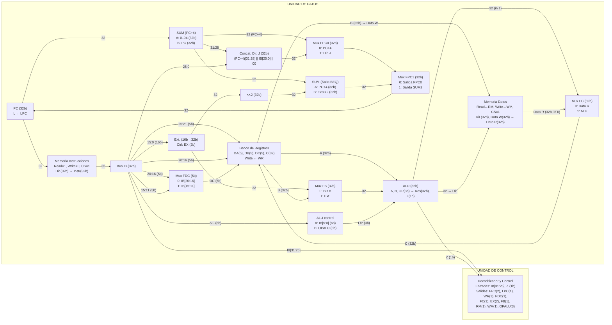

**Detalle completo de señales de control y anchuras de buses (r-MIPS monociclo):**

| Señal | Anchura | Origen $\rightarrow$ Destino | Función |
| :--- | :---: | :--- | :--- |
| `FPC` (`FPC1`, `FPC0`) | $2$ bits | UC $\rightarrow$ `Mux FPC1`, `Mux FPC0` | Selecciona la fuente del nuevo `PC`: `PC+4`, dirección de salto `J` o dirección de salto `BEQ` |
| `LPC` | $1$ bit | UC $\rightarrow$ `PC` (`L`) | Habilita la carga del registro `PC` |
| `WR` | $1$ bit | UC $\rightarrow$ `Banco de Registros` (`Write`) | Habilita la escritura en el registro indicado por `DC` |
| `FDC` | $1$ bit | UC $\rightarrow$ `Mux FDC` | Selecciona el registro destino `DC`: `0` = `IB[20:16]` (`rt`), `1` = `IB[15:11]` (`rd`) |
| `FC` | $1$ bit | UC $\rightarrow$ `Mux FC` | Selecciona el dato de escritura `C` en el banco de registros: `0` = `Dato R` (Memoria Datos), `1` = resultado `ALU` |
| `EX` | $2$ bits | UC $\rightarrow$ `Ext.` | Selecciona el tipo de extensión de $16$ a $32$ bits (signo, ceros, carga en parte alta para `LUI`) |
| `FB` | $1$ bit | UC $\rightarrow$ `Mux FB` | Selecciona el operando `B` de la `ALU`: `0` = salida `B` del banco de registros, `1` = salida de `Ext.` |
| `RM` | $1$ bit | UC $\rightarrow$ `Memoria Datos` (`Read`) | Habilita lectura en memoria de datos (`CS = 1` fijo) |
| `WM` | $1$ bit | UC $\rightarrow$ `Memoria Datos` (`Write`) | Habilita escritura en memoria de datos (`CS = 1` fijo) |
| `OPALU` | $3$ bits | UC $\rightarrow$ `ALU control` (`B`) | Código de operación general hacia `ALU control` (combinado con `IB[5:0]` de $6$ bits para generar los $3$ bits de `OP` de la `ALU`) |
| `Z` | $1$ bit | `ALU` $\rightarrow$ UC | Indicador de resultado cero en la `ALU` |

*Pie de diapositiva:* Tema 3 | 60

---

## Diapositiva 61: Tiempo de ciclo

- Ejecución de instrucciones sincronizada por señal de reloj

```wavedrom
{
  "signal": [
    { "name": "CLK", "wave": "N.....", "period": 2 },
    { "name": "Ejecución", "wave": "======.", "data": ["I1", "I2", "I3", "I4", "I5", "I6"], "period": 2 }
  ],
  "foot": {
    "text": "Duración de cada ciclo = T (entre flancos de bajada consecutivos de CLK)"
  }
}
```

*Descripción del cronograma:* La señal de reloj `CLK` es periódica con periodo $T$, activo por flanco de bajada (indicado con flechas verticales descendentes en cada flanco de bajada). En cada ciclo de duración $T$ se ejecuta secuencialmente una instrucción completa: $I_1, I_2, I_3, I_4, I_5, I_6$.

- El flanco de reloj carga los elementos de memoria:
  - PC
  - Registros del banco
  - Memoria RAM
- ¿cuál es la máxima frecuencia a la que puede funcionar el procesador?
  - Mínimo $T$

*Pie de diapositiva:* Tema 3 | 61

---

## Diapositiva 62: Tiempo de ciclo

- $T$ tiene que ser suficiente para que de tiempo a realizar todas las transferencias de cada instrucción
- Cada elemento hardware introduce un retardo
  - Necesita un tiempo desde que cambian sus entradas hasta que su salida es estable
- Ejemplos de retardos (en unidades de tiempo)
  - Memorias: $40$ (tanto para lectura como escritura)
  - ALU: $40$
  - Banco registros: $20$ (tanto para lectura como escritura)

*Pie de diapositiva:* Tema 3 | 62

---

## Diapositiva 63: Tiempo de ciclo

- **`OpAlu rd, rs, rt`**
  - $R[rd] \leftarrow R[rs]\; (\text{funcion})\; R[rt]$

**Formato de instrucción (32 bits):**

| Campo | `000000` | `rs` | `rt` | `rd` | `xxxxx` | `función` |
| :--- | :---: | :---: | :---: | :---: | :---: | :---: |
| **Bits** | $31\text{--}26$ | $25\text{--}21$ | $20\text{--}16$ | $15\text{--}11$ | $10\text{--}6$ | $5\text{--}0$ |

**Retardos anotados sobre la UNIDAD DE DATOS del procesador r-MIPS monociclo (en unidades de tiempo):**

| Componente hardware | Retardo (u.t.) |
| :--- | :---: |
| `PC` | $5$ |
| `SUM` (sumador `PC + 4`) | $5$ |
| `Mux FPC0` | $5$ |
| `Mux FPC1` | $5$ |
| `Memoria Instrucciones` | $40$ |
| `Banco de Registros` (lectura o escritura) | $20$ |
| `Mux FC` | $5$ |
| `Ext.` | $5$ |
| `SUM` (sumador dirección de salto) | $5$ |
| `Mux FB` | $5$ |
| `ALU` | $40$ |
| `Memoria Datos` (lectura o escritura) | $40$ |

*(Nota visual: Muestra el esquema completo de la UNIDAD DE DATOS de la Diapositiva 60 con etiquetas grises de texto rojo indicando los retardos anteriores sobre cada bloque, sin resaltar aún las rutas activas).*

*Pie de diapositiva:* Tema 3 | 63

---

## Diapositiva 64: Tiempo de ciclo

- **`OpAlu rd, rs, rt`**
  - $R[rd] \leftarrow R[rs]\; (\text{funcion})\; R[rt]$

**Formato de instrucción (32 bits):**

| Campo | `000000` | `rs` | `rt` | `rd` | `xxxxx` | `función` |
| :--- | :---: | :---: | :---: | :---: | :---: | :---: |
| **Bits** | $31\text{--}26$ | $25\text{--}21$ | $20\text{--}16$ | $15\text{--}11$ | $10\text{--}6$ | $5\text{--}0$ |

**Cálculo del tiempo de ciclo y camino crítico:**
$$PC \Rightarrow 5\text{ (PC)} + 5\text{ (Sum)} + 5\text{ (Mux)} + 5\text{ (Mux)} = 20$$
$$BR \Rightarrow 5\text{ (PC)} + 40\text{ (Mem)} + 20\text{ (BR)} + 5\text{ (Mux)} + 40\text{ (ALU)} + 5\text{ (Mux)} + 20\text{ (BR)} = 135$$
$$\text{Camino crítico} = 135$$

**Rutas activas destacadas en rojo en la UNIDAD DE DATOS:**

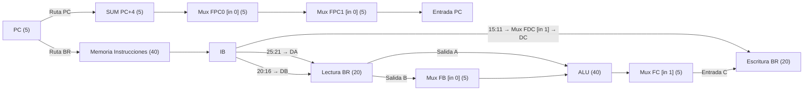

*Pie de diapositiva:* Tema 3 | 64

---

## Diapositiva 65: Tiempo de ciclo

- **`ADDI rt, rs, constante`**
  - $R[rt] \leftarrow R[rs] + \text{ExSig}(\text{constante})$

**Formato de instrucción (32 bits):**

| Campo | `001000` | `rs` | `rt` | `constante` |
| :--- | :---: | :---: | :---: | :---: |
| **Bits** | $31\text{--}26$ | $25\text{--}21$ | $20\text{--}16$ | $15\text{--}0$ |

*(Nota visual: Muestra el diagrama completo de la UNIDAD DE DATOS del procesador r-MIPS monociclo con los mismos retardos anotados de la Diapositiva 63, sin caminos resaltados).*

*Pie de diapositiva:* Tema 3 | 65

---

## Diapositiva 66: Tiempo de ciclo

- **`ADDI rt, rs, constante`**
  - $R[rt] \leftarrow R[rs] + \text{ExSig}(\text{constante})$

**Formato de instrucción (32 bits):**

| Campo | `001000` | `rs` | `rt` | `constante` |
| :--- | :---: | :---: | :---: | :---: |
| **Bits** | $31\text{--}26$ | $25\text{--}21$ | $20\text{--}16$ | $15\text{--}0$ |

**Tiempo de ciclo:**
$$PC = 5\text{ (PC)} + 5\text{ (Sum)} + 5\text{ (Mux)} + 5\text{ (Mux)} = 20$$
$$BR \Rightarrow 5\text{ (PC)} + 40\text{ (Mem)} + \max(20\text{ (BR)},\; 5\text{ (ext)} + 5\text{ (mux)}) + 40\text{ (ALU)} + 5\text{ (Mux)} + 20\text{ (BR)} = 130$$
$$\text{Camino crítico} = 130$$

**Rutas activas destacadas en rojo en la UNIDAD DE DATOS:**

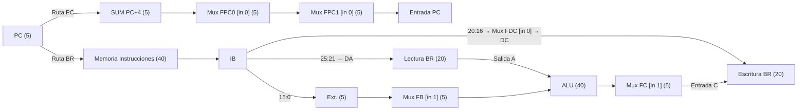

*Pie de diapositiva:* Tema 3 | 66

---

## Diapositiva 67: Tiempo de ciclo

- **`ORI rt, rs, constante`**
  - $R[rt] \leftarrow R[rs] \text{ OR } 0000000000000000,\text{constante}$

**Formato de instrucción (32 bits):**

| Campo | `001101` | `rs` | `rt` | `constante` |
| :--- | :---: | :---: | :---: | :---: |
| **Bits** | $31\text{--}26$ | $25\text{--}21$ | $20\text{--}16$ | $15\text{--}0$ |

*(Nota visual: Muestra el diagrama completo de la UNIDAD DE DATOS del procesador r-MIPS monociclo con los retardos anotados de la Diapositiva 63, sin caminos resaltados).*

*Pie de diapositiva:* Tema 3 | 67

---

## Diapositiva 68: Tiempo de ciclo

- **`ORI rt, rs, constante`**
  - $R[rt] \leftarrow R[rs] \text{ OR } 0000000000000000,\text{constante}$

**Formato de instrucción (32 bits):**

| Campo | `001101` | `rs` | `rt` | `constante` |
| :--- | :---: | :---: | :---: | :---: |
| **Bits** | $31\text{--}26$ | $25\text{--}21$ | $20\text{--}16$ | $15\text{--}0$ |

**Cálculo del tiempo de ciclo y camino crítico:**
$$PC = 5\text{ (PC)} + 5\text{ (Sum)} + 5\text{ (Mux)} + 5\text{ (Mux)} = 20$$
$$BR \Rightarrow 5\text{ (PC)} + 40\text{ (Mem)} + \max(20\text{ (BR)},\; 5\text{ (ext)} + 5\text{ (mux)}) + 40\text{ (ALU)} + 5\text{ (Mux)} + 20\text{ (BR)} = 130$$
$$\text{Camino crítico} = 130$$

**Rutas activas destacadas en rojo en la UNIDAD DE DATOS:**


*Pie de diapositiva:* Tema 3 | 68

---

## Diapositiva 69: Tiempo de ciclo

- **`LW rt, desp.(rs)`**
  - $R[rt] \leftarrow M[R[rs] + \text{ExSig}(\text{desp})]$

**Formato de instrucción (32 bits):**

| Campo | `100011` | `rs` | `rt` | `desp.` |
| :--- | :---: | :---: | :---: | :---: |
| **Bits** | $31\text{--}26$ | $25\text{--}21$ | $20\text{--}16$ | $15\text{--}0$ |

*(Nota visual: Muestra el diagrama completo de la UNIDAD DE DATOS del procesador r-MIPS monociclo con los retardos anotados de la Diapositiva 63, sin caminos resaltados).*

*Pie de diapositiva:* Tema 3 | 69

---

## Diapositiva 70: Tiempo de ciclo

- **`LW rt, desp.(rs)`**
  - $R[rt] \leftarrow M[R[rs] + \text{ExSig}(\text{desp})]$

**Formato de instrucción (32 bits):**

| Campo | `100011` | `rs` | `rt` | `desp.` |
| :--- | :---: | :---: | :---: | :---: |
| **Bits** | $31\text{--}26$ | $25\text{--}21$ | $20\text{--}16$ | $15\text{--}0$ |

**Cálculo del tiempo de ciclo y camino crítico:**
$$PC = 5\text{ (PC)} + 5\text{ (Sum)} + 5\text{ (Mux)} + 5\text{ (Mux)} = 20$$
$$BR \Rightarrow 5\text{ (PC)} + 40\text{ (Mem)} + \max(20\text{ (BR)},\; 5\text{ (ext)} + 5\text{ (mux)}) + 40\text{ (ALU)} + 40\text{ (Mem)} + 5\text{ (Mux)} + 20\text{ (BR)} = 170$$
$$\text{Camino crítico} = 170$$

**Rutas activas destacadas en rojo en la UNIDAD DE DATOS:**

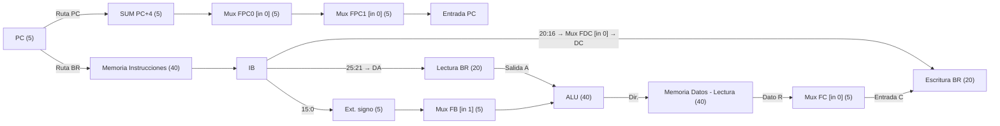

*Pie de diapositiva:* Tema 3 | 70

---

## Diapositiva 71: Tiempo de ciclo

- **`SW rt, desp.(rs)`**
  - $M[R[rs] + \text{ExSig}(\text{desp})] \leftarrow R[rt]$

**Formato de instrucción (32 bits):**

| Campo | `101011` | `rs` | `rt` | `desp.` |
| :--- | :---: | :---: | :---: | :---: |
| **Bits** | $31\text{--}26$ | $25\text{--}21$ | $20\text{--}16$ | $15\text{--}0$ |

*(Nota visual: Muestra el diagrama completo de la UNIDAD DE DATOS del procesador r-MIPS monociclo con los retardos anotados de la Diapositiva 63, sin caminos resaltados).*

*Pie de diapositiva:* Tema 3 | 71

---

## Diapositiva 72: Tiempo de ciclo

- **`SW rt, desp.(rs)`**
  - $M[R[rs] + \text{ExSig}(\text{desp})] \leftarrow R[rt]$

**Formato de instrucción (32 bits):**

| Campo | `101011` | `rs` | `rt` | `desp.` |
| :--- | :---: | :---: | :---: | :---: |
| **Bits** | $31\text{--}26$ | $25\text{--}21$ | $20\text{--}16$ | $15\text{--}0$ |

**Cálculo del tiempo de ciclo y camino crítico:**
$$PC = 5\text{ (Sum)} + 5\text{ (Mux)} + 5\text{ (Mux)} + 5\text{ (PC)} = 20$$
$$MEM \Rightarrow 5\text{ (PC)} + 40\text{ (Mem)} + \max(20\text{ (BR)},\; 5\text{ (ext)} + 5\text{ (mux)}) + 40\text{ (ALU)} + 40\text{ (Mem)} = 145$$
$$\text{Camino crítico} = 145$$

**Rutas activas destacadas en rojo en la UNIDAD DE DATOS:**

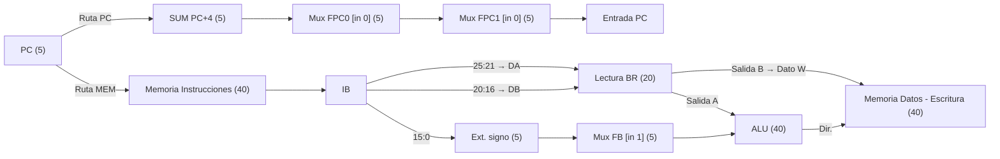

*Pie de diapositiva:* Tema 3 | 72

---

## Diapositiva 73: Tiempo de ciclo

- **`LUI rt, constante`**
  - $rt \leftarrow \text{constante}, 0000000000000000$

**Formato de instrucción (32 bits):**

| Campo | `101111` | `00000` | `rt` | `constante` |
| :--- | :---: | :---: | :---: | :---: |
| **Bits** | $31\text{--}26$ | $25\text{--}21$ | $20\text{--}16$ | $15\text{--}0$ |

*(Nota visual: Muestra el diagrama completo de la UNIDAD DE DATOS del procesador r-MIPS monociclo con los retardos anotados de la Diapositiva 63, sin caminos resaltados).*

*Pie de diapositiva:* Tema 3 | 73

---

## Diapositiva 74: Tiempo de ciclo

- **`LUI rt, constante`**
  - $rt \leftarrow \text{constante}, 0000000000000000$

**Formato de instrucción (32 bits):**

| Campo | `101111` | `00000` | `rt` | `constante` |
| :--- | :---: | :---: | :---: | :---: |
| **Bits** | $31\text{--}26$ | $25\text{--}21$ | $20\text{--}16$ | $15\text{--}0$ |

**Cálculo del tiempo de ciclo y camino crítico:**
$$PC = 5\text{ (PC)} + 5\text{ (Sum)} + 5\text{ (Mux)} + 5\text{ (Mux)} = 20$$
$$BR \Rightarrow 5\text{ (PC)} + 40\text{ (Mem)} + \max(20\text{ (BR)},\; 5\text{ (ext)} + 5\text{ (mux)}) + 40\text{ (ALU)} + 5\text{ (Mux)} + 20\text{ (BR)} = 130$$
$$\text{Camino crítico} = 130$$

**Rutas activas destacadas en rojo en la UNIDAD DE DATOS:**

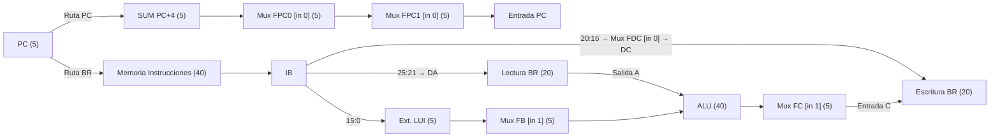

*Pie de diapositiva:* Tema 3 | 74

---

## Diapositiva 75: Tiempo de ciclo

- **`J dir`**
  - $PC \leftarrow (PC+1)[31:28], \text{dir}, 00$

**Formato de instrucción (32 bits):**

| Campo | `000100` | `dir` |
| :--- | :---: | :---: |
| **Bits** | $31\text{--}26$ | $25\text{--}0$ |

*(Nota visual: Muestra el diagrama completo de la UNIDAD DE DATOS del procesador r-MIPS monociclo con los retardos anotados de la Diapositiva 63, sin caminos resaltados).*

*Pie de diapositiva:* Tema 3 | 75

---

## Diapositiva 76: Tiempo de ciclo

- **`J dir`**
  - $PC \leftarrow (PC+1)[31:28], \text{dir}, 00$

**Formato de instrucción (32 bits):**

| Campo | `000100` | `dir` |
| :--- | :---: | :---: |
| **Bits** | $31\text{--}26$ | $25\text{--}0$ |

**Cálculo del tiempo de ciclo y camino crítico:**
$$PC \Rightarrow 5\text{ (PC)} + \max(5\text{ (Sum)},\; 40\text{ (Mem)}) + 5\text{ (Mux)} + 5\text{ (Mux)} = 55$$
$$\text{Camino crítico} = 55$$

**Rutas activas destacadas en rojo en la UNIDAD DE DATOS:**

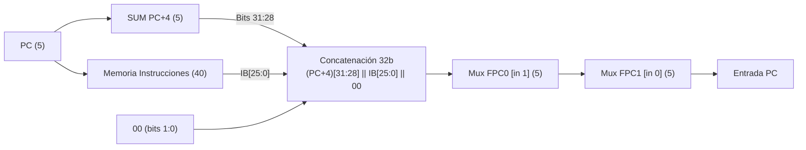

*Pie de diapositiva:* Tema 3 | 76

---

## Diapositiva 77: Tiempo de ciclo

- **`BEQ rs, rt, dir`**
  - $\text{if } (R[rs] = R[rt])\; PC \leftarrow (PC+4) + (\text{ExSig}(\text{dir}) \ll 2)$

**Formato de instrucción (32 bits):**

| Campo | `000100` | `rs` | `rt` | `dir` |
| :--- | :---: | :---: | :---: | :---: |
| **Bits** | $31\text{--}26$ | $25\text{--}21$ | $20\text{--}16$ | $15\text{--}0$ |

*(Nota visual: Muestra el diagrama completo de la UNIDAD DE DATOS del procesador r-MIPS monociclo con los retardos anotados de la Diapositiva 63, sin caminos resaltados).*

*Pie de diapositiva:* Tema 3 | 77

---

## Diapositiva 78: Tiempo de ciclo

- **`BEQ rs, rt, dir`**
  - $\text{if } (R[rs] = R[rt])\; PC \leftarrow (PC+4) + (\text{ExSig}(\text{dir}) \ll 2)$

**Formato de instrucción (32 bits):**

| Campo | `000100` | `rs` | `rt` | `dir` |
| :--- | :---: | :---: | :---: | :---: |
| **Bits** | $31\text{--}26$ | $25\text{--}21$ | $20\text{--}16$ | $15\text{--}0$ |

**Cálculo del tiempo de ciclo y camino crítico:**
$$tZ \Rightarrow 5\text{ (PC)} + 40\text{ (Mem)} + 20\text{ (BR)} + 5\text{ (Mux)} + 40\text{ (ALU)} = 110$$
$$PC \Rightarrow \max(tZ,\; 5\text{ (PC)} + 5\text{ (Sum)} + 5\text{ (Mux)}) + 5\text{ (Mux)} = 115$$
$$PC \Rightarrow \max(tZ,\; 5\text{ (PC)} + 40\text{ (Mem)} + 5\text{ (Ext)} + 5\text{ (Sum)}) + 5\text{ (Mux)} = 115$$
$$\text{Camino crítico} = 115$$

**Rutas activas destacadas en rojo en la UNIDAD DE DATOS:**

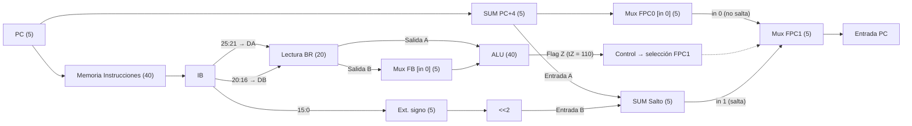

*Pie de diapositiva:* Tema 3 | 78

---

## Diapositiva 79: Tiempo de ciclo

| Instrucción | Tiempo |
| :--- | :---: |
| `OpALU` | $135$ |
| `ADDI` | $130$ |
| `ORI` | $130$ |
| `LW` | $170$ |
| `SW` | $145$ |
| `LUI` | $130$ |
| `J` | $55$ |
| `BEQ` | $115$ |

- **Tiempo de ciclo ($T$) $= 170$**
- Todas las instrucciones tardarán lo mismo en ejecutarse: $170$ unidades de tiempo

```wavedrom
{
  "signal": [
    { "name": "CLK (T=170)", "wave": "N.....", "period": 4 },
    { "name": "Ejecución", "wave": "=..==.x=.x.=.x=.x=.x", "data": ["LW (170)", "SW (145)", "J (55)", "ORI (130)", "ADD (135)", "BEQ (115)"] }
  ],
  "foot": {
    "text": "Cada ciclo de reloj dura 170 u.t.; las zonas x representan tiempo ocioso al final del ciclo"
  }
}
```

*Descripción del cronograma:* Cada periodo entre flancos de bajada de `CLK` mide $170$ unidades de tiempo. `LW` ocupa el ciclo completo ($170$ u.t.), mientras que `SW` ($145$ u.t.), `J` ($55$ u.t.), `ORI` ($130$ u.t.), `ADD` ($135$ u.t.) y `BEQ` ($115$ u.t.) terminan antes del flanco siguiente dejando tiempo desperdiciado dentro de su ciclo.

*Pie de diapositiva:* Tema 3 | 79

---

## Diapositiva 80: SEGMENTACION

**Tema 3**

# SEGMENTACION

*Pie de diapositiva:* 80

---

## Diapositiva 81: Implementación MONOCICLO

- **Implementación MONOCICLO:**
  - Todas las instrucciones se ejecutan en un único ciclo
  - El tiempo de ciclo viene marcado por la instrucción más lenta
  - Hay pérdida de tiempo en algunas instrucciones

```wavedrom
{
  "signal": [
    { "name": "CLK (T=170)", "wave": "N.....", "period": 4 },
    { "name": "Instrucción", "wave": "=..==.x=.x.=.x=.x=.x", "data": ["LW", "SW", "J", "ORI", "ADD", "BEQ"] }
  ],
  "foot": {
    "text": "Periodo de reloj fijo T = 170 u.t. con tiempos muertos en SW, J, ORI, ADD y BEQ"
  }
}
```

*Descripción del cronograma:* Se muestra nuevamente la secuencia `LW`, `SW`, `J`, `ORI`, `ADD`, `BEQ` sincronizada por flanco de bajada de `CLK` con periodo constante de $170$ u.t., evidenciando los huecos vacíos tras finalizar las instrucciones más rápidas.

- ¿Se puede acelerar la ejecución de un programa sin cambiar la tecnología?

*Pie de diapositiva:* Tema 3 | 81

---

## Diapositiva 82: Tiempo de ejecución de un programa

- Suponemos $10$ iteraciones en el bucle

```mips
        lw $1,desp($0)
        lw $2,0($1)
        lw $3,desp2($0)
        lw $4,desp3($0)
loop:   beq $3,$4,exit
        lw $4,0($2)
        sw $4,0($1)
        addi $2, $2, 4
        addi $1, $1, 4
        j loop
exit:   ...
```

**Desglose del cálculo del tiempo de ejecución (en procesador monociclo, $T = 170\text{ u.t.}$):**
- Bloque inicial (`lw $1` hasta `lw $4`):
  $$4\text{ inst.} \times 170\text{ u.t.} = 680\text{ u.t.}$$
- Bloque del bucle (`beq` hasta `j loop`):
  $$6\text{ inst.} \times 10\text{ iteraciones} \times 170\text{ u.t.} = 10200\text{ u.t.}$$
  $$(\text{salida del bucle})\; 1\text{ inst.} \times 170\text{ u.t.} = 170\text{ u.t.}$$
  $$\text{Subtotal bucle} = 10200 + 170 = 10370\text{ u.t.}$$
- **Tiempo total:**
  $$680\text{ u.t.} + 10370\text{ u.t.} = \mathbf{11050\text{ u.t.}}$$

*Pie de diapositiva:* Tema 3 | 82

---

## Diapositiva 83: ¿cómo se puede reducir el tiempo de ejecución del programa?

- **Reducir el tiempo de ciclo (monociclo)**
  - Reducir el tiempo empleado en el camino crítico (instrucción más lenta)
  - Sin cambiar la tecnología (los mismos retardos) intentar eliminar puertas del camino crítico si es posible

**Diagrama temporal monociclo simplificado (tiempo de ciclo $= 40 + 20 + 40 + 40 + 20 = 160\text{ u.t.}$):**

```wavedrom
{
  "signal": [
    { "name": "CLK (T=160)", "wave": "N..", "period": 8 },
    { "name": "CC1 (LW)",  "wave": "=.=.=.=.=...............", "data": ["MI(40)", "Reg(20)", "ALU(40)", "MD(40)", "Reg(20)"] },
    { "name": "CC2 (ADD)", "wave": "........=.=.=.=.=.......", "data": ["MI(40)", "Reg(20)", "ALU(40)", "MD(40)", "Reg(20)"] },
    { "name": "CC3 (J)",   "wave": "................=.=.....", "data": ["MI(40)", "Reg(20)"] }
  ],
  "foot": {
    "text": "CC1 (LW): 160 u.t. | CC2 (ADD): 160 u.t. | CC3 (J): 160 u.t. | Total = 480 u.t."
  }
}
```

*Detalle del diagrama:* Eje vertical descendente = `Instrucciones`; eje horizontal = `tiempo`. En la parte superior se indican las subdivisiones temporales de cada ciclo (`40 | 20 | 40 | 40 | 20`).
- `CC1 (LW)`: recorre `MI` ($40$) $\rightarrow$ `Reg` ($20$) $\rightarrow$ `ALU` ($40$) $\rightarrow$ `MD` ($40$) $\rightarrow$ `Reg` ($20$) $= 160$ u.t.
- `CC2 (ADD)`: ocupa igualmente un ciclo completo de $160$ u.t.
- `CC3 (J)`: ocupa igualmente un ciclo completo de $160$ u.t.
- **Total $= 480$ u.t.**

*Pie de diapositiva:* Tema 3 | 83

---

## Diapositiva 84: ¿cómo se puede reducir el tiempo de ejecución del programa?

- **Duración distinta para cada instrucción (multiciclo)**
  - Hacer que las instrucciones más rápidas terminen antes
  - Ahora no todas las instrucciones se ejecutan en un ciclo de reloj
  - Se divide la instrucción en una serie de pasos (ciclo de reloj marcado por el más lento)
  - Cada instrucción necesita diversos ciclos de reloj (unas más y otras menos), uno para cada uno de los pasos en los que se divide

**Diagrama temporal multiciclo (duración de cada ciclo $= 40\text{ u.t.}$):**

| Instrucción | CC1 (40) | CC2 (40) | CC3 (40) | CC4 (40) | CC5 (40) | CC6 (40) | CC7 (40) | CC8 (40) | CC9 (40) | CC10 (40) | CC11 (40) | Duración total |
| :--- | :---: | :---: | :---: | :---: | :---: | :---: | :---: | :---: | :---: | :---: | :---: | :---: |
| **`LW (5ck)`** | `MI` | `Reg` | `ALU` | `MD` | `Reg` | | | | | | | **$200$** ($5\text{ ck}$) |
| **`ADD (4ck)`** | | | | | | `MI` | `Reg` | `ALU` | `Reg` | | | **$160$** ($4\text{ ck}$) |
| **`J (2ck)`** | | | | | | | | | | `MI` | `Reg` | **$80$** ($2\text{ ck}$) |

```wavedrom
{
  "signal": [
    { "name": "CLK (40 u.t.)", "wave": "N..........", "period": 1 },
    { "name": "LW (200)",  "wave": "=====......", "data": ["MI", "Reg", "ALU", "MD", "Reg"] },
    { "name": "ADD (160)", "wave": ".....====..", "data": ["MI", "Reg", "ALU", "Reg"] },
    { "name": "J (80)",    "wave": ".........==", "data": ["MI", "Reg"] }
  ],
  "foot": {
    "text": "Total = 200 + 160 + 80 = 440 u.t. (11 ciclos de 40 u.t.)"
  }
}
```

- **Total $= 440$ u.t.**

*Pie de diapositiva:* Tema 3 | 84

---

## Diapositiva 85: Segmentación: analogía

- **Paralelización de la lavandería:**
  - Se superpone cada etapa del proceso
  - Se incrementa el rendimiento

**Ejecución Secuencial (de 6 PM a 2 AM):**
- **Ratio:** $8\text{ h} / 4\text{ coladas} = 2\text{ h por colada}$
- **Throughput** $= 4\text{ coladas} / 8\text{ h} = 0.5\text{ coladas/h}$

| Task order / Time | 6:00 | 6:30 | 7:00 | 7:30 | 8:00 | 8:30 | 9:00 | 9:30 | 10:00 | 10:30 | 11:00 | 11:30 | 12:00 | 12:30 | 1:00 | 1:30 |
| :---: | :---: | :---: | :---: | :---: | :---: | :---: | :---: | :---: | :---: | :---: | :---: | :---: | :---: | :---: | :---: | :---: |
| **A** | Lavar | Secar | Doblar | Guardar | | | | | | | | | | | | |
| **B** | | | | | Lavar | Secar | Doblar | Guardar | | | | | | | | |
| **C** | | | | | | | | | Lavar | Secar | Doblar | Guardar | | | | |
| **D** | | | | | | | | | | | | | Lavar | Secar | Doblar | Guardar |

**Ejecución Paralelizada (de 6 PM a 9:30 PM):**
- **Ratio:** $3.5\text{ h} / 4\text{ coladas} \approx 1\text{ h por colada}$
- **Throughput** $= 4\text{ coladas} / 3.5\text{ h} \approx 1.15\text{ coladas/h}$

| Task order / Time | 6:00 | 6:30 | 7:00 | 7:30 | 8:00 | 8:30 | 9:00 | 9:30–2:00 |
| :---: | :---: | :---: | :---: | :---: | :---: | :---: | :---: | :---: |
| **A** | Lavar | Secar | Doblar | Guardar | | | | *(libre)* |
| **B** | | Lavar | Secar | Doblar | Guardar | | | *(libre)* |
| **C** | | | Lavar | Secar | Doblar | Guardar | | *(libre)* |
| **D** | | | | Lavar | Secar | Doblar | Guardar | *(libre)* |

*Pie de diapositiva:* Tema 3 | 85

---

## Diapositiva 86: ¿cómo se puede reducir el tiempo de ejecución del programa?

- **Paralelismo (segmentación)**
  - Se puede dividir la ejecución de cada instrucción en una serie de etapas:
    - Cada etapa viene marcada por la unidad funcional que utiliza
- **Ejemplo: Instrucción LW**
  - La ejecución de la instrucción `LW` consta de $5$ etapas marcadas por las unidades funcionales que utilizan:
    - **Etapa 1:** Memoria de Instrucción (leer instrucción)
    - **Etapa 2:** Banco de registros (leer registro para dirección)
    - **Etapa 3:** ALU (calcular la dirección de memoria a leer)
    - **Etapa 4:** Memoria de Datos (leer dato de la memoria)
    - **Etapa 5:** Banco de registros (escribir dato leído en el reg. destino)

*Pie de diapositiva:* Tema 3 | 86

---

## Diapositiva 87: ¿cómo se puede reducir el tiempo de ejecución del programa?

- **Idea de la segmentación:**
  - Solapar la ejecución de varias instrucciones
  - Cada una en una fase distinta de la ejecución de la instrucción
  - No disminuye el tiempo por instrucción sino el número de instrucciones por unidad de tiempo (*throughput*)

**Diagrama temporal segmentado (duración de ciclo $= 40\text{ u.t.}$):**

| Instrucción | CC1 (40) | CC2 (40) | CC3 (40) | CC4 (40) | CC5 (40) | CC6 (40) | CC7 (40) | Latencia individual |
| :--- | :---: | :---: | :---: | :---: | :---: | :---: | :---: | :---: |
| **`LW`** | `MI` | `Reg` | `ALU` | `MD` | `Reg` | | | $200\text{ LW (5ck)}$ |
| **`ADD`** | | `MI` | `Reg` | `ALU` | `MD` | `Reg` | | $200\text{ ADD (5ck)}$ |
| **`J`** | | | `MI` | `Reg` | `ALU` | `MD` | `Reg` | $200\text{ J (5ck)}$ |

```wavedrom
{
  "signal": [
    { "name": "CLK (40 u.t.)", "wave": "N......", "period": 1 },
    { "name": "LW (5ck)",  "wave": "=====..", "data": ["MI", "Reg", "ALU", "MD", "Reg"] },
    { "name": "ADD (5ck)", "wave": ".=====.", "data": ["MI", "Reg", "ALU", "MD", "Reg"] },
    { "name": "J (5ck)",   "wave": "..=====", "data": ["MI", "Reg", "ALU", "MD", "Reg"] }
  ],
  "foot": {
    "text": "Total = 7 ciclos × 40 u.t. = 280 u.t."
  }
}
```

- **Total $= 280$ u.t.**

*Pie de diapositiva:* Tema 3 | 87

---

## Diapositiva 88: Comparación monociclo-segmentado

- **Implementación monociclo ($CC = 160$)**

```wavedrom
{
  "signal": [
    { "name": "CLK (160)", "wave": "P..", "period": 4 },
    { "name": "Monociclo", "wave": "=...=...=...", "data": ["Ciclo 1: LW", "Ciclo 2: ADD", "Ciclo 3: J"] }
  ]
}
```

- **Implementación segmentada ($CC = 40$)**

| Instrucción | CC1 (40) | CC2 (40) | CC3 (40) | CC4 (40) | CC5 (40) | CC6 (40) | CC7 (40) |
| :--- | :---: | :---: | :---: | :---: | :---: | :---: | :---: |
| **`LW`** | `IF` | `ID` | `EX` | `MEM` | `WB` | | |
| **`ADD`** | | `IF` | `ID` | `EX` | `MEM` | `WB` | |
| **`J`** | | | `IF` | `ID` | `EX` | `MEM` | `WB` |

- Una instrucción: segmentado tarda $200$ y monociclo $160$
- ¿cuánto tardarían $1000$ instrucciones en cada caso?

*Pie de diapositiva:* Tema 3 | 88

---

## Diapositiva 89: Rendimiento de la implementación segmentada

**Diagrama temporal del cauce segmentado (6 instrucciones, `CC1` a `CC10`):**

| Instrucción | CC1 | CC2 | CC3 | CC4 | **CC5 (Cauce lleno)** | CC6 | CC7 | CC8 | CC9 | CC10 |
| :--- | :---: | :---: | :---: | :---: | :---: | :---: | :---: | :---: | :---: | :---: |
| **`Inst.1`** | `MI` | `Reg` | `ALU` | `M` | **`Reg`** | *(fin Inst.1)* | | | | |
| **`Inst.2`** | | `MI` | `Reg` | `ALU` | **`MD`** | `Reg` | *(fin Inst.2)* | | | |
| **`Inst.3`** | | | `MI` | `Reg` | **`ALU`** | `MD` | `Reg` | *(fin Inst.3)* | | |
| **`Inst.4`** | | | | `MI` | **`Reg`** | `ALU` | `MD` | `Reg` | *(fin Inst.4)* | |
| **`Inst.5`** | | | | | **`MI`** | `Reg` | `ALU` | `MD` | `Reg` | *(fin Inst.5)* |
| **`Inst.6`** | | | | | | `MI` | `Reg` | `ALU` | `MD` | `Reg` *(fin Inst.6)* |

```wavedrom
{
  "signal": [
    { "name": "CLK", "wave": "N.........", "period": 1 },
    { "name": "Inst.1", "wave": "=====.....", "data": ["MI", "Reg", "ALU", "M", "Reg"] },
    { "name": "Inst.2", "wave": ".=====....", "data": ["MI", "Reg", "ALU", "MD", "Reg"] },
    { "name": "Inst.3", "wave": "..=====...", "data": ["MI", "Reg", "ALU", "MD", "Reg"] },
    { "name": "Inst.4", "wave": "...=====..", "data": ["MI", "Reg", "ALU", "MD", "Reg"] },
    { "name": "Inst.5", "wave": "....=====.", "data": ["MI", "Reg", "ALU", "MD", "Reg"] },
    { "name": "Inst.6", "wave": ".....=====", "data": ["MI", "Reg", "ALU", "MD", "Reg"] }
  ],
  "foot": {
    "text": "CC1–CC4: Tiempo hasta llenar el cauce segmentado | CC5 en adelante: se completa 1 instrucción/ciclo"
  }
}
```

**Anotaciones destacadas en rojo en la diapositiva:**
- Flecha horizontal cubriendo `CC1` a `CC4`: **Tiempo hasta llenar el cauce segmentado**
- Columna `CC5` recuadrada en rojo: muestra las $5$ etapas ocupadas simultáneamente por `Inst.1` (`Reg`), `Inst.2` (`MD`), `Inst.3` (`ALU`), `Inst.4` (`Reg`) e `Inst.5` (`MI`).
- Texto destacado a la derecha: **Una vez lleno el cauce, se completa una instrucción cada ciclo de reloj**
- Marcadores inferiores de finalización: `fin Inst.1` (al terminar CC5), `fin Inst.2` (al terminar CC6), `fin Inst.3` (al terminar CC7), `fin Inst.4` (al terminar CC8), `fin Inst.5` (al terminar CC9), `fin Inst.6` (al terminar CC10).

*Pie de diapositiva:* Tema 3 | 89

---

## Diapositiva 90: DEPENDENCIAS Y RIESGOS ENTRE INSTRUCCIONES

**Tema 3**

# DEPENDENCIAS Y RIESGOS ENTRE INSTRUCCIONES

*Pie de diapositiva:* 90

---

## Diapositiva 91: Tipos de dependencias

- **Dependencia:** circunstancia que restringe la ejecución.
- Las dependencias entre instrucciones pueden dar lugar...
  - A la ejecución incorrecta del código si no actuamos sobre ellas.
  - A conflictos en la ejecución.
- **Tipos de dependencias** (supongamos que $i$ precede a $j$):
  - **Dependencia de datos:** se debe respetar el orden de acceso al mismo operando (registro, posición de mem.) en las instrucciones $i$ y $j$
    - **Dependencia verdadera:** $i$ escribe el operando y $j$ lo lee
    - **Antidependencia:** $i$ lee el operando y $j$ lo escribe *(Dependencias falsas o dependencias por nombre)*
    - **Dependencia de salida:** $i$ y $j$ escriben el operando *(Dependencias falsas o dependencias por nombre)*
  - **Dependencia de recursos:** $i$ y $j$ utilizan el mismo recurso
  - **Dependencia de control:** $i$ decide si se ejecuta o no $j$ (saltos condicionales)

*(Nota visual: una llave agrupa "Antidependencia" y "Dependencia de salida" bajo la etiqueta "Dependencias falsas o dependencias por nombre").*

*Pie de diapositiva:* Tema 3 | 91

---

## Diapositiva 92: Dependencias de datos

- **Dependencia verdadera o de flujo**
  - Una instrucción $j$ depende de otra $i$ si se verifica que:
    - La instrucción $i$ produce un resultado que es usado por $j$
  - **Ejemplo:**
    ```asm
    i:  ld   f0, 0(r1)
    j:  addd f4, f0, f2
    k:  sd   0(r1), f4
    ```
    - $j$ depende de $i$ *(operando común: `f0`)*
    - $k$ depende de $j$ *(operando común: `f4`)*

- **Antidependencia:**
  - Una instrucción $j$ depende de otra $i$ por antidependencia si:
    - Si $i$ precede a $j$ e $i$ lee un reg. o posición de mem. que es escrito luego por $j$
  - **Ejemplo:**
    ```asm
    i:  addd f4, f0, f2
    j:  ld   f0, 0(r1)
    ```
    *(operando común: `f0`, leído en `i` y escrito en `j`)*

*Pie de diapositiva:* Tema 3 | 92

---

## Diapositiva 93: Dependencias de datos

- **Dependencia de salida**
  - Una instrucción $j$ depende de otra $i$ por dependencia de salida si:
    - $i$ precede a $j$ y las dos instrucciones ($j$ e $i$) escriben en el mismo reg. o posición de mem.
  - **Ejemplo:**
    ```asm
    i:  addd f0, f4, f2
    j:  ld   f0, 0(r1)
    ```
    *(operando común: `f0`, escrito tanto en `i` como en `j`)*

- **Grafo de dependencias:**

| Sentencia | Etiqueta | Código |
| :---: | :---: | :--- |
| `S1` | | $a = b + e$ |
| `S2` | | $\text{if } (a > 10)\; \text{goto L1}$ |
| `S3` | | $d = b \times e$ |
| `S4` | | $e = d + 1$ |
| `S5` | `L1:` | $d = e / 2$ |

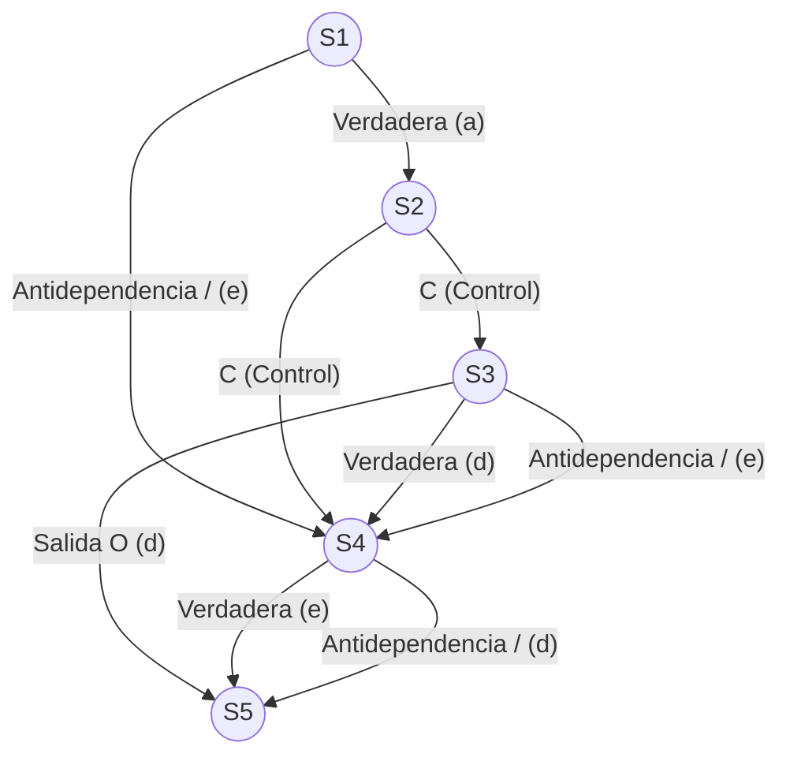

**Leyenda de símbolos en las aristas del grafo original:**
- **Flecha simple (`→`):** Dependencia verdadera (`S1 → S2`, `S3 → S4`, `S4 → S5`).
- **Flecha tachada con barra (`—/→`):** Antidependencia (`S1 → S4`, `S3 → S4`, `S4 → S5`).
- **Flecha con círculo (`—O→`):** Dependencia de salida (`S3 → S5`).
- **Flecha etiquetada con `C`:** Dependencia de control (`S2 → S3`, `S2 → S4`).

*Pie de diapositiva:* Tema 3 | 93

---

## Diapositiva 94: Riesgos entre instrucciones

- **Riesgo o Azar (*Hazard*):**
  - Cuando la existencia de una dependencia produce una ejecución incorrecta de las instrucciones segmentadas.
- **Tipos de riesgos**
  - **Riesgos estructurales:**
    - Derivan de dependencias estructurales
    - Dos instrucciones intentan acceder en el mismo ciclo a la misma unidad funcional: conflicto
    - Una de las instrucciones tiene que esperar a la otra
  - **Riesgos de control:**
    - Derivan de dependencias de control y de saltos incondicionales
    - Consecuencia de la ejecución de instrucciones que modifican el PC: saltos, saltos condicionales, salto subrutina
    - Hasta que no se conoce la dirección de salto y si el salto es efectivo (o no) no se puede buscar la siguiente instrucción
  - **Riesgos de datos:**
    - Derivan de dependencias de datos (verdadera, antidependencia y de salida)
    - Conflictos por el acceso a datos (registros o posiciones de memoria)

*Pie de diapositiva:* Tema 3 | 94

---

## Diapositiva 95: Riesgos estructurales

- Conflictos en los accesos a los recursos del sistema
- Por ejemplo:
  - Accesos simultáneos a la misma memoria
  - Escrituras y lecturas simultáneas en el banco de registros
- **Solución inmediata (barata pero ineficiente)**
  - Detener el flujo de instrucciones hasta que se resuelva el riesgo
  - Se insertan burbujas (*stall*) mientras se resuelve el riesgo
- **Soluciones eficientes (pero más caras):**
  - Usar caches particionadas de datos e instrucciones
  - Aumentar el número de puertos de acceso al banco de registros

*Pie de diapositiva:* Tema 3 | 95

---

**[PAUSA EN DIAPOSITIVA 95 — Escribe "Continúa" para extraer el resto]**