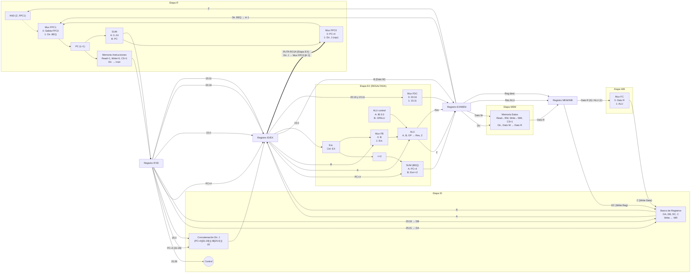
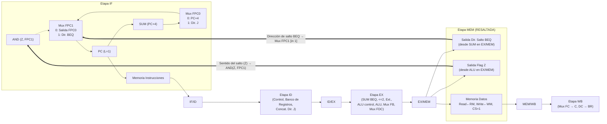
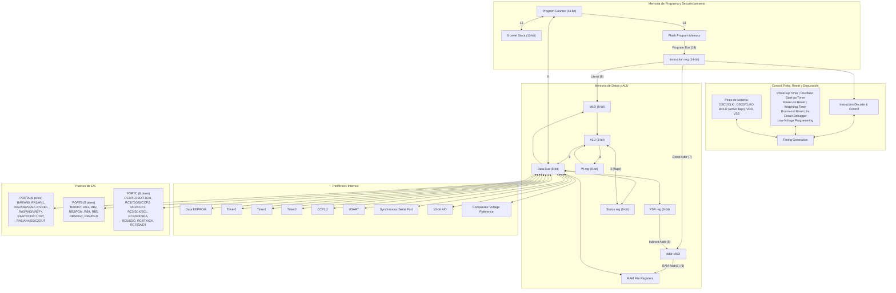

## Diapositiva 96: Riesgos estructurales

- **Acceso simultáneo a la misma memoria**
  - Supongamos que tenemos las caches de instrucciones y datos unificadas
  - La primera instrucción es un `lw` (usa la cache en las fases `IF` y `MEM`)
  - La `IF` de la instrucción $3$ colisiona con el `lw` en el acceso a `MEM` (`CC4`)

**Diagrama temporal del cauce segmentado (conflicto estructural en memoria unificada en `CC 4`):**

| Instrucción | CC 1 | CC 2 | CC 3 | **CC 4 (Conflicto)** | CC 5 | CC 6 | CC 7 | CC 8 |
| :--- | :---: | :---: | :---: | :---: | :---: | :---: | :---: | :---: |
| **`Carga`** | `Mem` | `Reg` | `ALU` | **`Mem` (COLISIÓN)** | `Reg` | | | |
| **`Instr. 1`** | | `Mem` | `Reg` | `ALU` | `Mem` | `Reg` | | |
| **`Instr. 2`** | | | `Mem` | `Reg` | `ALU` | `Mem` | `Reg` | |
| **`Instr. 3`** | | | | **`Mem` (COLISIÓN)** | `Reg` | `ALU` | `Mem` | `Reg` |
| **`Instr. 4`** | | | | | `Mem` | `Reg` | `ALU` | `Mem` |

```wavedrom
{
  "signal": [
    { "name": "Ciclo (Tiempo)", "wave": "=========", "data": ["CC 1", "CC 2", "CC 3", "CC 4", "CC 5", "CC 6", "CC 7", "CC 8", "..."] },
    { "name": "Carga (lw)",     "wave": "===9=....", "data": ["Mem", "Reg", "ALU", "Mem (!)", "Reg"] },
    { "name": "Instr. 1",       "wave": ".=====...", "data": ["Mem", "Reg", "ALU", "Mem", "Reg"] },
    { "name": "Instr. 2",       "wave": "..=====..", "data": ["Mem", "Reg", "ALU", "Mem", "Reg"] },
    { "name": "Instr. 3",       "wave": "...9====.", "data": ["Mem (!)", "Reg", "ALU", "Mem", "Reg"] },
    { "name": "Instr. 4",       "wave": "....=====", "data": ["Mem", "Reg", "ALU", "Mem", "..."] }
  ],
  "foot": {
    "text": "Colisión en CC 4: Carga accede a Mem (etapa MEM) simultáneamente con Instr. 3 (etapa IF)"
  }
}
```

*Detalle visual del diagrama:* Entre cada etapa de cada instrucción se dibujan los registros intermedios de segmentación (barras verticales grises). En la columna `CC 4` (resaltada en un recuadro azul), tanto la etapa `Mem` de `Carga` como la etapa `Mem` de `Instr. 3` están marcadas con un icono rojo de explosión/colisión indicando el conflicto estructural por acceso simultáneo a la misma caché unificada.

*Pie de diapositiva:* Tema 3 | 96

---

## Diapositiva 97: Riesgos estructurales

- **Acceso simultáneo a la misma memoria**
  - **Solución:** Separar en distintas caches las instrucciones y los datos

**Diagrama temporal del cauce segmentado (cachés separadas de datos e instrucciones en `CC 4`):**

| Instrucción | CC 1 | CC 2 | CC 3 | **CC 4 (Sin conflicto)** | CC 5 | CC 6 | CC 7 | CC 8 |
| :--- | :---: | :---: | :---: | :---: | :---: | :---: | :---: | :---: |
| **`Carga`** | `Mem` | `Reg` | `ALU` | **`Mem Data`** | `Reg` | | | |
| **`Instr. 1`** | | `Mem` | `Reg` | `ALU` | `Mem` | `Reg` | | |
| **`Instr. 2`** | | | `Mem` | `Reg` | `ALU` | `Mem` | `Reg` | |
| **`Instr. 3`** | | | | **`Mem Instr.`** | `Reg` | `ALU` | `Mem` | `Reg` |
| **`Instr. 4`** | | | | | `Mem` | `Reg` | `ALU` | `Mem` |

```wavedrom
{
  "signal": [
    { "name": "Ciclo (Tiempo)", "wave": "=========", "data": ["CC 1", "CC 2", "CC 3", "CC 4", "CC 5", "CC 6", "CC 7", "CC 8", "..."] },
    { "name": "Carga (lw)",     "wave": "===5=....", "data": ["Mem", "Reg", "ALU", "Mem Data", "Reg"] },
    { "name": "Instr. 1",       "wave": ".=====...", "data": ["Mem", "Reg", "ALU", "Mem", "Reg"] },
    { "name": "Instr. 2",       "wave": "..=====..", "data": ["Mem", "Reg", "ALU", "Mem", "Reg"] },
    { "name": "Instr. 3",       "wave": "...5====.", "data": ["Mem Instr.", "Reg", "ALU", "Mem", "Reg"] },
    { "name": "Instr. 4",       "wave": "....=====", "data": ["Mem", "Reg", "ALU", "Mem", "..."] }
  ],
  "foot": {
    "text": "Solución en CC 4: Carga accede a Mem Data e Instr. 3 accede a Mem Instr. en paralelo sin colisión"
  }
}
```

*Detalle visual del diagrama:* La columna `CC 4` aparece destacada en azul, con las etiquetas en rojo `Data` dentro del bloque `Mem` de `Carga` e `Instr.` dentro del bloque `Mem` de `Instr. 3`, eliminando la colisión.

*Pie de diapositiva:* Tema 3 | 97

---

## Diapositiva 98: Riesgos estructurales

- **Acceso simultáneo al mismo registro**
  - La instrucción de carga (`lw`) utiliza registro destino `$1`
  - La instrucción $3$ lee el registro `$1`
  - La `ID` de la instrucción $3$ colisiona con el `lw` en `WB` (`CC5`) por acceder ambas a `$1` (dependencia de datos)

**Diagrama temporal del cauce segmentado (conflicto en banco de registros en `CC 5`):**

| Instrucción | CC 1 | CC 2 | CC 3 | CC 4 | **CC 5 (Conflicto)** | CC 6 | CC 7 | CC 8 |
| :--- | :---: | :---: | :---: | :---: | :---: | :---: | :---: | :---: |
| **`Carga`** | `Mem` | `Reg` | `ALU` | `Mem` | **`Reg` (WB - COLISIÓN)** | | | |
| **`Instr. 1`** | | `Mem` | `Reg` | `ALU` | `Mem` | `Reg` | | |
| **`Instr. 2`** | | | `Mem` | `Reg` | `ALU` | `Mem` | `Reg` | |
| **`Instr. 3`** | | | | `Mem` | **`Reg` (ID - COLISIÓN)** | `ALU` | `Mem` | `Reg` |
| **`Instr. 4`** | | | | | `Mem` | `Reg` | `ALU` | `Mem` |

```wavedrom
{
  "signal": [
    { "name": "Ciclo (Tiempo)", "wave": "=========", "data": ["CC 1", "CC 2", "CC 3", "CC 4", "CC 5", "CC 6", "CC 7", "CC 8", "..."] },
    { "name": "Carga (lw)",     "wave": "====9....", "data": ["Mem", "Reg", "ALU", "Mem", "Reg WB (!)"] },
    { "name": "Instr. 1",       "wave": ".=====...", "data": ["Mem", "Reg", "ALU", "Mem", "Reg"] },
    { "name": "Instr. 2",       "wave": "..=====..", "data": ["Mem", "Reg", "ALU", "Mem", "Reg"] },
    { "name": "Instr. 3",       "wave": "...=9===.", "data": ["Mem", "Reg ID (!)", "ALU", "Mem", "Reg"] },
    { "name": "Instr. 4",       "wave": "....=====", "data": ["Mem", "Reg", "ALU", "Mem", "..."] }
  ],
  "foot": {
    "text": "Colisión en CC 5: Carga escribe $1 en WB y simultáneamente Instr. 3 lee $1 en ID"
  }
}
```

*Detalle visual del diagrama:* La columna `CC 5` está recuadrada en azul. Los bloques `Reg` de `Carga` (etapa `WB`) y de `Instr. 3` (etapa `ID`) están marcados con iconos rojos de colisión.

*Pie de diapositiva:* Tema 3 | 98

---

## Diapositiva 99: Riesgos estructurales

- **Acceso simultáneo al mismo registro**
  - **Solución (Anticipación en el banco de registros):** Hacer que la escritura en el banco de registros se realice en la primera mitad del ciclo y la lectura en la segunda.

**Diagrama temporal y detalle de sincronización dentro de `CC 5`:**

| Instrucción | CC 1 | CC 2 | CC 3 | CC 4 | **CC 5 (1.ª mitad \| 2.ª mitad)** | CC 6 | CC 7 | CC 8 |
| :--- | :---: | :---: | :---: | :---: | :---: | :---: | :---: | :---: |
| **`Carga`** | `Mem` | `Reg` | `ALU` | `Mem` | **`Reg` [Escritura (rojo) \| —]** | | | |
| **`Instr. 1`** | | `Mem` | `Reg` | `ALU` | `Mem` | `Reg` | | |
| **`Instr. 2`** | | | `Mem` | `Reg` | `ALU` | `Mem` | `Reg` | |
| **`Instr. 3`** | | | | `Mem` | **`Reg` [— \| Lectura (verde)]** | `ALU` | `Mem` | `Reg` |
| **`Instr. 4`** | | | | | `Mem` | `Reg` | `ALU` | `Mem` |

```wavedrom
{
  "signal": [
    { "name": "CLK (CC 5)", "wave": "0.p.n.", "period": 1 },
    { "name": "Carga (WB)", "wave": "..9.x.", "data": ["Escritura BR"] },
    { "name": "Instr. 3 (ID)", "wave": "..x.3.", "data": ["Lectura BR"] }
  ],
  "foot": {
    "text": "Flanco de subida (mitad de CC 5): Escritura en el banco de registros | Flanco de bajada (fin de CC 5): Escritura en los registros de estado de la segmentación"
  }
}
```

*Detalle visual del diagrama:*
- En `CC 5` (recuadro azul), la primera mitad izquierda del bloque `Reg` de `Carga` aparece sombreada en **rojo** (escritura en el banco de registros) y la segunda mitad derecha del bloque `Reg` de `Instr. 3` aparece sombreada en **verde** (lectura del dato recién escrito). Una flecha verde apunta desde la mitad izquierda de `Carga` (`Reg`) hacia la mitad derecha de `Instr. 3` (`Reg`).
- Debajo del ciclo `CC 5` se dibuja un pulso de reloj (nivel bajo en la primera mitad, flanco ascendente en el centro del ciclo, nivel alto en la segunda mitad, flanco descendente al final del ciclo):
  - Flecha verde al flanco de subida (centro de `CC 5`): **Escritura en el banco de registros**.
  - Flecha verde al flanco de bajada (final de `CC 5`): **Escritura en los registros de estado de la segmentación**.

*Pie de diapositiva:* Tema 3 | 99

---

## Diapositiva 100: Riesgos de control

- Los saltos determinan el flujo de control
  - La carga de una instrucción depende de la ejecución del salto
  - En la instrucción `J` la dirección de salto se conoce en la etapa `EX`



**Conexiones clave destacadas en la diapositiva:**
- La etapa **`EX`** (entre los registros `ID/EX` y `EX/MEM`) está encerrada en un recuadro verde/azul resaltado.
- **Camino resaltado en rojo:** La dirección objetivo del salto incondicional `J`, formada en la etapa `ID` mediante la concatenación `(PC+4)[31:28] || IB[25:0] || 00` y almacenada en el registro `ID/EX`, sale al inicio de la etapa **`EX`** y se realimenta directamente a la entrada `1` de `Mux FPC0` para actualizar `PC`. Por ello, la dirección de salto de `J` está disponible en la etapa `EX`.

*Pie de diapositiva:* Tema 3 | 100

---

## Diapositiva 101: Riesgos de control

- Los saltos determinan el flujo de control
  - En la instrucción `BEQ` la dirección de salto se conoce en la etapa `MEM`
  - El sentido del salto también se conoce en la etapa `MEM`



**Conexiones clave destacadas en la diapositiva:**
- Se utiliza la misma ruta de datos segmentada de la Diapositiva 100, resaltando ahora la etapa **`MEM`** (entre `EX/MEM` y `MEM/WB`).
- Tanto la **dirección de salto** (calculada por el sumador `SUM` en `EX` y registrada en `EX/MEM`) como el **sentido del salto** (bandera `Z` calculada por la `ALU` en `EX` y registrada en `EX/MEM`) salen del registro `EX/MEM` durante la etapa **`MEM`** para realimentar respectivamente la entrada `1` de `Mux FPC1` y la puerta `AND` (`Z`, `FPC1`) que controla dicho multiplexor.

*Pie de diapositiva:* Tema 3 | 101

---

## Diapositiva 102: Riesgos de control

- **Instrucción `J dir` (resolución en `EX`)**
  - Después de la instrucción `J` se debe cargar la instrucción de la posición `dir`
  - Han entrado $2$ instrucciones posteriores a `J` antes de cargar la de la posición `dir`

**Diagrama temporal de ejecución en el cauce segmentado:**

| Instrucción | CC1 | CC2 | CC3 | CC4 | CC5 | CC6 | CC7 | CC8 | CC9 |
| :--- | :---: | :---: | :---: | :---: | :---: | :---: | :---: | :---: | :---: |
| **`i: J dir`** | `MI` | `Reg` | **`ALU` (EX)** | `M` | `Reg` | | | | |
| **`i+1: ..`** *(errónea)* | | `MI` | `Reg` | `ALU` | `MD` | `Reg` | | | |
| **`i+2: ..`** *(errónea)* | | | `MI` | `Reg` | `ALU` | `MD` | `Reg` | | |
| **`dir: ..`** *(destino)* | | | | **`MI`** | `Reg` | `ALU` | `MD` | `Reg` | |
| **`dir+1:..`** | | | | | `MI` | `Reg` | `ALU` | `MD` | `Reg` |

```wavedrom
{
  "signal": [
    { "name": "Ciclo (tiempo)", "wave": "=========", "data": ["CC1", "CC2", "CC3", "CC4", "CC5", "CC6", "CC7", "CC8", "CC9"] },
    { "name": "i: J dir",       "wave": "==5==....", "data": ["MI", "Reg", "ALU (EX)", "M", "Reg"] },
    { "name": "i+1: ..",        "wave": ".9====...", "data": ["MI", "Reg", "ALU", "MD", "Reg"] },
    { "name": "i+2: ..",        "wave": "..9====..", "data": ["MI", "Reg", "ALU", "MD", "Reg"] },
    { "name": "dir: ..",        "wave": "...3====.", "data": ["MI", "Reg", "ALU", "MD", "Reg"] },
    { "name": "dir+1:..",       "wave": "....=====", "data": ["MI", "Reg", "ALU", "MD", "Reg"] }
  ],
  "foot": {
    "text": "J resuelve el salto en EX (CC3) → dir se busca en CC4; i+1 e i+2 ya han entrado en CC2 y CC3"
  }
}
```

*Pie de diapositiva:* Tema 3 | 102

---

## Diapositiva 103: Riesgos de control

- **Instrucción `BEQ $1,$2,desp` (resolución en `MEM`)**
  - Después de la instrucción `BEQ` se ejecutará la `i+1` o la `i+1+desp`
  - En caso de tomar el salto han entrado $3$ instrucciones posteriores a `BEQ` antes de cargar la de la posición `i+1+desp`

**Diagrama temporal de ejecución en el cauce segmentado:**

| Instrucción | CC1 | CC2 | CC3 | CC4 | CC5 | CC6 | CC7 | CC8 | CC9 |
| :--- | :---: | :---: | :---: | :---: | :---: | :---: | :---: | :---: | :---: |
| **`i: beq`** | `MI` | `Reg` | `ALU` | **`M` (MEM)** | `Reg` | | | | |
| **`i+1: ..`** *(errónea)* | | `MI` | `Reg` | `ALU` | `MD` | `Reg` | | | |
| **`i+2: ..`** *(errónea)* | | | `MI` | `Reg` | `ALU` | `MD` | `Reg` | | |
| **`i+3: ..`** *(errónea)* | | | | `MI` | `Reg` | `ALU` | `MD` | `Reg` | |
| **`i+1+desp:..`** *(destino)* | | | | | **`MI`** | `Reg` | `ALU` | `MD` | `Reg` |

```wavedrom
{
  "signal": [
    { "name": "Ciclo (tiempo)", "wave": "=========", "data": ["CC1", "CC2", "CC3", "CC4", "CC5", "CC6", "CC7", "CC8", "CC9"] },
    { "name": "i: beq",         "wave": "===5=....", "data": ["MI", "Reg", "ALU", "M (MEM)", "Reg"] },
    { "name": "i+1: ..",        "wave": ".9====...", "data": ["MI", "Reg", "ALU", "MD", "Reg"] },
    { "name": "i+2: ..",        "wave": "..9====..", "data": ["MI", "Reg", "ALU", "MD", "Reg"] },
    { "name": "i+3: ..",        "wave": "...9====.", "data": ["MI", "Reg", "ALU", "MD", "Reg"] },
    { "name": "i+1+desp:..",    "wave": "....3====", "data": ["MI", "Reg", "ALU", "MD", "Reg"] }
  ],
  "foot": {
    "text": "BEQ resuelve el salto en MEM (CC4) → i+1+desp se busca en CC5; i+1, i+2 e i+3 ya entraron en CC2–CC4"
  }
}
```

*Pie de diapositiva:* Tema 3 | 103

---

## Diapositiva 104: Riesgos de control

- **Soluciones**
  - **Solución Software: NOPs**
    - Insertar instrucciones `NOPs` detrás de las instrucciones de salto (programador o compilador)
      - $2$ `NOPs` tras un `J`
      - $3$ `NOPs` tras un `BEQ`
    - **Instrucción `NOP`:** Instrucción que no hace nada
      - Formato instrucción: $32$ bits a $0$
      - Señales de control: todas a $0$

**Ejemplo tras `J` ($2$ `nop`):**

```mips
add $3, $4, $5
lw $6, 0($7)
j dir
nop
nop
sub $3, $3, $1
```

**Ejemplo tras `BEQ` ($3$ `nop`):**

```mips
add $3, $4, $5
lw $6, 0($7)
beq $1,$2,desp
nop
nop
nop
sub $3, $3, $1
```

*Pie de diapositiva:* Tema 3 | 104

---

## Diapositiva 105: Riesgos de control

- **Soluciones**
  - **Solución Software: Salto retardado**
    - Pasar instrucciones independientes anteriores al salto tras el mismo
    - No siempre es posible por las dependencias

**Transformación ejemplo `J` (con `NOPs` $\rightarrow$ con salto retardado):**

```mips
# Con NOPs:
add $3, $4, $5
lw $6, 0($7)
j dir
nop
nop
sub $3, $3, $1
```

$\longrightarrow$

```mips
# Con salto retardado:
j dir
add $3, $4, $5
lw $6, 0($7)
sub $3, $3, $1
```

**Transformación ejemplo `BEQ` (con `NOPs` $\rightarrow$ con salto retardado):**

```mips
# Con NOPs:
add $3, $4, $5
lw $6, 0($7)
beq $1,$2,desp
nop
nop
nop
sub $3, $3, $1
```

$\longrightarrow$

```mips
# Con salto retardado:
beq $1,$2,desp
add $3, $4, $5
lw $6, 0($7)
nop
sub $3, $3, $1
```

*Pie de diapositiva:* Tema 3 | 105

---

## Diapositiva 106: Riesgos de control

- **Soluciones**
  - **Soluciones Hardware:** ni el programador ni el compilador se tienen que preocupar
    - Parar el cauce segmentado (actualización de `PC`) $2$ o $3$ ciclos según el salto
      - No mejora el rendimiento (la espera la realiza el HW)
    - Modificar el hardware para adelantar la etapa de resolución de los saltos
      - Como mucho a la etapa `ID`
      - Puede afectar al tiempo de ciclo al meter nuevos retardos en la etapa `ID` (junto con los de control)
      - Mejora el rendimiento pues reduce los ciclos de espera
    - Predictores de saltos

*Pie de diapositiva:* Tema 3 | 106

---

## Diapositiva 107: Riesgos de datos

- Derivados de dependencias de datos
- **Dependencia verdadera $\rightarrow$ Riesgo RAW (*Read After Write*)**
  - Una instrucción $j$ intenta leer un operando que va a ser modificado por una instrucción previa $i$
  ```mips
  add $3, $4, $5
  lw $6, 0($3)
  ```
- **Antidependencia $\rightarrow$ Riesgo WAR (*Write After Read*)**
  - Una instrucción $j$ intenta escribir un destino antes de que éste sea leído por una instrucción previa $i$.
  ```mips
  lw $6, 0($3)
  add $3, $4, $5
  ```
- **Dependencia de salida $\rightarrow$ Riesgo WAW (*Write After Write*)**
  - Una instrucción $j$ intenta escribir un operando antes de que sea escrito por una instrucción previa $i$.
  ```mips
  add $6, $4, $5
  lw $6, 0($3)
  ```

*Pie de diapositiva:* Tema 3 | 107

---

## Diapositiva 108: Riesgos de datos

- **Dependencia verdadera (RAW)**
  - La dependencia atrás en el tiempo causa el riesgo (*hazard*)

**Diagrama temporal de riesgo RAW sobre el registro `$1`:**

| Instrucción | CC1 | CC2 | CC3 | CC4 | CC5 | CC6 | CC7 | CC8 | CC9 | Observación |
| :--- | :---: | :---: | :---: | :---: | :---: | :---: | :---: | :---: | :---: | :--- |
| **`add $1…, lw $1 …`** | `MI` | `Reg` | `ALU` | `M` | **`Reg` (WB `$1`)** | | | | | Escribe `$1` en `CC5` |
| **`sub $4, $1, $5`** | | `MI` | **`Reg` (ID `$1`)** | `ALU` | `MD` | `Reg` | | | | **Lee valor incorrecto de `$1`** (hacia atrás desde CC5 a CC3) |
| **`and $6, $1, $7`** | | | `MI` | **`Reg` (ID `$1`)** | `ALU` | `MD` | `Reg` | | | **Lee valor incorrecto de `$1`** (hacia atrás desde CC5 a CC4) |
| **`or $8, $1, $9`** | | | | `MI` | `Reg` (ID `$1`) | `ALU` | `MD` | `Reg` | | Lee en 2.ª mitad de `CC5` (correcto) |
| **`addi $4, $1, 10`** | | | | | `MI` | `Reg` (ID `$1`) | `ALU` | `MD` | `Reg` | Lee en `CC6` (correcto) |

```wavedrom
{
  "signal": [
    { "name": "Ciclo (tiempo)",  "wave": "=========", "data": ["CC1", "CC2", "CC3", "CC4", "CC5", "CC6", "CC7", "CC8", "CC9"] },
    { "name": "add $1 / lw $1",  "wave": "====5....", "data": ["MI", "Reg", "ALU", "M", "Reg (WB)"] },
    { "name": "sub $4, $1, $5",  "wave": ".=9===...", "data": ["MI", "Reg (!)", "ALU", "MD", "Reg"] },
    { "name": "and $6, $1, $7",  "wave": "..=9===..", "data": ["MI", "Reg (!)", "ALU", "MD", "Reg"] },
    { "name": "or $8, $1, $9",   "wave": "...=3===.", "data": ["MI", "Reg (OK)", "ALU", "MD", "Reg"] },
    { "name": "addi $4, $1, 10", "wave": "....=3===", "data": ["MI", "Reg (OK)", "ALU", "MD", "Reg"] }
  ],
  "foot": {
    "text": "Leen valor incorrecto del registro $1: sub (en CC3) y and (en CC4), antes de que WB escriba $1 en CC5"
  }
}
```

*Anotación destacada en la diapositiva:* **Leen valor incorrecto del registro `$1`** *(señalando la lectura en `CC3` de `sub $4, $1, $5` y en `CC4` de `and $6, $1, $7` respecto a la escritura `Reg` en `CC5` de `add $1…, lw $1 …`).*

*Pie de diapositiva:* Tema 3 | 108

---

## Diapositiva 109: Riesgos de datos

- **Soluciones a la dependencias RAW**
  - **Soluciones software: NOPs**
    - Insertar instrucciones `NOPs` para evitar el riesgo (programador o compilador)
    - Se pierden tantos ciclos como `NOPs` insertados

**Diagrama temporal tras insertar $2$ instrucciones `nop`:**

| Instrucción | CC1 | CC2 | CC3 | CC4 | CC5 | CC6 | CC7 | CC8 | CC9 |
| :--- | :---: | :---: | :---: | :---: | :---: | :---: | :---: | :---: | :---: |
| **`add $1…, lw $1 …`** | `MI` | `Reg` | `ALU` | `M` | **`Reg` (WB `$1`)** | | | | |
| **`nop`** | | `MI` | `Reg` | `ALU` | `MD` | `Reg` | | | |
| **`nop`** | | | `MI` | `Reg` | `ALU` | `MD` | `Reg` | | |
| **`sub $4, $1, $5`** | | | | `MI` | **`Reg` (ID `$1`)** | `ALU` | `MD` | `Reg` | |
| **`and $6, $1, $7`** | | | | | `MI` | **`Reg` (ID `$1`)** | `ALU` | `MD` | `Reg` |

```wavedrom
{
  "signal": [
    { "name": "Ciclo (tiempo)", "wave": "=========", "data": ["CC1", "CC2", "CC3", "CC4", "CC5", "CC6", "CC7", "CC8", "CC9"] },
    { "name": "add $1 / lw $1", "wave": "====5....", "data": ["MI", "Reg", "ALU", "M", "Reg (WB)"] },
    { "name": "nop",            "wave": ".=====...", "data": ["MI", "Reg", "ALU", "MD", "Reg"] },
    { "name": "nop",            "wave": "..=====..", "data": ["MI", "Reg", "ALU", "MD", "Reg"] },
    { "name": "sub $4, $1, $5", "wave": "...=3===.", "data": ["MI", "Reg (ID)", "ALU", "MD", "Reg"] },
    { "name": "and $6, $1, $7", "wave": "....=3===", "data": ["MI", "Reg (ID)", "ALU", "MD", "Reg"] }
  ],
  "foot": {
    "text": "Con 2 NOPs, sub lee $1 en CC5 (2.ª mitad) tras escribirse en CC5 (1.ª mitad), y and lee en CC6"
  }
}
```

*Pie de diapositiva:* Tema 3 | 109

---

## Diapositiva 110: Riesgos de datos

- **Soluciones a la dependencias RAW**
  - **Soluciones software: Reordenar el código (planificación SW)**
    - Consiste en insertar instrucciones del código entre las instrucciones que provocan riesgos
      - Las instrucciones se pueden cambiar de orden si no dependen entre si
      - **Ventaja:** si lo consigues $\rightarrow$ ya no pierdes ciclos de reloj
      - **Inconveniente:** el compilador (o programador) tiene que hacer el trabajo
    - **Ejemplo de planificación SW:**
      - La instrucción `add` no depende de las instrucciones `lw` y `slt`
        - Se pueden cambiar de orden con el `add` sin modificar la semántica del programa
      - La instrucción `slt` sí depende de `lw` así que no se pueden cambiar de orden
    - El compilador no siempre encuentra instr. independientes para insertar
      - En ese caso y a falta de soluciones HW, hay que introducir `nops`

**Código original vs. código reordenado:**

```mips
# Código original (riesgo RAW en r2 entre add y sub):
lw r7,10(r6)
slt r6,r4,r3
add r2,r3,r4
sub r1,r2,r5
```

$\longrightarrow$

```mips
# Código reordenado (add se adelanta por encima de lw y slt):
add r2,r3,r4
lw r7,10(r6)
slt r6,r4,r3
sub r1,r2,r5
```

*Pie de diapositiva:* Tema 3 | 110

---

## Diapositiva 111: Riesgos de datos

- **Soluciones a la dependencias RAW**
  - **Soluciones hardware: Detención:**
    - Detener la ejecución uno o más ciclos hasta que se resuelva el riesgo
    - Pérdida de ciclos de reloj
    - Implica la implementación de una lógica para insertar burbujas ($\cong$ NOPs hardware)
  - **Soluciones hardware: Anticipación**
    - Implementar adelantamientos o cortocircuitos (*forwarding* o *bypassing*)
    - Anticipar el resultado que produce una etapa en una instrucción a otra etapa que consume ese resultado para otra instrucción
      - No hay por qué esperar hasta que un resultado se escribe en el banco de registros
      - En cuanto está disponible se puede adelantar (anticipar) a la etapa que lo necesita
    - Reduce la pérdida de ciclos

*Pie de diapositiva:* Tema 3 | 111

---

## Diapositiva 112: Riesgos de datos

- **Antidependencia (WAR)**
  - No provocan riesgos en la ejecución de instrucciones MIPS
  - Aunque exista una antidependencia entre dos instrucciones $i$ y $j$
    - La instrucción $i$ siempre lee sus operandos antes de que $j$ escriba
    - **Operandos en registros:** $i$ lee de `r1` y $j$ escribe en `r1`.
      - La instrucción $i$ lee en `ID` y $j$ escribe en `WB` cuatro ciclos más tarde
    - **Operandos en memoria:**
      - $i$ es un `lw` de una posición de memoria y $j$ es un `sw` que escribe en la misma posición
      - Aunque hay una antidependencia entre $i$ y $j$, no hay riesgo porque $i$ lee primero y $j$ escribe luego
  - En otras arquitecturas si pueden aparecer riesgos WAR
    - Si se permiten escrituras al comienzo del cauce y lecturas al final
    - En arquitecturas con ejecución fuera de orden

**Ejemplos de antidependencia WAR sin riesgo en MIPS:**

```mips
# Operandos en registros (r1):
add r3, r1, r2
sub r1, r5, r2
```

```mips
# Operandos en memoria (4(r1)):
lw r3, 4(r1)
sw 4(r1), r5
```

**Alineación temporal en el cauce:**

| Instrucción | CC1 | CC2 | CC3 | CC4 | CC5 | CC6 |
| :---: | :---: | :---: | :---: | :---: | :---: | :---: |
| **`i`** | `IF` | **`ID`** *(lee reg)* | `EX` | **`MEM`** *(lee mem)* | `WB` | |
| **`j`** | | `IF` | `ID` | `EX` | **`MEM`** *(escribe mem)* | **`WB`** *(escribe reg)* |

*Pie de diapositiva:* Tema 3 | 112

---

## Diapositiva 113: Riesgos de datos

- **Dependencias de salida (WAW)**
  - No producen riesgos en la ejecución de instrucciones en el MIPS
  - Aunque exista dependencia de salida entre $i$ y $j$
    - Las escrituras de $i$ y $j$ se realizan en orden (primero $i$ y luego $j$)

**Ejemplo de dependencia de salida WAW sin riesgo en MIPS:**

```mips
add r1, r3, r2
sub r1, r5, r2
```

**Alineación temporal en el cauce:**

| Instrucción | CC1 | CC2 | CC3 | CC4 | CC5 | CC6 |
| :---: | :---: | :---: | :---: | :---: | :---: | :---: |
| **`i`** | `IF` | `ID` | `EX` | `MEM` | **`WB`** *(escribe `r1` primero)* | |
| **`j`** | | `IF` | `ID` | `EX` | `MEM` | **`WB`** *(escribe `r1` después)* |

*Pie de diapositiva:* Tema 3 | 113

---

## Diapositiva 114: TIEMPO DE EJECUCION DE UN PROGRAMA EN UN CAUCE SEGMENTADO

# TIEMPO DE EJECUCION DE UN PROGRAMA EN UN CAUCE SEGMENTADO

*Pie de diapositiva:* Tema 3 | 114

---

## Diapositiva 115: Transformación del código

- Transformamos el código inicial para que pueda ejecutarse sin riesgos en un cauce segmentado
  - No se usa ningún tipo de solución hardware de los riesgos

**Paso 1: Reordenar** *(se desplaza `lw $2,0($1)` tras `lw $3` y `lw $4` para eliminar el riesgo RAW sobre `$1`)*

```mips
# Código inicial:
      lw $1,desp($0)
      lw $2,0($1)
      lw $3,desp2($0)
      lw $4,desp3($0)
loop: beq $3,$4,exit
      lw $4,0($2)
      sw $4,0($1)
      addi $2, $2, 4
      addi $1, $1, 4
      j loop
exit: ...
```

$\xrightarrow{\text{Reordenar}}$

```mips
# Tras reordenar:
      lw $1,desp($0)
      lw $3,desp2($0)
      lw $4,desp3($0)
      lw $2,0($1)
loop: beq $3,$4,exit
      lw $4,0($2)
      sw $4,0($1)
      addi $2, $2, 4
      addi $1, $1, 4
      j loop
exit: ...
```

*Pie de diapositiva:* Tema 3 | 115

---

## Diapositiva 116: Transformación del código

- Transformamos el código inicial para que pueda ejecutarse sin riesgos en un cauce segmentado
  - No se usa ningún tipo de solución hardware de los riesgos

**Paso 2: Insertar NOP** *(se inserta un `nop` antes de `loop: beq $3,$4,exit` para completar los $2$ ciclos de separación por riesgo RAW sobre `$4` desde `lw $4,desp3($0)`)*

```mips
# Estado tras Paso 1 (Reordenar):
      lw $1,desp($0)
      lw $3,desp2($0)
      lw $4,desp3($0)
      lw $2,0($1)
loop: beq $3,$4,exit
      lw $4,0($2)
      sw $4,0($1)
      addi $2, $2, 4
      addi $1, $1, 4
      j loop
exit: ...
```

$\xrightarrow{\text{Insertar NOP}}$

```mips
# Tras insertar NOP:
      lw $1,desp($0)
      lw $3,desp2($0)
      lw $4,desp3($0)
      lw $2,0($1)
      nop
loop: beq $3,$4,exit
      lw $4,0($2)
      sw $4,0($1)
      addi $2, $2, 4
      addi $1, $1, 4
      j loop
exit: ...
```

*Pie de diapositiva:* Tema 3 | 116

---

## Diapositiva 117: Transformación del código

- Transformamos el código inicial para que pueda ejecutarse sin riesgos en un cauce segmentado
  - No se usa ningún tipo de solución hardware de los riesgos

**Paso 3: Insertar NOPs** *(se insertan $3$ `nop` tras `beq $3,$4,exit` por riesgo de control al resolverse `BEQ` en etapa `MEM`)*

```mips
# Estado tras Paso 2:
      lw $1,desp($0)
      lw $3,desp2($0)
      lw $4,desp3($0)
      lw $2,0($1)
      nop
loop: beq $3,$4,exit
      lw $4,0($2)
      sw $4,0($1)
      addi $2, $2, 4
      addi $1, $1, 4
      j loop
exit: ...
```

$\xrightarrow{\text{Insertar NOPs}}$

```mips
# Tras insertar 3 NOPs tras beq:
      lw $1,desp($0)
      lw $3,desp2($0)
      lw $4,desp3($0)
      lw $2,0($1)
      nop
loop: beq $3,$4,exit
      nop
      nop
      nop
      lw $4,0($2)
      sw $4,0($1)
      addi $2, $2, 4
      addi $1, $1, 4
      j loop
exit: ...
```

*Pie de diapositiva:* Tema 3 | 117

---

## Diapositiva 118: Transformación del código

- Transformamos el código inicial para que pueda ejecutarse sin riesgos en un cauce segmentado
  - No se usa ningún tipo de solución hardware de los riesgos

**Paso 4: Insertar NOPs** *(se insertan $2$ `nop` entre `lw $4,0($2)` y `sw $4,0($1)` para resolver el riesgo RAW sobre `$4`)*

```mips
# Estado tras Paso 3:
      lw $1,desp($0)
      lw $3,desp2($0)
      lw $4,desp3($0)
      lw $2,0($1)
      nop
loop: beq $3,$4,exit
      nop
      nop
      nop
      lw $4,0($2)
      sw $4,0($1)
      addi $2, $2, 4
      addi $1, $1, 4
      j loop
exit: ...
```

$\xrightarrow{\text{Insertar NOPs}}$

```mips
# Tras insertar 2 NOPs tras lw $4,0($2):
      lw $1,desp($0)
      lw $3,desp2($0)
      lw $4,desp3($0)
      lw $2,0($1)
      nop
loop: beq $3,$4,exit
      nop
      nop
      nop
      lw $4,0($2)
      nop
      nop
      sw $4,0($1)
      addi $2, $2, 4
      addi $1, $1, 4
      j loop
exit: ...
```

*Pie de diapositiva:* Tema 3 | 118

---

## Diapositiva 119: Transformación del código

- Transformamos el código inicial para que pueda ejecutarse sin riesgos en un cauce segmentado
  - No se usa ningún tipo de solución hardware de los riesgos

**Paso 5: Reordenar (Salto retardado)** *(se adelanta `j loop` colocando las $2$ instrucciones `addi` en los $2$ huecos de retardo del salto incondicional `J`)*

```mips
# Estado tras Paso 4:
      lw $1,desp($0)
      lw $3,desp2($0)
      lw $4,desp3($0)
      lw $2,0($1)
      nop
loop: beq $3,$4,exit
      nop
      nop
      nop
      lw $4,0($2)
      nop
      nop
      sw $4,0($1)
      addi $2, $2, 4
      addi $1, $1, 4
      j loop
exit: ...
```

$\xrightarrow{\text{Reordenar (Salto retardado)}}$

```mips
# Código final con salto retardado:
      lw $1,desp($0)
      lw $3,desp2($0)
      lw $4,desp3($0)
      lw $2,0($1)
      nop
loop: beq $3,$4,exit
      nop
      nop
      nop
      lw $4,0($2)
      nop
      nop
      sw $4,0($1)
      j loop
      addi $2, $2, 4
      addi $1, $1, 4
exit: ...
```

*Pie de diapositiva:* Tema 3 | 119

---

## Diapositiva 120: Transformación del código

- Transformamos el código inicial para que pueda ejecutarse sin riesgos en un cauce segmentado
  - No se usa ningún tipo de solución hardware de los riesgos

**Comparación entre el código inicial y el código transformado:**

```mips
# Código inicial (anotación al pie: 10725 u.t.):
      lw $1,desp($0)
      lw $2,0($1)
      lw $3,desp2($0)
      lw $4,desp3($0)
loop: beq $3,$4,exit
      lw $4,0($2)
      sw $4,0($1)
      addi $2, $2, 4
      addi $1, $1, 4
      j loop
exit: ...
```

```mips
# Código transformado para el cauce segmentado:
      lw $1,desp($0)
      lw $3,desp2($0)
      lw $4,desp3($0)
      lw $2,0($1)
      nop
loop: beq $3,$4,exit
      nop
      nop
      nop
      lw $4,0($2)
      nop
      nop
      sw $4,0($1)
      j loop
      addi $2, $2, 4
      addi $1, $1, 4
exit: ...
```

*Anotación numérica bajo el código inicial:* $10725\text{ u.t.}$

*Pie de diapositiva:* Tema 3 | 120

---

## Diapositiva 121: Tiempo de ejecución

- Tiempo de ciclo del cauce segmentado: $40\text{ u.t.}$
- Ciclos para llenar el cauce: $4\text{ cc}$
- Una vez lleno el cauce: $1$ instrucción cada ciclo ($1\text{ cc}$)

```mips
      lw $1,desp($0)      # \
      lw $3,desp2($0)     #  |
      lw $4,desp3($0)     #  } 5 instrucciones
      lw $2,0($1)         #  |
      nop                 # /
loop: beq $3,$4,exit      # \
      nop                 #  |
      nop                 #  |
      nop                 #  |
      lw $4,0($2)         #  |
      nop                 #  } 11 instrucciones en el cuerpo del bucle
      nop                 #  |
      sw $4,0($1)         #  |
      j loop              #  |
      addi $2, $2, 4      #  |
      addi $1, $1, 4      # /
exit: ...
```

**Conteo de instrucciones y cálculo del tiempo de ejecución ($10$ iteraciones):**
- Bloque inicial: $5\text{ instrucciones}$
- Cuerpo del bucle:
  $$11\text{ instr.} \times 10\text{ iteraciones} = 110$$
- Salida del bucle (`BEQ` $+ 3\text{ NOPs}$):
  $$4\text{ inst.} \implies +4$$
  $$\text{Subtotal bucle} = 110 + 4 = 114$$
- **Total de instrucciones ejecutadas:**
  $$5 + 114 = \mathbf{119\text{ instrucciones}}$$
- **Ciclos totales:**
  $$\text{ciclos} = 4\text{ cc} + 119 \times 1\text{ cc} = \mathbf{123\text{ cc}}$$
- **Tiempo total en cauce segmentado:**
  $$\text{tiempo} = 123\text{ cc} \times 40\text{ u.t./cc} = \mathbf{4920\text{ u.t.}}$$
- **Monociclo:** $11050\text{ u.t.}$

*Pie de diapositiva:* Tema 3 | 121

---

## Diapositiva 122: PIC16F87XA — FIGURE 1-1: PIC16F873A/876A BLOCK DIAGRAM

*Encabezado de hoja de datos:* **PIC16F87XA** | `DS39582B-page 6` | `© 2003 Microchip Technology Inc.`

### FIGURE 1-1: PIC16F873A/876A BLOCK DIAGRAM

**Tabla de capacidades de memoria integrada en la figura:**

| Device | Program Flash | Data Memory | Data EEPROM |
| :--- | :---: | :---: | :---: |
| `PIC16F873A` | $4\text{K words}$ | $192\text{ Bytes}$ | $128\text{ Bytes}$ |
| `PIC16F876A` | $8\text{K words}$ | $368\text{ Bytes}$ | $256\text{ Bytes}$ |



**Notas y conexiones clave del diagrama de bloques (`PIC16F873A/876A`):**
- **Note 1:** *Higher order bits are from the Status register.* (Los bits de mayor peso de los $9$ bits de `RAM Addr(1)` provienen del registro `Status reg`).
- **Arquitectura Harvard:** Separa el `Program Bus` de $14$ bits (bus de direcciones de programa de $13$ bits) del `Data Bus` de $8$ bits.
- **Pines de alimentación, reloj y reset:** `OSC1/CLKI`, `OSC2/CLKO`, $\overline{\text{MCLR}}$, `VDD`, `VSS`.
- **Pines multiplexados de `PORTA`:** `RA0/AN0`, `RA1/AN1`, `RA2/AN2/VREF-/CVREF`, `RA3/AN3/VREF+`, `RA4/T0CKI/C1OUT`, `RA5/AN4/$\overline{\text{SS}}$/C2OUT`.
- **Pines multiplexados de `PORTB`:** `RB0/INT`, `RB1`, `RB2`, `RB3/PGM`, `RB4`, `RB5`, `RB6/PGC`, `RB7/PGD`.
- **Pines multiplexados de `PORTC`:** `RC0/T1OSO/T1CKI`, `RC1/T1OSI/CCP2`, `RC2/CCP1`, `RC3/SCK/SCL`, `RC4/SDI/SDA`, `RC5/SDO`, `RC6/TX/CK`, `RC7/RX/DT`.

---

## Diapositiva 123: Section 4. Architecture — 4.2 Clocking Scheme/Instruction Cycle

*Encabezado de hoja de datos:* `© 1997 Microchip Technology Inc.` | `DS31004A-page 4-5` | **Section 4. Architecture** | **Architecture 4**

### 4.2 Clocking Scheme/Instruction Cycle

The clock input (from `OSC1`) is internally divided by four to generate four non-overlapping quadrature clocks, namely `Q1`, `Q2`, `Q3`, and `Q4`. Internally, the program counter (`PC`) is incremented every `Q1`, and the instruction is fetched from the program memory and latched into the instruction register in `Q4`. The instruction is decoded and executed during the following `Q1` through `Q4`. The clocks and instruction execution flow are illustrated in **Figure 4-3**, and **Example 4-1**.

### Figure 4-3: Clock/Instruction Cycle

```wavedrom
{
  "signal": [
    { "name": "OSC1",                "wave": "P...........", "period": 1 },
    ["Internal phase clock",
      { "name": "Q1",                "wave": "10..10..10.." },
      { "name": "Q2",                "wave": "010..10..10." },
      { "name": "Q3",                "wave": "0.10..10..10" },
      { "name": "Q4",                "wave": "0..10..10..1" }
    ],
    { "name": "OSC2/CLKOUT (RC)",    "wave": "0.1.0.1.0.1." },
    { "name": "PC",                  "wave": "=...=...=...", "data": ["PC", "PC+1", "PC+2"] },
    { "name": "Fetch",               "wave": "=...=...=...", "data": ["Fetch INST (PC)", "Fetch INST (PC+1)", "Fetch INST (PC+2)"] },
    { "name": "Execute",             "wave": "=...=...=...", "data": ["Execute INST (PC-1)", "Execute INST (PC)", "Execute INST (PC+1)"] }
  ],
  "foot": {
    "text": "TCY1: Q1–Q4 (PC) | TCY2: Q1–Q4 (PC+1) | TCY3: Q1–Q4 (PC+2)"
  }
}
```

**Descripción detallada de los estados y flancos en `Figure 4-3`:**
- Cada ciclo de instrucción (`TCY1`, `TCY2`, `TCY3`) abarca $4$ ciclos de `OSC1`, divididos en las cuatro fases internas no solapadas en cuadratura (`Internal phase clock`): `Q1`, `Q2`, `Q3`, `Q4`.
- La salida `OSC2/CLKOUT (RC mode)` presenta una frecuencia de $f_{\text{OSC1}} / 4$: nivel bajo durante `Q1` y `Q2`, y nivel alto durante `Q3` y `Q4`.
- **`TCY1` (`PC`):** Se realiza en paralelo `Fetch INST (PC)` y `Execute INST (PC-1)`.
- **`TCY2` (`PC+1`):** En `Q1` se incrementa el `PC` a `PC+1`. Se realiza en paralelo `Fetch INST (PC+1)` y `Execute INST (PC)`.
- **`TCY3` (`PC+2`):** En `Q1` se incrementa el `PC` a `PC+2`. Se realiza en paralelo `Fetch INST (PC+2)` y `Execute INST (PC+1)`.

---

## Diapositiva 124: PICmicro MID-RANGE MCU FAMILY — 4.3 Instruction Flow/Pipelining

*Encabezado de hoja de datos:* **PICmicro MID-RANGE MCU FAMILY** | `DS31004A-page 4-6` | `© 1997 Microchip Technology Inc.`

### 4.3 Instruction Flow/Pipelining

An “Instruction Cycle” consists of four Q cycles (`Q1`, `Q2`, `Q3`, and `Q4`). Fetch takes one instruction cycle while decode and execute takes another instruction cycle. However, due to Pipelining, each instruction effectively executes in one cycle. If an instruction causes the program counter to change (e.g. `GOTO`) then an extra cycle is required to complete the instruction (**Example 4-1**).

The instruction fetch begins with the program counter incrementing in `Q1`.

In the execution cycle, the fetched instruction is latched into the “Instruction Register (`IR`)” in cycle `Q1`. This instruction is then decoded and executed during the `Q2`, `Q3`, and `Q4` cycles. Data memory is read during `Q2` (operand read) and written during `Q4` (destination write).

**Example 4-1** shows the operation of the two stage pipeline for the instruction sequence shown. At time `TCY0`, the first instruction is fetched from program memory. During `TCY1`, the first instruction executes while the second instruction is fetched. During `TCY2`, the second instruction executes while the third instruction is fetched. During `TCY3`, the fourth instruction is fetched while the third instruction (`CALL SUB_1`) is executed. When the third instruction completes execution, the CPU forces the address of instruction four onto the Stack and then changes the Program Counter (`PC`) to the address of `SUB_1`. This means that the instruction that was fetched during `TCY3` needs to be “flushed” from the pipeline. During `TCY4`, instruction four is flushed (executed as a `NOP`) and the instruction at address `SUB_1` is fetched. Finally during `TCY5`, instruction five is executed and the instruction at address `SUB_1 + 1` is fetched.

### Example 4-1: Instruction Pipeline Flow

*All instructions are single cycle, except for any program branches. These take two cycles since the fetch instruction is “flushed” from the pipeline while the new instruction is being fetched and then executed.*

| Instruction | `TCY0` | `TCY1` | `TCY2` | `TCY3` | `TCY4` | `TCY5` |
| :--- | :---: | :---: | :---: | :---: | :---: | :---: |
| `1. MOVLW 55h` | `Fetch 1` | `Execute 1` | | | | |
| `2. MOVWF PORTB` | | `Fetch 2` | `Execute 2` | | | |
| `3. CALL SUB_1` | | | `Fetch 3` | `Execute 3` | | |
| `4. BSF PORTA, BIT3 (Forced NOP)` | | | | `Fetch 4` | `Flush` | |
| `5. Instruction @ address SUB_1` | | | | | `Fetch SUB_1` | `Execute SUB_1` |
| *(Siguiente instrucción en `SUB_1 + 1`)* | | | | | | `Fetch SUB_1 + 1` |

```wavedrom
{
  "signal": [
    { "name": "Ciclo",           "wave": "======", "data": ["TCY0", "TCY1", "TCY2", "TCY3", "TCY4", "TCY5"] },
    { "name": "1. MOVLW 55h",    "wave": "==....", "data": ["Fetch 1", "Execute 1"] },
    { "name": "2. MOVWF PORTB",  "wave": ".==...", "data": ["Fetch 2", "Execute 2"] },
    { "name": "3. CALL SUB_1",   "wave": "..==..", "data": ["Fetch 3", "Execute 3"] },
    { "name": "4. BSF PORTA,3",  "wave": "...=9.", "data": ["Fetch 4", "Flush (NOP)"] },
    { "name": "5. @ SUB_1",      "wave": "....==", "data": ["Fetch SUB_1", "Execute SUB_1"] },
    { "name": "6. @ SUB_1 + 1",  "wave": ".....=", "data": ["Fetch SUB_1 + 1"] }
  ],
  "foot": {
    "text": "Cauce de 2 etapas del PICmicro: CALL SUB_1 fuerza un ciclo extra (Flush/NOP) en TCY4"
  }
}
```

---

## Diapositiva 125: Bibliografía

- D.A. PATTERSON y J.L. HENNESSY (2014). *Computer Organization and Design: The Hardware/Software Interface*. 5th Edition. Ed. Elsevier
- D.A. PATTERSON y J.L. HENNESSY (2009). *Estructura y diseño de computadores: La interfaz hardware / software*. 4ª edición. Barcelona. Ed. Reverté
  - Capítulos 1 y 2.
- S.L. HARRIS y D.M. HARRIS (2016). *Digital Design and Computer Architecture. ARM Edition*. Ed. Elsevier
  - Capítulo 6.
- G. BANDERA, F.J. CORBERA y OTROS (2000). *Tecnología de computadores*. 1ª edición. Málaga. Servicio de publicaciones de la UMA.
  - Capítulo 2.

*Pie de diapositiva:* Tema 3 | 122 *(página 125 del archivo PDF)*