	## Diapositiva 1: Tema 4 - Organización de la E/S

*Elementos gráficos de portada:*
- Logotipo institucional de la Universidad de Málaga (`ma` / `UNIVERSIDAD DE MÁLAGA`).
- Logotipo del Departamento de Arquitectura de Computadores (`DAC` / `MÁLAGA` / `UNIVERSIDAD`).

**Fundamentos de Computadores**  
**Tema 4**  
**Organización de la E/S**

---

## Diapositiva 2: Contenidos

- Estructura de la E/S
- Interfase y modelo de programación del periférico
- E/S por PIO o DMA
- Papel de las interrupciones en la E/S
- Mecanismos de gestión de interrupciones y DMA

*Pie de página:* Fundamentos de Computadores | Ingeniería Electrónica, Robótica y Mecatrónica | 2

---

## Diapositiva 3: I - Estructura de la E/S

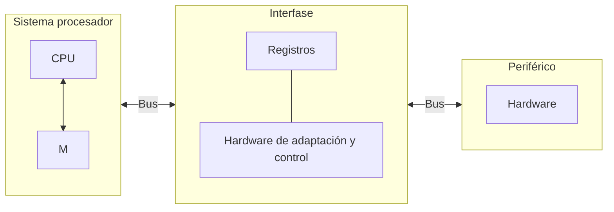

*Detalle de conexiones clave del esquema:*
- Dentro de **Sistema procesador**, la `CPU` y la memoria `M` están interconectadas mediante un bus interno bidireccional.
- Desde dicho bus interno sale un **Bus** bidireccional hacia el bloque **Interfase**, conectando directamente con su sección de `Registros`.
- La **Interfase** se divide en dos bloques adyacentes: `Registros` (lado del sistema procesador) y `Hardware de adaptación y control` (lado del periférico).
- Desde `Hardware de adaptación y control` parte un segundo **Bus** bidireccional hacia el bloque `Hardware` del **Periférico**.

- Organización de la E/S se ajusta siempre a este esquema
- Interfase suele estar integrada en periférico, pero puede ser un dispositivo independiente
- "Sistema procesador" puede ser CPU/Memoria de ordenador, o CPU/Memoria de un dispositivo intermedio (ej: HBA SCSI)

*Pie de página:* Fundamentos de Computadores | Ingeniería Electrónica, Robótica y Mecatrónica | 3

---

## Diapositiva 4: Estructura de la E/S


- "Driver" del dispositivo: software que gestiona y controla la transferencia de datos
  - Corre en el sistema procesador
- Dirección de las transferencias referida a sistema procesador
  - Lectura ($R = \text{Read}$) : Entrada
    - Datos provienen del periférico y entran al sistema procesador
  - Escritura ($W = \text{Write}$) : Salida
    - Datos provienen del sistema procesador y van al periférico

*Pie de página:* Fundamentos de Computadores | Ingeniería Electrónica, Robótica y Mecatrónica | 4

---

## Diapositiva 5: Estructura de la E/S


*Detalle de direcciones de transferencia internas:*
- **Registros de entrada de datos:** Reciben datos unidireccionalmente desde el bus del periférico y los entregan unidireccionalmente al bus del sistema procesador.
- **Registros de estado:** Entregan información unidireccionalmente hacia el bus del sistema procesador (solo lectura desde la CPU).
- **Registros de control:** Reciben valores unidireccionalmente desde el bus del sistema procesador (escritura desde la CPU).
- **Registros de salida de datos:** Reciben datos unidireccionalmente desde el bus del sistema procesador y los envían unidireccionalmente hacia el bus del periférico.

- Organización típica de registros de la interfase

*Pie de página:* Fundamentos de Computadores | Ingeniería Electrónica, Robótica y Mecatrónica | 5

---

## Diapositiva 6: Estructura de la E/S


- Registros control: Escritura de valores sobre ellos permite el control indirecto del hardware
- Registros estado: Leyendo sus valores obtenemos información actual del estado del periférico

*Pie de página:* Fundamentos de Computadores | Ingeniería Electrónica, Robótica y Mecatrónica | 6

---

## Diapositiva 7: Estructura de la E/S

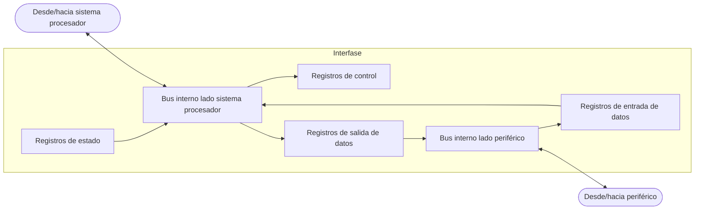

- Registros entrada datos: Hardware que alberga temporalmente los datos entregados desde el periférico
  - Puede ser un único registro, o un buffer RAM con múltiples posiciones
- Registros salida datos: Hardware que alberga temporalmente los datos enviados hacia el periférico
  - Puede ser un único registro, o un buffer RAM con múltiples posiciones

*Pie de página:* Fundamentos de Computadores | Ingeniería Electrónica, Robótica y Mecatrónica | 7

---

## Diapositiva 8: Modelo de programación del periférico

- Es la descripción completa de:
  - Los registros que componen la interfase
    - Su organización y estructura
  - El conjunto de comandos y parámetros que acepta la interfase
    - Su temporización y las condiciones de error

*Pie de página:* Fundamentos de Computadores | Ingeniería Electrónica, Robótica y Mecatrónica | 8

---

## Diapositiva 9: FIGURE 1-2: PIC16F874 AND PIC16F877 BLOCK DIAGRAM

| Device | Program FLASH | Data Memory | Data EEPROM |
| :--- | :--- | :--- | :--- |
| PIC16F874 | 4K | 192 Bytes | 128 Bytes |
| PIC16F877 | 8K | 368 Bytes | 256 Bytes |

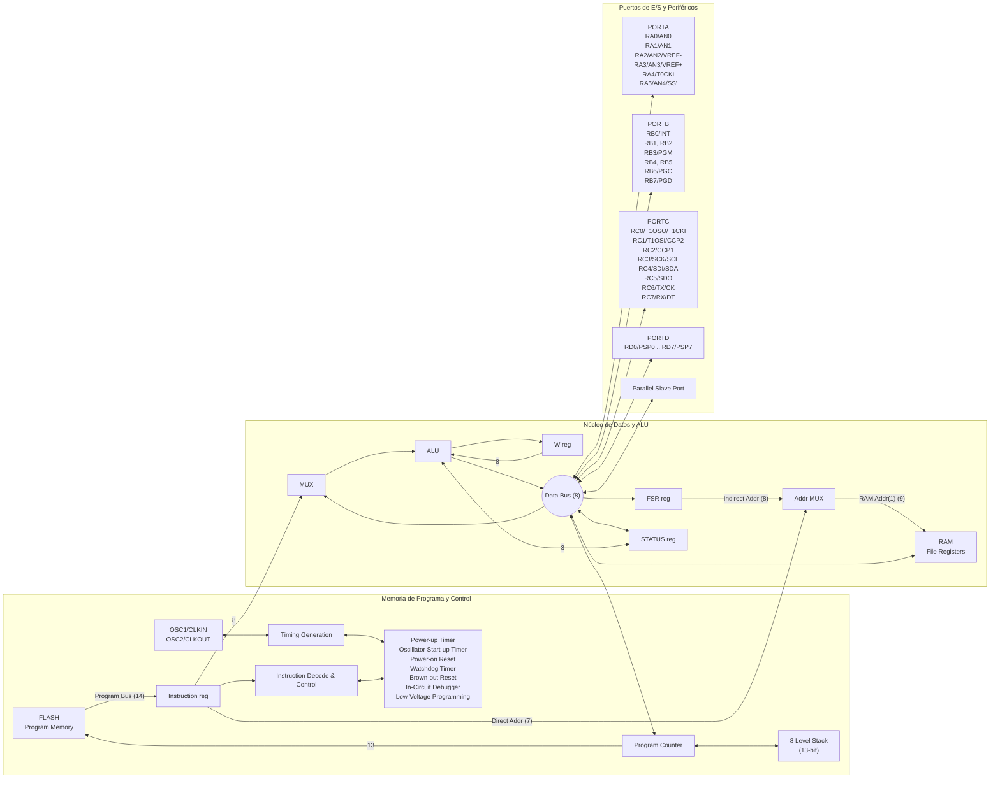

*Detalle completo de conexiones, anchos de bus y pines del diagrama de bloques:*
- **Ruta de programa:**
  - `Program Counter` envía una dirección de $13\text{ bits}$ hacia `FLASH Program Memory` e intercambia direcciones bidireccionalmente con `8 Level Stack (13-bit)`.
  - `FLASH Program Memory` entrega instrucciones de $14\text{ bits}$ por el `Program Bus` hacia `Instruction reg`.
  - Desde `Instruction reg` salen tres rutas:
    1. Hacia `Instruction Decode & Control`.
    2. `Direct Addr` de $7\text{ bits}$ hacia el multiplexor `Addr MUX`.
    3. Bus de $8\text{ bits}$ (literales) hacia el `MUX` de entrada de la `ALU`.
- **Direccionamiento de RAM (`RAM File Registers`):**
  - `Addr MUX` selecciona entre `Direct Addr` ($7\text{ bits}$) e `Indirect Addr` ($8\text{ bits}$ desde `FSR reg`) y genera `RAM Addr`$^{ (1)}$ de $9\text{ bits}$ hacia `RAM File Registers`.
- **Bus de datos (`Data Bus` de $8\text{ bits}$):**
  - Interconecta `Program Counter`, `RAM File Registers`, `FSR reg`, `STATUS reg`, la entrada del `MUX` de la `ALU`, la salida de la `ALU`, `Parallel Slave Port`, y los puertos `PORTA`, `PORTB`, `PORTC` y `PORTD`.
- **ALU y registros asociados:**
  - `ALU` recibe un operando desde `MUX` y otro de $8\text{ bits}$ desde `W reg`; intercambia $3\text{ bits}$ de banderas con `STATUS reg` y entrega resultado hacia `W reg` o hacia el `Data Bus`.
- **Reloj y bloques de sistema:**
  - `OSC1/CLKIN` y `OSC2/CLKOUT` conectan con `Timing Generation`, que se comunica bidireccionalmente con la pila de circuitos de temporización, reset y depuración: `Power-up Timer`, `Oscillator Start-up Timer`, `Power-on Reset`, `Watchdog Timer`, `Brown-out Reset`, `In-Circuit Debugger` y `Low-Voltage Programming`.
- **Pines bidireccionales de los puertos:**
  - **PORTA:** `RA0/AN0`, `RA1/AN1`, `RA2/AN2/`$V_{\text{REF-}}$, `RA3/AN3/`$V_{\text{REF+}}$, `RA4/T0CKI`, `RA5/AN4/`$\overline{\text{SS}}$.
  - **PORTB:** `RB0/INT`, `RB1`, `RB2`, `RB3/PGM`, `RB4`, `RB5`, `RB6/PGC`, `RB7/PGD`.
  - **PORTC:** `RC0/T1OSO/T1CKI`, `RC1/T1OSI/CCP2`, `RC2/CCP1`, `RC3/SCK/SCL`, `RC4/SDI/SDA`, `RC5/SDO`, `RC6/TX/CK`, `RC7/RX/DT`.
  - **PORTD:** `RD0/PSP0`, `RD1/PSP1`, `RD2/PSP2`, `RD3/PSP3`, `RD4/PSP4`, `RD5/PSP5`, `RD6/PSP6`, `RD7/PSP7` (asociado al bloque `Parallel Slave Port`).

---

## Diapositiva 10: FIGURE 2-3: PIC16F876A/877A REGISTER FILE MAP

| Register (Bank 0) | File Address | Register (Bank 1) | File Address | Register (Bank 2) | File Address | Register (Bank 3) | File Address |
| :--- | :--- | :--- | :--- | :--- | :--- | :--- | :--- |
| Indirect addr.(*) | `00h` | Indirect addr.(*) | `80h` | Indirect addr.(*) | `100h` | Indirect addr.(*) | `180h` |
| `TMR0` | `01h` | `OPTION_REG` | `81h` | `TMR0` | `101h` | `OPTION_REG` | `181h` |
| `PCL` | `02h` | `PCL` | `82h` | `PCL` | `102h` | `PCL` | `182h` |
| `STATUS` | `03h` | `STATUS` | `83h` | `STATUS` | `103h` | `STATUS` | `183h` |
| `FSR` | `04h` | `FSR` | `84h` | `FSR` | `104h` | `FSR` | `184h` |
| `PORTA` | `05h` | `TRISA` | `85h` | *(vacío)* | `105h` | *(vacío)* | `185h` |
| `PORTB` | `06h` | `TRISB` | `86h` | `PORTB` | `106h` | `TRISB` | `186h` |
| `PORTC` | `07h` | `TRISC` | `87h` | *(vacío)* | `107h` | *(vacío)* | `187h` |
| `PORTD`$^{ (1)}$ | `08h` | `TRISD`$^{ (1)}$ | `88h` | *(vacío)* | `108h` | *(vacío)* | `188h` |
| `PORTE`$^{ (1)}$ | `09h` | `TRISE`$^{ (1)}$ | `89h` | *(vacío)* | `109h` | *(vacío)* | `189h` |
| `PCLATH` | `0Ah` | `PCLATH` | `8Ah` | `PCLATH` | `10Ah` | `PCLATH` | `18Ah` |
| `INTCON` | `0Bh` | `INTCON` | `8Bh` | `INTCON` | `10Bh` | `INTCON` | `18Bh` |
| `PIR1` | `0Ch` | `PIE1` | `8Ch` | `EEDATA` | `10Ch` | `EECON1` | `18Ch` |
| `PIR2` | `0Dh` | `PIE2` | `8Dh` | `EEADR` | `10Dh` | `EECON2` | `18Dh` |
| `TMR1L` | `0Eh` | `PCON` | `8Eh` | `EEDATH` | `10Eh` | Reserved $^{ (2)}$ | `18Eh` |
| `TMR1H` | `0Fh` | *(vacío)* | `8Fh` | `EEADRH` | `10Fh` | Reserved $^{ (2)}$ | `18Fh` |
| `T1CON` | `10h` | *(vacío)* | `90h` | General Purpose Register (16 Bytes, rango `110h`–`11Fh`) | `110h` | General Purpose Register (16 Bytes, rango `190h`–`19Fh`) | `190h` |
| `TMR2` | `11h` | `SSPCON2` | `91h` | *(cont. GPR 16 Bytes)* | `111h` | *(cont. GPR 16 Bytes)* | `191h` |
| `T2CON` | `12h` | `PR2` | `92h` | *(cont. GPR 16 Bytes)* | `112h` | *(cont. GPR 16 Bytes)* | `192h` |
| `SSPBUF` | `13h` | `SSPADD` | `93h` | *(cont. GPR 16 Bytes)* | `113h` | *(cont. GPR 16 Bytes)* | `193h` |
| `SSPCON` | `14h` | `SSPSTAT` | `94h` | *(cont. GPR 16 Bytes)* | `114h` | *(cont. GPR 16 Bytes)* | `194h` |
| `CCPR1L` | `15h` | *(vacío)* | `95h` | *(cont. GPR 16 Bytes)* | `115h` | *(cont. GPR 16 Bytes)* | `195h` |
| `CCPR1H` | `16h` | *(vacío)* | `96h` | *(cont. GPR 16 Bytes)* | `116h` | *(cont. GPR 16 Bytes)* | `196h` |
| `CCP1CON` | `17h` | *(vacío)* | `97h` | General Purpose Register 16 Bytes *(etiqueta visible en esta zona)* | `117h` | General Purpose Register 16 Bytes *(etiqueta visible en esta zona)* | `197h` |
| `RCSTA` | `18h` | `TXSTA` | `98h` | *(cont. GPR 16 Bytes)* | `118h` | *(cont. GPR 16 Bytes)* | `198h` |
| `TXREG` | `19h` | `SPBRG` | `99h` | *(cont. GPR 16 Bytes)* | `119h` | *(cont. GPR 16 Bytes)* | `199h` |
| `RCREG` | `1Ah` | *(vacío)* | `9Ah` | *(cont. GPR 16 Bytes)* | `11Ah` | *(cont. GPR 16 Bytes)* | `19Ah` |
| `CCPR2L` | `1Bh` | *(vacío)* | `9Bh` | *(cont. GPR 16 Bytes)* | `11Bh` | *(cont. GPR 16 Bytes)* | `19Bh` |

---

## Diapositiva 11: TABLE 3-4: SUMMARY OF REGISTERS ASSOCIATED WITH PORTB

*Extracto superior de tabla de registros TRIS:*

| Address | Name | Description | Value on POR, BOR | Value on all other RESETS | Page |
| :--- | :--- | :--- | :--- | :--- | :--- |
| `86h` | `TRISB` | PORTB Data Direction Register | `1111 1111` | `1111 1111` | 31 |
| `87h` | `TRISC` | PORTC Data Direction Register | `1111 1111` | `1111 1111` | 33 |
| `88h`$^{ (4)}$ | `TRISD` | PORTD Data Direction Register | `1111 1111` | `1111 1111` | 35 |

**TABLE 3-4: SUMMARY OF REGISTERS ASSOCIATED WITH PORTB**

| Address | Name | Bit 7 | Bit 6 | Bit 5 | Bit 4 | Bit 3 | Bit 2 | Bit 1 | Bit 0 | Value on: POR, BOR | Value on all other RESETS |
| :--- | :--- | :--- | :--- | :--- | :--- | :--- | :--- | :--- | :--- | :--- | :--- |
| `06h`, `106h` | `PORTB` | `RB7` | `RB6` | `RB5` | `RB4` | `RB3` | `RB2` | `RB1` | `RB0` | `xxxx xxxx` | `uuuu uuuu` |
| `86h`, `186h` | `TRISB` | PORTB Data Direction Register (Bits 7–0) | | | | | | | | `1111 1111` | `1111 1111` |
| `81h`, `181h` | `OPTION_REG` | $\overline{\text{RBPU}}$ | `INTEDG` | `T0CS` | `T0SE` | `PSA` | `PS2` | `PS1` | `PS0` | `1111 1111` | `1111 1111` |

Legend: $x =$ unknown, $u =$ unchanged. Shaded cells are not used by PORTB.

---

## Diapositiva 12: Modelo de programación del periférico

- El modelo de programación permite desacoplar el hardware de su comportamiento lógico
- El fabricante puede así cambiar el hardware sin alterar su función
  - Sólo necesita conservar la compatibilidad con el modelo de programación previo

*Pie de página:* Fundamentos de Computadores | Ingeniería Electrónica, Robótica y Mecatrónica | 12

---

## Diapositiva 13: Direccionamiento de la interfase

- En un mismo ordenador existirán múltiples periféricos
  - Cada periférico tendrá una o más interfases
  - Cada interfase tendrá uno o más registros
- Para realizar una transferencia desde el sistema computador hay que identificar con precisión:
  - qué periférico estará involucrado
  - el registro origen o destino de la transferencia
- Se llama direccionamiento al mecanismo que permite esta identificación

*Pie de página:* Fundamentos de Computadores | Ingeniería Electrónica, Robótica y Mecatrónica | 13

---

## Diapositiva 14: Direccionamiento de la interfase

- El direccionamiento requiere combinación de mecanismos hardware:
  - Asignación de un valor a las líneas de un bus de direcciones
  - Uso de una línea de activación selectiva (Chip Select, CS) de la interfase.
  - Decodificación del valor presente en el bus de direcciones
- La decodificación dará como resultado la activación de una determinada interfase y un cierto registro en esa interfase

*Pie de página:* Fundamentos de Computadores | Ingeniería Electrónica, Robótica y Mecatrónica | 14

---

## Diapositiva 15: Direccionamiento de la interfase

Ejemplo:

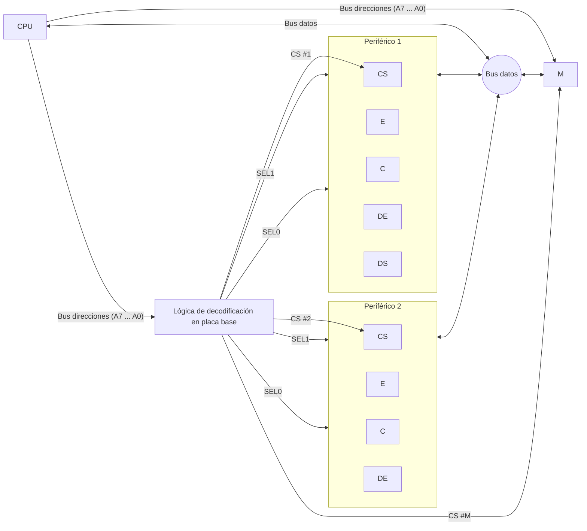

*Detalle de conexiones clave:*
- El **Bus direcciones** ($A_7 \dots A_0$) sale unidireccionalmente desde la `CPU` hacia la memoria `M`, y deriva una copia de $(A_7 \dots A_0)$ hacia la `Lógica de decodificación en placa base`.
- El **Bus datos** es bidireccional y conecta `CPU`, `M`, `Periférico 1` y `Periférico 2`.
- La `Lógica de decodificación en placa base` genera 5 salidas:
  - `CS #M` $\rightarrow$ activa la memoria `M`.
  - `CS #1` $\rightarrow$ entrada `CS` de `Periférico 1` (que contiene los registros `E`, `C`, `DE`, `DS`).
  - `CS #2` $\rightarrow$ entrada `CS` de `Periférico 2` (que contiene los registros `E`, `C`, `DE`).
  - `SEL1` y `SEL0` $\rightarrow$ líneas compartidas que entran a ambos periféricos (`Periférico 1` y `Periférico 2`) para seleccionar el registro interno dentro del periférico activado.

*Pie de página:* Fundamentos de Computadores | Ingeniería Electrónica, Robótica y Mecatrónica | 15

---

## Diapositiva 16: Direccionamiento de la interfase

Ejemplo: ARM AHB (Advanced High-Performance Bus)

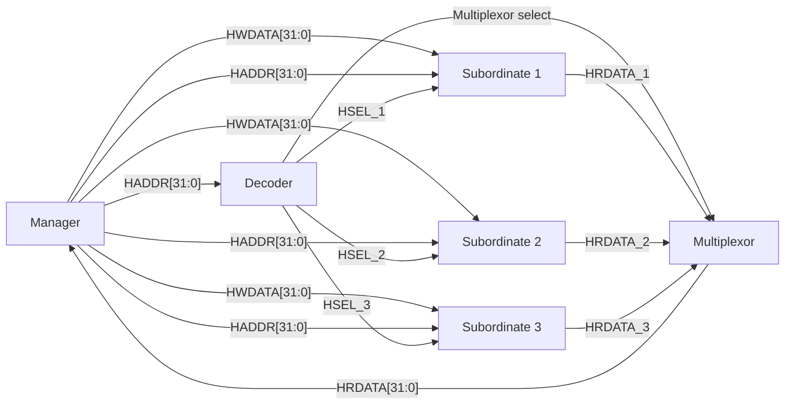

*Detalle de conexiones clave (Figure 1-1 AHB block diagram):*
- `Manager` envía el bus de escritura `HWDATA[31:0]` en paralelo a `Subordinate 1`, `Subordinate 2` y `Subordinate 3`.
- `Manager` envía el bus de direcciones `HADDR[31:0]` tanto al bloque `Decoder` como a `Subordinate 1`, `Subordinate 2` y `Subordinate 3`.
- `Decoder` decodifica `HADDR[31:0]` y genera las señales individuales de selección `HSEL_1` (hacia `Subordinate 1`), `HSEL_2` (hacia `Subordinate 2`), `HSEL_3` (hacia `Subordinate 3`), además de la señal `Multiplexor select` que controla el multiplexor de lectura.
- Cada subordinado entrega sus datos de lectura (`HRDATA_1`, `HRDATA_2`, `HRDATA_3`) a las entradas del multiplexor, cuya salida `HRDATA[31:0]` retorna al `Manager`.

Figure 1-1 AHB block diagram

*Pie de página:* Fundamentos de Computadores | Ingeniería Electrónica, Robótica y Mecatrónica

---

## Diapositiva 17: Direccionamiento de la interfase

**Direccionamiento local en periférico 1**

| $A_1$ | $A_0$ | Registro |
| :---: | :---: | :--- |
| $0$ | $0$ | Estado |
| $0$ | $1$ | Control |
| $1$ | $0$ | Datos Entrada |
| $1$ | $1$ | Datos Salida |

**Direccionamiento local en periférico 2**

| $A_1$ | $A_0$ | Registro |
| :---: | :---: | :--- |
| $0$ | $0$ | Estado |
| $0$ | $1$ | Control |
| $1$ | $0$ | Datos Salida |
| $1$ | $1$ | Reservado |

*(Nota de fidelidad sobre el PDF original: en la tabla del periférico 2 del documento original los dígitos de $A_1, A_0$ en la fila de Control aparecen impresos/digitalizados con inversión tipográfica y la fila de Reservado sin dígitos visibles, correspondiendo a las combinaciones binarias $01$ y $11$ respectivamente).*

- Debemos asignar, arbitrariamente, al menos $7$ de las $256$ direcciones posibles para el acceso a la E/S
  - Elegimos arbitrariamente ubicar periférico1 en $\text{0x80}$
  - Análogamente, elegimos ubicar periférico2 en $\text{0x90}$

*Pie de página:* Fundamentos de Computadores | Ingeniería Electrónica, Robótica y Mecatrónica | 17

---

## Diapositiva 18: Direccionamiento de la interfase (Tabla de decodificación)

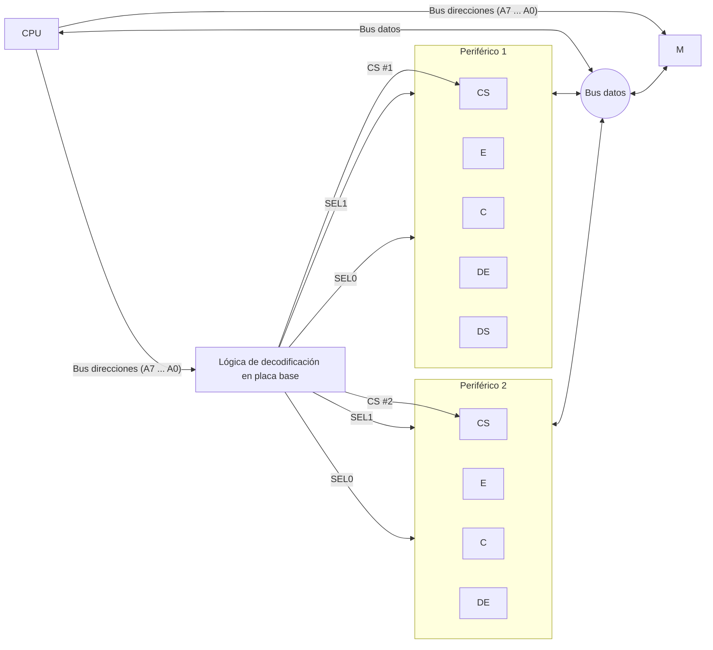

| Cantidad | $A_7 \dots A_0$ | Dispositivo direccionado | `CS1` | `CS2` | `SEL1` | `SEL2` *(SEL0)* |
| :---: | :--- | :--- | :---: | :---: | :---: | :---: |
| $(128)$ | $\text{0x00}$ a $\text{0x7F}$ | M | `0` | `0` | `X` | `X` |
| | $\text{0x80}$ | periférico 1, registro E | `1` | `0` | `0` | `0` |
| | $\text{0x81}$ | periférico 1, registro C | `1` | `0` | `0` | `1` |
| | $\text{0x82}$ | periférico 1, registro DE | `1` | `0` | `1` | `0` |
| | $\text{0x83}$ | periférico 1, registro DS | `1` | `0` | `1` | `1` |
| $(12)$ | $\text{0x84}$ a $\text{0x8F}$ | M | `0` | `0` | `X` | `X` |
| | $\text{0x90}$ | periférico 2, registro E | `0` | `1` | `0` | `0` |
| | $\text{0x91}$ | periférico 2, registro C | `0` | `1` | `0` | `1` |
| | $\text{0x92}$ | periférico 2, registro DE | `0` | `1` | `1` | `0` |
| | $\text{0x93}$ | Reservada | No se debe usar | | | |
| $(108)$ | $\text{0x94}$ a $\text{0xFF}$ | M | `0` | `0` | `X` | `X` |

*(Nota de fidelidad: en la cabecera original de la tabla figura `SEL1 SEL2` en lugar de `SEL1 SEL0`; asimismo, el texto extraído de las filas $\text{0x82}$ y $\text{0x92}$ presentaba columnas desplazadas en la capa OCR del PDF, reflejando aquí la correspondencia exacta de `CS1`, `CS2`, `SEL1`, `SEL0` con los bits $A_1, A_0$).*

*Pie de página:* 18

---

## Diapositiva 19: Direccionamiento de la interfase

- Las direcciones de E/S están entremezcladas con las de memoria
  - CPU usará la misma instrucción para acceder a una posición de memoria o a una posición de E/S
- Este tipo de direccionamiento se llama E/S mapeada por memoria

*Pie de página:* Fundamentos de Computadores | Ingeniería Electrónica, Robótica y Mecatrónica | 19

---

## Diapositiva 20: Direccionamiento de la interfase

- Ventajas de E/S mapeada por memoria:
  - Registro E/S se ve simplemente como una posición especial de memoria
  - CPU no necesita usar instrucciones especiales para acceder a E/S
- Inconvenientes:
  - Fragmenta el espacio de direcciones
    - En el ejemplo, ya no es posible conseguir un bloque de más de $128$ posiciones de memoria contiguas
  - Un error de programación puede hacernos direccionar accidentalmente posiciones de E/S
    - Debe tenerse esto en cuenta, y diseñar el sistema de forma que no se puedan provocar accidentalmente daños físicos

*Pie de página:* Fundamentos de Computadores | Ingeniería Electrónica, Robótica y Mecatrónica | 20

---

## Diapositiva 21: Direccionamiento de la interfase

- Alternativa de direccionamiento: E/S diferenciada
  - Usa un espacio de direcciones separado para la E/S
  - Utiliza una línea física específica para identificar accesos al espacio de E/S
  - Requiere el uso de una instrucción especial (`IN` o `OUT`)
    - Instrucción activa línea física de direccionamiento E/S
- Puertos de E/S: direcciones accedidas usando `IN` o `OUT`

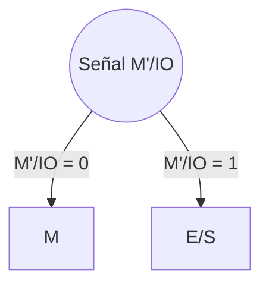

*Detalle de señalización del esquema:*
- La línea física $\overline{M}/IO$ se bifurca hacia los bloques de memoria `M` y de entrada/salida `E/S`:
  - Cuando $\overline{M}/IO = 0$, se selecciona el espacio de memoria `M`.
  - Cuando $\overline{M}/IO = 1$, se selecciona el espacio de `E/S`.

*Pie de página:* Fundamentos de Computadores | Ingeniería Electrónica, Robótica y Mecatrónica | 21

---

## Diapositiva 22: Direccionamiento de la interfase

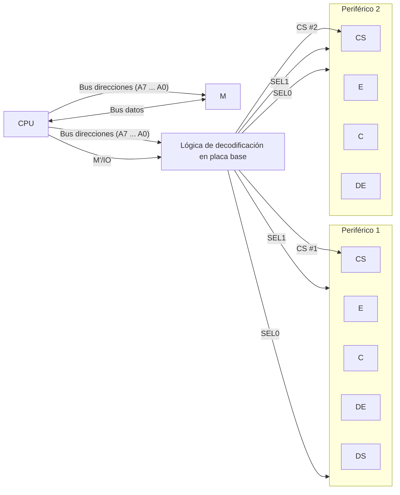

*Detalle de conexiones clave:*
- A diferencia del esquema mapeado por memoria (Diapositiva 15), la `CPU` envía directamente la línea de control $\overline{M}/IO$ hacia la `Lógica de decodificación en placa base`.
- El `Bus direcciones` ($A_7 \dots A_0$) va de la `CPU` a `M` y entra también a la `Lógica de decodificación en placa base`.
- El `Bus datos` es bidireccional entre `CPU` y `M`.
- La `Lógica de decodificación en placa base` activa `CS #1` (para `Periférico 1`, registros `E`, `C`, `DE`, `DS`) o `CS #2` (para `Periférico 2`, registros `E`, `C`, `DE`), junto con las líneas compartidas `SEL1` y `SEL0`.

*Pie de página:* Fundamentos de Computadores | Ingeniería Electrónica, Robótica y Mecatrónica | 22

---

## Diapositiva 23: Direccionamiento de la interfase

- Ventajas de E/S diferenciada:
  - Separa totalmente accesos de E/S de accesos a memoria
    - Evita fragmentación del espacio de direcciones de memoria
- Inconvenientes:
  - Requiere el uso de instrucciones especiales (`IN` o `OUT`)
    - Sólo existen en algunos procesadores (Intel)
    - Direccionamiento limitado a $16\text{ bits}$ ($65536$ direcciones)
  - Accesos son más lentos que E/S mapeada por memoria

*Pie de página:* Fundamentos de Computadores | Ingeniería Electrónica, Robótica y Mecatrónica | 23

---

## Diapositiva 24: Direccionamiento de la interfase

**ATmega48A/PA/88A/PA/168A/PA/328/P**

| Address | Name | Bit 7 | Bit 6 | Bit 5 | Bit 4 | Bit 3 | Bit 2 | Bit 1 | Bit 0 | Page |
| :--- | :--- | :---: | :---: | :---: | :---: | :---: | :---: | :---: | :---: | :---: |
| $\text{0x15}$ ($\text{0x35}$) | `TIFR0` | - | - | - | - | - | `OCF0B` | `OCF0A` | `TOV0` | |
| $\text{0x14}$ ($\text{0x34}$) | Reserved | - | - | - | - | - | - | - | - | |
| $\text{0x13}$ ($\text{0x33}$) | Reserved | - | - | - | - | - | - | - | - | |
| $\text{0x12}$ ($\text{0x32}$) | Reserved | - | - | - | - | - | - | - | - | |
| $\text{0x11}$ ($\text{0x31}$) | Reserved | - | - | - | - | - | - | - | - | |
| $\text{0x10}$ ($\text{0x30}$) | Reserved | - | - | - | - | - | - | - | - | |
| $\text{0x0F}$ ($\text{0x2F}$) | Reserved | - | - | - | - | - | - | - | - | |
| $\text{0x0E}$ ($\text{0x2E}$) | Reserved | - | - | - | - | - | - | - | - | |
| $\text{0x0D}$ ($\text{0x2D}$) | Reserved | - | - | - | - | - | - | - | - | |
| $\text{0x0C}$ ($\text{0x2C}$) | Reserved | - | - | - | - | - | - | - | - | |
| $\text{0x0B}$ ($\text{0x2B}$) | `PORTD` | `PORTD7` | `PORTD6` | `PORTD5` | `PORTD4` | `PORTD3` | `PORTD2` | `PORTD1` | `PORTD0` | 101 |
| $\text{0x0A}$ ($\text{0x2A}$) | `DDRD` | `DDD7` | `DDD6` | `DDD5` | `DDD4` | `DDD3` | `DDD2` | `DDD1` | `DDD0` | 101 |
| $\text{0x09}$ ($\text{0x29}$) | `PIND` | `PIND7` | `PIND6` | `PIND5` | `PIND4` | `PIND3` | `PIND2` | `PIND1` | `PIND0` | 101 |
| $\text{0x08}$ ($\text{0x28}$) | `PORTC` | - | `PORTC6` | `PORTC5` | `PORTC4` | `PORTC3` | `PORTC2` | `PORTC1` | `PORTC0` | 100 |
| $\text{0x07}$ ($\text{0x27}$) | `DDRC` | - | `DDC6` | `DDC5` | `DDC4` | `DDC3` | `DDC2` | `DDC1` | `DDC0` | 100 |
| $\text{0x06}$ ($\text{0x26}$) | `PINC` | - | `PINC6` | `PINC5` | `PINC4` | `PINC3` | `PINC2` | `PINC1` | `PINC0` | 101 |
| $\text{0x05}$ ($\text{0x25}$) | `PORTB` | `PORTB7` | `PORTB6` | `PORTB5` | `PORTB4` | `PORTB3` | `PORTB2` | `PORTB1` | `PORTB0` | 100 |
| $\text{0x04}$ ($\text{0x24}$) | `DDRB` | `DDB7` | `DDB6` | `DDB5` | `DDB4` | `DDB3` | `DDB2` | `DDB1` | `DDB0` | 100 |
| $\text{0x03}$ ($\text{0x23}$) | `PINB` | `PINB7` | `PINB6` | `PINB5` | `PINB4` | `PINB3` | `PINB2` | `PINB1` | `PINB0` | 100 |
| $\text{0x02}$ ($\text{0x22}$) | Reserved | - | - | - | - | - | - | - | - | |
| $\text{0x01}$ ($\text{0x21}$) | Reserved | - | - | - | - | - | - | - | - | |
| $\text{0x00}$ ($\text{0x20}$) | Reserved | - | - | - | - | - | - | - | - | |

**Note:**
1. For compatibility with future devices, reserved bits should be written to zero if accessed. Reserved I/O memory addresses should never be written.
2. I/O Registers within the address range $\text{0x00}-\text{0x1F}$ are directly bit-accessible using the `SBI` and `CBI` instructions. In these registers, the value of single bits can be checked by using the `SBIS` and `SBIC` instructions.
3. Some of the Status Flags are cleared by writing a logical one to them. Note that, unlike most other AVRs, the `CBI` and `SBI` instructions will only operate on the specified bit, and can therefore be used on registers containing such Status Flags. The `CBI` and `SBI` instructions work with registers $\text{0x00}$ to $\text{0x1F}$ only.
4. When using the I/O specific commands `IN` and `OUT`, the I/O addresses $\text{0x00} - \text{0x3F}$ must be used. When addressing I/O Registers as data space using `LD` and `ST` instructions, $\text{0x20}$ must be added to these addresses. The ATmega48A/PA/88A/PA/168A/PA/328/P is a complex microcontroller with more peripheral units than can be supported within the $64$ location reserved in Opcode for the `IN` and `OUT` instructions. For the Extended I/O space from $\text{0x60} - \text{0xFF}$ in SRAM, only the `ST/STS/STD` and `LD/LDS/LDD` instructions can be used.
5. Only valid for ATmega88A/88PA/168A/168PA/328/328P.
6. `BODS` and `BODSE` only available for picoPower devices ATmega48PA/88PA/168PA/328P.

*Pie de página:* Fundamentos de Computadores | Ingeniería Electrónica, Robótica y Mecatrónica

---

## Diapositiva 25: Direccionamiento de la interfase

- Computadores actuales usan un modelo mixto de direccionamiento
  - Se usan puertos de E/S para acceder a registros críticos o dispositivos "legacy"
  - Se usa E/S mapeada por memoria para accesos veloces a E/S
  - También se usa E/S mapeada por memoria para direccionar funciones que requieren muchos registros

*Pie de página:* Fundamentos de Computadores | Ingeniería Electrónica, Robótica y Mecatrónica | 25

---

## Diapositiva 26: II - Métodos de E/S

- Existen dos formas de realizar las transferencias de E/S: PIO y DMA
- E/S por programa ($\text{PIO} = \text{Program I/O}$)
  - Involucra uso explícito de la CPU en cada movimiento de datos
    - Registro de CPU actúa como intermediario entre M y periférico
- E/S por DMA ($\text{Direct Memory Access}$)
  - No requiere emplear explícitamente la CPU en cada transferencia
  - Precisa empleo de hardware especial para controlar la transferencia y provocar el movimiento de los datos

*Pie de página:* Fundamentos de Computadores | Ingeniería Electrónica, Robótica y Mecatrónica | 26

---

## Diapositiva 27: E/S por programa (PIO)

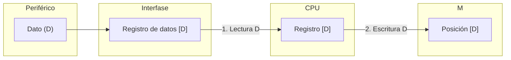

- Diagrama muestra transacción de lectura
  - Transacción de escritura es análoga, invirtiendo el sentido y el orden de las operaciones
  - Necesario ejecutar dos instrucciones en la CPU por cada transferencia

*Pie de página:* Fundamentos de Computadores | Ingeniería Electrónica, Robótica y Mecatrónica | 27

---

## Diapositiva 28: E/S por programa (PIO)

- Ventajas:
  - No requiere hardware especial
  - Sencilla de implementar
- Inconvenientes:
  - Requiere el uso continuo de CPU durante la transferencia
    - Movimiento de bloques de datos ralentiza notablemente al sistema
- Usada para transferencias puntuales, que involucran pocos datos

*Pie de página:* Fundamentos de Computadores | Ingeniería Electrónica, Robótica y Mecatrónica | 28

---

## Diapositiva 29: Consulta de estado

- Antes de realizar la transferencia PIO debe comprobarse si el periférico está preparado para llevarla a cabo
  - Requiere protocolo de *handshaking* (intercambio de información de control)
- *Consulta de estado*: acceso a registros de la interfase (estado o control) para realizar este handshaking

*Pie de página:* Fundamentos de Computadores | Ingeniería Electrónica, Robótica y Mecatrónica | 29

---

## Diapositiva 30: Consulta de estado

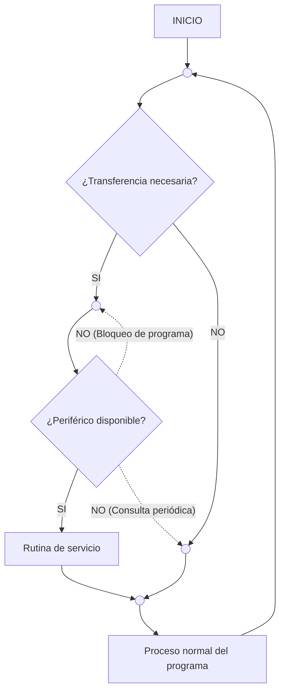

*Detalle del flujo:*
- Desde `INICIO`, el flujo evalúa `¿Transferencia necesaria?`.
  - Si es `NO`, pasa al `Proceso normal del programa` y vuelve al inicio del bucle.
  - Si es `SI`, evalúa `¿Periférico disponible?`:
    - Si es `SI`, ejecuta `Rutina de servicio` y luego continúa con `Proceso normal del programa`.
    - Si es `NO`, se representan en línea discontinua las dos variantes posibles:
      - **Bloqueo de programa:** vuelve a comprobar `¿Periférico disponible?` en bucle cerrado hasta que responda `SI`.
      - **Consulta periódica:** abandona temporalmente la espera y pasa a `Proceso normal del programa` para reintentar en la siguiente iteración.

- Consulta de estado puede realizarse de dos formas distintas:
  - Bloqueo de programa
  - Consulta periódica

*Pie de página:* Fundamentos de Computadores | Ingeniería Electrónica, Robótica y Mecatrónica | 30

---

## Diapositiva 31: Consulta de estado

- Bloqueo programa: driver entra en bucle de espera, leyendo continuamente registro hasta que periférico esté preparado
  - Garantiza tiempo de respuesta mínimo...
  - pero paraliza la operación del sistema
- Consulta periódica: Si periférico no está listo, driver permite al programa hacer otras cosas antes de volver a intentar el acceso
  - No garantiza un tiempo de respuesta mínimo
  - Puede ser difícil acotar el tiempo máximo de respuesta
  - A cambio, permite al sistema operar concurrentemente con la E/S

*Pie de página:* Fundamentos de Computadores | Ingeniería Electrónica, Robótica y Mecatrónica | 31

---

## Diapositiva 32: Ejemplo de E/S por PIO

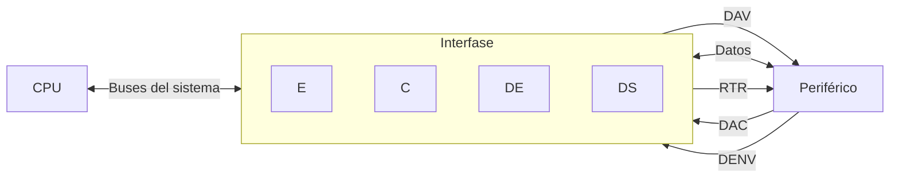

- Señalización entre interfase y periférico usa $4$ líneas:
  - `DAV` (Dato Válido): Interfase indica a periférico envío de dato. Se mantiene activa hasta recibir `DAC`
  - `DAC` (Dato Aceptado): Periférico indica que ha aceptado el dato
  - `RTR` (Ready To Receive): Interfase activa esta señal para indicar al periférico disponibilidad para recibir un dato
  - `DENV` (Dato Enviado): Periférico indica a la interfase que le está enviando un dato

*Pie de página:* Fundamentos de Computadores | Ingeniería Electrónica, Robótica y Mecatrónica | 32

---

## Diapositiva 33: Ejemplo de E/S por PIO

Descripción de una lectura de datos, previamente solicitada desde la CPU

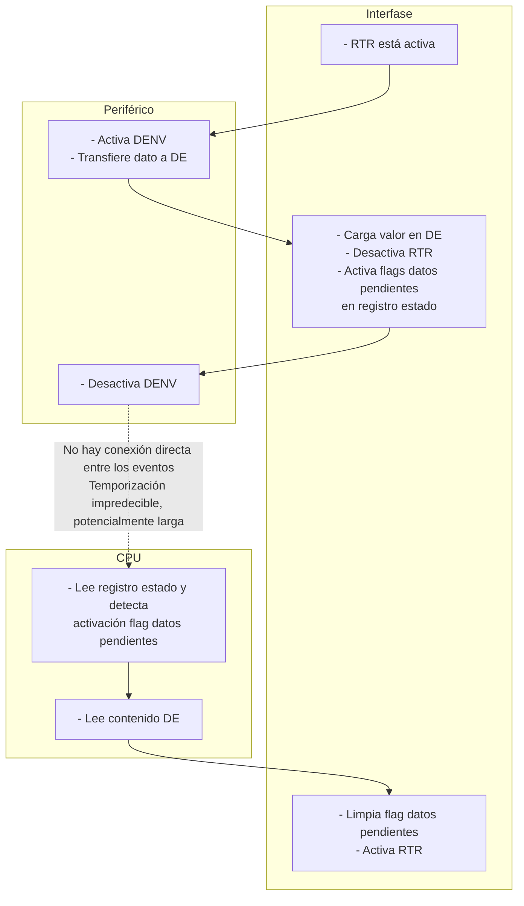

*Secuencia exacta de eventos (lectura por PIO):*
1. **Interfase:** `- RTR está activa` $\rightarrow$ señaliza al **Periférico**.
2. **Periférico:** `- Activa DENV` y `- Transfiere dato a DE` $\rightarrow$ envía hacia la **Interfase**.
3. **Interfase:** `- Carga valor en DE`, `- Desactiva RTR`, `- Activa flags datos pendientes en registro estado` $\rightarrow$ notifica al **Periférico**.
4. **Periférico:** `- Desactiva DENV`.
5. *Transición asíncrona (flecha discontinua):* *No hay conexión directa entre los eventos. Temporización impredecible, potencialmente larga.*
6. **CPU:** `- Lee registro estado y detecta activación flag datos pendientes` $\rightarrow$ `- Lee contenido DE` $\rightarrow$ accede a la **Interfase**.
7. **Interfase:** `- Limpia flag datos pendientes`, `- Activa RTR`.

*Pie de página:* Fundamentos de Computadores | Ingeniería Electrónica, Robótica y Mecatrónica | 33

---

## Diapositiva 34: Ejemplo de E/S por PIO

Descripción de una escritura de datos, previamente solicitada desde la CPU

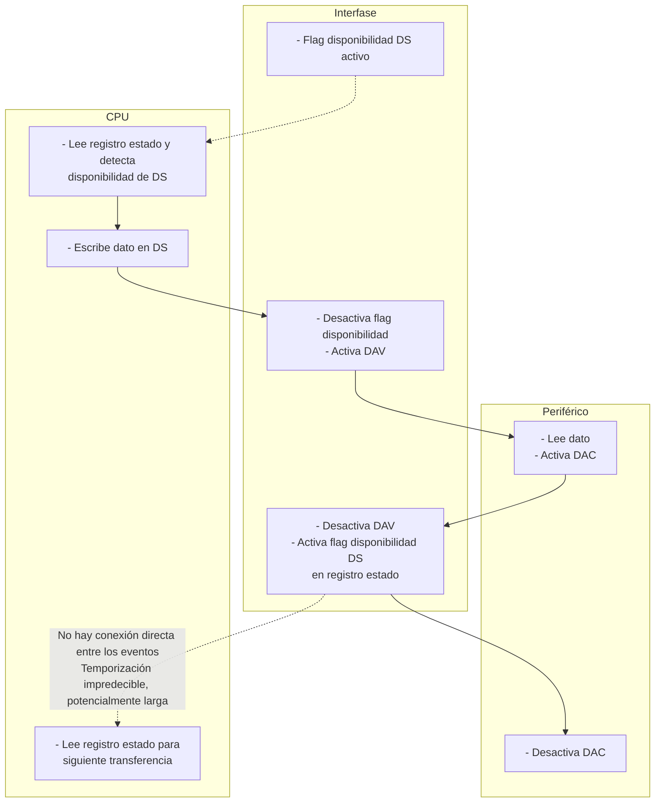

*Secuencia exacta de eventos (escritura por PIO):*
1. **Interfase:** `- Flag disponibilidad DS activo`.
2. **CPU:** `- Lee registro estado y detecta disponibilidad de DS` $\rightarrow$ `- Escribe dato en DS` $\rightarrow$ escribe en la **Interfase**.
3. **Interfase:** `- Desactiva flag disponibilidad`, `- Activa DAV` $\rightarrow$ señaliza al **Periférico**.
4. **Periférico:** `- Lee dato`, `- Activa DAC` $\rightarrow$ responde a la **Interfase**.
5. **Interfase:** `- Desactiva DAV`, `- Activa flag disponibilidad DS en registro estado` $\rightarrow$ señaliza al **Periférico** (`- Desactiva DAC`).
6. *Transición asíncrona (flecha discontinua desde la activación del flag en la Interfase hacia la CPU):* *No hay conexión directa entre los eventos. Temporización impredecible, potencialmente larga.*
7. **CPU:** `- Lee registro estado para siguiente transferencia`.

*Pie de página:* Fundamentos de Computadores | Ingeniería Electrónica, Robótica y Mecatrónica | 34

---

## Diapositiva 35: Interrupciones

- Uso de interrupciones hardware permite a la interfase generar explícitamente un evento que provoque la respuesta de la CPU
  - Elimina la indeterminación en la temporización de la E/S

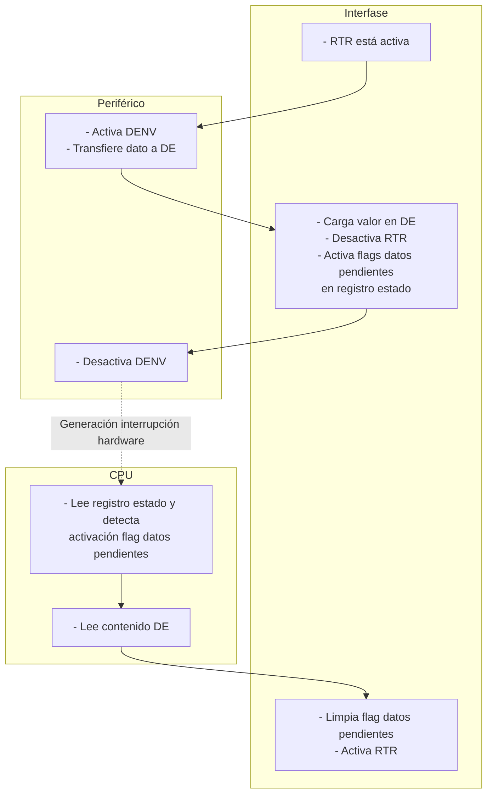

*Diferencia clave respecto a la Diapositiva 33:*
- La transición hacia la lectura del registro de estado por parte de la CPU ya no es una espera impredecible, sino que está disparada explícitamente por la línea de trazo y punto etiquetada como **Generación interrupción hardware**.

*Pie de página:* Fundamentos de Computadores | Ingeniería Electrónica, Robótica y Mecatrónica | 35

---

## Diapositiva 36: Interrupciones

- Interfase y CPU son dispositivos físicos distintos
  - Interrupción necesita de una línea hardware que los interconecte
- Rutina de servicio de interrupción gestionará la operación de E/S

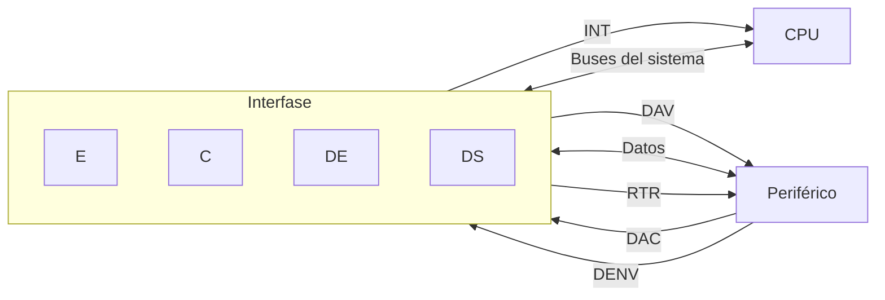

*Detalle de conexiones clave:*
- Se añade la línea hardware unidireccional `INT` desde la `Interfase` hacia la `CPU`, manteniendo los `Buses del sistema` entre `CPU` e `Interfase`, y las líneas `DAV`, `DAC`, bus `Datos`, `RTR` y `DENV` entre `Interfase` y `Periférico`.

*Pie de página:* Fundamentos de Computadores | Ingeniería Electrónica, Robótica y Mecatrónica | 36

---

## Diapositiva 37: Interrupciones

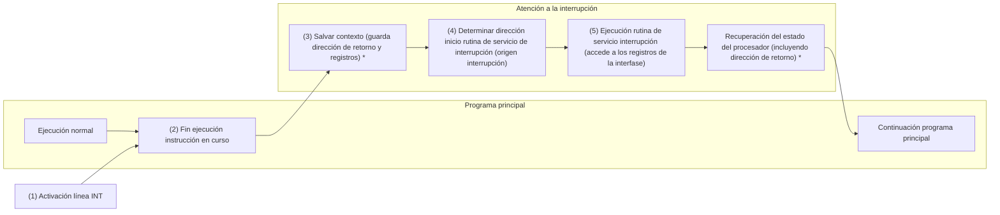

\* = Los cambios de contexto demasiado frecuentes presentan problemas de eficiencia

- Esquema básico de servicio de una interrupción hardware
  - Interrupción se atiende al finalizar la instrucción que está en ejecución cuando se detecta la activación de `INT`
- Este esquema básico, sin embargo, no funciona

*Pie de página:* Fundamentos de Computadores | Ingeniería Electrónica, Robótica y Mecatrónica | 37

---

## Diapositiva 38: Interrupciones

*Tiempos no representados a escala*

```wavedrom
{
  "signal": [
    { "name": "INT", "wave": "01.......0.", "node": ".a.b.c.d.e." }
  ],
  "edge": [
    "a (1) Detección INT",
    "b (2) Fin inst. actual",
    "c (3) Fin cambio contexto",
    "d (4) Fin id. origen",
    "e (5) Fin 1ª inst. ISR"
  ],
  "head": {
    "text": "Cronograma de señal INT (Interrupción autointerrumpida)"
  }
}
```

*Descripción exacta de los eventos sobre la forma de onda `INT` (niveles `0` y `1`):*
- La señal `INT` permanece inicialmente en nivel bajo (`0`).
- **Instante (1) — Flanco de subida (`0` $\rightarrow$ `1`):** `Detección INT`. La señal pasa a nivel alto (`1`) y se mantiene activa durante todo el proceso hasta ser atendida por la rutina de servicio.
- **Instante (2) — `INT = 1`:** `Fin ejecución instrucción actual`.
- **Instante (3) — `INT = 1`:** `Fin cambio contexto`.
- **Instante (4) — `INT = 1`:** `Fin identificación origen interrupción`.
- **Instante (5) — `INT = 1` (resaltado en recuadro discontinuo):** `Fin ejecución primera instrucción de la rutina de servicio`. Como la señal `INT` sigue a `1` (porque la rutina de servicio aún no ha accedido a la interfase para limpiarla), al terminar la primera instrucción de la propia rutina de servicio la CPU vuelve a muestrear `INT = 1`:
  - *Aviso inferior:* **!Se genera una nueva interrupción, que es incorrecta! INTERRUPCIÓN AUTOINTERRUMPIDA**
  - *Consecuencia (flecha hacia aviso derecho):* **¡Se entrará dos veces seguidas en la rutina de servicio!**
- **Flanco de bajada posterior (`1` $\rightarrow$ `0`):** La línea `INT` finalmente cae a `0` tiempo después, una vez la interfase desactiva la petición.

*Pie de página:* Fundamentos de Computadores | Ingeniería Electrónica, Robótica y Mecatrónica | 38

---

## Diapositiva 39: Interrupciones

- Interrupción autointerrumpida provoca serio problema hardware
  - Interfase del periférico es accedida dos veces consecutivas, cuando sólo espera una
  - Potencialmente pude bloquear físicamente el sistema
    - "Pantallazo azul de la muerte (BOSD)" en Windows
    - "Kernel panic" en Linux
- Necesario evitar interrupción autointerrumpida
  - Hay dos formas posibles de hacerlo:
    - Usar como señalización de `INT` sólo flanco de subida o de bajada
    - Usar enmascaramiento de interrupciones

*Pie de página:* Fundamentos de Computadores | Ingeniería Electrónica, Robótica y Mecatrónica | 39

---

## Diapositiva 40: Interrupciones

- Enmascaramiento bloquea nueva interrupción hasta que termine la actual

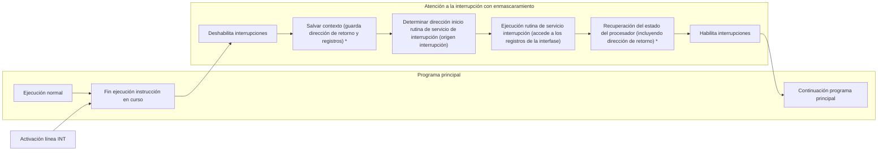

\* = Los cambios de contexto demasiado frecuentes presentan problemas de eficiencia

*Pie de página:* Fundamentos de Computadores | Ingeniería Electrónica, Robótica y Mecatrónica | 40

---

## Diapositiva 41: Vector de interrupción

- Interrupción provoca la ejecución de una rutina de servicio
  - Esta rutina debe ser la correcta para acceder a la interfase que ha provocado la interrupción
- Vector de interrupción es el mecanismo que enlaza origen de interrupción y rutina de servicio
  - Es un valor entero de $8\text{ bits}$, que actúa como identificador del origen de la interrupción
  - Proporciona indirectamente un puntero al inicio de la rutina de servicio, a través de una (o más) tablas de vectores de interrupción

*Pie de página:* Fundamentos de Computadores | Ingeniería Electrónica, Robótica y Mecatrónica | 41

---

## Diapositiva 42: Vector de interrupción

Indirección vía tabla de vectores de interrupción

```mermaid
flowchart LR
    VEC["Vector interrupción<br/>0x02"]

    subgraph TVI["Tabla de vectores de interrupción<br/>(en memoria principal)"]
        T0["0x00 | Rutina X"]
        T1["0x01 | Rutina Y"]
        T2["0x02 | Rutina Z"]
        T3["0x03 | Rutina W"]
    end

    subgraph MEM["Rutinas de servicio de interrupción<br/>(drivers de dispositivo)<br/>Cargadas en memoria principal"]
        MX["Dirección X: Código Rutina X"]
        MY["Dirección Y: Código Rutina Y"]
        MZ["Dirección Z: Código Rutina Z"]
        MW["Dirección W: Código Rutina W"]
    end

    VEC --> T2
    T2 -->|"Puntero Z"| MZ
```

*Detalle de la indirección mostrada en el diagrama:*
- El `Vector interrupción` contiene el índice $\text{0x02}$, que indexa la entrada $\text{0x02}$ (`Rutina Z`) en la `Tabla de vectores de interrupción (en memoria principal)` (junto con $\text{0x00} \rightarrow \text{Rutina X}$, $\text{0x01} \rightarrow \text{Rutina Y}$, $\text{0x03} \rightarrow \text{Rutina W}$).
- El contenido de la entrada $\text{0x02}$ (`Rutina Z`) apunta directamente a la dirección de inicio `Z` dentro de la memoria principal, donde están cargadas las `Rutinas de servicio de interrupción (drivers de dispositivo)` en las direcciones `X`, `Y`, `Z` y `W`.

*Pie de página:* Fundamentos de Computadores | Ingeniería Electrónica, Robótica y Mecatrónica | 42

---

## Diapositiva 43: Vector de interrupción

- En interrupciones generadas desde software (excepciones, funciones estilo `INT(21h)`), el vector de interrupción se genera automáticamente
- Para el resto de las interrupciones, vector de interrupción debe ser entregado por el hardware que produce la interrupción
  - En interrupciones señalizadas vía una línea `INT`, se entrega durante ciclo especial de reconocimiento de interrupción

*Pie de página:* Fundamentos de Computadores | Ingeniería Electrónica, Robótica y Mecatrónica | 43

---

## Diapositiva 44: Vector de interrupción

```mermaid
flowchart LR
    CPU["CPU"]

    subgraph EXT["Dispositivo externo"]
        VEC["Vector interrupción"]
    end

    EXT -->|"(1) INT"| CPU
    CPU -->|"(2) INTA"| EXT
    VEC -.->|"(3) Bus Datos (lectura del vector)"| CPU
    CPU <-->|"Bus Datos"| EXT
```

- Secuencia de eventos del proceso es:
  1) Activación linea `INT` desde dispositivo externo
  2) Al iniciarse el procesamiento de la interrupción, CPU activa la línea de reconocimiento de interrupción, `INTA`
  3) Dispositivo externo deposita en el bus de datos el valor del vector de interrupción, que es leído por la CPU
  4) Usando este vector de interrupción para obtener el puntero a la rutina de servicio, la CPU continúa el procesamiento de la interrupción

*Pie de página:* Fundamentos de Computadores | Ingeniería Electrónica, Robótica y Mecatrónica | 44

---

## Diapositiva 45: Gestión de orígenes múltiples: polling

- Si múltiples periféricos pueden generar interrupciones, deben compartir uso línea `INT`
  - Necesario mecanismo para identificar origen de la interrupción
- Mecanismo más sencillo de compartición es por polling
  - Activación `INT` hace entrar a CPU en rutina de servicio genérica
  - Rutina genérica comprueba uno a uno los registros de estado en las interfaces de los periféricos, hasta encontrar uno con interrupción pendiente
  - Rutina usa entonces vector preestablecido por software para ese dispositivo

```mermaid
flowchart LR
    CPU["CPU"]
    INT_BUS(("Línea INT compartida"))
    DBUS(("Bus Datos"))
    P1["P1"]
    P2["P2"]
    P3["P3"]

    P1 --> INT_BUS
    P2 --> INT_BUS
    P3 --> INT_BUS
    INT_BUS -->|"INT"| CPU

    CPU <--> DBUS
    P1 <--> DBUS
    P2 <--> DBUS
    P3 <--> DBUS
```

*Detalle de conexiones:*
- Las salidas de interrupción de los periféricos `P1`, `P2` y `P3` se unen a una única línea `INT` que entra en la `CPU`.
- `CPU`, `P1`, `P2` y `P3` están todos conectados bidireccionalmente al `Bus Datos` común.

*Pie de página:* Fundamentos de Computadores | Ingeniería Electrónica, Robótica y Mecatrónica | 45

---

## Diapositiva 46: Gestión de orígenes múltiples: polling

- Ventajas:
  - No requiere hardware especializado
  - Prioridad de dispositivos se cambia fácilmente, alterando el orden de muestreo
- Inconvenientes
  - Es relativamente lenta para el último dispositivo de la cola, por necesidad de muestrear todos los anteriores.

*Pie de página:* Fundamentos de Computadores | Ingeniería Electrónica, Robótica y Mecatrónica | 46

---

## Diapositiva 47: Gestión de orígenes múltiples: polling

- Usado en sistemas sencillos, que sólo tienen un único vector de interrupciones
  - Ejemplo: microcontroladores
- Figura muestra mapa del espacio de direcciones del microcontrolador Microchip 16F877
  - Hay un único vector de interrupciones, en la dirección `0004h`
  - Esa dirección apunta a una rutina común de servicio
  - Necesario polling para identificar orígen de la interrupción

**FIGURE 2-1: PIC16F877/876 PROGRAM MEMORY MAP AND STACK**

```mermaid
flowchart TD
    PC["PC<12:0>"]
    BUS_13(("Bus 13 bits<br/>CALL, RETURN<br/>RETFIE, RETLW"))

    subgraph STACK["8-Level Stack"]
        S1["Stack Level 1"]
        S2["Stack Level 2"]
        SD["..."]
        S8["Stack Level 8"]
    end

    subgraph PMEM["On-Chip Program Memory"]
        RST["0000h: RESET Vector"]
        DOTS["..."]
        IVEC["0004h: Interrupt Vector"]
        P0["0005h - 07FFh: Page 0"]
        P1["0800h - 0FFFh: Page 1"]
        P2["1000h - 17FFh: Page 2"]
        P3["1800h - 1FFFh: Page 3"]
    end

    PC <--> BUS_13
    BUS_13 <--> STACK
    BUS_13 -->|"13"| PMEM
```

| Dirección (Hex) | Sección de Memoria de Programa |
| :--- | :--- |
| `0000h` | `RESET Vector` |
| `0001h` – `0003h` | `...` |
| `0004h` | `Interrupt Vector` |
| `0005h` – `07FFh` | `Page 0` (`On-Chip Program Memory`) |
| `0800h` – `0FFFh` | `Page 1` (`On-Chip Program Memory`) |
| `1000h` – `17FFh` | `Page 2` (`On-Chip Program Memory`) |
| `1800h` – `1FFFh` | `Page 3` (`On-Chip Program Memory`) |

*Pie de página:* Fundamentos de Computadores | Ingeniería Electrónica, Robótica y Mecatrónica | 47

---

## Diapositiva 48: Gestión de orígenes múltiples: polling

- Usado también en sistemas operativos complejos para compartir un mismo vector de interrupción cuando hay un número limitado de vectores hardware de interrupción
  - Ejemplo: Compartición IRQ 9 (IRQ sharing) en un Windows XP

*Descripción detallada de la captura de pantalla de Windows XP (`Administrador de dispositivos`, barra de menú `Acción`, `Ver`, árbol de recursos bajo el equipo `MERLIN`):*
- Categorías contraídas en el árbol:
  - `Acceso directo a memoria (DMA)`
  - `Entrada/salida (E/S)`
  - `Memoria`
- Categoría expandida `Solicitud de interrupción (IRQ)` mostrando la asignación de interrupciones, destacando la compartición de la **IRQ 9** entre múltiples dispositivos PCI y ACPI:

| Bus / Línea IRQ | Dispositivo asignado |
| :--- | :--- |
| `(ISA) 0` | Cronómetro del sistema |
| `(ISA) 1` | Teclado estándar de 101/102 teclas o Microsoft Natural PS/2 Keyboard |
| `(ISA) 4` | Puerto de comunicaciones (COM1) |
| `(ISA) 6` | Controlador estándar de disquetes |
| `(ISA) 8` | Sistema CMOS/reloj en tiempo real |
| `(ISA) 9` | Sistema Microsoft compatible con ACPI |
| `(ISA) 12` | Synaptics PS/2 Port TouchPad |
| `(ISA) 13` | Procesador de datos numéricos |
| `(ISA) 14` | Canal IDE principal |
| `(ISA) 15` | Canal IDE secundario |
| `(PCI) 9` | Controladora de CardBus Ricoh R/RL/5C476(II) o compatible |
| `(PCI) 9` | Controladora de CardBus Ricoh R/RL/5C476(II) o compatible |
| `(PCI) 9` | ESS Allegro PCI Audio (WDM) |
| `(PCI) 9` | Fax-módem ESS ES56CVM-PI |
| `(PCI) 9` | Intel(R) 82801BA/BAM USB Universal Host Controller - 2442 |
| `(PCI) 9` | Mobility Radeon |
| `(PCI) 9` | Realtek RTL8139 Family PCI Fast Ethernet NIC |

*Pie de página:* Fundamentos de Computadores | Ingeniería Electrónica, Robótica y Mecatrónica | 48

---

## Diapositiva 49: Controlador de interrupciones

- Gestión de orígenes múltiples de interrupciones puede hacerse mediante un circuito especializado, llamado controlador de interrupciones
  - Intermediario entre periféricos y CPU
  - Cada periférico tiene su propia entrada diferenciada de petición de interrupción.
  - El controlador:
    - Prioriza las peticiones, y determina si se deben o no atender
    - Activa la línea o señal de interrupción
    - Entrega a la CPU el vector de interrupción asociado al periférico

```mermaid
flowchart LR
    CPU["CPU"]
    PIC["Controlador de interrupciones"]
    P1["P1"]
    P2["P2"]
    P3["P3"]
    FREE["(Entrada libre)"]

    PIC -->|"INT"| CPU
    CPU -->|"INTA"| PIC
    CPU <-->|"Bus Datos"| PIC

    P1 -->|"INT#0"| PIC
    P2 -->|"INT#1"| PIC
    P3 -->|"INT#2"| PIC
    FREE -->|"INT#3"| PIC
```

*Pie de página:* Fundamentos de Computadores | Ingeniería Electrónica, Robótica y Mecatrónica | 49

---

## Diapositiva 50: Controlador de interrupciones

- Controlador de interrupciones no es más que un periférico especializado
  - Tiene, por tanto, una interfase con registros y un modelo de programación
- Registros del controlador de interrupciones permiten:
  - Enmascarar interrupciones individuales
  - Evitar interrupciones autointerrumpidas
    - Usa para ello un registro con el nivel de interrupción en servicio
    - Sólo se atiende a una interrupción más prioritaria que la actualmente en servicio
  - Determinar el rango de posibles vectores de interrupción

*Pie de página:* Fundamentos de Computadores | Ingeniería Electrónica, Robótica y Mecatrónica | 50

---

## Diapositiva 51: Controlador de interrupciones

Ejemplo de posible arquitectura interna

```mermaid
flowchart LR
    P1["P1"] --> AND0["AND"]
    P2["P2"] --> AND1["AND"]
    P3["P3"] --> AND2["AND"]
    P4["P4"] --> AND3["AND"]

    subgraph INTERFASE["INTERFASE"]
        M0["INT #0"]
        M1["INT #1"]
        M2["INT #2"]
        M3["INT #3"]
        REG_ACT["Registro con nivel de la<br/>interrupción actualmente en servicio<br/>(Bit 1 | Bit 0)"]
        VBASE["Vector base"]
        SUM["Sumador"]
        BUF_INT["Buffer señal INT"]
    end

    M0 --> AND0
    M1 --> AND1
    M2 --> AND2
    M3 --> AND3

    AND0 -->|"#0 (más prioridad)"| ENC["Codificador con prioridad"]
    AND1 -->|"#1"| ENC
    AND2 -->|"#2"| ENC
    AND3 -->|"#3 (menos prioridad)"| ENC

    AND0 --> ANY_INT(("Detección de<br/>petición activa"))
    AND1 --> ANY_INT
    AND2 --> ANY_INT
    AND3 --> ANY_INT

    ENC -->|"Bit 1, Bit 0<br/>(Número en binario de la<br/>entrada activada)"| COMP["Comparador<br/>NUEVA < ACTUAL"]
    ENC -->|"Bit 1, Bit 0"| REG_ACT
    ENC -->|"Bit 1, Bit 0"| SUM

    REG_ACT -->|"ACTUAL (Bit 1, Bit 0)"| COMP
    COMP -->|"AUTORIZAR (NUEVA < ACTUAL)"| AND_OUT["AND"]
    COMP -->|"CARGAR"| REG_ACT
    ANY_INT --> AND_OUT
    AND_OUT --> BUF_INT
    BUF_INT --> OUT_INT(["INT"])

    VBASE --> SUM
    SUM --> OUT_VEC(["Vector de interrupción =<br/>Vector base + número de la interrupción"])
```

*Detalle exacto de conexiones y señales del circuito interno:*
- **Etapa de enmascaramiento:** Cuatro puertas `AND` de $2$ entradas combinan cada petición externa (`P1`, `P2`, `P3`, `P4`) con su correspondiente bit del registro `Máscaras de interrupción individuales` (`INT #0`, `INT #1`, `INT #2`, `INT #3`) ubicado dentro de `INTERFASE`.
- **Codificador con prioridad:** Recibe las $4$ líneas enmascaradas ordenadas desde `#0 (más prioridad)` hasta `#3 (menos prioridad)` y genera en salida `Bit 1` y `Bit 0` (*Número (en binario) de la entrada de interrupción activada*).
- **Comparador (`NUEVA < ACTUAL`):**
  - Entrada `NUEVA`: recibe `Bit 1` y `Bit 0` procedentes del `Codificador con prioridad`.
  - Entrada `ACTUAL`: recibe `Bit 1` y `Bit 0` desde `Registro con nivel de la interrupción actualmente en servicio`.
  - Salida `AUTORIZAR` (activa cuando $\text{NUEVA} < \text{ACTUAL}$, es decir, mayor prioridad numéricamente menor):
    1. Activa la señal `CARGAR` para actualizar el `Registro con nivel de la interrupción actualmente en servicio` con los nuevos `Bit 1` y `Bit 0`.
    2. Entra en una puerta `AND` final junto con la línea común que une las salidas de las $4$ puertas de enmascaramiento (`#0` a `#3`); la salida de esta puerta `AND` alimenta el `Buffer señal INT`, que genera la línea externa `INT`.
- **Cálculo del vector de interrupción:** Dentro de `INTERFASE`, el `Sumador` recibe el registro `Vector base` más los $2\text{ bits}$ (`Bit 1`, `Bit 0`) del codificador con prioridad, produciendo la salida:
$$\text{Vector de interrupción} = \text{Vector base} + \text{número de la interrupción}$$

*Pie de página:* Fundamentos de Computadores | Ingeniería Electrónica, Robótica y Mecatrónica | 51

---

## Diapositiva 52: E/S por DMA

- E/S por programa (PIO) enlentece el ordenador, porque involucra a CPU en cada movimiento de datos
- E/S por DMA transfiere los datos sin necesidad de usar la CPU para moverlos
  - Datos son intercambiados directamente entre memoria principal e interfase del periférico
  - Requiere el uso de hardware especial (controlador DMA) para que realice en cada transferencia los direccionamientos necesarios (asignaciones de valores a líneas de bus de direcciones y bus de control)
- El controlador DMA NO mueve los datos; sólo controla su movimiento

*Pie de página:* Fundamentos de Computadores | Ingeniería Electrónica, Robótica y Mecatrónica | 52

---

## Diapositiva 53: E/S por DMA

- Figura muestra arquitectura DMA tradicional (en controlador diskettes del PC)
  - En sistemas simples se siguen usando esquemas similares

```mermaid
flowchart LR
    DISK(("Disk Drive"))
    FDC["Floppy Drive Controller"]
    DRAM["DRAM Memory"]
    DMAC["DMA Controller"]
    INTC["Interrupt Controller"]
    MPU["Microprocessor"]

    DISK <--> FDC
    FDC <==>|"Data Bus"| DRAM

    FDC -->|"DREQn"| DMAC
    DMAC -->|"DAKn#"| FDC
    DMAC -->|"IORC#"| FDC
    DMAC -->|"IOWC#"| FDC
    DMAC -->|"TC"| FDC

    DMAC ==>|"Address Bus"| DRAM
    DMAC -->|"MRDC#"| DRAM
    DMAC -->|"MWTC#"| DRAM

    DMAC -->|"HOLD"| MPU
    MPU -->|"HLDA"| DMAC

    FDC -->|"IRQ6"| INTC
    INTC -->|"INTR"| MPU
```

*Detalle de buses y señales de control de la arquitectura DMA tradicional:*
- `Data Bus` (bidireccional): conecta directamente `Floppy Drive Controller` con `DRAM Memory`.
- `Address Bus`, `MRDC#` (Memory Read Command) y `MWTC#` (Memory Write Command): salen desde `DMA Controller` hacia `DRAM Memory`.
- Señales entre `Floppy Drive Controller` y `DMA Controller`: `DREQn` (del FDC al DMA), y `DAKn#`, `IORC#`, `IOWC#`, `TC` (del DMA al FDC).
- Señales de arbitraje de bus con `Microprocessor`: `HOLD` (del `DMA Controller` al `Microprocessor`) y `HLDA` (del `Microprocessor` al `DMA Controller`).
- Señales de interrupción: `IRQ6` (del `Floppy Drive Controller` al `Interrupt Controller`) e `INTR` (del `Interrupt Controller` al `Microprocessor`).
- Conexión bidireccional directa entre `Floppy Drive Controller` y `Disk Drive`.

*Pie de página:* Fundamentos de Computadores | Ingeniería Electrónica, Robótica y Mecatrónica | 53

---

## Diapositiva 54: E/S por DMA

*(Incluye el mismo diagrama de bloques de arquitectura DMA tradicional detallado en la Diapositiva 53).*

- Observar que bus datos permite mover datos directamente entre floppy y memoria
  - Controlador DMA sólo dará valores a líneas del bus de direcciones y a algunas líneas de control
- Si transferencia DMA usa bus de direcciones y bus de datos, CPU no puede emplearlos durante la transferencia
  - CPU pone en alta impedancia sus conexiones a estos buses (se desconecta físicamente de ellos)
  - No puede, por tanto, leer instrucciones desde memoria
  - Necesario parar CPU durante la transferencia

*Pie de página:* Fundamentos de Computadores | Ingeniería Electrónica, Robótica y Mecatrónica | 54

---

## Diapositiva 55: E/S por DMA

*(Incluye el mismo diagrama de bloques de arquitectura DMA tradicional detallado en la Diapositiva 53).*

- Secuencia de transferencia DMA:
  1) CPU programa transferencia en registros de las interfases de controlador de floppy y de controlador DMA
  2) CPU ordena a controlador floppy iniciar una operación (lectura/escritura) a través de registro de comandos de su interfaz
  3) Controlador floppy activa `DREQ` para solicitar transferencia DMA

(sigue...)

*Pie de página:* Fundamentos de Computadores | Ingeniería Electrónica, Robótica y Mecatrónica | 55

---

## Diapositiva 56: E/S por DMA

*(Incluye el mismo diagrama de bloques de arquitectura DMA tradicional detallado en la Diapositiva 53).*

4) Controlador DMA activa `HOLD` para solicitar a CPU el control de los buses
5) CPU detiene su operación, cede los buses desconectándose de ellos, y activa `HLDA` (HOLD Acknowledge) para indicarlo
6) Controlador DMA activa `DAK` para indicar a floppy inicio transferencia

(sigue...)

*Pie de página:* Fundamentos de Computadores | Ingeniería Electrónica, Robótica y Mecatrónica | 56

---

## Diapositiva 57: E/S por DMA

*(Incluye el mismo diagrama de bloques de arquitectura DMA tradicional detallado en la Diapositiva 53).*

7) Para cada dato del bloque a mover, controlador DMA direcciona posición de memoria, y activa líneas de control (strobes) que mueven el dato
   - Direccionamiento en floppy es automático, porque datos salen de un único registro de su interfaz
8) Al finalizar la transferencia, controlador DMA libera buses y desactiva `HOLD`
   - CPU retoma operación normal

*Pie de página:* Fundamentos de Computadores | Ingeniería Electrónica, Robótica y Mecatrónica | 57

---

## Diapositiva 58: E/S por DMA

- Necesidad parar al procesador implica que bloque no puede ser muy largo
  - Movimiento del bloque, sin embargo, es más rápido que en PIO, porque cada transferencia individual se hace más rápidamente

*Pie de página:* Fundamentos de Computadores | Ingeniería Electrónica, Robótica y Mecatrónica | 58

---

## Diapositiva 59: E/S por DMA

Figura muestra una posible implementación interna de un controlador simple de DMA

```mermaid
flowchart TB
    EXT_ADDR(["Bus direcciones"])
    EXT_STROBES(["Strobes de sincronización periférico-memoria (x3)"])
    EXT_HOLD(["HOLD"])
    EXT_HLDA(["HLDA"])
    EXT_DMAREQ(["DMAREQ"])
    EXT_DMAACK(["DMAACK"])
    EXT_DATA(["Bus datos"])

    subgraph DMAC["Controlador DMA"]
        BUF_ADDR["Buffer con dirección actual"]
        COMP["Comparador<br/>A = B"]
        CTRL["Lógica de control"]

        subgraph INT_DMA["Interfase controlador DMA"]
            R_FIN["Registro con dirección final"]
            R_ACT["Registro con dirección actual<br/>(cargar con dirección inicial)"]
            R_CMD["Registro de comandos"]
            R_EST["Registro de estado"]
            IBUS(("Bus interno de datos"))
        end
    end

    BUF_ADDR ==> EXT_ADDR
    R_ACT ==> BUF_ADDR
    R_FIN ==>|"B"| COMP
    R_ACT ==>|"A"| COMP
    COMP -->|"A = B"| CTRL
    CTRL -->|"Strobe incremento"| R_ACT

    R_CMD <==> CTRL
    R_EST <==> CTRL

    IBUS ==> R_FIN
    IBUS ==> R_ACT
    IBUS ==> R_CMD
    R_EST ==> IBUS
    EXT_DATA <==> IBUS

    CTRL --> EXT_STROBES
    CTRL --> EXT_HOLD
    EXT_HLDA --> CTRL
    EXT_DMAREQ --> CTRL
    CTRL --> EXT_DMAACK
```

*Detalle de bloques y conexiones internas del controlador DMA:*
- **Interfase controlador DMA** (conectada externamente al `Bus datos` bidireccional):
  - `Registro con dirección final`: escritura desde `Bus datos`; entrega su valor a la entrada `B` del `Comparador`.
  - `Registro con dirección actual (cargar con dirección inicial)`: escritura desde `Bus datos`; recibe la señal `Strobe incremento` desde `Lógica de control`; entrega su valor simultáneamente a la entrada `A` del `Comparador` y al `Buffer con dirección actual`.
  - `Registro de comandos`: escritura desde `Bus datos`; interfaz bidireccional con `Lógica de control`.
  - `Registro de estado`: lectura hacia `Bus datos`; interfaz bidireccional con `Lógica de control`.
- **Bloques de control y direccionamiento:**
  - `Buffer con dirección actual`: saca la dirección al `Bus direcciones` externo.
  - `Comparador`: evalúa $A = B$ y notifica el resultado a `Lógica de control` para detectar el fin de bloque.
  - `Lógica de control`: gestiona las señales externas de salida (`Strobes de sincronización periférico-memoria` —3 líneas—, `HOLD`, `DMAACK`) y de entrada (`HLDA`, `DMAREQ`).

*Pie de página:* Fundamentos de Computadores | Ingeniería Electrónica, Robótica y Mecatrónica | 59

---

## Diapositiva 60: E/S por DMA

- CPU programa transferencia cargando (en modo PIO) registros del controlador DMA con:
  - Dirección inicio de la transferencia
  - Número de datos a mover (o dirección final de la transferencia)

*Pie de página:* Fundamentos de Computadores | Ingeniería Electrónica, Robótica y Mecatrónica | 60

---

## Diapositiva 61: Control de acceso al bus: Arbitración

- En el caso más general, en un mismo ordenador tendremos varios dispositivos capaces de dar valores al bus de direcciones y líneas de control:
  - Al menos una CPU
  - Varios controladores DMA

```mermaid
flowchart TB
    subgraph MASTERS["Dispositivos maestros del bus"]
        CPU["CPU"]
        DMA1["Controlador DMA#1"]
        DMAD["..."]
        DMAn["Controlador DMA#n"]
    end

    BUS(("Bus del sistema compartido"))

    subgraph SLAVES["Memoria y periféricos"]
        MEM["Memoria"]
        PER1["Periférico #1"]
        PERD["..."]
        PERk["Periférico #k"]
    end

    CPU --- BUS
    DMA1 --- BUS
    DMAn --- BUS
    BUS --- MEM
    BUS --- PER1
    BUS --- PERk
```

*Pie de página:* Fundamentos de Computadores | Ingeniería Electrónica, Robótica y Mecatrónica | 61

---

## Diapositiva 62: Control de acceso al bus: Arbitración

- En cada momento sólo uno de estos dispositivos puede estar dándole valores a estos buses
- Es necesario, por tanto, un mecanismo de coordinación que determine en cada transferencia cual es el dispositivo que tomará el control de los buses
  - Se llama arbitración de bus a este mecanismo de coordinación
- Arbitración requerirá siempre un intercambio de señales
  - Dispositivo que quiere controlar el bus activará una línea de petición
  - El ganador del proceso de arbitración se indicará activando una línea de cesión para ese dispositivo

*Pie de página:* Fundamentos de Computadores | Ingeniería Electrónica, Robótica y Mecatrónica | 62

---

## Diapositiva 63: Arbitración paralela centralizada

- Usa un circuito, llamado árbitro de bus, que es el encargado, antes de iniciar cada transacción, de seleccionar qué dispositivo tomará el control del bus
- Arbitro usa para cada posible controlador del bus una pareja independiente de líneas:
  - $BR = \text{Bus Request} = \text{petición de bus}$
  - $BG = \text{Bus Grant} = \text{cesión de bus}$

```mermaid
flowchart LR
    ARB["Arbitro de bus"]
    BM1["BM1"]
    BM2["BM2"]
    BM3["BM3"]

    BM1 -->|"BR -> BR#1"| ARB
    ARB -->|"BG#1 -> BG"| BM1

    BM2 -->|"BR -> BR#2"| ARB
    ARB -->|"BG#2 -> BG"| BM2

    BM3 -->|"BR -> BR#3"| ARB
    ARB -->|"BG#3 -> BG"| BM3
```

*Pie de página:* Fundamentos de Computadores | Ingeniería Electrónica, Robótica y Mecatrónica | 63

---

## Diapositiva 64: Arbitración paralela centralizada

- Todos los dispositivos que quieran competir por el bus activan sus líneas `BR`
- Arbitro decide el ganador, y se lo indica activando, sólo a él, su línea `BG`

```mermaid
flowchart LR
    ARB["Arbitro de bus"]
    BM1["BM1"]
    BM2["BM2"]
    BM3["BM3"]

    BM1 -->|"BR -> BR#1"| ARB
    ARB -->|"BG#1 -> BG"| BM1

    BM2 -->|"BR -> BR#2"| ARB
    ARB -->|"BG#2 -> BG"| BM2

    BM3 -->|"BR -> BR#3"| ARB
    ARB -->|"BG#3 -> BG"| BM3
```

*Pie de página:* Fundamentos de Computadores | Ingeniería Electrónica, Robótica y Mecatrónica | 64

---

## Diapositiva 65: Arbitración paralela centralizada

- Ventajas:
  - Sencillo de implementar para los controladores de bus
  - Permite uso de algoritmos complejos, en el árbitro, para controlar prioridades y evitar acaparamiento del bus por un solo dispositivo
  - No usa las líneas del bus de datos para arbitrar
    - Arbitración puede, por tanto, realizarse en paralelo a transferencias de datos
- Inconvenientes:
  - Requiere la presencia, en la placa madre, del circuito árbitro de bus
  - Requiere enrutar las líneas de petición y cesión entre dispositivos y árbitro de bus
    - No viable si se quiere minimizar el número de líneas del bus, o si tienen longitudes largas

*Pie de página:* Fundamentos de Computadores | Ingeniería Electrónica, Robótica y Mecatrónica | 65

---

## Diapositiva 66: DMA con E/S por buffer (Buffered I/O)

- En buffered I/O, transferencias DMA requieren paso de datos a través de una zona intermedia de memoria (buffer), gestionada por sistema operativo
- Las operaciones de E/S con buffer requieren dos pasos
  - En escritura (Write):
    1. Sistema operativo copia datos de memoria de programa a buffer
    2. Transferencia DMA mueve bloque de datos de buffer a periférico
  - En lectura (Read):
    1. Transferencia DMA mueve bloque de datos de periférico a buffer
    2. Sistema operativo copia datos de buffer a memoria de programa
- Transferencia datos entre buffer y memoria suele ser realizada mediante DMA memoria - memoria

*Pie de página:* Fundamentos de Computadores | Ingeniería Electrónica, Robótica y Mecatrónica | 66

---

## Diapositiva 67: DMA con E/S por buffer (Buffered I/O)

- Propósito de buffer es dar a DMA bloque de direcciones contiguas para la transferencia
  - Permite que driver DMA sea más sencillo de implementar

```mermaid
flowchart LR
    subgraph MEM_U["(1) Espacio de Memoria"]
        PMEM["Physical Memory (Pages)<br/>(páginas físicas dispersas)"]
        subgraph UVAS["User-Mode Virtual Address Space"]
            THR["Thread"]
            UBUF["Buffer"]
        end
    end

    IOM["I/O Manager"]
    EXEC["Executive Support"]

    subgraph RNP["Resident Nonpaged Pool"]
        SBUF["SystemBuffer"]
    end

    subgraph IRP["IRP"]
        IRP1["SystemBuffer"]
        IRP2["IRP_MJ_READ"]
        IRP3["PtrDeviceObject"]
    end

    DRV(["Driver"])
    DEV["Device"]

    THR -->|"(2) Read request"| IOM
    IOM -->|"(3) ExAllocatePool"| EXEC
    EXEC -.-> RNP
    IOM -->|"(4)"| IRP
    IRP --> DRV
    DRV <--> DEV
    DRV -->|"(5)"| SBUF
    SBUF -->|"(6)"| UBUF
```

*Secuencia numerada del diagrama (Buffered I/O en lectura):*
1. **(1)** El `Buffer` en `User-Mode Virtual Address Space` (asociado al `Thread`) está respaldado por páginas no contiguas en `Physical Memory (Pages)`.
2. **(2)** El `Thread` emite una `Read request` hacia el `I/O Manager`.
3. **(3)** El `I/O Manager` llama a `ExAllocatePool` en `Executive Support`, que reserva un bloque contiguo `SystemBuffer` en el `Resident Nonpaged Pool`.
4. **(4)** El `I/O Manager` crea y envía el paquete `IRP` (`SystemBuffer`, `IRP_MJ_READ`, `PtrDeviceObject`) al `Driver`.
5. **(5)** El `Driver` realiza la transferencia con el `Device` y deposita los datos en `SystemBuffer` dentro del `Resident Nonpaged Pool`.
6. **(6)** Los datos se copian desde `SystemBuffer` al `Buffer` del espacio virtual de usuario (`User-Mode Virtual Address Space`).

*Pie de página:* Fundamentos de Computadores | Ingeniería Electrónica, Robótica y Mecatrónica | 67

---

## Diapositiva 68: DMA con E/S directa (Direct I/O)

- En modo Direct I/O, transferencias DMA se realizan directamente entre memoria principal y periférico
  - No se emplea buffer intermedio
  - Es, por tanto, más rápida, al no requerir copia memoria-memoria para preparar el buffer o usar sus contenidos

```mermaid
flowchart LR
    subgraph MEM_U["(1) Espacio de Memoria"]
        PMEM["Physical Memory (Pages)<br/>(páginas físicas dispersas)"]
        subgraph UVAS["User-Mode Virtual Address Space"]
            THR["Thread"]
            UBUF["Buffer"]
        end
    end

    IOM["I/O Manager or<br/>File System Driver"]
    MM["Memory Manager"]

    subgraph MDL["MDL for Buffer"]
        MDL_V["User-Mode Virtual Address<br/>VAddr_A ... VAddr_N"]
        MDL_P["Physical Address<br/>PAddr_A ... PAddr_N"]
    end

    subgraph IRP["IRP"]
        IRP1["MdlAddress"]
        IRP2["IRP_MJ_READ"]
        IRP3["PtrDeviceObject"]
    end

    DRV(["Driver"])
    DEV["Device"]

    THR -->|"(2) Read request"| IOM
    IOM -->|"(3) MmProbeAndLockPages"| MM
    MM -.-> MDL
    MDL_V --> UBUF
    IOM -->|"(4)"| IRP
    IRP --> DRV
    MM <-->|"(5) MmGetMdlVirtualAddress"| DRV
    DRV <-->|"(6) MapTransfer"| DEV
    DEV -.-> MDL_P
```

*Secuencia numerada del diagrama (Direct I/O en lectura):*
1. **(1)** `Buffer` en `User-Mode Virtual Address Space` mapeado sobre páginas físicas dispersas en `Physical Memory (Pages)`.
2. **(2)** `Thread` envía `Read request` a `I/O Manager or File System Driver`.
3. **(3)** Se invoca `MmProbeAndLockPages` en `Memory Manager`, bloqueando las páginas en memoria y construyendo la tabla `MDL for Buffer` (`User-Mode Virtual Address`: `VAddr_A ... VAddr_N` $\leftrightarrow$ `Physical Address`: `PAddr_A ... PAddr_N`).
4. **(4)** Se entrega el `IRP` (`MdlAddress`, `IRP_MJ_READ`, `PtrDeviceObject`) al `Driver`.
5. **(5)** El `Driver` interactúa con `Memory Manager` mediante `MmGetMdlVirtualAddress`.
6. **(6)** El `Driver` coordina `MapTransfer` con el `Device`, el cual transfiere directamente hacia las direcciones físicas (`PAddr_A ... PAddr_N`) descritas en el `MDL for Buffer`.

*Pie de página:* Fundamentos de Computadores | Ingeniería Electrónica, Robótica y Mecatrónica | 68

---

## Diapositiva 69: DMA con E/S directa (Direct I/O)

- Direct I/O requiere más sofisticación en controlador y driver DMA
  - Debe ser capaz de gestionar en una única transferencia, sin solución de continuidad, un conjunto de bloques no contiguos de memoria
  - Esta capacidad se denomina scatter-gather
  - Controlador DMA necesita como parámetro de la transferencia una lista de scatter-gather
    - Listado de direcciones de inicio y longitudes de los bloques

**MDL for Buffer**

| User-Mode Virtual Address | Physical Address |
| :---: | :---: |
| `VAddr_A` | `PAddr_A` |
| `:` | `:` |
| `VAddr_N` | `PAddr_N` |

*Pie de página:* Fundamentos de Computadores | Ingeniería Electrónica, Robótica y Mecatrónica | 69

---

## Diapositiva 70

```mermaid
flowchart TB
    PROC["Processor"]

    subgraph CHIPSET["Intel® 955X Express Chipset"]
        MCH["Intel® 82955X MCH"]
        ICH7["Intel® ICH7 Family"]
        MCH <-->|"DMI Interface"| ICH7
    end

    GFX["Graphics Card"]
    DISP["Display"]

    subgraph SYSMEM["System Memory"]
        CH_A["Channel A: DDR2 + DDR2"]
        CH_B["Channel B: DDR2 + DDR2"]
    end

    USB["USB* 2.0<br/>8 ports, 480 Mb/s"]
    IDE["IDE"]
    SATA["4 SATA* Ports"]
    AUD["AC '97/Intel High Definition<br/>Audio CODECs"]
    PCIE1["PCI Express* x1"]
    GBE["Intel® PCI Express<br/>Gigabit Ethernet"]
    GPIO["GPIO"]

    PWR["Power Management"]
    CLK["Clock Generation"]
    LAN["LAN Connect"]
    TCO["System Management (TCO)"]
    SMBUS["SMBus 2.0/I2C"]
    PCI["PCI Bus (Slots)"]
    SPI["SPI BIOS"]

    ASIC["Other ASICs (Optional)"]
    TPM["TPM (Optional)"]
    SIO["Super I/O"]
    FBIOS["Flash BIOS"]

    PROC <-->|"200/266 MHz FSB<br/>(800/1066 MT/s)"| MCH
    MCH <-->|"PCI Express* x16 Graphics"| GFX
    GFX --> DISP
    MCH <-->|"Channel A"| CH_A
    MCH <-->|"Channel B"| CH_B

    USB <--> ICH7
    IDE <--> ICH7
    SATA <--> ICH7
    AUD <--> ICH7
    PCIE1 <--> ICH7
    GBE --- PCIE1
    GPIO <--> ICH7

    ICH7 <--> PWR
    ICH7 <--> CLK
    ICH7 <--> LAN
    ICH7 <--> TCO
    ICH7 <--> SMBUS
    ICH7 --- PCI
    ICH7 --- SPI

    ICH7 ---|"LPC Interface"| ASIC
    ICH7 ---|"LPC Interface"| TPM
    ICH7 ---|"LPC Interface"| SIO
    ICH7 ---|"LPC Interface"| FBIOS
```

*Detalle de componentes del diagrama Intel® 955X Express Chipset:*
- **Procesador y Puente Norte:** `Processor` conectado mediante `200/266 MHz FSB (800/1066 MT/s)` a `Intel® 82955X MCH`.
- **Gráficos:** `PCI Express* x16 Graphics` conecta `Intel® 82955X MCH` con `Graphics Card`, que alimenta `Display`.
- **Memoria del sistema (`System Memory`):** Dos canales independientes (`Channel A` y `Channel B`), cada uno con $2$ módulos `DDR2`.
- **Enlace Norte-Sur:** `DMI Interface` bidireccional entre `Intel® 82955X MCH` e `Intel® ICH7 Family`.
- **Periféricos conectados a `Intel® ICH7 Family`:**
  - Izquierda: `USB* 2.0 (8 ports, 480 Mb/s)`, `IDE`, `4 SATA* Ports`, `AC '97/Intel High Definition Audio CODECs`, `PCI Express* x1` (con rama a `Intel® PCI Express Gigabit Ethernet`), `GPIO`.
  - Derecha: `Power Management` y `Clock Generation`, `LAN Connect`, `System Management (TCO)`, `SMBus 2.0/`$\text{I}^2\text{C}$, `PCI Bus`, `SPI BIOS`.
  - Parte inferior (`LPC Interface`): `Other ASICs (Optional)`, `TPM (Optional)`, `Super I/O`, `Flash BIOS`.

*Pie de página:* 70

---

## Diapositiva 71: Implementación DMA en chipsets modernos

*(Incluye el mismo diagrama de bloques del `Intel® 955X Express Chipset` detallado en la Diapositiva 70).*

- DMA en arquitecturas modernas ya no impacta tanto en CPU
  - No se necesita detener CPU durante acceso DMA a memoria
- Chipsets introducen un controlador de memoria intermediario entre procesador y DRAM
  - Llamado Puente Norte (North Bridge) o Memory Controller Hub (MCH)
- Puente Norte proporciona buses diferenciados para:
  - accesos a CPU
  - accesos a memoria
  - accesos a E/S

*Pie de página:* Fundamentos de Computadores | Ingeniería Electrónica, Robótica y Mecatrónica | 71

---

## Diapositiva 72: Implementación DMA en chipsets modernos

- Puente Norte desacopla acceso a memoria, acceso a procesador y acceso a E/S
  - Permite la operación concurrente de todos estos accesos

```mermaid
flowchart LR
    CPU["CPU"]
    VID["Video"]
    ES["E/S"]
    MEM["Memoria"]

    subgraph PN["Puente Norte"]
        MUX["MUX"]
    end

    CPU <--> MUX
    MUX --> VID
    ES <--> MUX
    MUX <--> MEM
```

*Pie de página:* Fundamentos de Computadores | Ingeniería Electrónica, Robótica y Mecatrónica | 72

---

## Diapositiva 73: Implementación DMA en chipsets modernos

- Bus acceso a memoria es mucho más rápido que los otros buses
  - Permite la multiplexación en el tiempo de todos los accesos

```mermaid
flowchart LR
    CPU["CPU"]
    VID["Video"]
    ES["E/S"]
    MUX["MUX"]
    MEM["Memoria"]

    CPU <--> MUX
    MUX --> VID
    ES <--> MUX
    MUX <-->|"Ranuras TDM: CPU | Video | ES/ | CPU | Video | ES/"| MEM
```

*Detalle de la secuencia multiplexada en el tiempo mostrada sobre el bus de memoria:*
`| CPU | Video | ES/ | CPU | Video | ES/ |` *(etiquetado literalmente `ES/` en la figura original)*.

- A efectos prácticos, el resultado es como si existieran caminos paralelos simultáneos para acceder concurrentemente a memoria desde CPU y E/S

```mermaid
flowchart LR
    CPU2["CPU"]
    ES2["E/S"]
    MEM2["Memoria"]

    subgraph PN2["Puente Norte (equivalente funcional)"]
        P_CPU["Camino directo CPU"]
        P_ES["Camino directo E/S"]
    end

    CPU2 <--> P_CPU <--> MEM2
    ES2 <--> P_ES <--> MEM2
```

*Pie de página:* Fundamentos de Computadores | Ingeniería Electrónica, Robótica y Mecatrónica | 73

---

## Diapositiva 74: Implementación DMA en chipsets modernos

- Ya no es necesario interferir en la operación de la CPU para hacer transferencias DMA
  - Especialmente importante en multiprocesadores, donde operación ordenada de las CPUs es imprescindible para sincronizar el sistema
  - Controladores de acceso a memoria (MCH) modernos también vigilan la coherencia de caché en los accesos a DMA

```mermaid
flowchart TB
    P1["P1"]
    P0["P0"]
    MCH["Intel® 5400 Chipset MCH"]
    IOH["Intel® 631xESB/632xESB<br/>I/O Controller Hub"]

    subgraph PCIE_LEFT["Buses PCI-E y SM Buses"]
        PE1["PCI-E x8 (par X16 5 Gbps)"]
        PE2["PCI-E x8 (par X16 5 Gbps)"]
        PE3["PCI-E x8 (par X16 5 Gbps)"]
        PE4["PCI-E x8 (par X16 5 Gbps)"]
        SMB["SM Buses"]
    end

    subgraph MEM_R["4 Dual-Ranked DIMMs/Channel (128 GBytes)<br/>17-21 GB/s (533-667)"]
        C0["Channel0: 4x FB-DDR"]
        C1["Channel1: 4x FB-DDR"]
        C2["Channel2: 4x FB-DDR"]
        C3["Channel3: 4x FB-DDR"]
    end

    USB8["8 USB Ports"]
    GPIO2["GPIO"]
    AZA["Azalia or AC '97 3 codec support"]
    SATA6["6 SATA Ports"]
    PATA1["1 PATA Port"]

    PWR2["Power Management"]
    CLK2["Clock Generation"]
    PEX4_1["PCI-E x4 Bus"]
    PEX4_2["PCI-E x4 Bus"]
    PCIX["PCI-X 133 Bus"]
    PCI32["PCI 32/33 Bus"]

    PHY["Gilgal PHY"]
    RJ1["RJ45"]
    RJ2["RJ45"]
    SIO2["SIO"]
    FBIOS2["Flash BIOS"]

    P1 <-->|"FSB 1067/1333 MT/s"| MCH
    P0 <-->|"FSB 1067/1333 MT/s"| MCH

    PE1 <-->|"2 PCI-E x4 2.5 Gbps"| MCH
    PE2 <-->|"2 PCI-E x4 2.5 Gbps"| MCH
    PE3 <-->|"2 PCI-E x4 2.5 Gbps"| MCH
    PE4 <-->|"2 PCI-E x4 2.5 Gbps"| MCH
    SMB <--> MCH

    MCH --> C0
    MCH --> C1
    MCH --> C2
    MCH --> C3

    MCH <-->|"PCI-E x4 2.5 Gbps"| IOH
    MCH <-->|"ESI x4 2.5 Gbps"| IOH

    USB8 <--> IOH
    GPIO2 <--> IOH
    AZA <--> IOH
    SATA6 <--> IOH
    PATA1 <--> IOH

    IOH <--> PWR2
    IOH <--> CLK2
    IOH <--> PEX4_1
    IOH <--> PEX4_2
    IOH <--> PCIX
    IOH <--> PCI32

    IOH <--> PHY
    PHY <--> RJ1
    PHY <--> RJ2
    IOH <--> SIO2
    SIO2 <--> FBIOS2
```

*Notas y etiquetas exactas presentes en la figura (`0223080902`):*
- `Note: All PCI Express bandwidth numbers are bidirectional`
- Cuatro bloques `PCI-E x8` emparejados de dos en dos como `PCI-E X16 5 Gbps`, cada uno enlazado al `Intel® 5400 Chipset MCH` mediante `2 PCI-E x4 2.5 Gbps`.
- Memoria: `4 Dual-Ranked DIMMs/Channel`, `128 GBytes`, canales `Channel0`, `Channel1`, `Channel2`, `Channel3` (cada uno con $4$ módulos `FB-DDR`), ancho de banda `17-21 GB/s (533-667)`.

*Pie de página:* Fundamentos de Computadores | Ingeniería Electrónica, Robótica y Mecatrónica | 74

---

## Diapositiva 75: DMA en microcontrolador ESP32

- Motor GDMA tiene $6$ canales, asignables a diversos periféricos, usando arbitración con prioridad fija y round-robin

```mermaid
flowchart LR
    IRAM["Internal Ram"]

    subgraph GDMA["GDMA_ENGINE"]
        AHB["AHB_BUS"]
        ARB["Arbiter"]
        RX0["Rx Channel 0"]
        TX0["Tx Channel 0"]
        RX1["Rx Channel 1"]
        TX1["Tx Channel 1"]
        RX2["Rx Channel 2"]
        TX2["Tx Channel 2"]
        PSEL["Peri Select"]

        AHB <--> ARB
        PSEL --> RX0 --> ARB
        ARB --> TX0 --> PSEL
        PSEL --> RX1 --> ARB
        ARB --> TX1 --> PSEL
        PSEL --> RX2 --> ARB
        ARB --> TX2 --> PSEL
    end

    P0["Peri 0"]
    P1["Peri 1"]
    P2["Peri 2"]
    Pn["Peri n"]

    IRAM <--> AHB
    PSEL <--> P0
    PSEL <--> P1
    PSEL <--> P2
    PSEL <--> Pn
```

*Pie de página:* Fundamentos de Computadores | Ingeniería Electrónica, Robótica y Mecatrónica

---

## Diapositiva 76: DMA en microcontrolador ESP32

- Motor GDMA tiene $6$ canales, asignables a diversos periféricos, usando arbitración con prioridad fija y round-robin
  - Sólo una de las dos UART puede usar DMA en un momento dado

| GDMA Channels | Modules |
| :--- | :--- |
| `Rx channel 0` | `SPI2` |
| `Tx channel 0` | `UHCI0 (UART0/UART1)` |
| `Rx channel 1` | `I2S` |
| `Tx channel 1` | `AES` |
| `Rx channel 2` | `SHA` |
| `Tx channel 2` | `ADC` |

```mermaid
flowchart LR
    subgraph PERIS["Periféricos"]
        U0["UART0"]
        U1["UART1"]
        SPI2["SPI2"]
        I2S["I2S"]
        ADC["ADC Controller"]
        AES["AES Accelerator"]
        SHA["SHA Accelerator"]
    end

    subgraph CHANS["Canales GDMA asignables"]
        CA["channel a"]
        CB["channel b"]
        CC["channel c"]
        CD["channel d"]
        CE["channel e"]
        CF["channel f"]
    end

    U0 -.->|"Mutuamente excluyentes (UHCI0)"| CA
    U1 -.->|"Mutuamente excluyentes (UHCI0)"| CA
    SPI2 <--> CB
    I2S <--> CC
    ADC <--> CD
    AES <--> CE
    SHA <--> CF
```

*Detalle del esquema de asignación:*
- Los $6$ canales lógicos (`channel a`, `channel b`, `channel c`, `channel d`, `channel e`, `channel f`) pueden asignarse dinámicamente a los periféricos soportados (`UART0`/`UART1` compartiendo una única conexión `UHCI0`, `SPI2`, `I2S`, `ADC Controller`, `AES Accelerator` y `SHA Accelerator`).

*Pie de página:* Fundamentos de Computadores | Ingeniería Electrónica, Robótica y Mecatrónica

---

## Diapositiva 77: DMA en microcontrolador ESP32

- Arquitectura de buses y espacio de memoria permite funcionamiento concurrente de CPU y DMA

| Rango de Direcciones | Tamaño / Función | Bus de Acceso | Bloque Destino |
| :--- | :--- | :--- | :--- |
| `0x0000_0000` – `0x3BFF_FFFF` | `Reserved` | — | — |
| `0x3C00_0000` – `0x3C7F_FFFF` | `8 MB External memory` | `Data bus` | `Cache` $\rightarrow$ `MMU` $\rightarrow$ `External memory` |
| `0x3C80_0000` – `0x3FC7_FFFF` | `Reserved` | — | — |
| `0x3FC8_0000` – `0x3FCD_FFFF` | `384 KB Internal memory` | `Data bus` | `SRAM` |
| `0x3FCE_0000` – `0x3FEF_FFFF` | `Reserved` | — | — |
| `0x3FF0_0000` – `0x3FF1_FFFF` | `128 KB Internal memory` | `Data bus` | `ROM` |
| `0x3FF2_0000` – `0x3FFF_FFFF` | `Reserved` | — | — |
| `0x4000_0000` – `0x4005_FFFF` | `384 KB Internal memory` | `Instruction bus` | `ROM` |
| `0x4006_0000` – `0x4037_BFFF` | `Reserved` | — | — |
| `0x4037_C000` – `0x403D_FFFF` | `400 KB Internal memory` | `Instruction bus` | `SRAM` |
| `0x403E_0000` – `0x41FF_FFFF` | `Reserved` | — | — |
| `0x4200_0000` – `0x427F_FFFF` | `8 MB External memory` | `Instruction bus` | `Cache` $\rightarrow$ `MMU` $\rightarrow$ `External memory` |
| `0x4280_0000` – `0x4FFF_FFFF` | `Reserved` | — | — |
| `0x5000_0000` – `0x5000_1FFF` | `8 KB Internal memory` | `Data/Instruction bus` | `RTC FAST Memory` |
| `0x5000_2000` – `0x5FFF_FFFF` | `Reserved` | — | — |
| `0x6000_0000` – `0x600D_0FFF` | `836 KB Peripherals` | `Data/Instruction bus` | `Peripheral` |
| `0x600D_1000` – `0xFFFF_FFFF` | `Reserved` | — | — |

```mermaid
flowchart LR
    EXT_MEM["External memory"]
    MMU["MMU"]
    CACHE["Cache"]

    subgraph MAP["Espacio de Direcciones ESP32"]
        M_EXT_D["0x3C00_0000 - 0x3C7F_FFFF<br/>8 MB External memory"]
        M_SRAM_D["0x3FC8_0000 - 0x3FCD_FFFF<br/>384 KB Internal memory"]
        M_ROM_D["0x3FF0_0000 - 0x3FF1_FFFF<br/>128 KB Internal memory"]
        M_ROM_I["0x4000_0000 - 0x4005_FFFF<br/>384 KB Internal memory"]
        M_SRAM_I["0x4037_C000 - 0x403D_FFFF<br/>400 KB Internal memory"]
        M_EXT_I["0x4200_0000 - 0x427F_FFFF<br/>8 MB External memory"]
        M_RTC["0x5000_0000 - 0x5000_1FFF<br/>8 KB Internal memory"]
        M_PER["0x6000_0000 - 0x600D_0FFF<br/>836 KB Peripherals"]
    end

    ROM["ROM"]
    SRAM["SRAM"]
    RTC["RTC FAST Memory"]
    PER["Peripheral"]
    GDMA["GDMA"]

    M_EXT_D -->|"Data bus"| CACHE
    M_EXT_I -->|"Instruction bus"| CACHE
    CACHE --> MMU --> EXT_MEM

    M_SRAM_D -->|"Data bus"| SRAM
    M_ROM_D -->|"Data bus"| ROM
    M_ROM_I -->|"Instruction bus"| ROM
    M_SRAM_I -->|"Instruction bus"| SRAM
    M_RTC -->|"Data/Instruction bus"| RTC
    M_PER -->|"Data/Instruction bus"| PER

    GDMA --> SRAM
    GDMA --> PER
```

*Detalle clave de concurrencia:*
- El bloque `GDMA` posee acceso directo a `SRAM` y a `Peripheral`, operando de forma paralela a los buses de datos e instrucciones de la CPU (`ROM`, `Cache`/`MMU`/`External memory`, `RTC FAST Memory`).

*Pie de página:* Fundamentos de Computadores | Ingeniería Electrónica, Robótica y Mecatrónica

---

## Diapositiva 78: DMA en microcontrolador ESP32

- GDMA usa "linked lists" = lista de scatter-gather

**Formato de un descriptor GDMA (3 palabras de $32\text{ bits}$: `DW0`, `DW1`, `DW2`)**

| Palabra | Bit `31` | Bit `30` | Bit `29` | Bit `28` | Bits `27:24` | Bits `23:12` | Bits `11:0` |
| :--- | :---: | :---: | :---: | :---: | :---: | :---: | :---: |
| **`DW0`** | `owner` | `suc_eof` | `Reserved` | `err_eof` | `Reserved` | `length` | `size` |
| **`DW1`** | `buffer address pointer` (Bits `31:0`) | | | | | | |
| **`DW2`** | `Next descriptor address` (Bits `31:0`) | | | | | | |

```mermaid
flowchart LR
    subgraph LL["Linked List"]
        subgraph D1["Descriptor 1"]
            D1_0["DW0"]
            D1_1["DW1"]
            D1_2["DW2"]
        end

        subgraph D2["Descriptor 2"]
            D2_0["DW0"]
            D2_1["DW1"]
            D2_2["DW2"]
        end

        subgraph D3["The last descriptor of linked list"]
            D3_0["DW0"]
            D3_1["DW1"]
            D3_2["DW2"]
        end
    end

    subgraph NLL["New linked list"]
        D4_0["DW0"]
        D4_1["DW1"]
        D4_2["DW2"]
    end

    D1_2 -->|"Next descriptor address"| D2_0
    D2_2 -->|"Next descriptor address"| D3_0
    D3_2 -->|"Next descriptor address"| D4_0
```

*Detalle de encadenamiento de descriptores:*
- Cada descriptor se compone de tres palabras de $32\text{ bits}$ (`DW0` con metadatos de control y longitudes `size`/`length`, `DW1` con el puntero `buffer address pointer`, y `DW2` con el puntero `Next descriptor address`).
- El campo `DW2` de cada descriptor apunta al inicio (`DW0`) del siguiente descriptor en la `Linked List`, hasta llegar a `The last descriptor of linked list`, cuyo `Next descriptor address` puede encadenarse a una `New linked list`.

*Pie de página:* Fundamentos de Computadores | Ingeniería Electrónica, Robótica y Mecatrónica