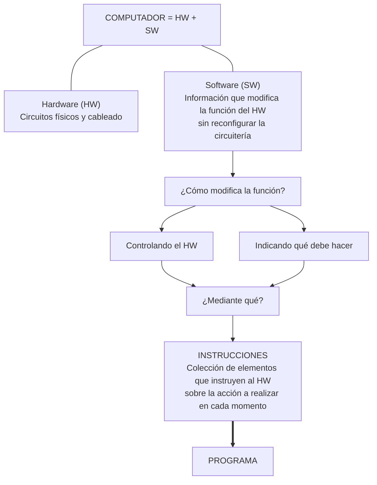

# 1.1. ¿Qué es un Computador?

> [!info] Ubicación en el Tema
> **Índice:** [[Tema_1_Indice]] | **Siguiente:** [[1.2_Arquitectura_y_Ciclo_de_Instruccion]]  
> **Transparencias oficiales:** Diapositivas $1$–$10$ | **Clases:** $1$, $2$ y $3$

---

## 1. Propósito de la Asignatura y Plataformas de Trabajo

El objetivo fundamental de la asignatura es eminentemente práctico: comprender **qué es un ordenador y un procesador** (microprocesador o microcontrolador, que son esencialmente lo mismo), **cómo funciona por dentro** a nivel conceptual (tratando la electrónica digital de bajo nivel como una *caja negra*, dado que aún no se ha cursado Electrónica Digital) y **cómo se programa** para tender un puente hacia asignaturas posteriores de control, robótica y automática (*Clases 1 y 2*).

Durante el curso se emplean dos entornos de referencia:
- **MARS (*MIPS Assembler and Runtime Simulator*):** Emulador del procesador **MIPS** de $32\text{ bits}$ para trabajar en lenguaje ensamblador y observar el código máquina real (véase [[Arquitectura MIPS]]).
- **PICSimLab y PIC Simulator IDE:** Entorno de simulación de una placa real de desarrollo diseñada en Brasil (*PICGenios* / *Microgenios*, de licencia libre) equipada con el microcontrolador **Microchip PIC16F877A** de gama media y $8\text{ bits}$ (véase [[Entrada y Salida]]).

---

## 2. Definición Formal de Computador: Hardware y Software

Según las transparencias oficiales (Diap. $4$–$7$), un **computador** es una máquina (sistema físico, históricamente mecánico o electromecánico, y hoy electrónico) en la que se distinguen obligatoriamente **dos elementos**:

- **Hardware (HW):** Circuitos físicos y cableado que realizan las operaciones elementales.
- **Software (SW):** Información que **modifica la función del hardware sin realizar ninguna reconfiguración física de la circuitería** para resolver problemas distintos.



En síntesis (Diap. $10$):

> *"Un computador es un sistema electrónico digital usado para la manipulación de información digital (datos binarios), de acuerdo a una lista de Instrucciones conocida como programa."*

Existen exactamente **tres tipos de manipulación** de la información digital, cada uno asociado a un subsistema físico del computador (Diap. $10$ y $13$):
1. **Almacenar** $\rightarrow$ Memoria.
2. **Procesar** $\rightarrow$ Procesador (CPU).
3. **Transmitir** $\rightarrow$ Subsistemas de [[Entrada y Salida]] (E/S).

> [!tip] Explicación de Pizarra / Intuición — Por qué el computador es binario ($0$ y $1$)
> El profesor ilustró la base física del mundo binario con la **analogía de la bombilla** (*Clase 2*): una bombilla tiene exactamente dos estados físicos estables, **encendida** (pasa corriente / hay tensión $\rightarrow 1$) o **apagada** (no pasa corriente / no hay tensión $\rightarrow 0$). El hardware electrónico digital manipula exclusivamente señales eléctricas de dos estados, que representamos lógicamente como cadenas de ceros y unos (véase [[Representación de la Información]]).

```tikz
\begin{circuitikz}[scale=1.0, transform shape]
  % Estado 0: Interruptor abierto (sin corriente)
  \draw (0,0) to[battery1, l=$V$] (0,2.2)
              to[nos, l={Interruptor abierto}] (2.5,2.2)
              to[lamp, l={Apagada}] (2.5,0) -- (0,0);
  \node[below, align=center] at (1.25,-0.3) {\textbf{Estado l\'ogico $0$}\\(No pasa corriente)};

  % Estado 1: Interruptor cerrado (pasa corriente)
  \draw (5.5,0) to[battery1, l=$V$] (5.5,2.2)
                to[cs, l={Interruptor cerrado}] (8.0,2.2)
                to[lamp, l={Encendida}] (8.0,0) -- (5.5,0);
  \node[below, align=center] at (6.75,-0.3) {\textbf{Estado l\'ogico $1$}\\(Pasa corriente)};
\end{circuitikz}
```

---

## 3. Clasificación por Propósito y Máquina de Programa Almacenado

Las transparencias (Diap. $8$–$9$) clasifican los computadores según el alcance de los problemas que pueden resolver y el lugar donde reside su programa:

| Categoría | Definición Oficial | Matiz Clave de Clase |
| :--- | :--- | :--- |
| **Propósito Específico** | Diseñado para realizar una tarea determinada. | Admite software (cambia su salida cambiando el programa sin tocar el HW), pero solo dentro de un único dominio (ej. tejer telas). |
| **Propósito General** | Máquina destinada a ejecutar **cualquier tipo de algoritmo**. | Puede resolver cualquier problema **a condición de conectarle los periféricos adecuados** para interactuar con el entorno físico. |
| **Programa Almacenado (John Von Neumann, $1945$)** | Almacena los programas **internamente en memoria** y codifica las instrucciones de forma numérica (**secuencias binarias**). | Frente a sistemas con programa externo (tarjetas perforadas) o recableado manual (ENIAC), hace que el ordenador electrónico sea verdaderamente práctico. |

> [!example] Ejemplo / Problema de Clase — Los 4 Sistemas Analizados en la Clase 2
> El profesor comparó cuatro sistemas concretos para fijar con precisión qué es y qué no es un computador (*Clase 2*):
>
> 1. **Dirección de tiro naval / computador balístico de acorazado (1ª Guerra Mundial):**
>    - *Problema:* Disparar desde un barco en movimiento a otro blanco móvil a $6$–$10\text{ km}$, resolviendo un problema trigonométrico con $10$–$15$ parámetros mecánicos de entrada (distancia, rumbos, viento, temperatura, munición) para obtener los ángulos de elevación y orientación del cañón.
>    - *Veredicto:* **NO es un computador** (es una *"regla de cálculo glorificada"*). Aunque resuelve un cálculo complejísimo, realiza una única función fija y cualquier cambio (por ejemplo, alterar cómo influye el rumbo del blanco) exige **modificar físicamente el hardware mecánico**.
> 2. **Telar de Jacquard (siglo XIX):**
>    - *Funcionamiento:* Telar mecánico cuyas agujas siguen una secuencia de movimiento definida por un mazo de **tarjetas perforadas** (cada tarjeta define una línea de la trama de colores).
>    - *Veredicto:* **SÍ es un computador**, pero **mecánico de propósito específico** (y **NO** de programa almacenado, porque el mazo de tarjetas es externo al sistema). Cambiando únicamente las tarjetas perforadas (el programa) produce telas distintas sin tocar el hardware del telar. *(Dato histórico de clase: el concepto de tarjeta perforada de Jacquard se heredó como entrada/salida en los computadores electrónicos hasta mediados de los años 60, cuando se popularizaron pantallas de fósforo y teclados).*
> 3. **ENIAC (uno de los primeros ordenadores electrónicos/electromecánicos):**
>    - *Funcionamiento:* Usado inicialmente para calcular tablas de tiro de artillería mucho más rápido que un humano, pero el algoritmo se definía **recableando físicamente tableros de conexiones** y conmutando relés.
>    - *Limitación:* Como ordenador de propósito general resultaba muy poco práctico porque requería **reconfigurar el hardware** para cambiar el programa. **John Von Neumann ($1945$)** superó esta limitación con la arquitectura puramente electrónica de **programa almacenado**, guardando el programa en una memoria interna en forma de ceros y unos.
> 4. **Ordenador de propósito general controlando una vasija de reacción química:**
>    - *Planteamiento:* Si un ordenador personal es de propósito general, ¿puede por sí solo calentar los reactivos de un tanque químico?
>    - *Conclusión:* El concepto de "realizar cualquier función" debe tomarse con matices: el procesador puede ejecutar cualquier algoritmo de control, pero necesita los **periféricos y circuitería de interfaz adecuados** para accionar físicamente la resistencia calefactora (conexión directa con [[Entrada y Salida]]).

---

## 4. Preguntas de Clase (Estilo Examen)

> [!question] Pregunta de Clase (Justifica la respuesta)
> **Enunciado (*Clase 2*):** De acuerdo con la definición formal de computador, ¿es un computador el sistema mecánico de dirección de tiro de un acorazado de la 1ª Guerra Mundial? ¿Y el telar de Jacquard? Justifica ambas respuestas.
>
> > [!success]- Solución
> > - **Dirección de tiro naval:** **No es un computador.** Aunque resuelve un cálculo balístico complejo, carece de software: realiza una única función fija y para cambiar cualquier aspecto de su operación hay que modificar físicamente su hardware mecánico.
> > - **Telar de Jacquard:** **Sí es un computador**, concretamente un computador mecánico de **propósito específico**. Permite generar distintos patrones de tela (resolver problemas distintos) cambiando únicamente la secuencia de tarjetas perforadas (el programa/software) sin modificar físicamente el hardware del telar. No es de propósito general porque solo puede tejer telas, ni es de programa almacenado porque el programa reside fuera de una memoria interna.

> [!question] Pregunta de Clase (Justifica la respuesta)
> **Enunciado (*Clase 2*):** Si un ordenador moderno es un computador de propósito general capaz de ejecutar cualquier algoritmo, ¿puede por sí mismo calentar una vasija de reacción química o tejer una tela?
>
> > [!success]- Solución
> > **No por sí mismo.** Que sea de propósito general significa que su procesador puede ejecutar cualquier algoritmo modificando el software en memoria, pero para actuar sobre el mundo físico necesita tener conectados los **periféricos y el hardware de adaptación adecuados** (por ejemplo, un sistema de control conectado a la resistencia calefactora o a los actuadores del telar).
