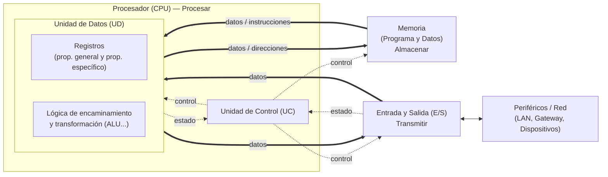
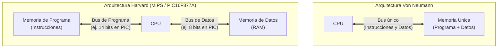
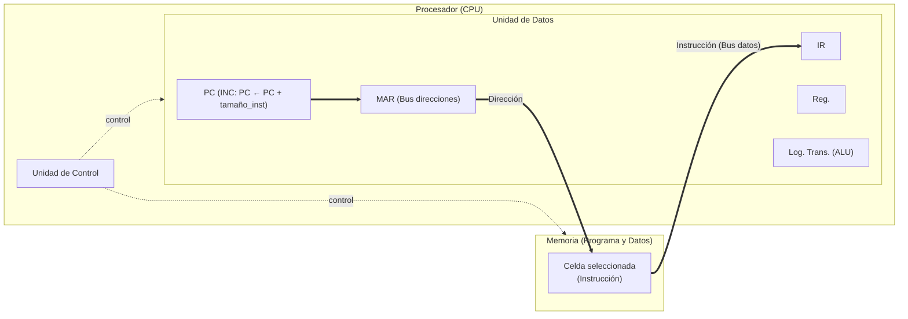
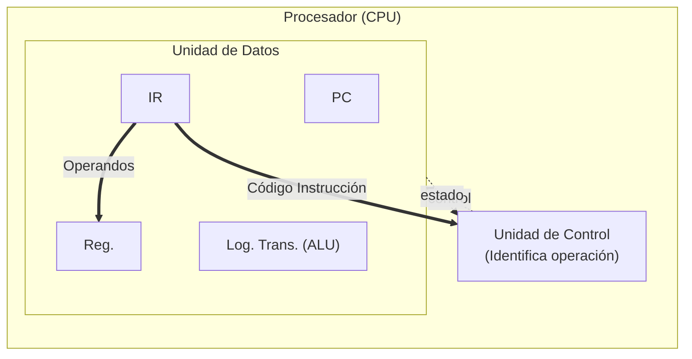
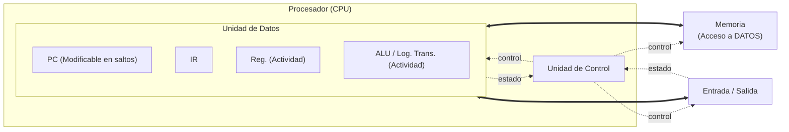

# 1.2. Arquitectura del Computador y Ciclo de Instrucción

> [!info] Ubicación en el Tema
> **Anterior:** [[1.1_Que_es_un_Computador]] | **Índice:** [[Tema_1_Indice]] | **Siguiente:** [[1.3_Programacion_y_Proceso_de_Traduccion]]  
> **Transparencias oficiales:** Tema 1, Diapositivas $11$–$22$ (y Diap. $122$–$124$ del Tema 3 vistas en Clase 22) | **Clases:** $2$, $3$, $5$, $15$ y $22$

---

## 1. Arquitectura de un Computador de Programa Almacenado

Un computador de programa almacenado se compone de **tres subsistemas principales** interconectados bidireccionalmente mediante un **BUS** común (Diap. $13$–$18$):

1. **Memoria (Programa y Datos):** Encargada de **almacenar** la información (tanto las instrucciones del programa como los datos sobre los que operan).
2. **Procesador (CPU):** Encargado de **procesar** la información siguiendo las instrucciones del programa. Su ecuación estructural es:
   $$\text{CPU} = \text{UC} + \text{UD} + \text{Registros}$$
   - **Unidad de Control (UC):** Circuitería encargada de gestionar el ciclo de instrucción, controlar la secuencia de ejecución y coordinar mediante señales de `control` el resto de bloques.
   - **Unidad de Datos (UD):** Conjunto de circuitos donde se ejecuta efectivamente la instrucción; incluye:
     - **Registros** (de propósito general y de propósito específico, como `PC` e `IR`).
     - **Lógica de encaminamiento y transformación**, cuyo núcleo es la **ALU** (*Unidad Aritmético-Lógica*), encargada de sumar, restar, multiplicar, dividir y comparar valores lógicos (*Clase 2*).
3. **Entrada y Salida (E/S):** Encargada de **transmitir** información con el exterior (periféricos humanos como teclado, ratón, pantalla, impresora, o redes y dispositivos de control industrial como `LAN`, `Gateway`, sensores y actuadores; véase [[Entrada y Salida]]).

> [!tip] Explicación de Pizarra / Intuición — ¿Es siempre obligatoria la E/S para humanos?
> El procesador y la memoria existen siempre (*Clase 3*). En sistemas empotrados con memoria no volátil (ROM) que no requieren interacción humana (ej. un controlador industrial), puede no haber teclado ni pantalla, aunque normalmente sí existirá algún subsistema de [[Entrada y Salida]] para comunicarse con otros dispositivos físicos.  
> Además, en la **Clase 15** el profesor subraya que este **bus común** (CPU, Memoria y Periféricos compartiendo las mismas líneas físicas) constituye un **bus multipunto**, lo que obliga a arbitrar quién escribe en cada instante mediante [[Chip Select]] para evitar una [[Colisión de Bus]].



**Resumen de señales del diagrama completo (Diap. $16$–$18$):**

| Enlace | Señales de Control / Estado | Flujo de Información (Buses) |
| :--- | :--- | :--- |
| **UC $\leftrightarrow$ UD** (internas) | `control` ($\text{UC} \rightarrow \text{UD}$); `estado` ($\text{UD} \rightarrow \text{UC}$) | — |
| **CPU $\leftrightarrow$ Memoria** | `control` ($\text{UC} \rightarrow \text{Memoria}$) | `datos` e `instrucciones` ($\text{Mem} \rightarrow \text{UD}$); `datos` y `direcciones` ($\text{UD} \rightarrow \text{Mem}$) |
| **CPU $\leftrightarrow$ E/S** | `control` ($\text{UC} \rightarrow \text{E/S}$); `estado` ($\text{E/S} \rightarrow \text{UC}$) | `datos` bidireccional ($\text{UD} \leftrightarrow \text{E/S}$) |

---

## 2. Arquitectura Von Neumann vs Arquitectura Harvard

> [!note] Aclaración entre Transparencias y Clases
> Las transparencias del Tema 1 (Diap. $13$–$22$) representan únicamente la **máquina de Von Neumann** (una sola caja `Memoria Programa y Datos`). Sin embargo, en las **Clases 2, 3 y 22** el profesor introduce explícitamente la **Arquitectura Harvard** (presente tanto en [[Arquitectura MIPS]] como en el microcontrolador **PIC16F877A**) y convierte la comparación entre ambas en una de las preguntas estrella de mayor nivel del Primer Parcial.

| Característica | Arquitectura Von Neumann | Arquitectura Harvard |
| :--- | :--- | :--- |
| **Organización física de memoria** | **Única memoria** que contiene simultáneamente instrucciones (programa) y datos. | **Dos memorias físicamente separadas** (con buses independientes): memoria de programa (instrucciones) y memoria de datos. |
| **Ejemplos vistos en la asignatura** | Simuladores JavaScript de clase; esquema base del Tema 1 y Tema 4. | Procesador **MIPS** (MARS) y microcontrolador **PIC16F877A** (Flash de programa de $14\text{ bits}$ y RAM de datos de $8\text{ bits}$). |
| **Visión del programador** | Memoria única con zonas separadas por convenio para instrucciones y datos. | En general transparente desde el punto de vista lógico del programador (*Clase 3*). |
| **Ciclo de instrucción** | Idéntico conceptualmente (*Fetch – Decode – Execute*). | Idéntico conceptualmente (*Fetch – Decode – Execute*), **pero permite solapar fases en paralelo**. |
| **Accesos simultáneos (Pipeline)** | **NO puede** realizar simultáneamente el *Fetch* de una instrucción y la lectura/escritura de datos en memoria de la anterior (colisionan en el acceso a la única memoria). | **SÍ puede** leer la siguiente instrucción de la memoria de programa mientras ejecuta operaciones sobre la memoria de datos (**sin colisión**). |



### Conexión de Examen (Clase 22): El Pipeline de $2$ Etapas del PIC16F877A

En la **Clase 22**, el profesor recuperó las **Diapositivas $122$–$124$ del Tema 3** (*datasheet* de la familia *mid-range* PIC16F87XA) para repasar el Tema 1 y justificar por qué el temporizador [[Timer0]] avanza a $f_{\text{osc}}/4$:

- Cada fase del ciclo de instrucción en el PIC (*Fetch* —que aquí engloba adquisición y decodificación— y *Execute*) tarda **$4$ ciclos de reloj** (`Q1`, `Q2`, `Q3`, `Q4`). Por ejemplo, con un cristal de $f_{\text{osc}} = 4\text{ MHz}$, cada fase dura:
  $$T_{\text{CY}} = \frac{4}{f_{\text{osc}}} = \frac{4}{4\text{ MHz}} = 1\ \mu\text{s}$$
- En total una instrucción tarda $8$ ciclos de reloj ($4$ de *Fetch* + $4$ de *Execute*), pero gracias a que el PIC tiene **arquitectura Harvard**, **superpone en paralelo** la ejecución de la instrucción actual (`Execute INST(PC)`) con la búsqueda de la siguiente (`Fetch INST(PC+1)`). A efectos prácticos, se completa **$1$ instrucción cada $4$ ciclos de reloj** (salvo saltos o instrucciones lentas como multiplicaciones/divisiones).

```wavedrom
{
  "signal": [
    { "name": "OSC1",            "wave": "P...........", "period": 1 },
    ["Fases internas",
      { "name": "Q1",            "wave": "10..10..10.." },
      { "name": "Q2",            "wave": "010..10..10." },
      { "name": "Q3",            "wave": "0.10..10..10" },
      { "name": "Q4",            "wave": "0..10..10..1" }
    ],
    { "name": "PC",              "wave": "=...=...=...", "data": ["PC", "PC+1", "PC+2"] },
    { "name": "Fetch (Prog.)",   "wave": "=...=...=...", "data": ["Fetch INST(PC)", "Fetch INST(PC+1)", "Fetch INST(PC+2)"] },
    { "name": "Execute (Datos)", "wave": "=...=...=...", "data": ["Execute INST(PC-1)", "Execute INST(PC)", "Execute INST(PC+1)"] }
  ],
  "foot": {
    "text": "PIC16F877A (Harvard): Fetch de PC+1 y Execute de PC ocurren simultáneamente cada 4 ciclos (TCY)"
  }
}
```

> [!danger] Aviso / Trampa de Examen — Pregunta "Camino de la Matrícula" (Clase 22)
> El profesor indicó explícitamente que preguntar sobre este diagrama (*"¿Es una máquina de Von Neumann? ¿Por qué este solapamiento no puede hacerse en Von Neumann y sí en Harvard?"*) es la típica pregunta de **diferenciar aprobado de sobresaliente/matrícula**.  
> **Clave de la justificación:** Como la ejecución de una instrucción (especialmente en el PIC, que opera directamente sobre posiciones de RAM como registros) puede implicar leer o escribir en memoria de datos, en una máquina de **Von Neumann** (memoria única) se intentarían hacer **dos accesos simultáneos a la misma memoria** (leer instrucción por *Fetch* y leer/escribir dato por *Execute*), lo cual no es posible en memorias sencillas. En **Harvard**, al estar separadas físicamente la memoria de instrucciones y la de datos, ambos accesos ocurren en paralelo sin colisión.

---

## 3. La Memoria: Tipos, Direccionamiento en Bytes y Hexadecimal

### 3.1. Memoria RAM (Volátil) vs Memoria ROM / Flash (No Volátil)

En la **Clase 3** y la **Clase 4** el profesor estableció la distinción práctica fundamental entre ambos tipos de memoria:

- **RAM (*Random Access Memory*):** Memoria de lectura/escritura de acceso aleatorio cuya característica crítica es ser **volátil**: en cuanto se corta la alimentación (aunque sea un instante brevísimo), **pierde todo su contenido**.
- **ROM (*Read Only Memory*) / Memoria Flash:** Memoria **no volátil** que conserva sus contenidos sin alimentación eléctrica. Aunque históricamente solo se escribía una vez, hoy las memorias **Flash** permiten borrar y reescribir sus contenidos de forma puntual (ej. actualizaciones de firmware).

> [!tip] Explicación de Pizarra / Intuición — Casos Reales de Ingeniería con RAM y ROM (Clases 3 y 4)
> 1. **Actualización de BIOS o Smart TV ("Ladrillo de 500 euros"):** Cuando una Smart TV o un portátil avisa *"No apague el equipo mientras se actualiza"*, está borrando y reescribiendo su **ROM/Flash**. Si se corta la luz a mitad del proceso, el código de arranque queda corrupto y el dispositivo no vuelve a encender jamás.
> 2. **Protección de sistemas críticos en RAM y discos SSD:** Si un sistema de control industrial mantiene datos críticos en RAM, un pico de tensión los borra; como ingenieros hay que protegerlo con una batería / **SAI** (*Sistema de Alimentación Ininterrumpida*). De forma análoga, los **discos SSD** profesionales incorporan **condensadores** capaces de almacenar energía suficiente tras un corte brusco para terminar de volcar sus metadatos críticos a la memoria Flash.
> 3. **¿Cómo arranca un PC si la RAM está borrada al encenderlo?** Al dar alimentación, el `PC` arranca en una dirección fija (típicamente $0$) que apunta a la **ROM del sistema**, donde reside el **cargador de arranque (*bootloader*)** que inicializa el equipo y copia el sistema operativo desde almacenamiento no volátil externo (disco duro, SSD, pendrive, tarjeta SD) a la RAM.

### 3.2. Direccionamiento en Bytes, Conteo desde Cero y Notación Hexadecimal

El profesor recalcó estas reglas de arquitectura desde las **Clases 2 y 3** (enlazando directamente con [[Binario Natural]] y [[Representación de la Información]]):

- **Unidad mínima de direccionamiento:** La memoria siempre se organiza y direcciona en **bytes** ($1\text{ byte} = 8\text{ bits}$).
- **Los informáticos empiezan a contar en $0$:** La primera dirección de memoria es siempre la **$0$**, nunca la $1$. Si una memoria tiene $256\text{ bytes}$, sus direcciones van de $0$ a $255$; si tiene $1024\text{ bytes}$, van de $0$ a $1023$.
- **Incremento del `PC` según el tamaño de instrucción:**
  - En una máquina con instrucciones de $1\text{ byte}$ ($8\text{ bits}$, como el simulador de clase), cada instrucción consecutiva incrementa el `PC` en $+1$ ($0, 1, 2, 3\dots$).
  - En [[Arquitectura MIPS]] (MARS), cada instrucción ocupa **$32\text{ bits} = 4\text{ bytes}$**, por lo que las instrucciones se ubican a intervalos de $4\text{ bytes}$ ($0, 4, 8, 12\dots$) y el `PC` avanza de **$4$ en $4$**.
- **Notación Hexadecimal (base $16$) como abreviatura del binario:** Manejar $32\text{ bits}$ en binario es propenso a bailar un bit y corromper la instrucción, y en decimal no es práctico. Como $2^4 = 16$, cada grupo de **$4\text{ bits}$** equivale exactamente a **$1$ dígito hexadecimal** (`0`–`9` y `A`–`F` para los valores $10$–$15$).

> [!example] Ejemplo / Problema de Clase — Agrupación Binario $\leftrightarrow$ Hexadecimal (*Clase 2*)
> - Un grupo de $4\text{ bits}$ con valor $1111_2$:
>   $$1 \cdot 2^3 + 1 \cdot 2^2 + 1 \cdot 2^1 + 1 \cdot 2^0 = 8 + 4 + 2 + 1 = 15_{10} = \text{F}_{16}$$
> - Una cadena de $12\text{ bits}$ se lee cómodamente como $3$ dígitos hexadecimales, por ejemplo $\text{92F}_{16}$.
> - Una instrucción de **MIPS** ($32\text{ bits} = 4\text{ bytes}$) se representa siempre con exactamente $\frac{32}{4} = \mathbf{8\text{ dígitos hexadecimales}}$.

---

## 4. Indistinguibilidad entre Instrucciones y Datos en Von Neumann

> [!danger] Aviso / Trampa de Examen — "La Pregunta del Millón" (Clases 3, 5, 8, 12 y 22)
> El profesor repitió en cinco clases distintas que esta es una de las preguntas clásicas más probables del Primer Parcial:
> - **¿Es posible distinguir, mirando únicamente el contenido de una posición de memoria de una máquina de Von Neumann, si una cadena de ceros y unos es una instrucción o un dato?**
> - **Respuesta tajante:** **NO.** Visual y lógicamente, una instrucción de $32\text{ bits}$ y un dato de $32\text{ bits}$ almacenados en memoria son cadenas de bits completamente indistinguibles.
> - **Único criterio de distinción:** La **fase del ciclo de instrucción** y qué elemento de la CPU genera la dirección de acceso:
>   - Si a esa posición se accede durante la fase de **Búsqueda (*Fetch*)** porque apunta a ella el **Contador de Programa (`PC`)**, el procesador la interpreta obligatoriamente como **instrucción**.
>   - Si a esa posición se accede durante la fase de **Ejecución (*Execute*)** a partir de la dirección indicada en el operando de una instrucción, el procesador la interpreta como **dato**.

---

## 5. El Ciclo de Instrucción (*Fetch – Decode – Execute*)

El **ciclo de instrucción** (conocido en inglés como ciclo **FDE**: *Fetch, Decode, Execute*) es la secuencia repetitiva de tres fases que la Unidad de Control ejecuta una y otra vez para recorrer un programa almacenado en memoria (Diap. $19$–$22$, *Clases 3 y 4*).

### Registros Específicos Implicados

> [!note] Matiz entre Transparencias y Clase 3
> Las Diapositivas $20$–$22$ dibujan únicamente **`PC`** e **`IR`** en el bloque de registros específicos de la Unidad de Datos. En la **Clase 3**, apoyándose en el simulador de Von Neumann, el profesor introduce además explícitamente el registro **`MAR`** (*Memory Address Register*) para explicar cómo la dirección del `PC` pasa al bus de direcciones.

| Registro | Significado | Función en el Ciclo de Instrucción |
| :--- | :--- | :--- |
| **`PC`** | *Program Counter* (Contador de Programa) | Contiene la dirección de memoria de la **próxima instrucción** que debe ejecutarse. Tras un reset se inicializa a un valor fijo (típicamente $0$). |
| **`MAR`** | *Memory Address Register* (Registro de Direcciones de Memoria) | Recibe la dirección (desde `PC` en *Fetch*) y activa las líneas del bus de direcciones hacia la memoria (*Clase 3*). |
| **`IR`** | *Instruction Register* (Registro de Instrucción) | Almacena temporalmente el código máquina de la instrucción recién traída de memoria por el bus de datos para poder decodificarla. |

### Las 3 Fases del Ciclo de Instrucción

#### Fase 1: Búsqueda de la Instrucción (*Fetching*) — Diap. $20$
1. La **UC** emite señales de `control` hacia la Unidad de Datos y la Memoria.
2. El valor de **`PC`** se copia en **`MAR`** para poner la dirección en el bus de direcciones y seleccionar la celda correspondiente de la memoria.
3. El contenido binario de esa celda viaja por el bus de datos hacia la CPU y se carga en el registro **`IR`**.
4. La UC **incrementa el `PC`** (etiqueta `INC` en Diap. $20$) para que apunte ya a la siguiente instrucción secuencial ($+1\text{ byte}$ en el simulador simple, $+4\text{ bytes}$ en MIPS).



#### Fase 2: Decodificación (*Decode*) — Diap. $21$
1. Durante esta fase **no hay accesos activos a la memoria**.
2. Desde el registro **`IR`** se extraen dos partes (véase [[Formato de Instrucción]]):
   - El **Código de Instrucción (`OPCODE`)** sube a la **Unidad de Control**, que lo compara con su tabla interna para identificar qué operación se pide (suma, acceso a memoria, salto...).
   - Los **Operandos** se encaminan hacia el banco de registros (`Reg.`) para identificar/seleccionar los datos necesarios.



#### Fase 3: Ejecución (*Execute*) — Diap. $22$
1. La **Unidad de Control** activa las señales de `control` adecuadas sobre la **UD**, la **Memoria** y/o la **E/S**, y recibe señales de `estado` de la UD y de la E/S.
2. Se realiza la acción solicitada por la instrucción:
   - Operación aritmético-lógica en la **ALU** (`Log. Trans.`) con valores de los registros (`Reg.`).
   - Lectura o escritura de un **dato** en Memoria o en un periférico de [[Entrada y Salida]] (en este instante es cuando se accede a datos en memoria, no desde el `PC`).
   - Si se trata de una **instrucción de salto** (*jump* o *branch*), la fase de ejecución **modifica explícitamente el contenido de `PC`** para romper la secuencia lineal (véase [[1.4_Ejecucion_de_un_Programa_y_Casos_Practicos]]).



> [!tip] Conexión con Tema 4 — ¿Cuándo se atiende una Interrupción Hardware?
> Como se estudia en [[Interrupciones]] (*Clase 20*), si un periférico activa la línea `INT` en mitad de la fase de ejecución, la CPU **no** se detiene instantáneamente (salvar todo el estado interno de `IR`, decodificador y ALU sería demasiado complejo y propenso a errores): espera a **terminar completamente la fase *Execute* de la instrucción en curso** y atiende la interrupción justo antes del siguiente *Fetch*, cuando el contexto mínimo imprescindible que debe guardarse es el valor de **`PC`**.

---

## 6. Preguntas de Clase (Estilo Examen)

> [!question] Pregunta de Clase (Justifica la respuesta)
> **Enunciado (*Clases 3, 5 y 22*):** En una máquina de Von Neumann, si inspeccionamos directamente una posición de memoria y vemos una cadena binaria de $32\text{ bits}$, ¿cómo podemos saber con certeza si corresponde a una instrucción o a un dato?
>
> > [!success]- Solución
> > **No existe ninguna forma** de saberlo mirando únicamente el contenido de la memoria, porque tanto instrucciones como datos se almacenan como cadenas de ceros y unos en una memoria única compartida. Solo se distinguen por el contexto del **ciclo de instrucción**: si a esa dirección se accede en la fase de búsqueda (*Fetch*) a través del **Contador de Programa (`PC`)**, es una **instrucción**; si se accede en la fase de ejecución (*Execute*) desde el campo operando de una instrucción, es un **dato**.

> [!question] Pregunta de Clase (Justifica la respuesta)
> **Enunciado (*Clase 22 — Nivel Matrícula*):** Observando el cronograma del microcontrolador PIC16F877A donde el *Fetch* de la instrucción siguiente (`PC+1`) ocurre durante los mismos $4$ ciclos de reloj en que se ejecuta (`Execute`) la instrucción actual (`PC`):  
> 1. ¿Corresponde este funcionamiento a una máquina de Von Neumann?  
> 2. ¿Por qué este solapamiento (*pipeline*) NO puede hacerse en una máquina de Von Neumann convencional y SÍ en el PIC16F877A?
>
> > [!success]- Solución
> > 1. **No**, corresponde a una **arquitectura Harvard**, porque el PIC16F877A separa físicamente la memoria de programa (instrucciones) de la memoria de datos (RAM), mientras que una máquina de Von Neumann tiene una única memoria compartida para ambas.
> > 2. **Justificación del solapamiento:** Durante la fase *Execute*, la instrucción en curso puede necesitar leer o escribir un dato en memoria al mismo tiempo que la fase *Fetch* lee de memoria el código de la siguiente instrucción. En una máquina de **Von Neumann** (una única memoria) eso exigiría **dos accesos simultáneos a la misma memoria**, produciendo una colisión incompatible con memorias simples. En la **arquitectura Harvard**, al existir dos memorias y dos buses físicamente independientes (programa y datos), el procesador puede leer la siguiente instrucción de la memoria de programa en paralelo con los accesos a la memoria de datos.

> [!question] Pregunta de Clase (Justifica la respuesta)
> **Enunciado (*Clases 3 y 4*):** Si la memoria RAM es volátil y queda vacía cada vez que apagamos el ordenador, ¿cómo consigue el procesador comenzar a ejecutar código y cargar el sistema operativo al pulsar el botón de encendido?
>
> > [!success]- Solución
> > Al encenderse o resetearse el sistema, el Contador de Programa (`PC`) toma automáticamente una dirección de inicio fija (típicamente $0$) que apunta a una **memoria ROM / Flash no volátil** (cuyo contenido no se borra al cortar la corriente). En esa ROM reside el programa de arranque (*bootloader* / BIOS), que el procesador comienza a ejecutar de inmediato para inicializar el hardware y copiar el sistema operativo desde el almacenamiento secundario (disco/SSD) a la memoria RAM.
