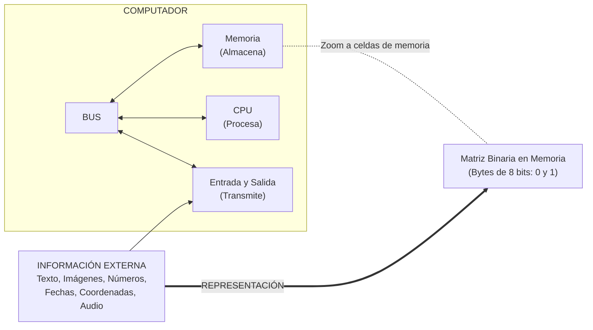
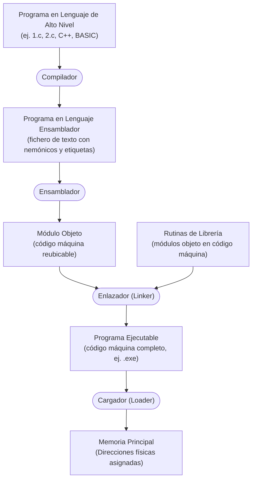

# 1.3. Programación de un Procesador y Proceso de Traducción

> [!info] Ubicación en el Tema
> **Anterior:** [[1.2_Arquitectura_y_Ciclo_de_Instruccion]] | **Índice:** [[Tema_1_Indice]] | **Siguiente:** [[1.4_Ejecucion_de_un_Programa_y_Casos_Practicos]]  
> **Transparencias oficiales:** Diapositivas $23$–$31$ | **Clases:** $4$, $5$ y $14$

---

## 1. Algoritmo, Lenguaje de Programación y Programa

Para definir qué tarea debe realizar un computador escribimos un **programa** (Diap. $25$). En la **Clase 4**, el profesor matizó la diferencia entre algoritmo y programa:

- **Algoritmo:** Concepto abstracto (matemático/mental) que define la **secuencia de pasos** a seguir para resolver un problema, teniendo en cuenta qué acciones elementales es capaz de realizar el procesador.
- **Lenguaje de programación:** Conjunto de reglas y símbolos que permiten expresar algoritmos formalmente para que un computador los pueda traducir y ejecutar.
- **Programa:** Algoritmo concretado y escrito en un lenguaje de programación (paso de la acción abstracta a la secuencia concreta de instrucciones del procesador).

> [!tip] Explicación de Pizarra / Intuición — Diseñar antes de picar código (*Clase 4*)
> Por críptico que sea el código máquina o cómodo que sea un lenguaje de alto nivel, el **primer paso nunca es escribir código**, sino pensar y trazar el **algoritmo** paso a paso (incluso en papel o en un diagrama) conociendo previamente la tabla de instrucciones del procesador.

---

## 2. Información Heterogénea y Representación Binaria en Memoria

Tal como ilustra la Diapositiva $26$, toda la información del mundo real —texto impreso, imágenes fotográficas, cifras, fechas, coordenadas geográficas, monedas o señales de audio— ingresa a través de la [[Entrada y Salida]], transita por el bus hacia la CPU y la Memoria, y acaba almacenándose **exclusivamente como una matriz de bits (`0` y `1`) agrupados en bytes** (véase [[Representación de la Información]]).



---

## 3. Tipos de Lenguajes de Programación

Según su **contenido semántico** (cuánto hace una sola instrucción y cuán cercana resulta al pensamiento humano) y quién los comprende directamente, existen **tres niveles de lenguaje** (Diap. $27$–$29$, *Clase 4*):

| Nivel de Lenguaje | Contenido Semántico | ¿Comprensible por humanos? | ¿Comprensible directamente por el HW? | Ejemplos Oficiales y de Clase |
| :--- | :--- | :---: | :---: | :--- |
| **Alto Nivel** | **Alto** (expresiones matemáticas, bucles `while`/`for`). | Sí (muy intuitivo). | **No** (es texto; requiere traducción). | C, C++, Java, Pascal (Diap. $27$); **Python** (*Clase 4*); **BASIC** compilado en PIC (*Clase 14*). |
| **Ensamblador** | **Bajo** ($1$ a $1$ con instrucciones simples de la CPU, usando **nemónicos** y **etiquetas**). | Sí (pero engorroso y propenso a errores). | **No** (sigue siendo un fichero de texto ASCII). | Intel 386, Alpha, **MIPS** (Diap. $28$, MARS en *Clase 4*), ensamblador PIC (*Clase 14*). |
| **Lenguaje Máquina** | **Bajo** (cadenas puras de ceros y unos). | Muy difícil / impráctico. | **SÍ (es el ÚNICO que entiende el procesador).** | Cadenas binarias puras (Diap. $29$, simulador *Clase 4*), hex de $32\text{ bits}$ en MARS, fichero **Intel HEX** en PIC. |

### Ejemplos Oficiales de los Tres Niveles (Diap. $27$–$29$)

**1. Lenguaje de alto nivel (C — suma de un vector de $4$ elementos, Diap. $27$):**
```c
#define vueltas 4
int suma = 0;
int V[4] = {0, 1, 2, 3};
main () {
    register int suma_parcial = 0;
    register int i = 0;
    while (i < vueltas) {
        suma_parcial += V[i];
        i++;
    }
    suma = suma_parcial;
}
```

**2. Lenguaje ensamblador (Diap. $28$):**
```asm
.text
main:
        MOVI R3,0               ; R3 es suma_parcial
        MOVI R1,0               ; R1 es i
        MOVI R4, LO(V)          ; R4 carga 1er elem. vector V
        MOVHI R4, HI(V)
        MOVI R0,0               ; para el salto incondicional
        MOVI R2, Vueltas
while:  CMPLT R5, R1, R2        ; ¿i < Vueltas?
        BZ R5, fiwhile          ; si (R5==0) fin bucle
        ADDI R1, R1, 1          ; i++
        BZ R0, while            ; salto incondicional bucle
fiwhile:
```

> [!note] Nota de Rigor sobre Erratas en la Diapositiva $28$ Original
> En la transparencia original figuran varias erratas tipográficas (`HÌ(V)`, `r2` en minúsculas, `RO` con la letra O en lugar del registro `R0`, falta la `i` en el comentario `¿ < Vueltas?`, e inconsistencia `fiwhile`/`Fiwhile:`) y se omiten las instrucciones internas de carga y suma de `V[i]` en `R3` dentro del cuerpo del bucle. El ejemplo se usa solo para ilustrar el contraste visual entre el nivel semántico de C y el del ensamblador.

**3. Lenguaje máquina (palabras binarias puras de $16\text{ bits}$, Diap. $29$):**
```text
0010100101101001
1010001001001011
1111010100111010
...
```

> [!tip] Explicación de Pizarra / Intuición — Ventaja de las Etiquetas en Ensamblador (*Clase 4*)
> Al programar en ensamblador **MIPS** en MARS (como el contador de $5$ en $5$ visto en clase), aunque las instrucciones siguen siendo muy simples, el programador sustituye las direcciones binarias manuales por **nemónicos** (ej. `LOAD`, `ADD`, `SUB`) y **etiquetas** de texto (ej. `loop:`) para indicar destinos de salto sin tener que recalcular a mano la dirección física de memoria.

### ¿Cuándo necesita un Ingeniero programar en Lenguaje Ensamblador?

En la **Clase 4**, el profesor subrayó que hoy casi nadie programa aplicaciones enteras en ensamblador, pero un ingeniero electrónico/robótico **sí se enfrentará al ensamblador en exactamente dos escenarios reales**:

1. **Ingeniería inversa y depuración sin código fuente:** Cuando hay que analizar un sistema cerrado del que nadie entrega el código fuente (ejemplo de clase: interceptar un **dron** sin destruir su unidad de control, leer el código máquina de su memoria y **desensamblarlo** conociendo el procesador para averiguar cómo funciona o deshabilitarlo).
2. ***Drivers* y sistemas críticos de control en tiempo real estricto:** Cuando los tiempos de respuesta exigidos son de milisegundos o menos (ejemplo de clase: el control de una locomotora del **AVE a $350\text{ km/h}$**). El código máquina generado automáticamente por un compilador de alto nivel introduce demasiada sobrecarga ("morralla") e instrucciones extra; bajar a ensamblador permite controlar exactamente cada instrucción ejecutada y garantizar el tiempo de respuesta.

---

## 4. El Proceso de Traducción al Código Máquina

Dado que el procesador **SOLO** entiende lenguaje máquina (Diap. $30$–$31$), todo programa escrito en texto debe atravesar una cadena de herramientas software de traducción:



### Función Exacta de Cada Herramienta (Diap. $30$–$31$, *Clases 4, 5 y 14*)

1. **Compilador:** Traduce un programa escrito en **lenguaje de alto nivel** (ej. C o el BASIC de PIC Simulator IDE) a **lenguaje ensamblador** para una arquitectura concreta (en sistemas empotrados, cuando se compila en un PC para otro procesador como el PIC16F877A, se habla de **compilador cruzado**, *Clase 14*).
2. **Ensamblador (*Assembler*):** Traduce el texto en **lenguaje ensamblador** a **código máquina** (en forma de **ficheros objeto** con código máquina reubicable). Si programamos directamente en ensamblador (como en el botón *Assemble* de MARS), pasamos en un único paso de ensamblador a código máquina (*Clases 4 y 5*).
3. **Enlazador (*Linker*):** Cuando un proyecto tiene varios ficheros fuente compilados por separado (ej. `1.c` y `2.c` $\rightarrow$ dos ficheros objeto) o invoca rutinas de librería, el *linker* **combina todos los módulos objeto**, resuelve las referencias cruzadas de direcciones entre ellos y genera un único **fichero ejecutable**.
4. **Cargador (*Loader*):** Toma el ejecutable y lo carga en memoria principal, **asignando direcciones físicas de memoria a las direcciones lógicas** utilizadas en el código objeto (Diap. $31$).

> [!note] Aclaración sobre Lenguajes Compilados vs Interpretados (*Clase 4* y *Clase 5*)
> En la Clase 4 el profesor mostró un bucle `while j > 0` en **Python** (indicando que es un lenguaje **interpretado** de alto nivel) para contrastar su legibilidad con el ensamblador, y precisó en la Clase 5 el flujo compilado clásico: *Alto Nivel $\xrightarrow{\text{Compilador}}$ Ensamblador $\xrightarrow{\text{Ensamblador}}$ Código Máquina*. Asimismo, en la **Clase 14** ilustró esta cadena en el entorno **PIC Simulator IDE** (*Compile & Assemble*): traduce el programa en **BASIC** a ensamblador **ASM** (usando el registro de trabajo `W` del PIC16F877A) y después a un fichero en formato **Intel HEX** (código máquina + sumas de comprobación CRC) listo para grabarse en la memoria Flash del microcontrolador mediante el programador ICSP.

---

## 5. Preguntas de Clase (Estilo Examen)

> [!question] Pregunta de Clase (Justifica la respuesta)
> **Enunciado (*Clase 4*):** Si abrimos un programa en ensamblador de MARS (`programa.asm`) o un código en C/Python con un editor de texto, vemos instrucciones claras. ¿Puede el procesador ejecutar directamente ese fichero? Justifica qué etapas hacen falta.
>
> > [!success]- Solución
> > **No.** Esos ficheros son texto plano compuesto por caracteres alfanuméricos ([[Código ASCII]] / UTF-8), mientras que el hardware del procesador **solo entiende lenguaje máquina** (cadenas binarias de ceros y unos codificadas según su ISA).
> > - Un programa en **ensamblador** debe pasar primero por un **ensamblador** (*assembler*) para traducirse a código máquina.
> > - Un programa en **alto nivel** (como C) debe pasar por un **compilador** (alto nivel $\rightarrow$ ensamblador), un **ensamblador** (ensamblador $\rightarrow$ módulos objeto en código máquina), un **enlazador (*linker*)** para unir módulos y librerías resolviendo referencias y generar el ejecutable, y finalmente el **cargador (*loader*)** para situarlo en direcciones físicas de memoria.

> [!question] Pregunta de Clase (Justifica la respuesta)
> **Enunciado (*Clase 4*):** Si los lenguajes de alto nivel son mucho más sencillos y menos propensos a errores, ¿en qué dos situaciones prácticas reales tendría que trabajar un ingeniero en lenguaje ensamblador?
>
> > [!success]- Solución
> > 1. **Ingeniería inversa o depuración sin código fuente:** Cuando solo se dispone del código máquina leído de la memoria de un dispositivo (ej. analizar la unidad de control de un dron interceptado) y hay que desensamblarlo para comprender o alterar su comportamiento.
> > 2. **Sistemas de control en tiempo real estricto (*drivers* críticos):** Cuando las restricciones temporales son tan severas (milisegundos o menos, ej. control de una locomotora del AVE a $350\text{ km/h}$) que el código generado por un compilador de alto nivel introduce demasiadas instrucciones auxiliares y es necesario bajar a ensamblador para controlar con precisión cada instrucción y garantizar el tiempo de respuesta.
