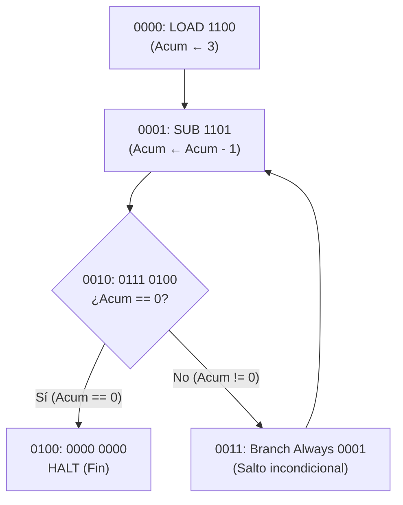

# 1.4. Ejecución de un Programa y Casos Prácticos de Pizarra

> [!info] Ubicación en el Tema
> **Anterior:** [[1.3_Programacion_y_Proceso_de_Traduccion]] | **Índice:** [[Tema_1_Indice]]  
> **Transparencias oficiales:** Diapositivas $32$–$35$ | **Clases:** $3$ y $4$

---

## 1. Ejecución Secuencial y Ruptura del Flujo mediante Saltos

En funcionamiento normal, el procesador lee y ejecuta **secuencialmente y en orden** las instrucciones almacenadas en memoria, repitiendo el ciclo *Fetch $\rightarrow$ Decode $\rightarrow$ Execute* (Diap. $33$–$35$). Al concluir cada búsqueda, el Contador de Programa (`PC`) se incrementa automáticamente para apuntar a la siguiente instrucción consecutiva.

Sin embargo, para construir **bucles** (reutilizar una misma instrucción sin escribirla $150\,000$ veces) o **estructuras condicionales** (saltar bloques de código si no se cumple una condición), es imprescindible romper el flujo secuencial (*Clases 3 y 4*):

- **Instrucciones de salto (*jump* / *branch*):** No realizan operaciones aritméticas con datos de memoria; durante su fase de **Ejecución (*Execute*)**, **modifican explícitamente el valor del `PC`**, obligando al siguiente *Fetch* a saltar hacia atrás (bucle) o hacia adelante (evitar código).
  - **Salto incondicional (*Branch Always* / *Jump*):** Cambia el `PC` siempre, sin evaluar ninguna condición.
  - **Salto condicional:** Cambia el `PC` únicamente si se cumple una condición sobre el estado actual del procesador (por ejemplo, si el acumulador es igual a $0$ o mayor/igual que $0$).

> [!danger] Aviso / Trampa de Examen — Riesgo de Saltos a Zona de Datos y Seguridad (*Clases 3 y 4*)
> Como en una máquina de Von Neumann las instrucciones y los datos comparten la misma memoria y son indistinguibles ([[1.2_Arquitectura_y_Ciclo_de_Instruccion]]), **si un error de programación o un atacante (*hacker*) logra que el `PC` apunte a una dirección que contiene datos**:
> 1. El procesador (que es "tonto" y no sabe que aquello era un dato) hará *Fetch* de ese valor hacia el `IR`.
> 2. Intentará decodificarlo y ejecutarlo como si fuera código máquina.
> 3. **Consecuencias:** Cuelgue del programa, fallo de segmentación (*segmentation fault*) o, si el atacante inyectó código malicioso disfrazado de datos, **toma de control del sistema**.  
> **Regla práctica de diseño (*Clase 4*):** En memoria compartida Von Neumann se ubican siempre las **instrucciones** y los **datos** en **zonas bien separadas** (ej. instrucciones desde la dirección $0$ hacia arriba y datos en las últimas direcciones de memoria).

---

## 2. Decisión Inteligente de Diseño: ¿Por qué `HALT` tiene el Código `0000`?

En el simulador Von Neumann utilizado en la **Clase 4**, la memoria recién alimentada se inicializa entera con ceros (`0000 0000`), y el `PC` arranca en `0000`. La instrucción **`HALT`** (que detiene al procesador) tiene asignado precisamente el código de operación **`0000`** en lugar de cualquiera de los otros $15$ códigos posibles de $4\text{ bits}$.

> [!tip] Explicación de Pizarra / Intuición — Seguridad por Defecto (*Clase 4*)
> Al asignar el código `0000` a `HALT`, si el procesador intenta ejecutar por accidente una zona de memoria no inicializada (que está llena de ceros), **se detiene inmediatamente** en vez de interpretar esos ceros como una instrucción activa que pudiera generar conflictos hardware o estropear algún periférico.

---

## 3. Caso Práctico Completo de Pizarra: Contador de $3$ a $0$ en Código Máquina Puro (*Clase 4*)

El profesor resolvió íntegramente en el simulador de máquina Von Neumann (con un único registro **Acumulador**, palabras de $8\text{ bits}$: $4\text{ bits}$ de `OPCODE` + $4\text{ bits}$ de dirección de memoria) el problema de **contar hacia atrás desde $3$ hasta $0$** programando directamente en binario puro.

### Paso 1: Diseño del Algoritmo (antes de tocar bits)
Mirando el repertorio de instrucciones del simulador (donde las cargas y restas operan entre el **Acumulador** y una posición de memoria):
1. Inicializar en memoria de datos el valor inicial del contador ($3$) y el decremento ($1$), ya que el programa necesita leer ambos desde memoria.
2. Cargar el $3$ en el Acumulador (`LOAD`).
3. Restarle $1$ al Acumulador (`SUB`).
4. Comprobar si la cuenta ha terminado; si no ha terminado, **saltar hacia atrás** para reutilizar la instrucción `SUB`.
5. Cuando termine, detener el procesador (`HALT`).

### Paso 2: Separación de Instrucciones y Datos en Memoria
- **Zona de datos (últimas direcciones de memoria):**
  - Dirección $1100_2$ ($12_{10}$): dato $3 \rightarrow 0000\,0011_2$ (en [[Binario Natural]]).
  - Dirección $1101_2$ ($13_{10}$): dato $1 \rightarrow 0000\,0001_2$.
- **Zona de instrucciones (desde la dirección $0000_2$):**

### Paso 3: Primera Versión en Clase (con Bug Real de Frontera `>= 0` vs `> 0`)

El profesor codificó inicialmente la siguiente secuencia en binario puro:

| Dirección (Bin) | Código Máquina (`OPCODE` \| `Dir.`) | Interpretación Simbólica | Acción |
| :---: | :---: | :--- | :--- |
| `0000` | `0101 1100` | `LOAD 1100` | Carga en el Acumulador el contenido de `1100` ($3$). |
| `0001` | `0010 1101` | `SUB 1101` | Resta al Acumulador el contenido de `1101` ($1$). |
| `0010` | `1000 0001` | `BRP 0001` *(salta si $\text{Acum} \ge 0$)* | Si Acumulador **no es negativo** ($\ge 0$), salta a `0001`. |
| `0011` | `0000 0000` | `HALT` | Fin del programa (parada del procesador). |

> [!example] Ejemplo / Problema de Clase — Trazado del Bug de Frontera en el Simulador (*Clase 4*)
> Al ejecutar paso a paso esta primera versión:
> 1. **`PC = 0000`:** Ejecuta `LOAD 1100` $\rightarrow$ $\text{Acum} = 3$.
> 2. **`PC = 0001`:** Ejecuta `SUB 1101` $\rightarrow$ $\text{Acum} = 2$.
> 3. **`PC = 0010`:** Evalúa `1000 0001`: ¿$2 \ge 0$? **Sí** $\rightarrow$ `PC` salta a `0001`.
> 4. **`PC = 0001`:** `SUB 1101` $\rightarrow$ $\text{Acum} = 1$. Salta de nuevo a `0001`.
> 5. **`PC = 0001`:** `SUB 1101` $\rightarrow$ $\text{Acum} = 0$.
> 6. **`PC = 0010` (EL FALLO):** Como la instrucción `1000` salta cuando el acumulador es **mayor o igual que cero** ($\ge 0$, no negativo) y **no** mayor estricto ($> 0$), con $\text{Acum} = 0$ **vuelve a saltar a `0001`** y ejecuta una resta de más (pasando a $-1$).

### Paso 4: Corrección Definitiva Invirtiendo la Lógica de Salto

Para corregir el fallo con el repertorio disponible en la máquina, el profesor rediseñó el bucle combinando **dos saltos**: un salto condicional **si es igual a cero** (`0111`) hacia `HALT` (en `0100`) y un **salto incondicional** (*Branch Always*) hacia atrás (`0001`):

| Dirección (Bin) | Código Máquina (`OPCODE` \| `Dir.`) | Acción |
| :---: | :---: | :--- |
| `0000` | `0101 1100` | Carga $3$ en el Acumulador (`LOAD 1100`). |
| `0001` | `0010 1101` | Resta $1$ al Acumulador (`SUB 1101`). |
| `0010` | `0111 0100` | **Salta a `0100` (`HALT`) si Acumulador $== 0$**. |
| `0011` | *(`Branch Always`)* `0001` | **Salto incondicional** de vuelta a `0001` para seguir restando. |
| `0100` | `0000 0000` | `HALT` (detiene el procesador al llegar a $0$). |

> [!note] Nota de Fidelidad sobre la Clase 4
> En el aula, al intentar ejecutar la versión corregida, un *bug* del propio simulador JavaScript al resetear la RAM descolocó las direcciones y el profesor no pudo ejecutarla paso a paso ni llegó a dictar el código binario exacto de $4\text{ bits}$ del *Branch Always* (solo especificó `0111 0100` para el salto si es cero y la dirección destino `0001` para el *Branch Always*).

> [!danger] Aviso / Trampa de Examen — Lección de Bajo Nivel (*Clase 4*)
> Programando en código máquina o ensamblador, **un matiz mínimo en la condición de salto** ($\ge 0$ frente a $> 0$) provoca errores de frontera ("restar uno de más"). Por eso el profesor insiste siempre en **leer con rigor exquisito la documentación de cada instrucción** (una advertencia que se repite en [[Tema 2]] con el desbordamiento de `Byte` en el PIC y en [[Tema 4]] con los registros del PIC16F877A).

---

## 4. Preguntas de Clase (Estilo Examen)

> [!question] Pregunta de Clase (Justifica la respuesta)
> **Enunciado (*Clase 3*):** ¿Qué ocurre internamente en el ciclo de instrucción de una máquina de Von Neumann si una instrucción de salto errónea hace que el `PC` pase a apuntar a una dirección donde guardábamos datos numéricos?
>
> > [!success]- Solución
> > Como instrucciones y datos comparten la misma memoria y son indistinguibles como cadenas de ceros y unos, en la siguiente fase de **búsqueda (*Fetch*)** la CPU leerá ese dato, lo cargará en el registro **`IR`** e intentará decodificarlo y ejecutarlo como una instrucción máquina válida. Esto provocará un comportamiento errático, un fallo de ejecución (*segmentation fault*) o, si un atacante inyectó deliberadamente instrucciones en la zona de datos, la ejecución de código malicioso (*hackeo*).

> [!question] Pregunta de Clase (Justifica la respuesta)
> **Enunciado (*Clase 4*):** En el diseño del juego de instrucciones de un procesador sencillo cuya memoria RAM se inicializa toda a ceros al arrancar, ¿por qué es una buena decisión de ingeniería asignar el código de operación `0000` a la instrucción `HALT`?
>
> > [!success]- Solución
> > Porque aporta **seguridad por defecto**: si por un fallo de programación o por arrancar sin programa cargado el `PC` apunta a una zona de memoria sin inicializar (llena de ceros), el procesador leerá el código `0000` (`HALT`) y se detendrá inmediatamente sin ejecutar instrucciones aleatorias que puedan corromper datos o provocar daños físicos en el hardware conectado.
