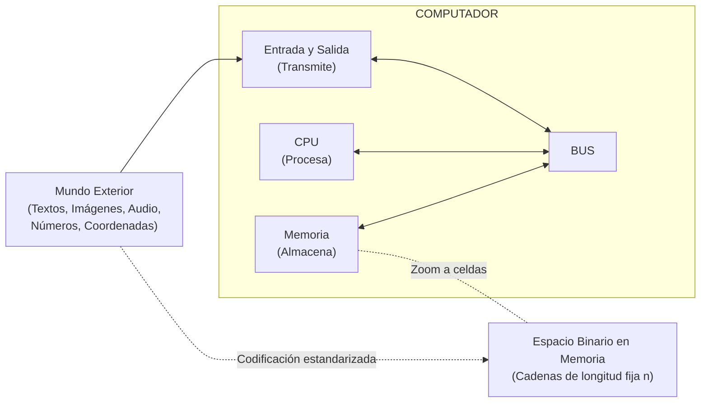

# 2.1. Introducción y Representación Alfanumérica

> [!info] Ubicación en el Tema
> **Índice:** [[Tema_2_Indice]] | **Siguiente:** [[2.2_Enteros_Posicionales_y_No_Posicionales]]  
> **Transparencias oficiales:** Diapositivas $1$–$16$ | **Clases:** $5$, $6$ y $7$

---

## 1. Principios de Representación de la Información (Diap. $3$–$6$)

Como vimos en [[1.2_Arquitectura_y_Ciclo_de_Instruccion]] y [[1.3_Programacion_y_Proceso_de_Traduccion]], dentro de la memoria y de la CPU del computador únicamente existen **cadenas de ceros y unos**. Para que distintos procesadores, librerías y programas puedan intercambiar información sin caos, no vale inventarse códigos arbitrarios: se utilizan **codificaciones estandarizadas** (*Clase 5*).

### Características del Espacio Material de Representación (Diap. $5$)
1. **Naturaleza binaria:** El hardware digital solo distingue $2$ estados físicos estables (`0` y `1`).
2. **Naturaleza finita:** La capacidad de almacenamiento es limitada $\Rightarrow$ toda representación tiene longitud y rango acotados.
3. **Agrupación en cadenas de longitud fija ($n$) y tamaños privilegiados:**
   - **Byte (octeto):** siempre **$8\text{ bits}$** (unidad básica de direccionamiento de la RAM; no se manejan bits sueltos ni fracciones de byte, *Clases 5 y 7*).
   - **Palabra (*Word*):** típicamente $16$, $32$ o $64\text{ bits}$ según la arquitectura (ej. $32\text{ bits}$ en [[Arquitectura MIPS]], $16\text{ bits}$ el tipo `Word` en el BASIC del PIC).
   - **Doble palabra (*Double word*):** múltiplo superior de la palabra base.

---

## 2. Representación Alfanumérica: Estándares de Codificación (Diap. $8$–$13$)

Un carácter individual se codifica asignándole un patrón binario de $n\text{ bits}$ ($2^n$ símbolos posibles). El problema de representar texto en un computador implica gestionar **mayúsculas vs minúsculas** (ej. `"Dime"` vs `"dime"`, que se transmiten con códigos distintos aunque luego una IA como Gemini/ChatGPT los normalice al convertirlos en *tokens*), **letras acentuadas y signos propios de cada idioma** ($1$ acento en castellano, $3$ en francés, diéresis en alemán, signos `¿`/`¡`) y **dígitos escritos como texto** (ej. `"5000"` como $4$ caracteres alfanuméricos, no como valor numérico) (*Clase 5*).

### 2.1. Código ASCII Estándar (ASCII de $7\text{ bits}$) — Diap. $9$–$10$

Estándar acordado en los años 50 para garantizar la compatibilidad entre ordenadores. Define **$2^7 = 128$ códigos** (del $0$ al $127$ en decimal, es decir, de $\text{0x00}$ a $\text{0x7F}$ en hexadecimal).

> [!danger] Aviso / Trampa de Examen — "Esto es lo que os lía todos los años" (*Clases 5 y 6*)
> **¿Cuántos bits ocupa en memoria cada carácter del ASCII de $7\text{ bits}$?**  
> **OCUPA SIEMPRE $8\text{ BITS}$ ($1\text{ BYTE}$ COMPLETO), NUNCA $7\text{ BITS}$.**  
> Se denomina "ASCII de $7\text{ bits}$" únicamente porque sus $128$ caracteres caben en los $7\text{ bits}$ menos significativos ($0$ a $127$), quedando **el bit más significativo (MSB) fijo siempre a `0`**. Como en memoria no se pueden direccionar bits sueltos, cada carácter consume un byte entero.

| Rango Decimal | Rango Hex | Categoría | Ejemplos Clave de Diapositiva y Clase (`Dec` / `Hex` : Símbolo) |
| :---: | :---: | :--- | :--- |
| $0 \dots 31$ | $\text{0x00} \dots \text{0x1F}$ | **Caracteres de control no imprimibles** (heredados de los teletipos) | $0$ ($\text{0x00}$): `NUL` (nulo) \| $4$ ($\text{0x04}$): `EOT` (*End of Text*) $9$ ($\text{0x09}$): **`TAB`** (tabulador horizontal) \| $10$ ($\text{0x0A}$): **`LF`** (*Line Feed*, salto de línea) $13$ ($\text{0x0D}$): **`CR`** (*Carriage Return*, retorno de carro) \| $27$ ($\text{0x1B}$): `ESC` |
| $32 \dots 47$ | $\text{0x20} \dots \text{0x2F}$ | Espacio y signos | $32$ ($\text{0x20}$): **`Space`** (espacio) \| $45$ ($\text{0x2D}$): `'-'` (signo menos) \| $46$ ($\text{0x2E}$): `'.'` |
| $48 \dots 57$ | $\text{0x30} \dots \text{0x39}$ | Dígitos `'0'` a `'9'` | $48$ ($\text{0x30}$): `'0'` \| $49$ ($\text{0x31}$): `'1'` \| $50$ ($\text{0x32}$): `'2'` \| $52$ ($\text{0x34}$): `'4'` \| $\dots$ \| $57$ ($\text{0x39}$): `'9'` |
| $58 \dots 64$ | $\text{0x3A} \dots \text{0x40}$ | Puntuación | $63$ ($\text{0x3F}$): `'?'` *(¡no existe `'¿'` en ASCII de 7 bits!)* |
| $65 \dots 90$ | $\text{0x41} \dots \text{0x5A}$ | Mayúsculas `'A'` a `'Z'` | $65$ ($\text{0x41}$): `'A'` \| $72$ ($\text{0x48}$): `'H'` \| $80$ ($\text{0x50}$): `'P'` \| $90$ ($\text{0x5A}$): `'Z'` |
| $97 \dots 122$ | $\text{0x61} \dots \text{0x7A}$ | Minúsculas `'a'` a `'z'` | $97$ ($\text{0x61}$): `'a'` \| $108$ ($\text{0x6C}$): `'l'` \| $111$ ($\text{0x6F}$): `'o'` \| $122$ ($\text{0x7A}$): `'z'` |
| $127$ | $\text{0x7F}$ | Control | `DEL` (borrar) |

> [!tip] Explicación de Pizarra / Intuición — Caracteres No Imprimibles en Notepad++ (*Clase 5*)
> Al activar el botón **`¶`** (como en Word) y el editor hexadecimal en *Notepad++*, el profesor demostró dos fuentes constantes de bugs invisibles para el programador:
> 1. **Espacio ($\text{0x20}$) vs Tabulador horizontal ($\text{0x09}$):** Visualmente pueden parecer iguales, pero son caracteres ASCII distintos. En lenguajes sensibles a la indentación como **Python** (o en columnas de Word), mezclar espacios y tabuladores provoca errores (de ahí la opción de *Notepad++* *"reemplazar tabuladores por espacios"*).
> 2. **Delimitadores de fin de línea según el Sistema Operativo** (heredados de los teletipos mecánicos, donde `CR` devolvía el carro a la izquierda y `LF` avanzaba el papel una línea):
>    - **Windows:** `CR` + `LF` ($\text{0x0D 0x0A}$) $\rightarrow$ **$2\text{ bytes}$ por línea**.
>    - **Unix / Linux:** solo `LF` ($\text{0x0A}$) $\rightarrow$ **$1\text{ byte}$ por línea**.
>    - **Mac clásico:** solo `CR` ($\text{0x0D}$) $\rightarrow$ **$1\text{ byte}$ por línea**.
>    - **Trampa adicional:** Si el emisor no pulsa *Enter* al final de la última línea del fichero, esa última línea **carece de delimitador final**, lo que cuelga a un receptor que espere `CR+LF` para cerrar la lectura.

### 2.2. ASCII Extendido (Páginas de Códigos de $8\text{ bits}$) — Diap. $11$

Para introducir tildes (`á`, `é`, `ñ`), signos (`¿`, `¡`), símbolos gráficos y letras griegas sin gastar más de $1\text{ byte}$, se aprovechó el octavo bit (valores del $128$ al $255$, $\text{0x80}$ a $\text{0xFF}$). Como $128$ códigos adicionales no bastaban para todos los idiomas, surgieron multitud de **páginas de códigos regionales** (`CP437`, `ISO 8859-1`, `ISO 8859-2`, etc.).

- **Problema grave (incompatibilidad / *mojibake*):** El mismo valor numérico (ej. $130$) significaba `'é'` en una página de códigos y una letra griega en otra. Al abrir o imprimir un documento en una máquina con otra página de códigos aparecían caracteres basura (*Clases 5 y 6*).

### 2.3. UNICODE vs UTF-8 — Diap. $12$–$13$

Para resolver definitivamente el caos de las páginas de códigos y representar **todos los caracteres de todos los idiomas del mundo**, nacieron las codificaciones universales **Unicode** y **UTF-8**:

| Característica | ASCII ($7\text{ bits}$) | UNICODE (UCS-2) | UTF-8 |
| :--- | :--- | :--- | :--- |
| **Tamaño por carácter** | **Fijo:** siempre **$1\text{ byte}$** ($8\text{ bits}$, MSB $= 0$). | **Fijo:** siempre **$2\text{ bytes}$** ($16\text{ bits}$) a piñón para cualquier carácter. | **Variable:** de **$1$ a $5\text{ bytes}$** según frecuencia de uso del carácter *(acotado de $1$ a $4\text{ bytes}$ en el estándar actual, Diap. $12$)*. |
| **Ejemplo dígito `'0'`** | $\text{30}_{16}$ ($1\text{ B}$) | $\text{00 30}_{16}$ ($2\text{ B}$) | $\text{30}_{16}$ ($1\text{ B}$ — **idéntico a ASCII**) |
| **Ejemplo letra `'á'` / `'ó'`** | No existe | $2\text{ bytes}$ | **$2\text{ bytes}$** (cabeceras $\text{0xC2}$ / $\text{0xC3}$) |
| **¿Representa más caracteres?** | Solo $128$ (inglés) | Todos los idiomas del mundo | **Exactamente los mismos** que Unicode |
| **Cabecera / *Magic Number*** | Ninguna | **BOM** ($2\text{ bytes}$ iniciales en `UCS-2 BE BOM` indicando formato, igual que en JPEG/PNG/Word) | Ninguna (se asume UTF-8 por defecto) |
| **Cuándo elegirlo (*Clase 6*)** | Comunicaciones simples entre sistemas heterogéneos sin tildes para evitar fallos de compatibilidad. | Programas **muy internacionalizados** donde interesa **regularidad de tamaño** para calcular el tamaño máximo de buffers sin depender del idioma. | **Internet / Web (HTML)** y entornos donde predominan caracteres ASCII: minimiza memoria y tráfico de red. |

> [!tip] Explicación de Pizarra / Intuición — Por qué UTF-8 domina Internet y cómo distingue la longitud (*Clase 6*)
> 1. **Inspección del Campus Virtual de la UMA (Diap. $13$):** La página declara `<meta http-equiv="Content-Type" content="text/html; charset=utf-8" />`. Como casi todo el código HTML está en inglés (ASCII), ocupa **$1\text{ byte}$/carácter** (carga el doble de rápido que Unicode), y cuando aparece una tilde como en `"Universidad de Málaga"`, inserta directamente los **$2\text{ bytes}$ UTF-8** sin necesitar códigos de escape antiguos (`&aacute;`).
> 2. **Optimización por frecuencia mundial (*Clase 6*):** Un mismo carácter **siempre** ocupa el mismo número de bytes en UTF-8 (no cambia de un día para otro): los $128$ caracteres ASCII ocupan **$1\text{ byte}$**; las tildes latinas y el **Kanji** (ideogramas chinos/japoneses, muy frecuentes por el peso de China) ocupan **$2\text{ bytes}$**; **Hiragana y Katakana** japoneses ocupan **$3\text{ bytes}$**; alfabetos poco usados como el sánscrito ocupan más bytes.
> 3. **¿Cómo sabe el lector que dos bytes forman un solo carácter en UTF-8?** Porque los prefijos del primer byte están estandarizados (Diap. $12$): `0x00`–`0x7F` ($1\text{ B}$), `0xC0`–`0xDF` (cabecera de $2\text{ B}$, ej. `0xC2`/`0xC3`), `0xE0`–`0xEF` ($3\text{ B}$), `0xF0`–`0xF4` ($4\text{ B}$), mientras que `0x80`–`0xBF` son exclusivamente bytes de continuación.

---

## 3. Longitud de Cadenas, Carácter vs Número y Ficheros Binarios (Diap. $14$–$16$)

### 3.1. Dos Formas de Almacenar la Longitud de una Cadena (Diap. $14$–$15$)

1. **Carácter centinela / terminador `NULL` (Lenguaje C y ensamblador MIPS):**
   - A la rutina solo se le pasa un **puntero** (dirección inicial en RAM) del primer carácter, **no** la longitud.
   - Al final de la cadena se añade obligatoriamente el carácter nulo **`NULL` ($\text{0x00}$, todos los bits a cero)** para señalar el fin.
   - La cadena consume **`longitud_caracteres + 1` bytes**.
2. **Cabecera o metadato de longitud (Python, C++, Java, C#):**
   - La cadena se trata como un **objeto** que guarda un entero previo con su longitud exacta, sin necesitar byte terminador (*Clase 6*).

**Ejemplo oficial (Diap. $15$): Codificación ASCII de `"Hola"`** (`'H'`=$\text{48h}$, `'o'`=$\text{6Fh}$, `'l'`=$\text{6Ch}$, `'a'`=$\text{61h}$):
- **Estilo C (terminador `00h` al final, $5\text{ bytes}$):**
  $$01001000\;\; 01101111\;\; 01101100\;\; 01100001\;\; \mathbf{00000000}$$
- **Estilo Objeto (cabecera de $1\text{ byte}$ con valor $4 = 00000100_2$, $5\text{ bytes}$):**
  $$\mathbf{00000100}\;\; 01001000\;\; 01101111\;\; 01101100\;\; 01100001$$

### 3.2. Diferencia entre Carácter Dígito y Valor Numérico (Diap. $16$)

- El valor numérico cero en $8\text{ bits}$ es $0_{10} = \text{0x00} = 00000000_2$ (`NULL`).
- El carácter tipográfico `'0'` en ASCII es $48_{10} = \text{0x30} = 00110000_2$.
- Para operar aritméticamente con números leídos de teclado o de un fichero de texto, hay que convertirlos mediante funciones estándar: **ASCII $\rightarrow$ número** (`atoi`, `atof`, `parseInt()`, `parseFloat()`) y **número $\rightarrow$ ASCII** (`itoa`, `.toString()`).

### 3.3. Fichero de Texto ASCII vs Fichero Binario (*Clase 5*)

Al inspeccionar en *Notepad++* un archivo ensamblador `.asm` (texto legible) frente a un archivo **Pickle (`.pkl`)** de Python (lleno de etiquetas negras `NULL`, `EOT` = $\text{0x04}$), el profesor explicó cómo reconocer un fichero binario: los bytes numéricos puros con valores $0$–$31$ se muestran como caracteres de control ASCII no imprimibles.

> [!example] Ejemplo / Problema de Clase 1 — Fichero Binario vs Texto ASCII (*Clase 5*)
> Queremos almacenar $5$ muestras de un sensor con valores enteros menores de $255$ (caben en $1\text{ byte}$ cada una, ej. `210, 40, 60, 80, ...`):
> - **En fichero binario puro:** Cada muestra ocupa $1\text{ byte}$ exacto y **no hacen falta delimitadores** porque el programa sabe que cada campo mide $8\text{ bits}$. Total: **$5\text{ bytes}$**.
> - **En fichero de texto ASCII (Windows):** Cada dígito es $1\text{ byte}$ ASCII (ej. `"210"` son $\text{32h, 31h, 30h}$ = $3\text{ B}$; `"40"` son $2\text{ B}$ $\Rightarrow 11\text{ bytes}$ en dígitos) **más** $2\text{ bytes}$ (`CR+LF`) por cada una de las $5$ líneas ($10\text{ B}$). Total: **$21\text{ bytes}$**.
> - **Escala real:** Para $1\text{ muestra/s}$ durante $24\text{ horas}$ ($86\,400$ muestras), el ahorro de espacio del formato binario es masivo.

> [!example] Ejemplo / Problema de Clase 2 — "La Mala Idea de Murphy" en MARS: `.ascii` vs `.asciiz` (*Clase 6*)
> En un programa MIPS en MARS que imprime una cadena con `syscall` (`$v0 = 4`, *Print String*, que espera una cadena terminada en `0x00`) y declara además `.byte 1, 2, 3`:
> - Si declaramos la cadena con **`.ascii`** (que **NO** añade el byte nulo `0x00`) *después* de los números, funciona por pura casualidad porque el resto de la RAM estaba inicializada a `0`.
> - Si simplemente cambiamos el orden y ponemos la cadena **`.ascii`** *antes* de `.byte 1, 2, 3`, el ensamblador los coloca contiguos en memoria: `syscall 4` imprime la cadena, **no encuentra ningún `0x00`** y sigue interpretando los bytes `1`, `2` y `3` como caracteres de control ASCII no imprimibles, sacando **cuadraditos de basura** por pantalla hasta tropezar con el siguiente cero de la RAM.
> - **Solución:** Usar siempre **`.asciiz`** en ensamblador MIPS (la `z` añade automáticamente el terminador cero), y en C reservar siempre **$+1\text{ byte}$** en el buffer para el `NULL`.

> [!example] Ejemplo / Problema de Clase 3 — Problema Tipo Examen: Buffer del Sensor IoT (*Clase 5*)
> **Enunciado:** Un sensor IoT envía a un microcontrolador receptor dos líneas de texto en **ASCII**:
> - Línea 1: Temperatura en el rango $[-20, 30]\ ^\circ\text{C}$ (sin el símbolo `°`).
> - Línea 2: Humedad en el rango $[10, 55]\%$ (sin el símbolo `%`).
> Determina el tamaño mínimo del buffer de memoria del receptor para el **peor caso posible**.
>
> **Resolución paso a paso:**
> 1. **Peor caso de la temperatura:** $-20$ $\rightarrow$ el signo `'-'` es un carácter ASCII ($1\text{ B}$) + dos dígitos (`'2'`, `'0'`) = **$3\text{ bytes}$**.
> 2. **Peor caso de la humedad:** $55$ $\rightarrow$ dos dígitos = **$2\text{ bytes}$**.
> 3. **Pregunta crítica de requisitos que falta hacer:** *¿Qué sistema operativo usan el emisor y el receptor?*
>    - Si el emisor es **Windows** (`CR+LF` = $2\text{ B/línea}$): $3 + 2 + (2 \times 2) = \mathbf{9\text{ bytes}}$.
>    - Si el emisor es **Linux** (`LF` = $1\text{ B/línea}$): $3 + 2 + (1 \times 2) = \mathbf{7\text{ bytes}}$.
> 4. **Incompatibilidades entre sistemas heterogéneos:**
>    - *Receptor Windows ($9\text{ B}$) recibiendo de emisor Linux ($7\text{ B}$):* **No se queda corto de buffer**, pero **falla el *parsing*** si busca la secuencia estándar `CR+LF` y solo recibe `LF` (requiere adaptar el delimitador en código).
>    - *Receptor Linux ($7\text{ B}$) recibiendo de emisor Windows ($9\text{ B}$):* **Desbordamiento del buffer y pérdida irrecuperable de datos** (el peor escenario posible).

---

## 4. Preguntas de Clase (Estilo Examen)

> [!question] Pregunta de Clase (Justifica la respuesta)
> **Enunciado (*Clase 6*):** ¿Al poder emplear UTF-8 hasta $5\text{ bytes}$ por carácter mientras que Unicode emplea siempre $2\text{ bytes}$, significa eso que UTF-8 puede almacenar más caracteres distintos que Unicode? ¿Cuándo elegirías cada uno?
>
> > [!success]- Solución
> > **No.** Ambos representan exactamente el mismo conjunto universal de caracteres de todos los idiomas del mundo. La diferencia es que **UTF-8 es una codificación de longitud variable** diseñada para optimizar espacio y tráfico de red asignando menos bytes ($1\text{ B}$) a los caracteres más frecuentes (los $128$ de ASCII, predominantes en inglés y código HTML) y más bytes ($2$ a $5\text{ B}$) a caracteres menos frecuentes. Se elige **UTF-8** cuando prima ahorrar almacenamiento/ancho de banda (web, texto occidental/ASCII) y **Unicode ($2\text{ B}$ fijos)** en software muy internacionalizado donde interesa regularidad para acotar con exactitud el tamaño de las cadenas con independencia del idioma.

> [!question] Pregunta de Clase (Justifica la respuesta)
> **Enunciado (*Clases 5 y 6*):** ¿Cuántos bytes de memoria necesita la cadena `"Hola"` en C usando ASCII de $7\text{ bits}$? ¿Y si la cadena fuera `"Málaga"` en ASCII de $7\text{ bits}$, en Unicode (sin BOM) y en UTF-8 (estilo C)?
>
> > [!success]- Solución
> > - **`"Hola"` en C (ASCII de $7\text{ bits}$):** Cada carácter ASCII ocupa **$1\text{ byte}$ ($8\text{ bits}$, no $7$)** $\Rightarrow 4\text{ bytes}$ de letras $+$ **$1\text{ byte}$ del terminador `NULL` ($\text{0x00}$)** $= \mathbf{5\text{ bytes}}$.
> > - **`"Málaga"`:**
> >   - **ASCII de $7\text{ bits}$:** **No es representable** correctamente porque `'á'` no pertenece a los $128$ caracteres del ASCII de $7\text{ bits}$.
> >   - **Unicode ($2\text{ B}$ fijos):** $6\text{ caracteres} \times 2\text{ B} = 12\text{ B}$ (más terminador nulo de $2\text{ B}$ si es cadena terminada en nulo en C).
> >   - **UTF-8 (estilo C):** $5$ caracteres ASCII (`M, l, a, g, a`) $\times 1\text{ B}$ $+$ `'á'` ($2\text{ B}$) $+$ terminador `NULL` ($1\text{ B}$) $= \mathbf{8\text{ bytes}}$.
