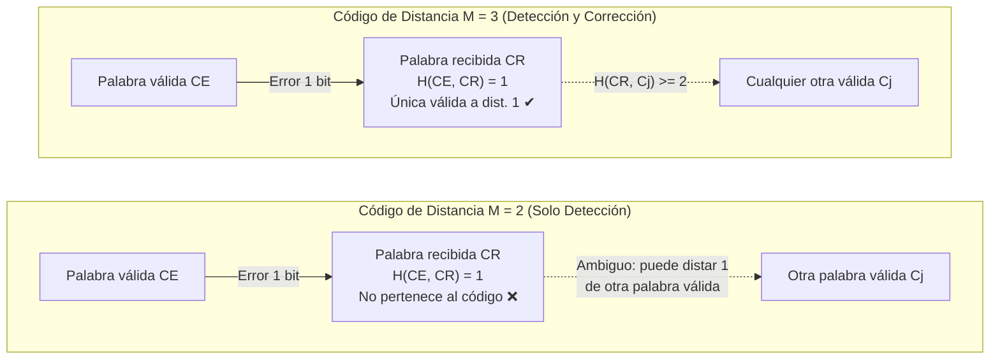

# 2.4. Códigos Redundantes: Paridad y Hamming SEC

> [!info] Ubicación en el Tema
> **Anterior:** [[2.3_Reales_Punto_Fijo_y_Coma_Flotante_IEEE754]] | **Índice:** [[Tema_2_Indice]]  
> **Transparencias oficiales:** Diapositivas $71$–$91$ | **Clases:** $12$, $13$, $14$, $20$ y $22$

---

## 1. Motivación Real y Concepto de Redundancia (Diap. $72$, *Clase 12*)

Los códigos redundantes protegen cualquier tipo de información binaria (numérica, alfanumérica o instrucciones) frente a fallos fortuitos durante su almacenamiento en memoria o transmisión por un canal.

> [!tip] Explicación de Pizarra / Intuición — Los Rovers de la NASA en Marte (*Clase 12*)
> ¿Por qué se corrompen los bits incluso en una memoria **ROM / Flash no volátil**?
> - **Marte no tiene campo magnético** que lo proteja del viento solar y la radiación cósmica. Las partículas de altísima energía impactan físicamente en los chips de memoria y **cambian el valor de un bit** (*bit flip*).
> - *Ejemplo del profesor:* En una instrucción máquina que apunta al registro `011`, una partícula cambia un bit a `010`. El código resultante **sigue siendo una instrucción totalmente válida**, pero accede a un registro equivocado. **No existe forma alguna** de darse cuenta mirando solo la palabra original (variante de la indistinguibilidad del Tema 1).
> - **¿Por qué no hacer copias continuas y compararlas?** Las sondas espaciales tienen un presupuesto energético equivalente al de una cafetera; duplicar todo el procesamiento para comparar gasta demasiada energía. *(Los rovers sí llevan doble memoria Flash como **mitigación** para reconstruir la memoria una vez detectado el error, pero para **detectarlo** necesitan **redundancia** —como un hash MD5 o códigos de paridad/Hamming—).*

---

## 2. Distancia de Hamming y Códigos de Distancia $M$ (Diap. $73$–$77$, *Clases 12 y 13*)

- **Distancia de Hamming $H(A, B)$:** Número de posiciones de bit en las que difieren dos cadenas binarias $A$ y $B$ de igual longitud (equivale al número de unos de $A \oplus B$).
  - *Ejemplo (Diap. $73$):* $H(100010_2,\; 010010_2) = 2$.
- **Código de distancia $M$:** Un código tiene distancia $M$ cuando la **distancia mínima** entre cualquier par de palabras válidas es $M = \min_{i \neq j} H(C_i, C_j)$.
  - *Ejemplo (Diap. $74$):* Para $\{0101, 1010, 0000, 1111\}$, las distancias entre pares son $2$ y $4 \implies M = 2$.

### Teorema Fundamental de Detección y Corrección (Diap. $75$)

Un código de distancia mínima $M$ puede **corregir hasta $C$ bits erróneos** y simultáneamente **detectar hasta $D$ bits erróneos** si cumple:

$$M \ge C + D + 1 \qquad (\text{con } D \ge C)$$

| Distancia $M$ | Corregibles ($C$) | Detectables ($D$) | Capacidad Funcional y Ejemplo |
| :---: | :---: | :---: | :--- |
| **$1$** | $0$ | $0$ | **Sin redundancia:** un fallo de $1\text{ bit}$ lleva de una palabra válida a otra válida (imposible detectar errores). |
| **$2$** | $0$ | $1$ | **Paridad simple:** un fallo de $1\text{ bit}$ lleva a una palabra **no válida** (se detecta el error, pero no se sabe qué palabra válida original a distancia $1$ se envió $\Rightarrow$ no corrige). |
| **$3$** | $1$ | $1$ | **Hamming SEC:** hay dos palabras no válidas entre válidas; un error de $1\text{ bit}$ deja la palabra recibida a distancia $1$ de **una única palabra válida** $\Rightarrow$ **detecta y corrige $1\text{ bit}$**. *(O detecta $2$ si renuncia a corregir).* |
| **$4$** | $1$ | $2$ | **Hamming SEC/DED:** corrige errores simples ($1\text{ bit}$) y detecta errores dobles ($2\text{ bits}$). *(Excluido de examen).* |



---

## 3. Códigos con Paridad ($M = 2$) (Diap. $78$–$82$, *Clases 12 y 13*)

Consisten en añadir **$1\text{ bit}$ de paridad ($P$)** a la palabra de datos para forzar que el total de unos (o de ceros) en la palabra completa sea par o impar. Existen $4$ modalidades (par/impar de unos y par/impar de ceros), siendo el convenio por defecto la **paridad par de unos**.

- **Demostración de que pasa de $M = 1$ a $M = 2$ (Diap. $80$):** Si dos datos $A$ y $B$ difieren en $1\text{ bit}$ ($H(A,B)=1$), uno tiene un número par de unos ($P=0$) y el otro impar ($P=1$), por lo que $P_A \neq P_B$ y su nueva distancia es $1 + 1 = 2$. Si ya diferían en $\ge 2\text{ bits}$, su distancia sigue siendo $\ge 2$.
- **Ecuaciones mediante puertas XOR (suma módulo $2$, para $8\text{ bits}$ $C_0 \dots C_7$, Diap. $81$–$82$):**
  $$P = C_0 \oplus C_1 \oplus C_2 \oplus C_3 \oplus C_4 \oplus C_5 \oplus C_6 \oplus C_7$$
  $$\text{Error} = C_0 \oplus C_1 \oplus C_2 \oplus C_3 \oplus C_4 \oplus C_5 \oplus C_6 \oplus C_7 \oplus P$$
  *(Si $\text{Error} = 0$, recepción correcta; si $\text{Error} = 1$, fallo detectado).*

### Circuitos Generador y Detector de Paridad Par de Unos (Diap. $81$–$82$)

```tikz
\begin{circuitikz}[scale=0.78, transform shape]
  % Nivel 1
  \node[xor port] (x1) at (2, 4.5) {};
  \node[xor port] (x2) at (2, 2.5) {};
  \node[xor port] (x3) at (2, 0.5) {};
  \node[xor port] (x4) at (2,-1.5) {};
  % Nivel 2
  \node[xor port] (x5) at (4.8, 3.5) {};
  \node[xor port] (x6) at (4.8,-0.5) {};
  % Nivel 3 (Generador P)
  \node[xor port] (x7) at (7.6, 1.5) {};
  % Nivel 4 (Detector de Error comparando con P recibido)
  \node[xor port] (x8) at (10.6, 0.8) {};

  \draw (x1.in 1) -- ++(-0.7,0) node[left] {$C_0$};
  \draw (x1.in 2) -- ++(-0.7,0) node[left] {$C_1$};
  \draw (x2.in 1) -- ++(-0.7,0) node[left] {$C_2$};
  \draw (x2.in 2) -- ++(-0.7,0) node[left] {$C_3$};
  \draw (x3.in 1) -- ++(-0.7,0) node[left] {$C_4$};
  \draw (x3.in 2) -- ++(-0.7,0) node[left] {$C_5$};
  \draw (x4.in 1) -- ++(-0.7,0) node[left] {$C_6$};
  \draw (x4.in 2) -- ++(-0.7,0) node[left] {$C_7$};

  \draw (x1.out) -| (x5.in 1);
  \draw (x2.out) -| (x5.in 2);
  \draw (x3.out) -| (x6.in 1);
  \draw (x4.out) -| (x6.in 2);
  \draw (x5.out) -| (x7.in 1);
  \draw (x6.out) -| (x7.in 2);
  \draw (x7.out) -- ++(0.4,0) node[above] {$P_{\text{calc}}$} -| (x8.in 1);

  \draw (x8.in 2) -- ++(-0.9,0) node[left] {$P_{\text{rec}}$};
  \draw (x8.out) -- ++(0.7,0) node[right, red!80!black] {$\mathbf{Error}$};
\end{circuitikz}
```
*(En el emisor se usan únicamente los $3$ primeros niveles —$7$ puertas XOR— para generar $P$; en el receptor se añade la $8.\text{ª}$ puerta XOR para comparar $P_{\text{calc}}$ con el bit $P_{\text{rec}}$ recibido).*

---

## 4. Código Hamming SEC ($M = 3$) — Confirmado para Examen (Diap. $83$–$86$, *Clases 13 y 22*)

**Hamming SEC** (*Single Error Correction*) logra distancia mínima **$M = 3$** añadiendo varios bits de paridad parcial que vigilan subconjuntos solapados de datos.

### 4.1. Dimensionamiento y Regla Nemotécnica Matricial (*Clase 13*)

Para proteger $N\text{ bits}$ de datos con $P\text{ bits}$ de paridad debe cumplirse (Diap. $85$):
$$2^P \ge N + P + 1$$
Para **$N = 4\text{ bits}$ de datos**, se necesitan **$P = 3\text{ bits}$ de paridad** ($2^3 = 8 \ge 4 + 3 + 1 = 8$), formando una palabra de **$7\text{ bits}$** indexados desde **$1$** hasta **$7$**:
- **Bits de paridad ($P_1, P_2, P_4$):** Se colocan en las posiciones que son **potencias de $2$** ($1, 2, 4$).
- **Bits de datos ($D_3, D_5, D_6, D_7$):** Ocupan el resto de posiciones ($3, 5, 6, 7$).
- **Orden de la palabra SEC ($7\text{ bits}$):** $\quad D_7\; D_6\; D_5\; P_4\; D_3\; P_2\; P_1$

> [!tip] Explicación de Pizarra / Intuición — Truco Matricial para NO Memorizar Fórmulas (*Clase 13*)
> Escribe los índices de los bits de datos ($7, 6, 5, 3$) en **binario natural de $3\text{ bits}$** en columnas verticales y lee en horizontal dónde hay un `1`:
>
> | Bit de paridad (peso) | $D_7$ (`7`) | $D_6$ (`6`) | $D_5$ (`5`) | $D_3$ (`3`) | Ecuación de Paridad Par |
> | :---: | :---: | :---: | :---: | :---: | :--- |
> | **$P_4$** ($b_4$) | `1` | `1` | `1` | `0` | $P_4 = D_7 \oplus D_6 \oplus D_5$ |
> | **$P_2$** ($b_2$) | `1` | `1` | `0` | `1` | $P_2 = D_7 \oplus D_6 \oplus D_3$ |
> | **$P_1$** ($b_1$) | `1` | `0` | `1` | `1` | $P_1 = D_7 \oplus D_5 \oplus D_3$ |

### 4.2. Detección y Corrección mediante el Síndrome ($C_4 C_2 C_1$)

En el extremo receptor se calculan los **bits de comprobación (síndrome)**:
$$C_4 = P_4 \oplus D_7 \oplus D_6 \oplus D_5 \qquad C_2 = P_2 \oplus D_7 \oplus D_6 \oplus D_3 \qquad C_1 = P_1 \oplus D_7 \oplus D_5 \oplus D_3$$
- Si **$(C_4 C_2 C_1)_2 = 000_2$:** **No hay error**.
- Si **$(C_4 C_2 C_1)_2 \neq 000_2$:** El valor leído en **binario natural** indica directamente el **índice exacto ($1$ a $7$) del bit erróneo** (ya sea un bit de datos o de paridad). Basta **invertir ese bit** para reconstruir la palabra original.

> [!example] Ejemplo / Problema de Clase — Ejercicios Oficiales Resueltos (Diap. $89$–$90$)
> **Parte A — Generación de palabra Hamming SEC ($D_7 D_6 D_5 P_4 D_3 P_2 P_1$) para $4\text{ bits}$ de datos:**
> 1. **Dato `0110`** ($D_7=0, D_6=1, D_5=1, D_3=0$):
>    - $P_4 = 0 \oplus 1 \oplus 1 = 0$
>    - $P_2 = 0 \oplus 1 \oplus 0 = 1$
>    - $P_1 = 0 \oplus 1 \oplus 0 = 1$
>    - **Palabra SEC resultante:** **`0110011`** *(en paridad par de `1`s simple: `01100`)*.
> 2. **Dato `1101`** ($D_7=1, D_6=1, D_5=0, D_3=1$):
>    - $P_4 = 1 \oplus 1 \oplus 0 = 0$
>    - $P_2 = 1 \oplus 1 \oplus 1 = 1$
>    - $P_1 = 1 \oplus 0 \oplus 1 = 0$
>    - **Palabra SEC resultante:** **`1100110`** *(en paridad par de `1`s simple: `11011`)*.
>
> **Parte B — Recepción, diagnóstico y corrección en Hamming SEC:**
> 1. **Palabra recibida `0110010`** ($D_7=0, D_6=1, D_5=1, P_4=0, D_3=0, P_2=1, P_1=0$):
>    - $C_4 = 0 \oplus 0 \oplus 1 \oplus 1 = 0$
>    - $C_2 = 1 \oplus 0 \oplus 1 \oplus 0 = 0$
>    - $C_1 = 0 \oplus 0 \oplus 1 \oplus 0 = 1$
>    - **Síndrome:** $(C_4 C_2 C_1)_2 = 001_2 = \mathbf{1} \implies$ **Error en la posición $1$ ($P_1$)**. Al estar el error en un bit de paridad, el dato original está intacto: **`0110`**.
> 2. **Palabra recibida `1101100`** ($D_7=1, D_6=1, D_5=0, P_4=1, D_3=1, P_2=0, P_1=0$):
>    - $C_4 = 1 \oplus 1 \oplus 1 \oplus 0 = 1$
>    - $C_2 = 0 \oplus 1 \oplus 1 \oplus 1 = 1$
>    - $C_1 = 0 \oplus 1 \oplus 0 \oplus 1 = 0$
>    - **Síndrome:** $(C_4 C_2 C_1)_2 = 110_2 = \mathbf{6} \implies$ **Error en la posición $6$ ($D_6$)**. Invirtiendo $D_6$ (`1` $\rightarrow$ `0`), el dato corregido es **`1001`**.

---

## 5. Hamming SEC/DED y Códigos Industriales (Diap. $87$–$88$, *Clases 13, 14 y 22*)

> [!danger] Aviso / Trampa de Examen — Hamming SEC/DED EXCLUIDO del Primer Parcial (*Clase 22*)
> *"No voy a preguntar Hamming SECDED, porque realmente lo único que hace es añadir un bit adicional de paridad al Hamming y no me dice nada. Lo que puede ser interesante es una pregunta de Hamming SEC."*

Solo como referencia completa de las transparencias (Diap. $87$–$88$):
- **Hamming SEC/DED ($M = 4$):** Añade $1\text{ bit}$ de paridad global $P$ a toda la palabra SEC ($8\text{ bits}$: $D_7 D_6 D_5 P_4 D_3 P_2 P_1 P$). En recepción, con la paridad global $C$ y el síndrome $C_4 C_2 C_1$: ($C=0$, síndrome `000`) $\rightarrow$ sin error; ($C=1$, síndrome $\neq 000$) $\rightarrow$ error simple corregible; ($C=0$, síndrome $\neq 000$) $\rightarrow$ **error doble detectado, no corregible**; ($C=1$, síndrome `000`) $\rightarrow$ error en el propio bit global $P$.
- **Códigos potentes de la vida real (*Clases 12, 13 y 14*):** Para mensajes largos y múltiples errores simultáneos se emplean librerías de códigos **BCH**, **Reed-Solomon** y **CRC** (*Cyclic Redundancy Check*, usado por ejemplo en los ficheros **Intel HEX** del PIC16F877A).

---

## 6. Preguntas de Clase (Estilo Examen)

> [!question] Pregunta de Clase (Justifica la respuesta)
> **Enunciado (*Clases 12 y 13*):** ¿Por qué un código binario sin redundancia ($M = 1$) no permite detectar errores, por qué añadir $1\text{ bit}$ de paridad ($M = 2$) detecta errores de $1\text{ bit}$ pero no puede corregirlos, y cuántos bits de paridad necesita Hamming SEC para proteger $4\text{ bits}$ de datos?
>
> > [!success]- Solución
> > - Con **$M = 1$**, cualquier cambio de $1\text{ bit}$ transforma una palabra válida en otra palabra también válida del código, haciendo imposible detectar el error.
> > - Con **$1\text{ bit}$ de paridad ($M = 2$)**, toda pareja de palabras válidas dista al menos $2\text{ bits}$; un fallo simple cae en una palabra **inválida** (se **detecta**), pero como esa palabra inválida puede estar a distancia $1$ de dos palabras válidas distintas, es imposible saber cuál era la original (**no corrige**).
> > - Para **$N = 4\text{ bits}$** en Hamming SEC ($M = 3$), aplicando $2^P \ge N + P + 1$ se requieren **$P = 3\text{ bits}$ de paridad** ($2^3 = 8 \ge 4 + 3 + 1$), situados en las posiciones $1, 2$ y $4$ ($7\text{ bits}$ en total).
