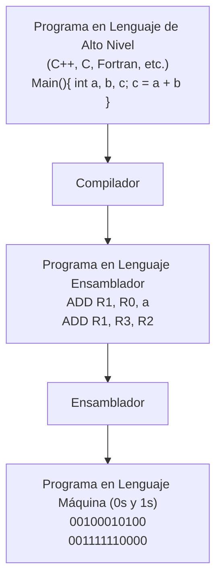
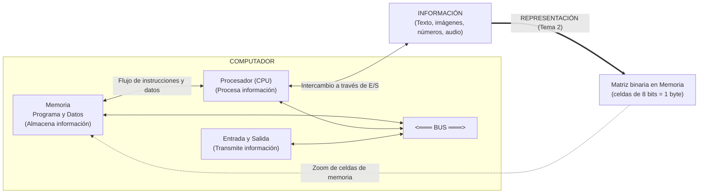

# 3.1. Instrucciones de un Procesador y Formato de Instrucción

> [!info] Ubicación en el Temario
> Corresponde al **Apartado 1 (subapartados 1.1, 1.2 y 1.4)** de `tema_3_fundamentos_de_computadores.md` (Diapositivas $1$–$10$ y $37$–$43$), explicado en la segunda mitad de la **Clase 8** (salto estratégico para preparar las prácticas de MARS), con refuerzos en las **Clases 2, 3, 4, 9 y 13**.
> ⬅️ Volver al [[Tema_3_Indice|Índice del Tema 3]] | Siguiente: [[3.2_Modos_de_Direccionamiento|3.2. Modos de Direccionamiento]] ➡️

---

## 1. Lenguaje Máquina, Traducción y Memoria de Programa

### 1.1. Lenguaje máquina y proceso de traducción *(Diap. 5–6)*

El procesador **SOLO entiende lenguaje máquina** (instrucciones máquina): un lenguaje de programación de muy bajo contenido semántico formado exclusivamente por cadenas binarias de ceros y unos.

**Ejemplo oficial de código en lenguaje máquina (palabras de $16\text{ bits}$, Diap. 5):**

```text
0010100101101001
1010001001001011
1111010100111010
0010010101000010
1110010100101001
0101000001000011
1110010010000010
0001000010101110
1001000101010000
1110100100100100
0010101001011110
1100101000000010
```

Para que un humano pueda programar sin enfrentarse directamente a esos bloques de ceros y unos, existe un **proceso de traducción** desde los lenguajes de alto nivel hasta el lenguaje máquina (conectado con [[1.3_Programacion_y_Proceso_de_Traduccion]] del Tema 1):



### 1.2. Instrucciones y datos en memoria *(Diap. 7; Clases 2, 3 y 8)*

En un computador clásico ([[Arquitectura Von Neumann]]), las instrucciones y los datos se codifican como cadenas binarias almacenadas en la **misma memoria**, intercambiadas con el procesador (`CPU`) y el subsistema de [[Entrada y Salida]] a través del bus común:



| Bit 7 | Bit 6 | Bit 5 | Bit 4 | Bit 3 | Bit 2 | Bit 1 | Bit 0 |
| :---: | :---: | :---: | :---: | :---: | :---: | :---: | :---: |
| `1` | `0` | `0` | `1` | `1` | `0` | `0` | `0` |
| `0` | `0` | `1` | `1` | `0` | `1` | `1` | `1` |
| `0` | `0` | `0` | `1` | `0` | `0` | `0` | `1` |
| `1` | `1` | `0` | `0` | `1` | `1` | `0` | `0` |

> [!tip] Explicación de Pizarra / Intuición (Conexión Tema 1 $\rightarrow$ Tema 2 $\rightarrow$ Tema 3 — *Clases 2, 3 y 8*)
> 1. **¿Cómo sabe la CPU que una cadena en memoria es una instrucción?** En una máquina de [[Arquitectura Von Neumann]] **no hay forma de distinguir** mirando solo los `0` y `1` si una palabra es un dato o una instrucción; se sabe únicamente porque en la fase de búsqueda (*Fetch*) del [[Ciclo de Instrucción]] esa dirección está apuntada por el **Contador de Programa (`PC`)** (*Clase 8*).
> 2. **Direccionamiento en bytes desde `0`:** La memoria siempre se organiza y direcciona en **bytes ($8\text{ bits}$)** empezando en la posición `0`. Si las instrucciones ocupan $32\text{ bits}$ ($4\text{ bytes}$, como en MIPS), el `PC` avanza de $4$ en $4$ (`0, 4, 8, 12...`) y cada instrucción se representa abreviadamente con **$8$ dígitos hexadecimales** (cada dígito hexadecimal agrupa $4\text{ bits}$, evitando errores humanos al leer $32$ bits seguidos) (*Clases 2 y 3*).

---

## 2. Conjunto de Instrucciones *(Diap. 8)*

Cada procesador está diseñado para entender un **conjunto de instrucciones** concreto. Todas las instrucciones de un procesador se clasifican en **tres grandes tipos**:

| Tipo de Instrucción | Función Principal | Ejemplos |
| :--- | :--- | :--- |
| **Transferencia** | Copian información de un lugar a otro (entre memoria y registros, o entre registros). | Cargas (`lw`, `lb`), almacenamientos (`sw`, `sb`), movimientos. |
| **Transformación** | Transforman la información operando sobre los datos. | Aritméticas (`add`, `sub`), lógicas (`and`, `or`, `nor`), desplazamiento (`sll`, `srl`), comparación (`slt`). |
| **Control** | Alteran o controlan el flujo secuencial de ejecución del programa modificando el `PC`. | Saltos condicionales (`beq`, `bne`), saltos incondicionales (`j`, `jal`, `jr`). |

---

## 3. Formato de Instrucción e ISA *(Diap. 9–10; Clases 8 y 13)*

Cuando la CPU trae de memoria una cadena de $n$ bits apuntada por el `PC`, necesita una **codificación estructurada** que le permita decodificar exactamente **qué operación** se pide y **cuáles son sus operandos**.

### 3.1. Definiciones fundamentales

- **Codificación binaria de longitud $n$:** En procesadores reales, la longitud de instrucción $n$ es un **múltiplo de $8$** ($8, 16, 32$ o $64\text{ bits}$). En MIPS, cada palabra de instrucción mide exactamente **$32\text{ bits}$** (numerados del bit $0$ al bit $31$).
- **Campos de bits basados en el Tema 2:** Una instrucción es un conjunto de **campos de bits** que codifican información en forma de **enteros**, reutilizando las representaciones estudiadas en el [[Tema_2_Indice|Tema 2]] ([[Binario Natural]] para identificadores de operación y registros; [[Complemento a 2]] para constantes negativas y desplazamientos de salto hacia atrás).
- **ISA (*Instruction Set Architecture*):** Estándar de un procesador que define **cómo interpretar esos campos de bits** (qué significa cada posición de bit en el código máquina).

### 3.2. Estructura general de una instrucción de $n$ bits *(Diap. 10)*

Toda instrucción consta de dos bloques esenciales:

1. **Código de operación (`OPCODE` / `CODOP`):** Identificador binario único de la operación (o familia de operaciones) cuya ejecución se requiere.
2. **Operandos (o direcciones) (`OP1`, `OP2`, $\dots$, `OPn`):** Argumentos necesarios para ejecutar la instrucción. La forma en que la Unidad de Control interpreta los bits de cada operando depende de su **[[3.2_Modos_de_Direccionamiento|modo de direccionamiento]]**.

| Campo | `OPCODE` | `OP1` | `OP2` | $\dots$ | `OPn` |
| :--- | :---: | :---: | :---: | :---: | :---: |
| **Función** | Código de operación | Operando o dirección $1$ | Operando o dirección $2$ | $\dots$ | Operando o dirección $n$ |
| **Longitud total** | $\longleftarrow$ | | **$n$ bits** | | $\longrightarrow$ |

### 3.3. Adelanto de los formatos reales de MIPS *(Diap. 9; Clase 8)*

En el procesador **MIPS** ($32\text{ bits}$), las instrucciones se reparten en tres formatos (que se estudian en detalle en [[3.3_Arquitectura_y_Ensamblador_MIPS]]):

**1. Register format (Formato R)**

| Campo | `Op-code` | `Rs` | `Rt` | `Rd` | `shamt` | `Function code` |
| :--- | :---: | :---: | :---: | :---: | :---: | :---: |
| **Bits (rango)** | $31\text{--}26$ ($6\text{ b}$) | $25\text{--}21$ ($5\text{ b}$) | $20\text{--}16$ ($5\text{ b}$) | $15\text{--}11$ ($5\text{ b}$) | $10\text{--}6$ ($5\text{ b}$) | $5\text{--}0$ ($6\text{ b}$) |
| **Codificación** | `000000` | `sssss` | `ttttt` | `ddddd` | `00000` | `ffffff` |

**2. Immediate format (Formato I)**

| Campo | `Op-code` | `Rs` | `Rt` | `Immediate` |
| :--- | :---: | :---: | :---: | :---: |
| **Bits (rango)** | $31\text{--}26$ ($6\text{ b}$) | $25\text{--}21$ ($5\text{ b}$) | $20\text{--}16$ ($5\text{ b}$) | $15\text{--}0$ ($16\text{ b}$) |
| **Codificación** | `ffffff` | `sssss` | `ttttt` | `iiiiiiiiiiiiiiii` |

**3. Jump format (Formato J)**

| Campo | `Op-code` | `Target` |
| :--- | :---: | :---: |
| **Bits (rango)** | $31\text{--}26$ ($6\text{ b}$) | $25\text{--}0$ ($26\text{ b}$) |
| **Codificación** | `000010` | `tttttttttttttttttttttttttt` |

> [!tip] Explicación de Pizarra / Intuición (Cómo dimensionar `OPCODE` y registros — *Clase 8*)
> - **¿Por qué el formato R tiene además un `Function code`?** En instrucciones como un salto, el `Op-code` identifica directamente la instrucción; en cambio, en las operaciones aritmético-lógicas de formato R, `Op-code` vale siempre `000000` y se necesita el campo adicional `Function code` ($6\text{ bits}$) para especificar concretamente si es una suma, resta, `AND`, `OR`, etc. (*Clases 8 y 9*).
> - **Analogía de los $9$ alumnos en clase (*Clase 8*):** *"Si yo no os conozco por nombre y apellidos y decido identificaros con un número, y sois **$9$ alumnos** en las dos primeras filas, os asigno un número en [[Binario Natural]] del $0$ al $8$. Como con $3\text{ bits}$ solo llego a $2^3 = 8$ ($0..7$), para $9$ alumnos necesito **$4\text{ bits}$**."*
> - **Regla general de cálculo de bits:** Para identificar de forma única $N$ elementos distintos (instrucciones, registros o modos de direccionamiento) numerados en [[Binario Natural]] desde $0$ hasta $N-1$, se necesitan:
>   $$k = \lceil \log_2 N \rceil \text{ bits}$$
>   - **$64$ instrucciones** ($0$ a $63$): $64 = 2^6 \implies \mathbf{6\text{ bits}}$ de `OPCODE`.
>   - **$32$ registros** en el banco de MIPS (`$0` a `$31`): $32 = 2^5 \implies \mathbf{5\text{ bits}}$ por cada campo de registro (`Rs`, `Rt`, `Rd`). En una suma de dos registros guardada en un tercero hacen falta tres campos de $5\text{ bits}$ ($15\text{ bits}$ en total solo para registros).

---

## 4. Diseño de un Formato de Instrucción *(Diap. 37–43; Clase 8)*

> [!example] Ejemplo / Problema de Clase — Diseño completo paso a paso (Diap. 37–43)
> **Enunciado oficial:** Diseñar el formato de instrucción para un procesador con las siguientes especificaciones:
> - **$64$ instrucciones** de **$32\text{ bits}$** de longitud fija.
> - **$32$ registros** de $32\text{ bits}$ cada uno.
> - **$3$ modos de direccionamiento** soportados en el procesador: *Directo a registro*, y *Directo a memoria* o *Relativo a PC*.
> - Instrucciones con **$2$ operandos**:
>   - El **1er operando (`OP1`)** especifica siempre un **registro**.
>   - El **2º operando (`OP2`)** especifica una **posición de memoria o un desplazamiento** (relativo a `PC`).
>
> ---
>
> **Resolución paso a paso (Diap. 37–43):**
>
> 1. **Paso 0 — Palabra vacía ($32\text{ bits}$):** Partimos de una palabra de bits numerados del $31$ (MSB) al $0$ (LSB).
> 2. **Paso 1 y 2 — Campo `OPCODE`:**
>    - Hay $64$ instrucciones posibles. En [[Binario Natural]] (del $0$ al $63$):
>      $$64 = 2^6 \implies \mathbf{6\text{ bits}} \quad (\text{bits } 31\text{--}26)$$
> 3. **Paso 3 y 4 — Campo `OP1` (primer operando):**
>    - `OP1` especifica **siempre** un registro (modo fijo: directo a registro, no requiere bits de selector de modo).
>    - Hay $32$ registros posibles (del $0$ al $31$):
>      $$32 = 2^5 \implies \mathbf{5\text{ bits}} \quad (\text{bits } 25\text{--}21)$$
> 4. **Paso 5 — Selector de modo $MD_{op2}$ y campo `OP2` (segundo operando):**
>    - **¡Atención a la trampa!** Aunque el procesador soporta $3$ modos de direccionamiento en total, el modo *directo a registro* es exclusivo de `OP1`. El segundo operando (`OP2`) solo puede interpretarse de **$2$ maneras** (*directo a memoria* o *relativo a PC*).
>    - Por tanto, para indicar cuál de esos $2$ modos usa `OP2` basta con:
>      $$2 = 2^1 \implies \mathbf{1\text{ bit}} \quad (MD_{op2},\; \text{bit } 20)$$
>    - Todos los bits restantes quedan disponibles para el valor de dirección o desplazamiento de `OP2`:
>      $$32 - (6 + 5 + 1) = \mathbf{20\text{ bits}} \quad (\text{bits } 19\text{--}0)$$
>
> **Formato final de la instrucción ($32\text{ bits}$):**
>
> | Campo | `OPCODE` | `OP1` | $MD_{op2}$ | `OP2` |
> | :--- | :---: | :---: | :---: | :---: |
> | **Rango de bits** | $31\text{--}26$ | $25\text{--}21$ | $20$ | $19\text{--}0$ |
> | **Anchura** | $6\text{ bits}$ | $5\text{ bits}$ | $1\text{ bit}$ | $20\text{ bits}$ |
> | **Significado** | Código de operación ($64$ instr.) | Índice de registro ($32$ reg.) | Modo de `OP2` (`0`: mem / `1`: rel. `PC`) | Dirección de memoria o desplazamiento |

```tikz
\begin{tikzpicture}[font=\sffamily\small]
  % Escala: 32 bits -> 12.8 cm (0.4 cm por bit)
  \draw[thick, fill=red!12]    (0,0)    rectangle (2.4,1.1)  node[pos=.5] {\textbf{OPCODE} (6)};
  \draw[thick, fill=blue!12]   (2.4,0)  rectangle (4.4,1.1)  node[pos=.5] {\textbf{OP1} (5)};
  \draw[thick, fill=orange!20] (4.4,0)  rectangle (5.2,1.1)  node[pos=.5] {\textbf{MD} (1)};
  \draw[thick, fill=green!12]  (5.2,0)  rectangle (12.8,1.1) node[pos=.5] {\textbf{OP2} (20 bits: Dir. Memoria / Desplazamiento)};

  % Etiquetas de bits superiores
  \node[above] at (0.2,1.1)  {\scriptsize 31};
  \node[above] at (2.2,1.1)  {\scriptsize 26};
  \node[above] at (2.6,1.1)  {\scriptsize 25};
  \node[above] at (4.2,1.1)  {\scriptsize 21};
  \node[above] at (4.8,1.1)  {\scriptsize 20};
  \node[above] at (5.4,1.1)  {\scriptsize 19};
  \node[above] at (12.6,1.1) {\scriptsize 0};

  % Anotaciones inferiores
  \node[below] at (1.2,-0.1)  {\scriptsize $64 = 2^6$};
  \node[below] at (3.4,-0.1)  {\scriptsize $32 = 2^5$};
  \node[below] at (4.8,-0.1)  {\scriptsize $2 = 2^1$};
  \node[below] at (9.0,-0.1)  {\scriptsize $32 - 6 - 5 - 1 = 20\text{ bits}$};
\end{tikzpicture}
```

> [!danger] Aviso / Trampa de Examen
> En problemas de diseño de formato de instrucción, **NO asignes automáticamente $\lceil \log_2(\text{total de modos}) \rceil$ a cada operando**. Lee con cuidado qué modos puede adoptar *cada operando concreto*:
> - Si `OP1` es **siempre** un registro $\rightarrow$ **$0\text{ bits}$** de selector de modo para `OP1`.
> - Si `OP2` solo elige entre **$2$ modos** $\rightarrow$ **$1\text{ bit}$** ($MD_{op2}$), ahorrando bits valiosos para el campo de dirección/desplazamiento (`OP2`).
> - Comprueba siempre que la suma de anchuras de todos los campos coincide exactamente con la longitud total de la instrucción ($6 + 5 + 1 + 20 = 32\text{ bits}$).

---

## 5. Codificación de Saltos Relativos a `PC` en Complemento a 2 *(Clase 8)*

En los bucles y estructuras de control, el procesador necesita saltar tanto **hacia adelante** (por ejemplo, saltarse un bloque `if`) como **hacia atrás** (volver al inicio de un bucle).

- Un **salto relativo a `PC`** suma un desplazamiento almacenado en la instrucción al contenido del Contador de Programa (`PC`).
- Si el programa debe **retroceder $3$ instrucciones**, el desplazamiento que debe sumarse al `PC` no es $+3$, sino **$-3$**.
- Para que el hardware del sumador del `PC` realice saltos positivos y negativos con el mismo circuito sin complicaciones adicionales, ese desplazamiento inmediato se codifica en **[[Complemento a 2]]** ([[2.2_Enteros_Posicionales_y_No_Posicionales]]).

> [!question] Pregunta de Clase (Justifica la respuesta)
> 1. Un procesador tiene $50$ instrucciones distintas y $12$ registros de propósito general. ¿Cuántos bits mínimos necesitan su campo `OPCODE` y cada campo identificador de registro?
> 2. En una instrucción de salto condicional relativo a `PC` que debe saltar **$3$ instrucciones hacia atrás**, ¿qué representación binaria se usa para codificar el desplazamiento y por qué?
>
> >> [!success]- Solución
> >> 1. Los identificadores se codifican en **[[Binario Natural]]** empezando desde `0`:
> >>    - Para $50$ instrucciones ($0..49$): como $2^5 = 32 < 50 \le 64 = 2^6$, el campo `OPCODE` requiere **$\lceil \log_2 50 \rceil = 6\text{ bits}$** (sobrando $14$ combinaciones sin usar).
> >>    - Para $12$ registros ($0..11$): como $2^3 = 8 < 12 \le 16 = 2^4$, cada operando de registro requiere **$\lceil \log_2 12 \rceil = 4\text{ bits}$**.
> >> 2. Se codifica en **[[Complemento a 2]]** como el entero negativo **$-3$**. La razón es de simplicidad y eficiencia hardware: al sumar un número en Complemento a 2 directamente al `PC` con un único sumador binario, los desplazamientos positivos avanzan el `PC` y los negativos lo hacen retroceder sin necesidad de circuitería restadora separada ni de tratar el doble cero.
