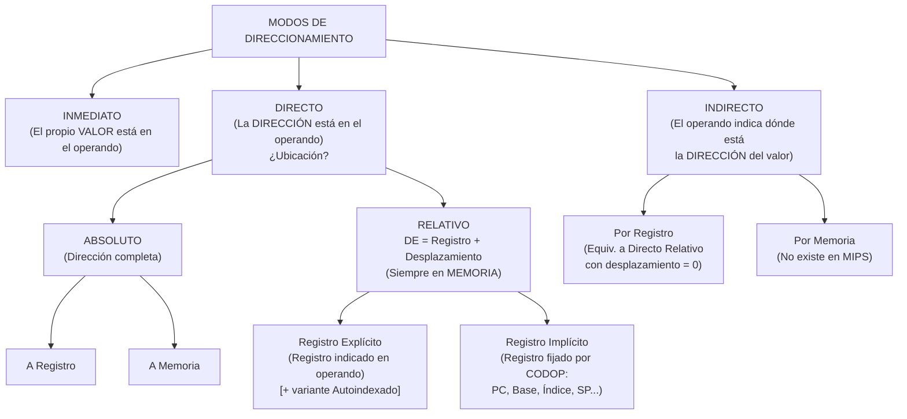

# 3.2. Modos de Direccionamiento

> [!info] Ubicación en el Temario
> Corresponde al **Apartado 1.3** de `tema_3_fundamentos_de_computadores.md` (Diapositivas $11$–$36$), explicado en profundidad en la **Clase 9** (con introducción en la **Clase 8** y repaso en la **Clase 13**).
> ⬅️ Anterior: [[3.1_Instrucciones_y_Formato_de_Instruccion|3.1. Formato de Instrucción]] | [[Tema_3_Indice|Índice del Tema 3]] | Siguiente: [[3.3_Arquitectura_y_Ensamblador_MIPS|3.3. Arquitectura MIPS]] ➡️

---

## 1. ¿Qué es un Modo de Direccionamiento? *(Diap. 11–13)*

Un **modo de direccionamiento** responde a la pregunta fundamental de la Unidad de Control al decodificar un operando: **¿cómo interpretar los bits del campo operando para obtener el valor real que necesita la operación?**

### Ejemplo hilo conductor oficial *(Diap. 11)*

A lo largo de todas las diapositivas oficiales se utiliza la misma instrucción ficticia de $16\text{ bits}$ ($4\text{ bits}$ por campo), que realiza la operación $A \leftarrow B + C$:

```text
ADD A, B, C  →  0100 1001 0010 0101    (A ← B + C)
```

| Campo simbólico | `ADD` (`OPCODE`) | `A` (Destino) | `B` (Operando 1) | `C` (Operando 2) |
| :--- | :---: | :---: | :---: | :---: |
| **Bits ($4\text{ bits}$ c/u)** | `0100` | `1001` | **`0010`** | `0101` |

¿Qué dato concreto se suma a $C$ cuando el campo `B` contiene los bits **`0010`**? **La respuesta depende exclusivamente del modo de direccionamiento del operando `B`.**

### Taxonomía completa de los modos de direccionamiento *(Diap. 12–13)*



---

## 2. Direccionamiento Inmediato *(Diap. 14–16; Clases 8 y 9)*

- **Definición:** *"El campo operando es el propio **VALOR** del operando."*
- El dato constante viene empotrado directamente dentro de los bits de la propia instrucción y se entrega tal cual a la ALU, codificado en binario según el tipo de dato ([[Binario Natural]], entero en [[Complemento a 2]], etc.).
- **Limitación práctica (*Clase 9*):** El tamaño máximo de la constante queda limitado al número de bits disponibles en el campo de la instrucción (por ejemplo, $16\text{ bits}$ en el formato I de MIPS; para cargar constantes de $32\text{ bits}$ en MARS hacen falta dos instrucciones reales, ver [[3.3_Arquitectura_y_Ensamblador_MIPS]]).

> [!example] Ejemplo / Problema de Clase — Inmediato (Diap. 15–16)
> En `ADD A, B, C` (`0100 1001 0010 0101`), si el operando `B` (`0010`) usa **direccionamiento inmediato** en binario puro:
> $$B = 0010_2 = 2_{10} \implies \mathbf{A = 2 + C}$$
>
> ```mermaid
> flowchart LR
>     INST["ADD A, B, C → 0100 1001 [0010] 0101<br/>Campo B = 0010 (Dato)"]
>     VAL["0010₂ = 2"]
>     RES["A = 2 + C"]
>     INST -->|"Valor directo"| VAL --> RES
> ```

---

## 3. Direccionamiento Directo Absoluto *(Diap. 17–21; Clase 9)*

En el direccionamiento **Directo**, el campo operando indica **DÓNDE está el valor** (en un registro o en una posición de memoria). Si es **Absoluto**, el operando proporciona la **dirección completa** sin cálculo previo.

### 3.1. Directo Absoluto a Registro *(Diap. 18–19; Clase 9)*

- **Definición:** El valor a operar reside en un registro del banco de registros; el campo operando contiene el **índice en [[Binario Natural]] del registro** (en MIPS, $5\text{ bits}$ para seleccionar entre $32$ registros).
- **Tamaño de los registros (*Clase 9*):** Al tratar los registros como *"caja negra"* (contenedores de $N$ bits), en MIPS coinciden las anchuras: instrucciones de $32\text{ bits}$, banco de registros de $32\text{ bits}$, palabra de memoria de $32\text{ bits}$ y operandos de la ALU de $32\text{ bits}$.

> [!tip] Explicación de Pizarra / Intuición (Por qué se abrevia "Directo a Registro" — *Clase 9*)
> En clase y en documentación a menudo nos comemos uno de los apellidos y decimos simplemente **"direccionamiento directo a registro"** en vez de "directo absoluto a registro". Son exactamente lo mismo porque el direccionamiento **relativo siempre apunta a una posición de memoria, nunca a un registro**; por tanto, especificar "absoluto" al hablar de un registro es redundante.

### 3.2. Directo Absoluto a Memoria *(Diap. 20–21; Clase 9)*

- **Definición:** El valor a operar reside en una posición de memoria; el campo operando contiene directamente la **dirección de memoria** (tratando la posición de memoria igual que un registro).

> [!tip] Explicación de Pizarra / Intuición (MIPS vs PIC16F877A en memoria — *Clase 9*)
> - **En MIPS (prácticas con MARS):** El direccionamiento directo absoluto a memoria **NO existe** (MIPS es arquitectura *Load-Store* y solo tiene directo a registro + relativo a registro base).
> - **En el PIC16F877A (segunda parte de prácticas):** **SÍ existe**, porque el PIC no separa el banco de registros de la RAM: todos los registros especiales (`PORTB`, `STATUS`, etc.) y las posiciones de RAM comparten un único espacio de direcciones dividido en **bancos**, con un único registro de trabajo (`W`) en lugar de los $32$ de MIPS.
> - **Trabajo sucio transparente en BASIC (*Clase 9*):** En ensamblador del PIC conmutar bancos es *"un trabajo muy sucio"*, pero como en laboratorio se programa en **BASIC compilado** (PIC Simulator IDE, tan potente como C), el programador simplemente escribe el nombre `PORTB` como una caja negra y el compilador/ensamblador se encarga del direccionamiento directo y el cambio de bancos.

> [!example] Ejemplo / Problema de Clase — Directo a Registro vs Directo a Memoria (Diap. 18–21)
> Dado el siguiente estado de **Memoria** y **Banco de Registros**, evaluamos `ADD A, B, C` (`0100 1001 0010 0101`, con `B = 0010`):
>
> | Dirección (Memoria) | Contenido | | Registro (Índice) | Contenido |
> | :---: | :---: | :---: | :---: | :---: |
> | `0000` | `0010` | | `R0 (0000)` | `0110` |
> | `0001` | `0100` | | `R1 (0001)` | `0001` |
> | **`0010`** | **`0000`** | | **`R2 (0010)`** | **`0111`** |
> | `1111` | `0101` | | `R15 (1111)` | `0000` |
>
> 1. **Si `B` es Directo Absoluto a Registro (Diap. 18–19):**
>    - El índice `0010` selecciona el registro `R2`, cuyo contenido es `0111` ($7_{10}$):
>      $$R[2] = 0111_2 = 7_{10} \implies \mathbf{A = 7 + C}$$
> 2. **Si `B` es Directo Absoluto a Memoria (Diap. 20–21):**
>    - La dirección `0010` accede a $\text{Memoria}[0010_2]$, cuyo contenido es `0000` ($0_{10}$):
>      $$\text{Memoria}[0010_2] = 0000_2 = 0_{10} \implies \mathbf{A = 0 + C}$$

---

## 4. Direccionamiento Directo Relativo *(Diap. 22–31; Clases 8 y 9)*

En el direccionamiento **Directo Relativo**, el operando proporciona información parcial que exige un **cálculo previo** para obtener la **Dirección Efectiva ($DE$)** en **memoria** (siempre apunta a una posición de memoria):

$$DE = \text{Contenido}(\text{Registro}) + \text{Desplazamiento}$$

Según cómo se indique el registro implicado, hay dos variantes:

### 4.1. Directo Relativo con Registro Implícito *(Diap. 22–24; Clase 9)*

- El registro **no aparece como campo** en la instrucción: lo fija por convenio el propio **`OPCODE`** (por ejemplo: relativo a `PC`, relativo a `Base`, indexado / relativo a registro índice, relativo a `SP` *Stack Pointer*...).
- En la instrucción solo se almacena el **desplazamiento**.

> [!tip] Explicación de Pizarra / Intuición (¿Por qué el `PC` es un registro implícito? — *Clase 9*)
> En instrucciones de salto como `beq`, el registro base es el **Contador de Programa (`PC`)**, pero no hay ningún campo de $5\text{ bits}$ que lo identifique. ¿Por qué? Porque **el `PC` no pertenece al banco de registros accesible por el programador** (precisamente *"para que el usuario no la líe"* corrompiendo el flujo de ejecución). En la fase de decodificación, al leer el `OPCODE` del salto, la Unidad de Control ya sabe implícitamente que el registro implicado es el `PC`.

> [!example] Ejemplo / Problema de Clase — Relativo con Registro Implícito a `Base` (Diap. 23–24)
> En `ADD A, B, C` (`0100 1001 0010 0101`), con registro implícito `Base = 1101` y campo `B = 0010` (desplazamiento):
> $$DE = \text{Base} + \text{Desplazamiento} = 1101_2 + 0010_2 = 1111_2$$
> $$\text{Memoria}[1111_2] = 0101_2 = 5_{10} \implies \mathbf{A = 5 + C}$$
>
> ```mermaid
> flowchart LR
>     INST["Campo B = 0010<br/>(Desplazamiento)"] --> SUM(("+"))
>     BASE["Registro implícito Base<br/>= 1101"] --> SUM
>     SUM -->|"DE = 1111"| MEM["Memoria[1111] = 0101₂ = 5"] --> RES["A = 5 + C"]
> ```

### 4.2. Directo Relativo con Registro Explícito *(Diap. 25–30; Clase 9)*

- El registro **sí se especifica explícitamente** en el formato de la instrucción: al operando se le asocian **dos campos** (identificador de registro + desplazamiento inmediato).
- **Proceso en 3 pasos (*Clase 9*):** (1) leer el contenido del registro indicado; (2) sumarle el desplazamiento inmediato para obtener $DE$; (3) acceder a $\text{Memoria}[DE]$ para obtener el operando.
- **Principal utilidad (recorrido de vectores/bucles):** Aunque es más largo que el absoluto, es mucho más potente porque permite **barrer un conjunto consecutivo de direcciones de memoria con la misma instrucción** sin modificar el código máquina: basta con incrementar el valor del registro en cada iteración del bucle.

> [!example] Ejemplo / Problema de Clase — Relativo Explícito y Recorrido en Bucle (Diap. 25–30)
> **Parte A — Cálculo individual (`ADD A, B(D), C`, Diap. 25–26):**
>
> | Campo simbólico | `ADD` | `A` | `B` (Registro) | `D` (Desplazamiento) | `C` |
> | :--- | :---: | :---: | :---: | :---: | :---: |
> | **Bits** | `0100` | `1001` | **`1111`** (`R15`) | **`0001`** ($+1$) | `0101` |
>
> Sabiendo que `R15 (1111) = 0000` y $\text{Memoria}[0001_2] = 0100_2$:
> $$DE = R[15] + \text{Desplazamiento} = 0000_2 + 0001_2 = 0001_2$$
> $$\text{Memoria}[0001_2] = 0100_2 = 4_{10} \implies \mathbf{A = 4 + C}$$
>
> **Parte B — Bucle recorriendo memoria con una sola instrucción (Diap. 27–30):**
> ```asm
> Bucle:
>     ...
>     ADD A, R0(0), B    # Desplazamiento fijo = 0; el puntero está en R0
>     INC R0             # Incrementa el registro base para la siguiente iteración
>     ...
>     JUMP Bucle
> ```
>
> | Iteración | Valor de `R0` | Cálculo de $DE = R_0 + 0$ | Dato leído en $\text{Memoria}[DE]$ |
> | :---: | :---: | :---: | :---: |
> | **1** | `0000` | `0000` | $\text{Memoria}[0000] = 0010_2$ ($2$) |
> | **2** *(tras `INC R0`)* | `0001` | `0001` | $\text{Memoria}[0001] = 0100_2$ ($4$) |
> | **3** *(tras `INC R0`)* | `0010` | `0010` | $\text{Memoria}[0010] = 0000_2$ ($0$) |

### 4.3. Variante: Directo Relativo Explícito Autoindexado *(Diap. 31)*

Algunas arquitecturas (no MIPS) incorporan incremento o decremento automático del registro base dentro de la propia instrucción `ADD A, R0(0), B`, ahorrando la instrucción `INC R0` del bucle:

| Modalidad Autoindexada | Secuencia de Operaciones |
| :--- | :--- |
| **Preautoincrementado** | $R_0 \leftarrow R_0 + 1;\quad DE = R_0 + 0$ |
| **Preautodecrementado** | $R_0 \leftarrow R_0 - 1;\quad DE = R_0 + 0$ |
| **Postautoincrementado** | $DE = R_0 + 0;\quad R_0 \leftarrow R_0 + 1$ |
| **Postautodecrementado** | $DE = R_0 + 0;\quad R_0 \leftarrow R_0 - 1$ |

---

## 5. Direccionamiento Indirecto *(Diap. 32–36; Clase 9)*

> [!info] Nota de Alcance (*Clase 9*)
> El profesor explica el concepto de direccionamiento indirecto por completitud del temario oficial, pero señala explícitamente que **no le preocupa para examen porque en MIPS no existe**: el indirecto por registro es funcionalmente redundante con el directo relativo de desplazamiento `0`, y el indirecto por memoria no existe en MIPS.

- **Definición:** *"El campo operando indica **DÓNDE está la DIRECCIÓN** del valor"* (en palabras de clase: *"un saltito más"*, puntero a la dirección real en memoria).
- **Dos modalidades oficiales:**
  1. **Indirecto por registro (Diap. 33–34):** El campo operando da el índice de un registro cuyo contenido es la dirección efectiva en memoria donde está el dato (equivalente a directo relativo con desplazamiento $= 0$).
  2. **Indirecto por memoria (Diap. 35–36):** El campo operando da una dirección de memoria (puntero) cuyo contenido es *otra* dirección de memoria donde finalmente reside el dato (requiere **dos accesos a memoria**).

> [!example] Ejemplo / Problema de Clase — Indirecto por Registro y por Memoria (Diap. 33–36)
> Con `ADD A, B, C` (`0100 1001 0010 0101`, `B = 0010`), modificando en la tabla `R2 (0010) = 1111` (y manteniendo $\text{Mem}[0000]=0010$, $\text{Mem}[0010]=0000$, $\text{Mem}[1111]=0101$):
>
> 1. **Indirecto por registro (Diap. 33–34):**
>    $$\text{Operando } 0010 \rightarrow R[2] = 1111_2 \rightarrow \text{Memoria}[1111_2] = 0101_2 = 5_{10} \implies \mathbf{A = 5 + C}$$
> 2. **Indirecto por memoria (Diap. 35–36):**
>    $$\text{Operando } 0010 \rightarrow \text{Memoria}[0010_2] = 0000_2 \rightarrow \text{Memoria}[0000_2] = 0010_2 = 2_{10} \implies \mathbf{A = 2 + C}$$

---

## 6. Resumen Comparativo y Pregunta Clave de Examen

### Tabla comparativa de todos los modos sobre `B = 0010`

| Modo de Direccionamiento | Interpretación del campo operando | Ruta hasta el dato | Resultado en ejemplo oficial | ¿Existe en MIPS? |
| :--- | :--- | :--- | :---: | :---: |
| **Inmediato** | El propio valor | $\text{Campo} = 0010_2$ | $2$ | Sí (`addi`, `ori`...) |
| **Directo Absoluto a Registro** | Índice de registro | $R[2]$ | $7$ | Sí (`add`, `sub`, `beq`...) |
| **Directo Absoluto a Memoria** | Dirección de memoria | $\text{Mem}[0010_2]$ | $0$ | No *(sí en PIC)* |
| **Directo Relativo (Reg. Implícito)** | Desplazamiento (+ reg. fijado por `OPCODE`) | $\text{Mem}[\text{Base} + 0010_2]$ | $5$ | Sí (`beq`, `bne` con `PC`) |
| **Directo Relativo (Reg. Explícito)** | Registro + desplazamiento | $\text{Mem}[R[15] + 0001_2]$ | $4$ | Sí (`lw`, `sw`, `lb`, `sb`) |
| **Indirecto por Registro** | Índice de registro que guarda dirección | $\text{Mem}[R[2]]$ | $5$ | Redundante (`0($rs)`) |
| **Indirecto por Memoria** | Dirección de puntero en memoria | $\text{Mem}[\text{Mem}[0010_2]]$ | $2$ | No |

> [!danger] Aviso / Trampa de Examen — Modos Mixtos en la Misma Instrucción (*Clase 9*)
> Una **misma instrucción máquina** puede combinar **modos de direccionamiento distintos** en diferentes operandos. En el examen es habitual preguntar por el modo de cada operando concreto dentro de una instrucción MIPS (`beq`, `lw`/`sw`), y hay que identificar cada parte sin mezclarlas.

> [!question] Pregunta de Clase (Justifica la respuesta) — *Clase 9*
> En el procesador MIPS, indica y justifica qué modos de direccionamiento intervienen en cada operando de las siguientes instrucciones:
> 1. `beq $s1, $s2, desp` (salto condicional si son iguales).
> 2. `lw $s1, 20($s2)` (carga de palabra desde memoria a registro).
>
> >> [!success]- Solución
> >> 1. **En `beq $s1, $s2, desp`:**
> >>    - Los operandos `$s1` y `$s2` (los dos valores que se comparan) utilizan **direccionamiento directo absoluto a registro** (campos de $5\text{ bits}$ con el índice en binario natural de cada registro).
> >>    - El destino del salto (`desp`) utiliza **direccionamiento directo relativo con registro implícito (`PC`)**: el registro `PC` no se codifica explícitamente porque no es accesible al usuario y viene impuesto por el `OPCODE` de `beq`; el desplazamiento (en [[Complemento a 2]] si salta hacia atrás) se suma al `PC` para obtener la dirección destino.
> >> 2. **En `lw $s1, 20($s2)`:**
> >>    - El registro destino `$s1` utiliza **direccionamiento directo absoluto a registro**.
> >>    - El operando de memoria `20($s2)` utiliza **direccionamiento directo relativo con registro explícito** (conocido en MIPS como *Base addressing*): la instrucción aporta explícitamente tanto el registro base (`$s2`, identificado en $5\text{ bits}$) como el desplazamiento (`20`), calculándose la dirección efectiva $DE = R[\text{\$s2}] + 20$ para leer la palabra en $\text{Memoria}[DE]$.
