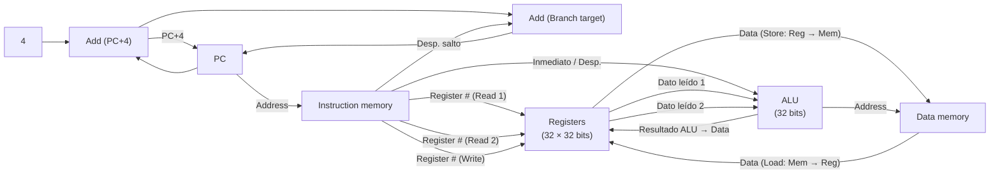
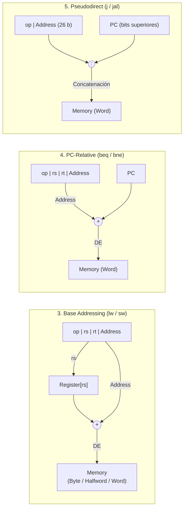

# 3.3. Arquitectura y Lenguaje Ensamblador MIPS (MARS)

> [!info] Ubicación en el Temario
> Corresponde al **Apartado 2 (subapartado 2.1)** de `tema_3_fundamentos_de_computadores.md` (Diapositivas $44$–$55$), desarrollado en la **Clase 9** y complementado con las demostraciones del emulador **MARS** de las **Clases 2, 3, 4, 6 y 8**.
> ⬅️ Anterior: [[3.2_Modos_de_Direccionamiento|3.2. Modos de Direccionamiento]] | [[Tema_3_Indice|Índice del Tema 3]] | Siguiente: [[3.4_Arquitectura_Harvard_y_Pipeline_PIC16F87XA|3.4. Arquitectura Harvard y Pipeline del PIC16F87XA]] ➡️

---

## 1. Filosofía RISC vs CISC *(Diap. 46)*

La arquitectura **MIPS** se basa en el paradigma **RISC**:

| Característica | **RISC** *(Reduced Instruction Set Computer)* — ej. **MIPS** | **CISC** *(Complex Instruction Set Computer)* — ej. **Intel x86** |
| :--- | :--- | :--- |
| **Conjunto de instrucciones** | Pequeño número de instrucciones **simples y frecuentes**. | Gran repertorio incluyendo instrucciones complejas y especializadas. |
| **Complejidad Hardware** | **Hardware simple y rápido** para decodificar y ejecutar instrucciones. | Decodificación y hardware interno más complejo. |
| **Operaciones complejas** | Las operaciones menos frecuentes o complejas se implementan mediante **secuencias de instrucciones simples**. | Suelen resolverse con una única instrucción máquina compleja. |

---

## 2. Banco de 32 Registros de MIPS *(Diap. 47; Clases 6, 8 y 9)*

- MIPS es un procesador de **$32\text{ bits}$**: instrucciones, registros, palabra de memoria y entradas de la ALU tienen todos una anchura de **$32\text{ bits}$** (*Clase 9*).
- Dispone de **$32$ registros de propósito general** (numerados de `$0` a `$31`, lo que exige **$5\text{ bits}$** por identificador de registro).
- Pueden referenciarse por número (`$0`..`$31`) o por su nombre simbólico de convenio.
- **Regla fija hardware:** el registro **`$0` (`$zero`) siempre vale `0`**.

| Nombre | Número | Uso (Convenio MIPS) | ¿Preservado tras llamada a función? |
| :--- | :---: | :--- | :---: |
| `$zero` | `0` | Valor constante `0` | N.A. |
| `$at` | `1` | *Assembler Temporary* (reservado para el ensamblador / pseudoinstrucciones) | No |
| `$v0`–`$v1` | `2`–`3` | Valores de retorno de funciones, evaluación de expresiones y código de servicio en `syscall` | No |
| `$a0`–`$a3` | `4`–`7` | Argumentos de entrada a funciones y parámetros de `syscall` | No |
| `$t0`–`$t7` | `8`–`15` | Registros temporales | No |
| `$s0`–`$s7` | `16`–`23` | Registros temporales salvados (*Saved Temporaries*) | Sí |
| `$t8`–`$t9` | `24`–`25` | Registros temporales adicionales | No |
| `$k0`–`$k1` | `26`–`27` | Reservados para el núcleo del Sistema Operativo (*OS Kernel*) | No |
| `$gp` | `28` | Puntero global (*Global Pointer*) | Sí |
| `$sp` | `29` | Puntero de pila (*Stack Pointer*) | Sí |
| `$fp` | `30` | Puntero de marco (*Frame Pointer*) | Sí |
| `$ra` | `31` | Dirección de retorno (*Return Address*, escrito por `jal`) | Sí |

> [!tip] Explicación de Pizarra / Intuición (Uso práctico de `$v0` y `$a0` en `syscall` de MARS — *Clase 6*)
> En el emulador **MARS**, la instrucción `syscall` invoca rutinas de servicio simuladas en ROM (entrada/salida por consola):
> - Se carga en **`$v0`** el número de servicio: **`4`** para imprimir una cadena terminada en `NULL` (*Print String*, requiere `.asciiz`) o **`1`** para imprimir un entero (*Print Integer*).
> - Se pasa el argumento por **`$a0`** (por ejemplo, la dirección inicial de la cadena apuntada por una etiqueta en `.data`). Si se usa `.ascii` en lugar de `.asciiz`, `syscall 4` imprime los bytes siguientes como basura ASCII hasta encontrar un `0x00` casual (ver [[2.1_Introduccion_y_Representacion_Alfanumerica]]).

---

## 3. Arquitectura *Load-Store* y Ruta de Datos Básica *(Diap. 48–49; Clases 2, 3 y 9)*

MIPS sigue una **arquitectura *Load-Store*** (carga y almacenamiento):

1. **Las operaciones aritméticas y lógicas (`add`, `sub`, `and`, `or`...) SOLO operan con valores que estén en registros** (nunca acceden directamente a posiciones de memoria).
2. Antes de operar con datos almacenados en memoria, es obligatorio realizar transferencias explícitas **`Memoria -> Registro`** mediante instrucciones de carga (**Load**: `lw`, `lh`, `lb`).
3. Una vez calculado el resultado (que queda en un registro), si se necesita guardarlo en memoria o liberar el registro, es obligatorio realizar una transferencia explícita **`Registro -> Memoria`** mediante instrucciones de almacenamiento (**Store**: `sw`, `sh`, `sb`).



**Flujo de señales en la ruta de datos básica (Diap. 48–49):**
- **`PC` y sumadores `Add`:** `PC` apunta a la `Instruction memory` y entra al primer sumador (`PC + 4`, porque cada instrucción mide $4\text{ bytes}$). El segundo sumador calcula la dirección destino de salto relativo a partir de `PC + 4` y el desplazamiento procedente de la instrucción.
- **`Instruction memory` y `Data memory` separadas:** Como señaló el profesor en las *Clases 2 y 3*, MIPS separa físicamente memoria de instrucciones y memoria de datos ([[Arquitectura Harvard]]), aunque desde el punto de vista lógico del programador en MARS se ven organizadas en los segmentos `.text` y `.data`.
- **`ALU`:** Produce resultados aritmético-lógicos hacia el banco `Registers` o direcciones efectivas (`Address`) hacia `Data memory`.

---

## 4. Los Cinco Modos de Direccionamiento de MIPS *(Diap. 50–51; Clase 9)*

Conectando la taxonomía general de [[3.2_Modos_de_Direccionamiento]] con el procesador MIPS real, este soporta exactamente **cinco modos de direccionamiento**:

| Nº | Nombre en MIPS (Diap. 50–51) | Equivalencia en Taxonomía General | Formato / Mecanismo |
| :---: | :--- | :--- | :--- |
| **1** | **Immediate addressing** | **Inmediato** | Formato I: el campo `Immediate` ($16\text{ bits}$) es la propia constante. |
| **2** | **Register addressing** | **Directo absoluto a registro** | Formato R: los campos `rs`, `rt`, `rd` ($5\text{ bits}$) indexan el banco de registros. |
| **3** | **Base addressing** | **Directo relativo con registro explícito** | Formato I: $DE = R[\text{rs}] + \text{Address}$ apunta a un `Byte`, `Halfword` o `Word` en memoria (`lw`, `sw`, `lb`, `sb`). |
| **4** | **PC-relative addressing** | **Directo relativo con registro implícito (`PC`)** | Formato I: $DE = PC + \text{Address}$ apunta a una palabra (`Word`) de instrucción (`beq`, `bne`). |
| **5** | **Pseudodirect addressing** | *(Específico de saltos largos `J`)* | Formato J: concatena los bits más significativos de `PC` con `Address` ($26\text{ bits}$) (pasado por encima en clase). |



---

## 5. Los Tres Formatos de Instrucción de 32 Bits *(Diap. 52; Clases 8 y 9)*

Todas las instrucciones MIPS ocupan exactamente **$32\text{ bits}$ ($4\text{ bytes}$)** y deben ajustarse a uno de estos tres formatos:

### 5.1. Formato R (*Register format*)

Utilizado en operaciones aritmético-lógicas entre registros (ej. `add $rd, $rs, $rt`). Como explicó el profesor en la *Clase 9*, `Op-code` es siempre `000000` y el código real de la operación (suma, resta, `AND`, `OR`...) va en `Function code`.

| Campo | `Op-code` | `Rs` | `Rt` | `Rd` | `shamt` | `Function code` |
| :--- | :---: | :---: | :---: | :---: | :---: | :---: |
| **Bits (rango)** | $31\text{--}26$ ($6\text{ b}$) | $25\text{--}21$ ($5\text{ b}$) | $20\text{--}16$ ($5\text{ b}$) | $15\text{--}11$ ($5\text{ b}$) | $10\text{--}6$ ($5\text{ b}$) | $5\text{--}0$ ($6\text{ b}$) |
| **Ejemplo** | `000000` | `sssss` (fuente 1) | `ttttt` (fuente 2) | `ddddd` (destino) | `00000` (despl.) | `ffffff` |

### 5.2. Formato I (*Immediate format*)

Utilizado en operaciones con constantes inmediatas (`addi`, `andi`, `ori`), transferencias de memoria (`lw`, `sw`, `lb`, `sb`) y saltos condicionales (`beq`, `bne`, con desplazamiento de $16\text{ bits}$ en [[Complemento a 2]]).

| Campo | `Op-code` | `Rs` | `Rt` | `Immediate` |
| :--- | :---: | :---: | :---: | :---: |
| **Bits (rango)** | $31\text{--}26$ ($6\text{ b}$) | $25\text{--}21$ ($5\text{ b}$) | $20\text{--}16$ ($5\text{ b}$) | $15\text{--}0$ ($16\text{ b}$) |
| **Ejemplo** | `ffffff` | `sssss` | `ttttt` | `iiiiiiiiiiiiiiii` |

### 5.3. Formato J (*Jump format*)

Utilizado en saltos incondicionales largos (`j`, `jal`).

| Campo | `Op-code` | `Target` |
| :--- | :---: | :---: |
| **Bits (rango)** | $31\text{--}26$ ($6\text{ b}$) | $25\text{--}0$ ($26\text{ b}$) |
| **Ejemplo** | `000010` | `tttttttttttttttttttttttttt` |

---

## 6. Repertorio Oficial de Instrucciones MIPS *(Diap. 53–55)*

### 6.1. Aritméticas, Transferencia de Datos y Lógicas *(Diap. 53)*

| Categoría | Instrucción | Ejemplo | Significado | Comentarios |
| :--- | :--- | :--- | :--- | :--- |
| **Aritmética** | `add` | `add $s1, $s2, $s3` | `$s1 = $s2 + $s3` | $3$ operandos de registro |
| **Aritmética** | `sub` | `sub $s1, $s2, $s3` | `$s1 = $s2 - $s3` | $3$ operandos de registro |
| **Aritmética** | `addi` | `addi $s1, $s2, 20` | `$s1 = $s2 + 20` | Suma de constante inmediata |
| **Transferencia** | `lw` | `lw $s1, 20($s2)` | `$s1 = Memory[$s2 + 20]` | Palabra ($4\text{ B}$) de memoria a registro |
| **Transferencia** | `sw` | `sw $s1, 20($s2)` | `Memory[$s2 + 20] = $s1` | Palabra ($4\text{ B}$) de registro a memoria |
| **Transferencia** | `lh` / `lhu` | `lh $s1, 20($s2)` | `$s1 = Memory[$s2 + 20]` | Media palabra ($2\text{ B}$, con / sin signo) |
| **Transferencia** | `sh` | `sh $s1, 20($s2)` | `Memory[$s2 + 20] = $s1` | Guardar media palabra ($2\text{ B}$) |
| **Transferencia** | `lb` / `lbu` | `lb $s1, 20($s2)` | `$s1 = Memory[$s2 + 20]` | Byte ($1\text{ B}$, con / sin signo) |
| **Transferencia** | `sb` | `sb $s1, 20($s2)` | `Memory[$s2 + 20] = $s1` | Guardar byte ($1\text{ B}$) |
| **Transferencia** | `ll` / `sc` | `ll $s1, 20($s2)` | Carga enlazada / escritura condicional | Intercambio atómico (*atomic swap*) |
| **Transferencia** | `lui` | `lui $s1, 20` | $\$s1 = 20 \times 2^{16}$ | Carga constante en los $16\text{ bits}$ superiores |
| **Lógica** | `and` | `and $s1, $s2, $s3` | `$s1 = $s2 & $s3` | AND bit a bit entre registros |
| **Lógica** | `or` | `or $s1, $s2, $s3` | $\$s1 = \$s2 \mid \$s3$ | OR bit a bit entre registros |
| **Lógica** | `nor` | `nor $s1, $s2, $s3` | $\$s1 = \sim(\$s2 \mid \$s3)$ | NOR bit a bit entre registros |
| **Lógica** | `andi` | `andi $s1, $s2, 20` | `$s1 = $s2 & 20` | AND bit a bit con constante |
| **Lógica** | `ori` | `ori $s1, $s2, 20` | $\$s1 = \$s2 \mid 20$ | OR bit a bit con constante |
| **Desplazamiento** | `sll` | `sll $s1, $s2, 10` | `$s1 = $s2 << 10` | Desplazamiento lógico a la izquierda |
| **Desplazamiento** | `srl` | `srl $s1, $s2, 10` | `$s1 = $s2 >> 10` | Desplazamiento lógico a la derecha |

### 6.2. Saltos Condicionales, Comparación y Saltos Incondicionales *(Diap. 54)*

| Categoría | Instrucción | Ejemplo | Significado | Comentarios |
| :--- | :--- | :--- | :--- | :--- |
| **Salto cond.** | `beq` | `beq $s1, $s2, 25` | Si `$s1 == $s2`, ir a $PC + 4 + 100$ | Igualdad; salto relativo a `PC` ($25 \times 4 = 100\text{ B}$) |
| **Salto cond.** | `bne` | `bne $s1, $s2, 25` | Si `$s1 != $s2`, ir a $PC + 4 + 100$ | Desigualdad; salto relativo a `PC` |
| **Comparación** | `slt` / `sltu` | `slt $s1, $s2, $s3` | `$s1 = ($s2 < $s3) ? 1 : 0` | Menor que (con / sin signo), combinado con `beq`/`bne` |
| **Comparación** | `slti` / `sltiu` | `slti $s1, $s2, 20` | `$s1 = ($s2 < 20) ? 1 : 0` | Menor que constante (con / sin signo) |
| **Salto incond.** | `j` | `j 2500` | Ir a dirección $10000$ | Salto directo a destino ($2500 \times 4 = 10000$) |
| **Salto incond.** | `jr` | `jr $ra` | Ir a dirección en `$ra` | Retorno de procedimiento / `switch` |
| **Salto incond.** | `jal` | `jal 2500` | `$ra = PC + 4`; ir a $10000$ | Llamada a procedimiento guardando retorno |

*(Nota de Diap. 55: las descripciones detalladas y ejemplos completos de programación en ensamblador MIPS se amplían en el material de referencia del Campus Virtual y las sesiones de prácticas con MARS).*

---

## 7. Prácticas con el Emulador MARS: Reglas y Detalles Críticos *(Clases 4, 6 y 9)*

### 7.1. Segmentos `.data` / `.text` y configuración `Compact, Data at Address 0` *(Clase 9)*

- **`.data`:** Segmento de datos donde se declaran e inicializan variables.
- **`.text`:** Segmento de código donde van las instrucciones (y etiquetas simbólicas como `loop:` para no calcular direcciones numéricas a mano, *Clase 4*).
- **Configuración en MARS (`Compact, Data at Address 0`):** Hace que el segmento de datos comience en la dirección `0x00000000`, simplificando drásticamente los direccionamientos en prácticas (el primer dato declarado ocupa desde el byte `0`).

### 7.2. Coherencia entre directivas (`.word` / `.byte`) e instrucciones (`lw` / `lb`) *(Clase 9)*

> [!example] Ejemplo / Problema de Clase — Demo MARS `.word 2, 5` vs `.byte 2, 5` (*Clase 9*)
> 1. Si declaramos `.word 2, 5` con `Data at Address 0`:
>    - Cada `.word` reserva **$4\text{ bytes}$ ($32\text{ bits}$)** completos (el `2` ocupa las direcciones `0..3` con sus bits altos a cero, y el `5` empieza en la dirección `4`).
>    - Debemos leerlos con **`lw`** (*load word*) y avanzar el puntero de **$4$ en $4$ bytes**.
> 2. Si declaramos `.byte 2, 5`:
>    - El `2` ocupa el byte `0` y el `5` ocupa inmediatamente el byte `1`.
>    - **Error fatal:** si leemos con **`lw`** ($4\text{ bytes}$) sobre datos definidos como `.byte`, la instrucción carga $4$ bytes de golpe y **mezcla el `2` y el `5` dentro del mismo registro**.
>    - **Regla de oro:** `.word` $\leftrightarrow$ `lw` (puntero `+4`); `.half` $\leftrightarrow$ `lh` (puntero `+2`); `.byte` $\leftrightarrow$ `lb` (puntero `+1`).

### 7.3. Pseudoinstrucciones: el caso de `li` de 32 bits *(Clase 9)*

> [!tip] Explicación de Pizarra / Intuición (Por qué `1` línea de ensamblador genera `2` líneas de código máquina — *Clase 9*)
> Queremos cargar la constante de $32\text{ bits}$ `0x12345678` en `$t0`:
> ```mips
> li $t0, 0x12345678
> ```
> **¿Por qué NO existe una instrucción real MIPS `li` de $32\text{ bits}$?** Porque una instrucción MIPS mide $32\text{ bits}$ en total: es físicamente imposible meter un `OPCODE` ($6\text{ b}$), un registro ($5\text{ b}$) y una constante de $32\text{ bits}$ dentro de $32\text{ bits}$ (el formato I solo admite $16\text{ bits}$ inmediatos).
>
> **Solución del ensamblador MARS (Pseudoinstrucción):** `li` es una **pseudoinstrucción** cómoda para el programador que el ensamblador MARS traduce automáticamente a **dos instrucciones reales** de código máquina:
> 1. **`lui`** (*Load Upper Immediate*): carga los $16\text{ bits}$ altos (`0x1234`) en la mitad superior del registro.
> 2. **`ori`** (*OR Immediate*): coloca los $16\text{ bits}$ bajos (`0x5678`) en la mitad inferior sin alterar los altos.
>
> Por eso al pulsar *Assemble* en MARS, una sola línea de código fuente con pseudoinstrucción puede convertirse en dos direcciones consecutivas de código máquina.

### 7.4. Alineamiento de memoria y *Endianness* en MARS *(SOLO PRÁCTICAS — Clases 7 y 9)*

> [!danger] Aviso / Trampa de Examen (Excluido del examen teórico, vital en prácticas de MARS)
> - **Alineamiento de memoria (*Clase 9*):** *"No os preocupéis para el examen por esta historia de la lectura desalineada. Preocuparos para las prácticas de MIPS."*
> - ***Endianness* (*Clase 7*):** *"Little Endian, Big Endian. No lo voy a pedir para examen, pero es muy conveniente que lo miréis."*

- **Tamaños soportados y alineamiento en potencias de $2$ ($1, 2, 4\text{ bytes}$ — *Clase 9*):**
  - La memoria se lee siempre alineada en fronteras potencias de $2$: $1\text{ byte}$ (`lb`, cualquier dirección), $2\text{ bytes}$ (`lh`, direcciones pares) o $4\text{ bytes}$ (`lw`, múltiplos de $4$).
  - Nunca se soportan lecturas de $3\text{ bytes}$ ni accesos que crucen la frontera entre dos palabras de $32\text{ bits}$ (ej. intentar leer $2\text{ bytes}$ tomando $1\text{ B}$ del final de una palabra y $1\text{ B}$ del principio de la siguiente): el hardware no lo soporta y MARS detiene la ejecución con el error **"lectura desalineada"** (típico al equivocarse sumando un desplazamiento incorrecto a un puntero).
- ***Little-Endian* en MARS (*Clase 9*):**
  - Aunque el procesador MIPS real es *bi-endian* (configurable), el emulador **MARS** está escrito en Java y hereda el orden de la máquina anfitriona (PC **x86**, que es ***Little-Endian***: el byte menos significativo va en la dirección más baja).
  - Por ello, al declarar `.word 0x11223344` en dirección `0`, en el segmento de datos de MARS se observa byte a byte:

| Dirección de memoria | `0x0` | `0x1` | `0x2` | `0x3` |
| :--- | :---: | :---: | :---: | :---: |
| **Byte almacenado en MARS (*Little-Endian*)** | `0x44` *(LSB)* | `0x33` | `0x22` | `0x11` *(MSB)* |

> [!tip] Conexión con Tema 1: ¿Cuándo programa un ingeniero en ensamblador? (*Clase 4*)
> Como se detalló en [[1.3_Programacion_y_Proceso_de_Traduccion]], en la práctica profesional se recurre al ensamblador en dos escenarios clave: **(1) ingeniería inversa** sin código fuente (desensamblar el código máquina de la unidad de control de un dron interceptado) y **(2) sistemas críticos de tiempo real estricto** (como el control de la locomotora del AVE a $350\text{ km/h}$, donde el código de un compilador de alto nivel añade demasiadas instrucciones extra).

> [!question] Pregunta de Clase (Justifica la respuesta) — *Clase 9*
> 1. ¿Por qué en MIPS una instrucción `add` no puede sumar directamente dos variables situadas en memoria RAM?
> 2. ¿Por qué al ensamblar `li $t0, 0x12345678` en MARS aparecen dos instrucciones en el segmento de código máquina (`.text`)?
>
> >> [!success]- Solución
> >> 1. Porque MIPS es una **arquitectura *Load-Store***: su ALU solo recibe operandos procedentes del banco de registros (o inmediatos), nunca directamente desde la memoria de datos. Primero hay que cargar los datos desde memoria a registros con instrucciones de carga (`lw`/`lb`), realizar el `add` entre registros y, si se requiere persistir el resultado, escribirlo con una instrucción de almacenamiento (`sw`/`sb`).
> >> 2. Porque todas las instrucciones reales de MIPS miden exactamente **$32\text{ bits}$** y no es posible empaquetar dentro de $32\text{ bits}$ el `OPCODE`, el registro destino y una constante completa de $32\text{ bits}$ (el formato I solo tiene $16\text{ bits}$ inmediatos). Por ello, `li` de $32\text{ bits}$ es una **pseudoinstrucción** que el ensamblador MARS expande automáticamente en dos instrucciones máquina reales: **`lui`** (para los $16\text{ bits}$ superiores) seguida de **`ori`** (para los $16\text{ bits}$ inferiores).
