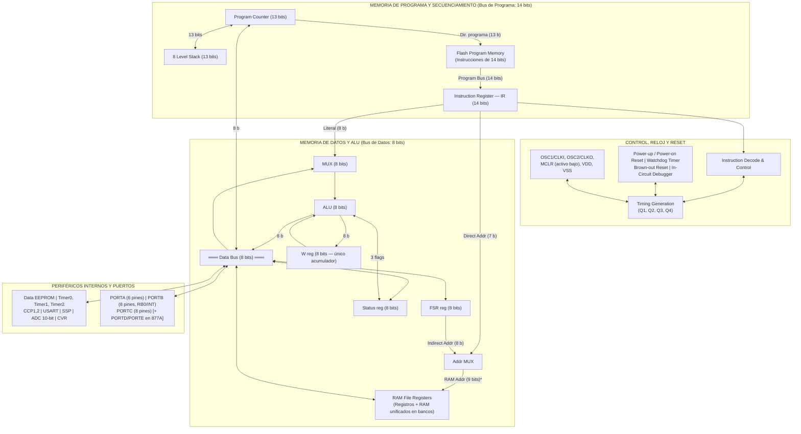
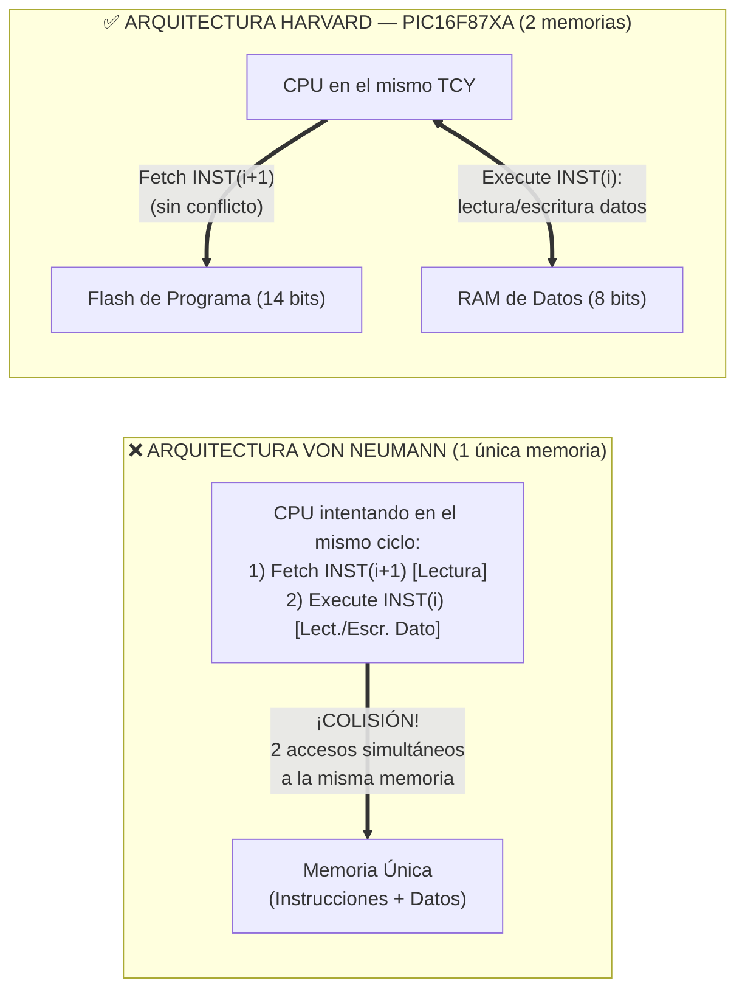

# 3.4. Arquitectura Harvard, Reloj $f/4$ y Pipeline del PIC16F87XA

> [!danger] Aviso / Trampa de Examen — Delimitación Exacta de las Partes 2 y 3 del Tema 3
> - **❌ EXCLUIDO del Primer Parcial (Diap. $56$–$121$):** Los apartados de *Tiempo de ciclo en procesador monociclo r-MIPS* (Diap. $56$–$79$) y *Segmentación MIPS de $5$ etapas, dependencias, riesgos estructurales/control/datos, `NOPs` y salto retardado* (Diap. $80$–$121$) **NO entran en la asignatura** (*Clase 13*: *"no vamos a perder tiempo hablando de la temporización"*; *Clase 22*: *"no vemos eso en la asignatura porque se nos sale de madre, pero os lo he dejado en los apuntes por si alguien tiene curiosidad"*).
> - **✅ SÍ ENTRA — PREGUNTA DE NOTA ALTA / MATRÍCULA (Diap. $122$–$124$, *Clases 21 y 22*):** Las tres últimas diapositivas técnicas del Tema 3 (hoja de datos del **PIC16F87XA**) fueron explicadas en detalle en las **Clases 21 y 22** conectando Tema 1, Tema 3 y Tema 4. El profesor las señaló expresamente como la típica pregunta de *"la nota hay que sudarla: la diferencia entre sacar un aprobado/notable o sacar el sobresaliente o la matrícula"*.

> [!info] Ubicación en el Temario
> Corresponde a las **Diapositivas $122$–$124$** de `tema_3_fundamentos_de_computadores_parte_3_diapositivas_96_125.md`, explicadas en la **Clase 21** (introducción de `Timer0` y $f_{\text{osc}}/4$) y desarrolladas por completo en la **Clase 22** (Secciones 2 y 3).
> ⬅️ Anterior: [[3.3_Arquitectura_y_Ensamblador_MIPS|3.3. Arquitectura MIPS]] | [[Tema_3_Indice|Índice del Tema 3]]

---

## 1. Arquitectura Interna Harvard del PIC16F87XA *(Diap. 122; Clases 9, 14 y 22)*

Los microcontroladores de la familia **PIC16F87XA** (incluyendo el **`PIC16F877A`** usado en la placa *PICGenios* / *PICSimLab*) pertenecen a la gama media (**_mid-range_**, series PIC12 a PIC16) de Microchip (*Clase 22*). Toda esta familia comparte la misma arquitectura interna de la Unidad de Control: una **[[Arquitectura Harvard]]**.

### 1.1. Capacidades de memoria en la figura oficial *(Diap. 122)*

| Dispositivo | Memoria Flash de Programa | Memoria de Datos (RAM) | Data EEPROM |
| :--- | :---: | :---: | :---: |
| `PIC16F873A` | $4\text{K words}$ ($14\text{ bits}$ c/u) | $192\text{ Bytes}$ | $128\text{ Bytes}$ |
| `PIC16F876A` *(y `877A` en prácticas)* | $8\text{K words}$ ($14\text{ bits}$ c/u) | $368\text{ Bytes}$ | $256\text{ Bytes}$ |

### 1.2. Diagrama de bloques oficial (`FIGURE 1-1`, Diap. 122)

La característica estructural decisiva es la **separación física completa entre la memoria y bus de programa ($14\text{ bits}$) y la memoria y bus de datos ($8\text{ bits}$)**:



*\*Nota 1 de la hoja de datos (Diap. 122):* Los bits de mayor peso de los $9\text{ bits}$ de direccionamiento de RAM (`RAM Addr`) proceden del registro `STATUS` (conmutación de bancos de memoria).

> [!tip] Explicación de Pizarra / Intuición (Diferencia clave PIC vs MIPS — *Clases 9 y 22*)
> - **Arquitectura Harvard real:** En el PIC, el ancho de instrucción en Flash es de **$14\text{ bits}$** (con `PC` y pila de $8$ niveles de $13\text{ bits}$), completamente independiente de la memoria RAM de datos de **$8\text{ bits}$**.
> - **Sin banco de registros separado:** A diferencia de MIPS ($32$ registros separados de la RAM), el PIC solo tiene un registro de trabajo (**`W reg`** de $8\text{ bits}$) y trata las posiciones de RAM y los registros especiales (`PORTB`, `STATUS`, `INTCON`...) de forma unificada (*RAM File Registers*). Por eso una operación aritmética típica en el PIC **lee o escribe directamente en la memoria de datos durante la fase *Execute*** (*Clase 22*).

---

## 2. Esquema de Reloj ($f_{\text{osc}}/4$) y Fases en Cuadratura $Q_1$–$Q_4$ *(Diap. 123; Clases 21 y 22)*

¿Por qué en las prácticas del PIC16F877A el temporizador **`[[Timer0]]`** incrementa a una frecuencia exactamente igual a la cuarta parte del cristal de cuarzo ($f_{\text{osc}} / 4$)? La respuesta está en la sección **4.2 (*Clocking Scheme / Instruction Cycle*)** de la hoja de datos (Diap. 123):

1. **División interna por $4$:** La señal de reloj externa que entra por **`OSC1`** (por ejemplo, el cuarzo de $4\text{ MHz}$ de la placa *PICGenios*) se divide internamente por $4$ para generar **cuatro relojes internos en cuadratura no solapados**: **`Q1`, `Q2`, `Q3` y `Q4`**.
2. **Ciclo de Instrucción ($T_{\text{CY}}$):** Cada ciclo de instrucción (`TCY`) dura exactamente **$4$ ciclos del oscilador `OSC1`** ($Q_1 + Q_2 + Q_3 + Q_4$):
   $$f_{\text{inst}} = f_{\text{Timer0}} = \frac{f_{\text{osc}}}{4} \qquad \Longrightarrow \qquad T_{\text{CY}} = \frac{4}{f_{\text{osc}}}$$
   - **Ejemplo de clase ($f_{\text{osc}} = 4\text{ MHz}$, *Clases 21 y 22*):**
     $$f_{\text{inst}} = \frac{4\text{ MHz}}{4} = 1\text{ MHz} \implies T_{\text{CY}} = \frac{1}{1\text{ MHz}} = \mathbf{1\ \mu\text{s} \text{ por instrucción (y por tick de Timer0)}}$$
   - *(Con un cristal de $8\text{ MHz}$, sería $f_{\text{inst}} = 2\text{ MHz} \implies T_{\text{CY}} = 0.5\ \mu\text{s}$).*
3. **Qué ocurre dentro de las $4$ fases $Q_1$–$Q_4$ (Diap. 123–124):**
   - **Durante el ciclo *Fetch* ($1\text{ TCY} = 4$ ciclos de `OSC1`):** en **`Q1`** se incrementa el `PC`, y la instrucción se busca en la memoria Flash de programa y se captura (*latched*) hacia el Registro de Instrucción (`IR`) al final (`Q4` / `Q1` del siguiente ciclo).
   - **Durante el ciclo *Execute* ($1\text{ TCY} = 4$ ciclos de `OSC1`):** la instrucción cargada en `IR` se **decodifica y ejecuta** a lo largo de `Q2`, `Q3` y `Q4` (lectura de operando en memoria de datos durante **`Q2`** y escritura en destino durante **`Q4`**).
   - *(Matiz verbal de la Clase 22:* al explicar el diagrama simplificado en clase, el profesor recuerda las tres fases clásicas del Tema 1 —búsqueda, decodificación y ejecución— y señala que en las dos cajas del diagrama, la primera caja *Fetch* prepara/decodifica la instrucción y la segunda *Execute* realiza la ejecución, tardando $4$ ciclos de reloj cada caja).*

### Cronograma oficial: `Figure 4-3: Clock/Instruction Cycle` *(Diap. 123)*

```wavedrom
{
  "signal": [
    { "name": "OSC1 (reloj ext.)",   "wave": "P...........", "period": 1 },
    ["Fases internas (cuadratura)",
      { "name": "Q1 (Inc. PC)",      "wave": "10..10..10.." },
      { "name": "Q2 (Lect. datos)",  "wave": "010..10..10." },
      { "name": "Q3 (Proceso ALU)",  "wave": "0.10..10..10" },
      { "name": "Q4 (Escr. datos)",  "wave": "0..10..10..1" }
    ],
    { "name": "OSC2/CLKOUT (f/4)",   "wave": "0.1.0.1.0.1." },
    { "name": "PC",                  "wave": "=...=...=...", "data": ["PC", "PC+1", "PC+2"] },
    { "name": "Fetch (Flash 14 b)",  "wave": "=...=...=...", "data": ["Fetch INST (PC)", "Fetch INST (PC+1)", "Fetch INST (PC+2)"] },
    { "name": "Execute (RAM 8 b)",   "wave": "=...=...=...", "data": ["Execute INST (PC-1)", "Execute INST (PC)", "Execute INST (PC+1)"] }
  ],
  "foot": {
    "text": "TCY1: Q1–Q4 (PC)  |  TCY2: Q1–Q4 (PC+1)  |  TCY3: Q1–Q4 (PC+2)  →  1 instrucción completada cada 4 ciclos de OSC1"
  }
}
```

---

## 3. Cauce Segmentado (*Pipeline*) de 2 Etapas y Pregunta de Matrícula *(Diap. 124; Clase 22)*

### 3.1. Solapamiento (*Pipeline*): 8 ciclos de latencia, 4 ciclos efectivos por instrucción

Observando `Figure 4-3` y `Example 4-1` (Diap. 123–124):

- Cada instrucción **tarda en realidad $8\text{ ciclos de reloj}$ ($2\text{ TCY}$)** en completarse desde que empieza hasta que termina: **$4\text{ ciclos}$** para `Fetch` + **$4\text{ ciclos}$** para `Execute`.
- Sin embargo, gracias al **cauce segmentado (*pipeline*) de $2$ etapas**, mientras se ejecuta la instrucción $i$ (`Execute INST(PC)`), el procesador realiza **en paralelo** la búsqueda de la instrucción inmediatamente siguiente (`Fetch INST(PC+1)`).
- **Resultado práctico (*Clase 22*):** Una vez lleno el cauce, el PIC completa efectivamente **$1$ instrucción cada $4\text{ ciclos de reloj}$ ($1\text{ TCY}$)**, coincidiendo exactamente con cada incremento del temporizador **`[[Timer0]]`**.

### 3.2. Excepciones: saltos (`Flush` / `Forced NOP`) y operaciones lentas

No todas las instrucciones tardan $1\text{ TCY}$ ($4\text{ ciclos de reloj}$):

1. **Instrucciones que modifican el `PC` (`GOTO`, `CALL`, saltos condicionales tomados — Diap. 124):**
   - Mientras se ejecuta `CALL SUB_1` (en `TCY3`), el *pipeline* ya ha buscado especulativamente la instrucción secuencial siguiente (`4. BSF PORTA, BIT3`).
   - Al terminar `CALL SUB_1`, la CPU guarda la dirección de retorno en la pila (*8 Level Stack*) y carga `SUB_1` en el `PC`.
   - Por tanto, la instrucción pre-buscada (`BSF`) **debe vaciarse/descartarse (*"flushed"*)** del cauce y se ejecuta como un **`NOP` forzado** durante `TCY4` mientras se hace `Fetch SUB_1`.
   - **Consecuencia:** Cualquier instrucción de salto o llamada tomada consume **2 ciclos de instrucción ($2\text{ TCY} = 8\text{ ciclos de reloj}$)**.
2. **Multiplicaciones y divisiones (*Clase 22*):** El profesor recuerda explícitamente que las multiplicaciones y divisiones tardan mucho más de $4$ ciclos de reloj (*"son horriblemente lentas"*) y deben evitarse en código crítico del PIC.

### Cronograma oficial: `Example 4-1: Instruction Pipeline Flow` *(Diap. 124)*

| Instrucción | `TCY0` | `TCY1` | `TCY2` | `TCY3` | `TCY4` | `TCY5` |
| :--- | :---: | :---: | :---: | :---: | :---: | :---: |
| `1. MOVLW 55h` | `Fetch 1` | `Execute 1` | | | | |
| `2. MOVWF PORTB` | | `Fetch 2` | `Execute 2` | | | |
| `3. CALL SUB_1` | | | `Fetch 3` | `Execute 3` | | |
| `4. BSF PORTA, BIT3` *(Forced NOP)* | | | | `Fetch 4` | **`Flush (NOP)`** | |
| `5. Instruction @ SUB_1` | | | | | `Fetch SUB_1` | `Execute SUB_1` |
| `6. Instruction @ SUB_1 + 1` | | | | | | `Fetch SUB_1 + 1` |

```wavedrom
{
  "signal": [
    { "name": "Ciclo (TCY)",     "wave": "======", "data": ["TCY0", "TCY1", "TCY2", "TCY3", "TCY4", "TCY5"] },
    { "name": "1. MOVLW 55h",    "wave": "==....", "data": ["Fetch 1", "Execute 1"] },
    { "name": "2. MOVWF PORTB",  "wave": ".==...", "data": ["Fetch 2", "Execute 2"] },
    { "name": "3. CALL SUB_1",   "wave": "..==..", "data": ["Fetch 3", "Execute 3"] },
    { "name": "4. BSF PORTA,3",  "wave": "...=9.", "data": ["Fetch 4", "Flush (NOP)"] },
    { "name": "5. @ SUB_1",      "wave": "....==", "data": ["Fetch SUB_1", "Execute SUB_1"] },
    { "name": "6. @ SUB_1 + 1",  "wave": ".....=", "data": ["Fetch SUB_1 + 1"] }
  ],
  "foot": {
    "text": "Pipeline de 2 etapas del PIC16F87XA: CALL SUB_1 fuerza un ciclo extra (Flush/NOP) en TCY4"
  }
}
```

### 3.3. Por qué Harvard permite el *pipeline* y Von Neumann NO *(Clase 22)*



> [!question] Pregunta de Clase (Justifica la respuesta) — Pregunta de Sobresaliente / Matrícula (*Clase 22*, Diap. 122–124)
> Observando el diagrama de tiempos del **PIC16F877A** (`Figure 4-3` / `Example 4-1`, donde dos cajas *Fetch* y *Execute* pertenecen a la misma instrucción y se solapan con la instrucción siguiente):
> 1. ¿Qué representa ese diagrama de dos fases (*Fetch* y *Execute*) solapadas?
> 2. ¿Corresponde a una máquina de Von Neumann? **Justifica la respuesta.**
> 3. ¿Por qué este solapamiento (*Fetch* de la instrucción siguiente al mismo tiempo que *Execute* de la actual) **NO puede realizarse en una máquina de Von Neumann sencilla** y **SÍ en el PIC16F877A**?
>
> >> [!success]- Solución
> >> 1. Representa el **[[Ciclo de Instrucción]] segmentado (*pipeline* de $2$ etapas)** del microcontrolador: cada fase dura $4$ ciclos de reloj ($Q_1$–$Q_4$), y al solapar la adquisición de la instrucción $i+1$ con la ejecución de la instrucción $i$ se completa $1$ instrucción efectiva cada $4$ ciclos de reloj.
> >> 2. **No.** Una máquina de [[Arquitectura Von Neumann]] se caracteriza por almacenar instrucciones y datos en una **única memoria** (donde son cadenas de ceros y unos indistinguibles salvo por el `PC`). El PIC16F877A utiliza una **[[Arquitectura Harvard]]**, porque separa físicamente la **memoria de programa** (Flash de $14\text{ bits}$) de la **memoria de datos** (RAM de $8\text{ bits}$), cada una con su propio bus independiente.
> >> 3. Porque durante la fase **_Execute_**, la instrucción en curso puede necesitar leer o escribir un dato en memoria (especialmente en el PIC, que opera directamente sobre registros en RAM) exactamente **al mismo tiempo** que la fase **_Fetch_** necesita leer el código de la siguiente instrucción de memoria (apuntada por `PC`).
> >>    - En una **máquina de Von Neumann** sencilla con una única memoria, esto provocaría una **colisión de dos accesos simultáneos a la misma memoria**, lo cual es físicamente imposible.
> >>    - En la **arquitectura Harvard**, al existir dos memorias físicamente independientes, la CPU lee la siguiente instrucción de la Flash de programa en paralelo mientras lee o escribe datos en la RAM sin ninguna colisión.

---

## 4. Diseño Práctico: Medición del Tiempo de un Código $S$ con `Timer0` *(Clases 21 y 22)*

Como aplicación directa de que `Timer0` ($8\text{ bits}$, valores $0..255$) siempre está corriendo y avanza **$1$ cuenta por cada instrucción completada** ($f_{\text{osc}}/4$), el profesor planteó en la **Clase 22** un problema clásico de ingeniería de tiempo real (conectado directamente con el Tema 4: [[Timer0]] e [[Interrupciones]]):

> [!example] Ejemplo / Problema de Clase — Medir el tiempo exacto de un segmento de código $S$ (*Clase 22*)
> **Objetivo:** Conocer con precisión cuántos microsegundos tarda en ejecutarse un segmento de código crítico $S$ de $N$ instrucciones (como en control en tiempo real o consulta periódica). *(Nota de clase: procesadores modernos como un Intel Core i5 incluyen contadores internos de nanosegundos para hacer exactamente esto tomando marcas de tiempo al inicio y al final).*
>
> ### Caso 1: Segmento corto ($N \le 255$ instrucciones) — Sin interrupciones
> 1. Justo en el punto de entrada de $S$, reiniciar el temporizador: `Timer0 = 0`.
> 2. Ejecutar el segmento $S$.
> 3. Justo a la salida, leer el contador en una variable: `cuenta = Timer0`.
> 4. Traducir el número de instrucciones a tiempo usando el periodo de instrucción $T_{\text{CY}} = \frac{4}{f_{\text{osc}}}$:
>    $$t_{\text{total}} = \text{cuenta} \times T_{\text{CY}} = \text{cuenta} \times \frac{4}{f_{\text{osc}}}$$
>    *(A $f_{\text{osc}} = 4\text{ MHz}$, $T_{\text{CY}} = 1\ \mu\text{s} \implies \text{cuenta}$ coincide directamente con el tiempo en $\mu\text{s}$).*
>
> ### Caso 2: Segmento largo ($N > 255$ instrucciones) — Desbordamiento e Interrupciones
> - **Limitación de los $8\text{ bits}$:** Al superar $255$, `Timer0` desborda y vuelve a `0` activando el bit de acarreo/desbordamiento (`TMR0IF`). Si leemos `20` al final tras un desbordamiento, no podemos distinguir `20` de $256 + 20 = 276$ instrucciones *(nota: en la explicación oral de la Clase 22 el profesor dijo $255 + 20 = 275$; en binario de $8\text{ bits}$ una vuelta completa son $2^8 = 256$ ticks, por lo que el valor exacto es $256 + 20 = 276$)*.
> - **¿Por qué NO sirve vigilar `TMR0IF` por software (*polling* / bloqueo)?** Porque insertar instrucciones de consulta dentro de $S$ **altera el propio sistema bajo test** (se ejecutan en la misma CPU y cambian el número de instrucciones y el tiempo que estamos midiendo).
> - **Solución hardware — Interrupción por desbordamiento de `Timer0`:**
>   1. Habilitar la interrupción de `Timer0` (`GIE = 1`, `TMR0IE = 1`, limpiando previamente `TMR0IF = 0`) para que una **rutina de servicio (ISR)** incremente una variable `desbordamientos` cada vez que `Timer0` dé la vuelta.
>   2. **El precio de la interrupción (perturbación del cambio de contexto):** Como `Timer0` **nunca se para**, sigue incrementándose mientras se ejecutan las instrucciones de la propia ISR y del **cambio de contexto** que inserta el compilador en el vector `0x0004` (**$4$ instrucciones de entrada** para salvar `W` y `STATUS` + cuerpo de la ISR + **$4$ instrucciones de salida** para restaurar contexto y `RETFIE`).
>   3. **Corrección del error:** Al desbordar, `Timer0` pasa a `0` y dispara la interrupción al final de la instrucción en curso. Por tanto, en la primera línea de nuestra ISR leeremos **`4`** (si no le dio tiempo a pasar de `0` a `1` antes de entrar) o **`5`** (si pasó a `1` antes de entrar). Sabido el valor real de entrada (`0` o `1`), al salir de la ISR se reprograma `Timer0` restaurando ese valor y descontando las instrucciones de contexto (teniendo en cuenta en el mundo real un pequeño ajuste adicional por los ciclos que tarda físicamente la escritura en el registro `Timer0`).
>   - *(Nota práctica de cierre del profesor:* en ingeniería real un segmento crítico suele ser muy corto y rara vez supera las $255$ instrucciones, pero el problema ilustra a la perfección cómo interactúan el hardware de `Timer0`, el ciclo $f_{\text{osc}}/4$ y el coste real de las interrupciones).*

> [!question] Pregunta de Clase (Justifica la respuesta) — *Clases 21 y 22*
> Si un PIC16F877A funciona con un cristal de cuarzo de $f_{\text{osc}} = 4\text{ MHz}$ y queremos medir con `Timer0` cuánto tarda un bloque de código $S$ que tiene más de $255$ instrucciones:
> 1. ¿Cuánto tarda cada incremento de `Timer0` y por qué?
> 2. ¿Por qué no podemos detectar los desbordamientos de `Timer0` haciendo consulta periódica (*polling*) del *flag* `TMR0IF` dentro del bloque $S$?
> 3. Si usamos la interrupción de `Timer0`, ¿qué perturbación debemos corregir en la medida?
>
> >> [!success]- Solución
> >> 1. Tarda **$1\ \mu\text{s}$**. Debido al esquema interno de $4$ fases en cuadratura ($Q_1$–$Q_4$) y al *pipeline* de $2$ etapas, cada instrucción completa su ejecución cada $4$ ciclos de reloj, por lo que `Timer0` trabaja a $f_{\text{osc}}/4 = 4\text{ MHz}/4 = 1\text{ MHz} \implies T_{\text{CY}} = 1\ \mu\text{s}$.
> >> 2. Porque esas instrucciones software de consulta se ejecutan en el **mismo procesador** que el código $S$ bajo test: consumirían ciclos adicionales y alterarían la propia cuenta y temporización que estamos intentando medir.
> >> 3. Como `Timer0` **no se detiene nunca**, sigue contando mientras se ejecutan las instrucciones del **cambio de contexto** ($4$ instrucciones de guardado al entrar + $4$ de restauración al salir en el PIC) y el cuerpo de la rutina de servicio (ISR); por ello hay que restaurar `Timer0` descontando ese *overhead* de instrucciones al salir de la ISR.
