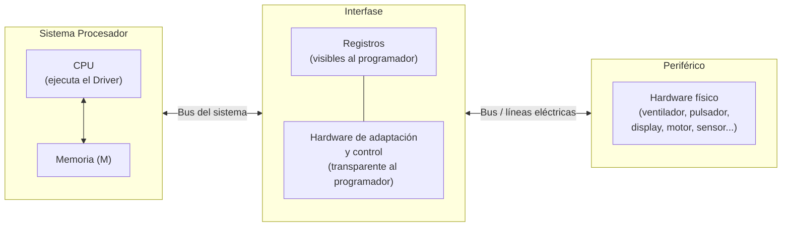
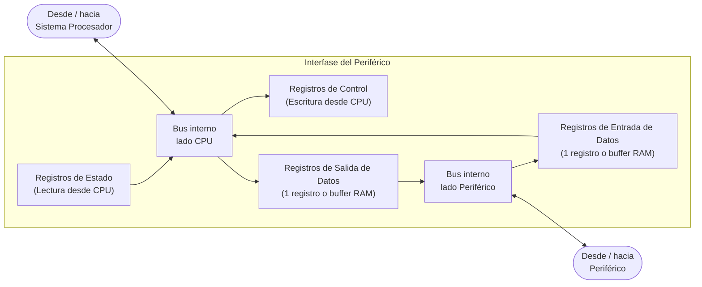

# 4.1. Estructura de la E/S, Hardware de Adaptación y Modelo de Programación

> [!info] Ubicación en el Temario
> Corresponde al **Apartado I — Estructura de la E/S y Modelo de Programación del Periférico** de `tema_4_organizaci_n_de_la_e_s.md` (Diapositivas $1$–$12$), explicado en las **Clases 14 y 15** y complementado con la guía hardware/software del PIC16F877A y PICGenios en la **Clase 17**.
> ⬅️ Volver al [[Tema_4_Indice|Índice del Tema 4]] | Siguiente: [[4.2_Direccionamiento_Interfase_Mapeada_vs_Diferenciada|4.2. Direccionamiento de la Interfase]] ➡️

---

## 1. Estructura General de la Entrada / Salida *(Diap. 3–4; Clases 14 y 15)*

Todo lo visto en los temas anteriores (procesador, memoria, representación binaria, instrucciones) tiene un único fin práctico: **comunicarse con periféricos** externos (por ejemplo, los motores que mueven las articulaciones y los sensores de posición de un **brazo robótico**, *Clase 14*) para hacer algo útil en el mundo físico.

La organización de la E/S se ajusta **siempre** a un esquema de **tres bloques**:



### Elementos y nomenclatura obligatoria *(Diap. 3–4; Clase 15)*

- **Sistema Procesador:** Puede ser la CPU y Memoria del computador principal, o la CPU/Memoria de un dispositivo intermedio inteligente (ej. un controlador *HBA SCSI*).
- **Interfase:** Intermediario indispensable compuesto por dos mitades:
  1. **Registros** (lado del sistema procesador): cajas de bits visibles al programador para interactuar de forma abstracta.
  2. **Hardware de adaptación y control** (lado del periférico): circuitería eléctrica (tensiones, corrientes, formatos) que el fabricante diseña y que es **transparente para el programador**.
  - La interfase suele ir integrada en el propio periférico (o en el microcontrolador), pero puede ser un chip independiente.
- ***Driver* del dispositivo:** Software que **corre en el sistema procesador** y gestiona/controla las transferencias con el periférico leyendo y escribiendo sus registros de interfase.
- **Convenio CPU-céntrico de direcciones (*Clase 15*, Diap. 4):** El sentido de cualquier operación de E/S se define **siempre tomando como referencia el Sistema Procesador (CPU)**:

| Operación | Sentido de los datos | Equivalencia |
| :--- | :--- | :--- |
| **Lectura (`R` = *Read*)** | Periférico $\longrightarrow$ Sistema Procesador | **Entrada** (*Input*) |
| **Escritura (`W` = *Write*)** | Sistema Procesador $\longrightarrow$ Periférico | **Salida** (*Output*) |

---

## 2. Hardware de Adaptación Eléctrica: 3 Casos Reales de PICGenios *(Clases 14, 15 y 17)*

### 2.1. Caso 1: El ventilador de $12\text{ V}$ y el transistor como interruptor digital *(Clases 14 y 15)*

En la placa **PICGenios**, el ventilador está conectado a la tercera línea del Puerto C: **`RC2`** (recordando que en informática se cuenta desde cero: `0, 1, 2`).

- **El problema eléctrico:**
  - El ventilador funciona a **$12\text{ V}$** con una potencia de $P = 0.5\text{ W}$ *(nota de clase: el profesor estimó oralmente $\sim 100\text{ mA}$ para ilustrar el exceso de corriente; aplicando estrictamente $P = V \cdot I$ a $12\text{ V}$ resultan $I = 0.5/12 \approx 41.7\text{ mA}$, y a $5\text{ V}$ serían $100\text{ mA}$ — en cualquier caso supera ampliamente el límite del microcontrolador)*.
  - Según el *datasheet* del PIC16F877A, cada pin opera a **$5\text{ V}$** y entrega una corriente máxima de **$25\text{ mA}$**. Conectar el ventilador directamente al pin **quemaría el chip** por incompatibilidad de tensión y exceso de corriente.
- **La solución (Hardware de adaptación):** Interponer un **transistor NPN actuando como interruptor digital controlado**:
  - El pin `RC2` del microcontrolador solo entrega **$\sim 3\text{ mA}$** a la base del transistor (a través de una resistencia de base).
  - Cuando `RC2` saca un `1` lógico ($+5\text{ V}$), el transistor conduce, cierra a tierra el circuito independiente de $12\text{ V}$ y el ventilador gira.
  - **Transparencia:** Para el programador del *driver*, encender el ventilador se reduce a escribir un `1` en el bit 2 de `PORTC`.

```tikz
\usepackage{circuitikz}
\begin{document}
\begin{circuitikz}[scale=1.0, transform shape]
  \draw (0,0) node[left] {\textbf{PIC \texttt{RC2}} ($5\text{ V}$, $\sim 3\text{ mA}$)} to[R, l=$R_B$, o-] (2.6,0)
        node[npn, anchor=B](Q1){};
  \draw (Q1.E) -- (Q1.E |- 0,-1.4) node[ground]{};
  \draw (Q1.C) -- ++(0,0.4) to[european resistor, l=Ventilador ($12\text{ V}$ / $0.5\text{ W}$)] ++(0,2.2)
        node[vcc]{$+12\text{ V}$};
  \draw[dashed, rounded corners, gray] (0.8,-1.8) rectangle (5.8,3.9);
  \node[gray, font=\footnotesize] at (3.3,-2.1) {Hardware de adaptacion (transparente al programador)};
\end{circuitikz}
\end{document}
```

---

### 2.2. Caso 2: Pulsadores con resistencia *pull-up* (`RB0`, `RB1`) y sus flancos *(Clase 15)*

Los pulsadores individuales de `PORTB` (`RB0`, `RB1`...) conectan el pin del microcontrolador a **tierra (`0 V`)** cuando se pulsan, y llevan conectada una **resistencia de *pull-up*** a $+V_{CC}$ ($+5\text{ V}$).

```tikz
\usepackage{circuitikz}
\begin{document}
\begin{circuitikz}[scale=1.0, transform shape]
  \draw (0,3.2) node[vcc]{$+V_{CC}\ (+5\text{ V})$}
        to[R, l=$R_{\text{pull-up}}$] (0,1.4)
        coordinate (pin)
        to[nos, l=Pulsador] (0,-0.4)
        node[ground]{};
  \draw (pin) to[short, *-o] (2.4,1.4) node[right] {\textbf{Pin PIC (\texttt{RB0} / \texttt{RB1})}};
\end{circuitikz}
\end{document}
```

> [!tip] Explicación de Pizarra / Intuición (¿Qué pinta la resistencia *pull-up*? — *Clase 15*)
> La resistencia *pull-up* cumple **dos funciones vitales**:
> 1. **Garantizar un `1` lógico definido ($+5\text{ V}$) en reposo:** cuando nadie pulsa el botón, la línea no queda "al aire" (indefinida), sino fijada a $+5\text{ V}$.
> 2. **Protección contra cortocircuitos al pulsar:** si conectáramos $+5\text{ V}$ directamente a `RB1` sin resistencia, al pulsar el botón uniríamos directamente $+5\text{ V}$ con tierra (`0 V`), provocando un **cortocircuito** que quemaría la fuente o el micro (*"algo va a echar humo"*). La resistencia *pull-up* (de valor elevado) limita la corriente al pulsar para que sea mínima y segura.
> *(Una resistencia **pull-down** hace exactamente lo contrario: fija la línea a `0 V` en reposo y se conecta a tierra).*

#### Forma de onda real y su impacto en interrupciones (`RB0`)

Como en reposo la línea está a `1` ($+5\text{ V}$) y al pulsar baja a `0` ($0\text{ V}$), el orden de los eventos es: **primero flanco de bajada (al pulsar)** y **después flanco de subida (al soltar)**.

```wavedrom
{
  "signal": [
    { "name": "Pulsador (RB0/RB1)", "wave": "1.0...1.", "node": "..a...b." }
  ],
  "edge": [
    "a Flanco de BAJADA (pulsar)",
    "b Flanco de SUBIDA (soltar)"
  ],
  "head": {
    "text": "Forma de onda con resistencia pull-up (activo en baja)"
  }
}
```

> [!danger] Aviso / Trampa de Examen — Flancos en `RB0` (*Clase 15*)
> La interrupción externa en **`RB0`** se dispara por **flanco** (configurable en el bit `INTEDG` de `OPTION_REG`). Con *pull-up*:
> - Si configuras **flanco de bajada**, la interrupción salta **en el instante en que pulsas el botón**.
> - Si configuras **flanco de subida**, la interrupción salta **cuando sueltas el botón** (exactamente igual que en un teclado, donde *pulsar* y *soltar* son dos eventos distintos).

---

### 2.3. Caso 3: El "problema gordo" del display de $7$ segmentos multiplexado (`1024`) *(Clases 15 y 17)*

En la placa PICGenios hay **4 displays de $7$ segmentos** (cada uno con $7$ segmentos + punto decimal = $8\text{ bits}$).

- **El problema gordo:** Los **4 displays comparten el mismo bus de salida de $8\text{ bits}$ (`PORTD`)**. Si los 4 displays estuvieran encendidos a la vez, mostrarían **exactamente el mismo dígito** (imposible mostrar un número de 4 dígitos distintos como **`1024`**).
- **El hardware de solución:** Cada display tiene en su retorno a tierra un **transistor NPN como interruptor digital**, controlado individualmente por las líneas **`DIS1`–`DIS4`** conectadas a **`RA2`, `RA3`, `RA4` y `RA5` de `PORTA`**. Al poner un `1` en `RAi`, ese transistor cierra el circuito a tierra y enciende solo ese display.
- **El algoritmo software (Multiplexación por barrido periódico):**
  1. Escribir en `PORTD` el patrón de segmentos del dígito 1 (`'1'`).
  2. Encender solo `DIS1` (`RA2 = 1`) durante un breve tiempo suficiente para que la retina capte la luz.
  3. Apagar `DIS1`, escribir el dígito 2 (`'0'`) en `PORTD`, encender `DIS2` (`RA3 = 1`), y repetir cíclicamente con `DIS3` (`'2'`) y `DIS4` (`'4'`).
  - Repitiendo el barrido a suficiente velocidad, se engaña al ojo humano mediante la **persistencia visual** (como en los televisores antiguos de tubo de fósforo) y el usuario ve **`1024`** fijo.

```tikz
\usepackage{circuitikz}
\begin{document}
\begin{circuitikz}[scale=0.92, transform shape, font=\sffamily\footnotesize]
  % Bus compartido PORTD
  \draw[ultra thick, blue!70!black] (0,3.2) -- (11.2,3.2);
  \node[above, blue!70!black] at (5.6,3.3) {\textbf{Bus compartido \texttt{PORTD} (8 lineas: segmentos a--g + dp)}};

  % 4 Displays + 4 Transistores
  \foreach \i/\x/\dig/\pin in {1/1.6/1/RA2, 2/4.4/0/RA3, 3/7.2/2/RA4, 4/10.0/4/RA5} {
    \draw[thick, fill=gray!12] (\x-0.7,1.4) rectangle (\x+0.7,2.6) node[pos=.5] {\textbf{DIS\i} (\dig)};
    \draw[blue!70!black] (\x,3.2) -- (\x,2.6);
    \draw (\x,1.4) -- (\x,0.9) node[npn, anchor=C](Q\i){};
    \draw (Q\i.E) -- ++(0,-0.25) node[ground]{};
    \draw (Q\i.B) to[short, -o] ++(-0.55,0) node[left] {\scriptsize \texttt{\pin}};
  }
\end{circuitikz}
\end{document}
```

---

## 3. Organización de los Registros de la Interfase *(Diap. 5–7; Clases 15, 18 y 21)*

Lo único que ve el programador del *driver* son los **registros de la interfase** (cajas de $1, 2, 4$ u $8\text{ bytes}$, normalmente del tamaño de la palabra del procesador). Existen **cuatro tipos lógicos**:



| Tipo de Registro | Acceso desde CPU | Función | Ejemplo de libro (PIC16F877A) |
| :--- | :---: | :--- | :--- |
| **Registro de Estado** | Lectura | Informa del estado actual del periférico (pulsado/no pulsado, ocupado/listo, error). | **`PORTB`** al leer el estado de los pulsadores (*Clase 15*). |
| **Registro de Control** | Escritura | Configura el periférico o le ordena ejecutar comandos (`arranca`, `para`). | **`TRISB`** (`0` = *Output*/salida, `1` = *Input*/entrada, *Clase 15*). |
| **Registro de Entrada de Datos** | Lectura | Alberga temporalmente datos entregados por el periférico (puede ser un único registro o un buffer RAM). | `ADRESH` / `ADRESL` (resultado de $10\text{ bits}$ del ADC, *Clase 18*). |
| **Registro de Salida de Datos** | Escritura | Alberga temporalmente datos enviados desde la CPU hacia el periférico (registro o buffer RAM). | `PORTD` al escribir los segmentos del display; `TXREG`. |

> [!danger] Aviso / Trampa de Examen — Registros Híbridos (Control + Estado a la vez) (*Clases 18 y 21*)
> En microcontroladores con pocos registros como el PIC16F877A es **habitual mezclar funciones de control y estado en un mismo registro**. Por ello, ante la pregunta *"¿El registro `INTCON` (o el bit `GO/DONE` de `ADCON0`) es de control o de estado?"*, la respuesta correcta es **AMBAS COSAS A LA VEZ** (contiene bits de escritura/control y bits de lectura/estado).

---

## 4. Modelo de Programación del Periférico *(Diap. 8–12; Clases 14 y 15)*

### 4.1. Definición y utilidad estratégica *(Diap. 8 y 12)*

El **Modelo de Programación** de un periférico es la **descripción completa** de:
1. Los **registros** que componen la interfase (su organización, direcciones y campos de bits).
2. El **conjunto de comandos y parámetros** que acepta la interfase.
3. Su **temporización** y sus **condiciones de error**.

**Ventaja clave de ingeniería (Desacoplamiento Hardware/Software):**
El modelo de programación desacopla la implementación física del comportamiento lógico. El fabricante puede **cambiar o mejorar el hardware interno** sin alterar su función ni obligar a reescribir el *driver*, **con tal de conservar la compatibilidad con el modelo de programación previo** (pudiendo ampliarlo con funciones nuevas sin romper las antiguas).

> [!example] Ejemplo / Problema de Clase — 3 Casos Reales de Modelo de Programación (*Clases 14 y 15*)
> 1. **Brazo robótico (*Clase 15*):** El fabricante sustituye el motor paso a paso por un modelo nuevo más fiable y con distinto accionamiento eléctrico, pero conserva intactos los mismos registros de control ("avanzar un paso" / "retroceder un paso"). **Resultado:** el *driver* ya programado sigue funcionando exactamente igual sin cambiar una sola línea de código.
> 2. **Microchip `PIC16F877` $\rightarrow$ `PIC16F877A` (Diap. 9–11; *Clase 15*):** En las transparencias, el diagrama de bloques es del `877` y el mapa de registros ya es del `877A`. Microchip modificó el silicio internamente pero **conservó y amplió** el mapa de registros (añadiendo repeticiones de registros entre bancos), manteniendo compatibilidad total con el software del `877`.
> 3. **Display LCD Hitachi `HD44780` ($2 \times 16$, *Clase 14*):** Su protocolo de control se convirtió en un **estándar de facto** que clonan todos los fabricantes, permitiendo utilizar librerías estándar (`Lcdout`) con independencia del fabricante físico de la pantalla.

### 4.2. Registros oficiales del `PIC16F877A` mostrados en las transparencias *(Diap. 9–11)*

- **Mapa de memoria (`FIGURE 2-3`, Diap. 10):** Organizado en **4 bancos** (`Bank 0`: `00h–7Fh`, `Bank 1`: `80h–FFh`, `Bank 2`: `100h–17Fh`, `Bank 3`: `180h–1FFh`), donde los registros más críticos (`STATUS`, `PCL`, `PCLATH`, `FSR`, `INTCON`) se reflejan en los 4 bancos para poder acceder a ellos sin cambiar de banco.
- **Registros asociados a `PORTB` y direcciones `TRIS` (`TABLE 3-4`, Diap. 11):**

| Dirección | Nombre | Bit 7 | Bit 6 | Bit 5 | Bit 4 | Bit 3 | Bit 2 | Bit 1 | Bit 0 | Valor en Reset (POR/BOR) |
| :--- | :--- | :---: | :---: | :---: | :---: | :---: | :---: | :---: | :---: | :---: |
| `06h`, `106h` | `PORTB` | `RB7` | `RB6` | `RB5` | `RB4` | `RB3` | `RB2` | `RB1` | `RB0` | `xxxx xxxx` |
| `86h`, `186h` | `TRISB` | Dirección de datos de `PORTB` (`1` = Entrada, `0` = Salida) | | | | | | | | `1111 1111` |
| `87h` | `TRISC` | Dirección de datos de `PORTC` | | | | | | | | `1111 1111` |
| `88h` | `TRISD` | Dirección de datos de `PORTD` | | | | | | | | `1111 1111` |
| `81h`, `181h` | `OPTION_REG` | $\overline{\text{RBPU}}$ | `INTEDG` | `T0CS` | `T0SE` | `PSA` | `PS2` | `PS1` | `PS0` | `1111 1111` |

---

## 5. *Watchdog Timer* y Guía Práctica de la Placa PICGenios *(Clases 14 y 17)*

### 5.1. El *Watchdog Timer* ("perro guardián") *(Clases 14 y 19)*

> [!example] Ejemplo / Problema de Clase — La máquina expendedora de Coca-Colas (*Clase 14*)
> Controlar la refrigeración de una máquina expendedora de la facultad por software (en vez de un termostato mecánico) permite subir la consigna de temperatura por las noches y fines de semana para ahorrar energía. **Riesgo:** si un *bug* o una espera bloqueante deja el microcontrolador colgado en un bucle infinito con el compresor encendido, **se quema el motor** y no es viable que un humano vaya a pulsar reset.
>
> **Solución hardware — *Watchdog Timer*:** Es un contador decremental hardware independiente del software (activado en los bits de configuración al programar la Flash). El programa normal debe **reiniciarlo periódicamente** en su bucle sano; si el programa se cuelga, deja de refrescarlo, el contador llega a **`0`** y **resetea automáticamente el microcontrolador por hardware**.

### 5.2. Entorno de prácticas (`PICSimLab` + `PIC Simulator IDE`) y trampillas hardware *(Clases 14 y 17)*

- **Placa física Microgenios vs `PICSimLab`:** Encapsulado DIP (*"cucaracha"*) en zócalos multi-micro (PIC16/PIC18), cristal de cuarzo de $4\text{ MHz}$, microinterruptores DIP para conectar/desconectar periféricos y conector programador **ICSP** que graba en Flash el fichero **Intel HEX** (protegido con sumas de comprobación **CRC**). **`PICSimLab` (`speed 1.0`) corre en tiempo real**, a diferencia del simulador interno de *PIC Simulator IDE*, que es lentísimo (*"con medio segundo de espera te puedes ir a tomar una cerveza"*).
- **Configuración crítica en *PIC Simulator IDE*:** Verificar siempre el modelo **`16F877A`** y la **frecuencia de reloj exacta** ($4\text{ MHz}$, $8\text{ MHz}$...) porque de ella dependen `WaitMs` y `Timer0`. Depuración sin paso a paso: mediante **LEDs**, mensajes por **`Lcdout`** o el **osciloscopio digital** integrado (`RC2` ventilador, `RC0` tacómetro).
- **Las 3 líneas iniciales obligatorias en todo programa PIC (*Clase 14*):**
  1. `#define _CONFIG ...` (bits de configuración hardware: reloj externo, Watchdog, etc.).
  2. `ALL_DIGITAL` (macro que pasa a digitales `RA0` y `RA1`, que arrancan como entradas analógicas para potenciómetros).
  3. `WaitMs 50` (parche contra una condición de carrera en el arranque que puede dejar el *flag* `INTF` a `1` generando interrupciones espurias).
- **Conflictos físicos en la placa PICGenios (*"Leed la documentación"*, *Clase 17*):**
  - **Teclado matricial vs Display $7$-segmentos en `PORTD`:** El teclado matricial funciona por barrido poniendo `0` en columnas y leyendo 4 filas por `PORTD` (**requiere `TRISD` como entrada**), mientras los displays escriben en `PORTD` (**requiere `TRISD` como salida**) $\implies$ **hay que reconfigurar `TRISD` constantemente** al alternar entre leer teclado y escribir display.
  - **`RC0`:** Conectada por defecto a un **relé** (cualquier actividad en `RC0` lo hace conmutar ruidosamente).
  - **`RB0`:** Enclavada por el **Reloj de Tiempo Real (RTC)** $\implies$ es obligatorio **desactivar el interruptor DIP del RTC** en PICSimLab para poder usar `RB0` libremente.
  - **Memoria RAM ($368\text{ B}$) y tipos en BASIC (`DIM`):** Los enteros (`Byte`, `Word`) son [[Binario Natural]] sin signo (**riesgo de *underflow***: en un `Byte`, $0 - 1 = 255$, bucle infinito en `while i >= 0`). El tipo **`Bit`** permite al compilador empaquetar **$8$ flags booleanos en $1$ solo byte** de RAM.

> [!question] Pregunta de Clase (Justifica la respuesta) — *Clases 14 y 15*
> 1. ¿Por qué no se puede conectar el ventilador de $12\text{ V}$ directamente al pin `RC2` del PIC16F877A y qué papel cumple el hardware de adaptación?
> 2. ¿Cuál es la doble función de la resistencia *pull-up* en `RB0` y qué flanco ocurre al pulsar el botón?
> 3. ¿Cómo se muestran 4 dígitos distintos (`1024`) si los 4 displays de $7$ segmentos comparten el mismo bus `PORTD`?
>
> >> [!success]- Solución
> >> 1. Porque el ventilador trabaja a $12\text{ V}$ y demanda más corriente que los $25\text{ mA}$ máximos a $5\text{ V}$ que soporta un pin del PIC, quemando el microcontrolador. El hardware de adaptación (un **transistor como interruptor digital**) permite que el pin solo suministre $\sim 3\text{ mA}$ a la base para conmutar el circuito de $12\text{ V}$, de forma totalmente transparente al programador.
> >> 2. Fija la línea a un `1` lógico definido ($+5\text{ V}$) cuando no se pulsa y **limita la corriente para evitar un cortocircuito** entre $+5\text{ V}$ y tierra al pulsar. Al pulsar el botón se produce un **flanco de bajada** (`1` $\rightarrow$ `0`), y al soltarlo un **flanco de subida** (`0` $\rightarrow$ `1`).
> >> 3. Mediante **multiplexación temporal por barrido periódico**: se coloca en `PORTD` el código de un dígito, se activa únicamente el transistor interruptor de su display (`DIS1`–`DIS4` en `RA2`–`RA5`), se apaga y se pasa rápidamente al siguiente, engañando a la retina humana por persistencia visual.
