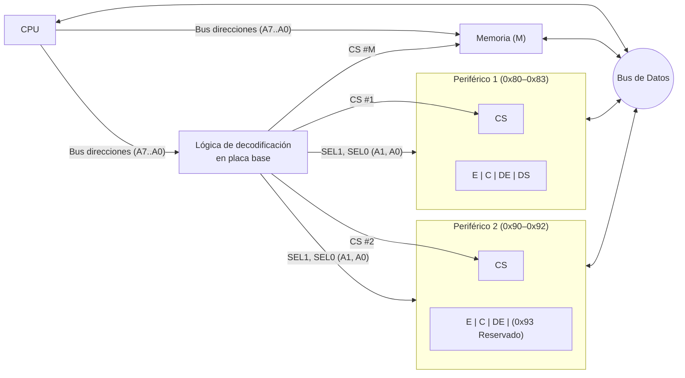
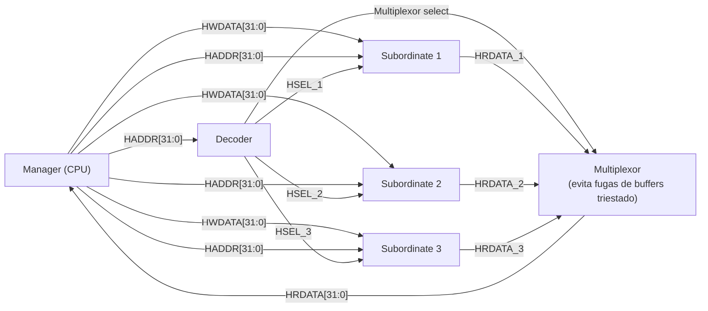
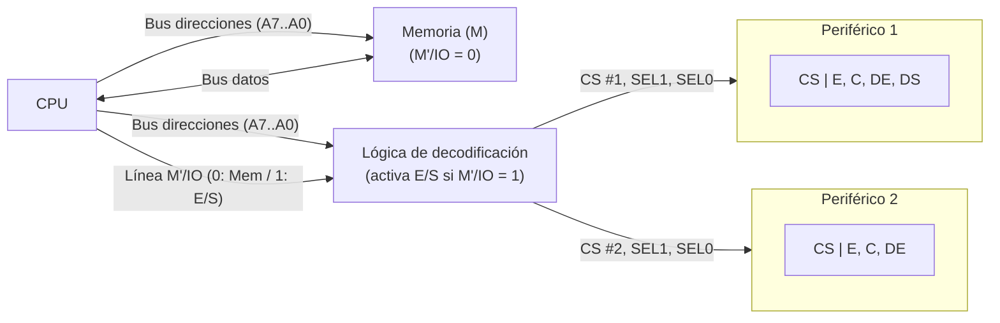

# 4.2. Direccionamiento de la Interfase: Mapeada vs Diferenciada

> [!info] Ubicación en el Temario
> Corresponde a **Direccionamiento de la interfase** en `tema_4_organizaci_n_de_la_e_s.md` (Diapositivas $13$–$25$), explicado al final de la **Clase 15** (tramo `[25:00]`, solo completo en `C. Transcripción 15.md`), desarrollado en la **Clase 16** y repasado al inicio de la **Clase 17**.
> ⬅️ Anterior: [[4.1_Estructura_ES_Interfase_y_Modelo_Programacion|4.1. Estructura de la E/S]] | [[Tema_4_Indice|Índice del Tema 4]] | Siguiente: [[4.3_Metodos_ES_PIO_y_Consulta_de_Estado|4.3. Métodos de E/S: PIO]] ➡️

---

## 1. El Problema del Bus Multipunto: [[Colisión de Bus]] y *Chip Select* (`CS`) *(Diap. 13–14; Clases 15 y 16)*

En un computador existen múltiples periféricos, cada uno con una o más interfases y cada interfase con varios registros. El **direccionamiento** es el mecanismo hardware que permite identificar con precisión:
1. **Qué periférico (interfase)** participa en la transferencia.
2. **Qué registro interno** (Estado, Control, Datos) es origen o destino.

### 1.1. ¿Qué es una [[Colisión de Bus]]? *(Pizarra Clase 15 `[25:00]` y Clase 16)*

En una máquina [[Arquitectura Von Neumann]], la `CPU`, la `Memoria` y las `Interfases` de periféricos se conectan físicamente a un mismo **bus de datos compartido (bus multipunto)**.
- **Lectura simultánea:** Varios dispositivos pueden **leer** el bus a la vez sin ningún problema de corriente.
- **Escritura simultánea (¡PROHIBIDA!):** Jamás pueden **escribir** dos dispositivos al mismo tiempo en el mismo hilo del bus.
  - En lógica **TTL**, el `1` lógico son **$+5\text{ V}$** (alimentación) y el `0` lógico son **$0\text{ V}$** (conexión directa a tierra).
  - Si el dispositivo `D1` escribe un `1` ($+5\text{ V}$) y simultáneamente el dispositivo `D3` escribe un `0` ($0\text{ V}$) sobre el mismo cable **sin resistencia de protección**, se produce un **cortocircuito directo** entre $+5\text{ V}$ y masa que quema los transistores de salida de los *drivers* (*"algo va a echar humo"*).

```tikz
\usepackage{circuitikz}
\begin{document}
\begin{circuitikz}[scale=0.95, transform shape, font=\sffamily\footnotesize]
  % Linea del bus de datos compartido
  \draw[ultra thick, red!75!black] (0,2.0) -- (10.5,2.0);
  \node[above, red!75!black] at (5.25,2.1) {\textbf{Linea compartida del Bus de Datos (1 bit) -- CORTOCIRCUITO TTL}};

  % D1 escribiendo 1 (+5V)
  \draw[thick, fill=blue!10] (0.5,0) rectangle (2.7,1.2) node[pos=.5, align=center] {\textbf{D1 (Escritura)}\\pone \texttt{1} ($+5\text{ V}$)};
  \draw (1.6,1.2) -- (1.6,2.0);
  \draw (1.6,0) -- (1.6,-0.4) node[below] {$+5\text{ V}$ (sin $R$)};

  % D2 leyendo
  \draw[thick, fill=green!10] (4.1,0) rectangle (6.3,1.2) node[pos=.5, align=center] {\textbf{D2 (Lectura)}\\sin conflicto};
  \draw[->, thick] (5.2,2.0) -- (5.2,1.2);

  % D3 escribiendo 0 (0V GND)
  \draw[thick, fill=orange!15] (7.7,0) rectangle (9.9,1.2) node[pos=.5, align=center] {\textbf{D3 (Escritura)}\\pone \texttt{0} ($0\text{ V}$)};
  \draw (8.8,1.2) -- (8.8,2.0);
  \draw (8.8,0) -- ++(0,-0.3) node[ground]{};

  % Flecha de corriente de cortocircuito
  \draw[->, very thick, dashed, red] (1.9,1.75) -- (8.5,1.75) node[midway, below] {\scriptsize Corriente descontrolada ($+5\text{ V} \to \text{GND}$)};
\end{circuitikz}
\end{document}
```

### 1.2. Solución hardware: Bus de direcciones, *Chip Select* (`CS`) y `R/W` *(Diap. 14; Clases 15 y 16)*

Como el **bus de direcciones** ($A_7 \dots A_0$) es escrito **exclusivamente por la CPU** (a través del `PC` o del registro de dirección de operando), sirve para coordinar quién toma el turno en el bus de datos mediante **tres mecanismos combinados**:

1. **Asignación de dirección** en el bus de direcciones por parte de la CPU.
2. **Lógica de decodificación:** circuito combinacional (puertas lógicas en la placa base o dentro del chip) que interpreta esa dirección.
3. **Línea de activación selectiva — *Chip Select* (`CS` / $\overline{\text{CS}}$ activa en baja) + línea `R/W`:** solo el único dispositivo cuyo `CS` está activado se acopla eléctricamente al bus de datos para escribir; el resto permanecen desacoplados eléctricamente (**alta impedancia**) o en solo lectura, haciendo imposible la colisión.

---

## 2. Lógica de Decodificación y Buses Modernos *(Diap. 15–18; Clase 16)*

### 2.1. Decodificación burda vs Decodificación fina *(Clase 16)*

Supongamos un microprocesador sencillo de $8\text{ bits}$ con bus de direcciones $A_7 \dots A_0$ ($2^8 = 256$ posiciones, de `0x00` a `0xFF`) y periféricos de hasta $4$ registros de $8\text{ bits}$:

- **Decodificación burda (`A7 = 1` $\rightarrow$ periférico, `A7 = 0` $\rightarrow$ memoria):** Aunque funciona, **desperdicia $128$ direcciones** para un periférico que solo tiene $4$ registros (inaceptable).
- **Decodificación fina (Diap. 15, 17 y 18):**
  - Los **$2$ bits bajos (`A1, A0`)** se conectan directamente a las entradas **`SEL1, SEL0`** de cada periférico para seleccionar cuál de sus $4$ registros internos se accede (`00`, `01`, `10`, `11`).
  - Los **$6$ bits altos (`A7..A2`)** entran en la **lógica de decodificación**, que activa exclusivamente una de las líneas `CS #M` (Memoria), `CS #1` (Periférico 1) o `CS #2` (Periférico 2).



#### Direccionamiento local y tabla de decodificación oficial *(Diap. 17–18; Clase 16)*

Elegimos arbitrariamente direcciones base terminadas en `00` binario: **Periférico 1 en `0x80`** y **Periférico 2 en `0x90`**.

| $A_1$ (`SEL1`) | $A_0$ (`SEL0`) | Registro en Periférico 1 (`0x80`–`0x83`) | Registro en Periférico 2 (`0x90`–`0x93`) |
| :---: | :---: | :--- | :--- |
| `0` | `0` | Estado (`E`) — `0x80` | Estado (`E`) — `0x90` |
| `0` | `1` | Control (`C`) — `0x81` | Control (`C`) — `0x91` |
| `1` | `0` | Datos Entrada (`DE`) — `0x82` | Datos Salida (`DS`) / `DE` — `0x92` |
| `1` | `1` | Datos Salida (`DS`) — `0x83` | **Reservado** — `0x93` *(no usar)* |

*(Nota sobre las transparencias: la Diap. 17 indica `Datos Salida` en `10` para P2 mientras la Diap. 18 etiqueta `0x92` como `DE`, y la cabecera de la Diap. 18 tiene la errata tipográfica `SEL2` en lugar de `SEL0`).*

| Cantidad | Rango ($A_7 \dots A_0$) | Dispositivo direccionado | `CS1` | `CS2` | `SEL1` | `SEL0` |
| :---: | :--- | :--- | :---: | :---: | :---: | :---: |
| **$128$** | $\text{0x00}$ a $\text{0x7F}$ | Memoria (`M`) | `0` | `0` | `X` | `X` |
| $4$ | $\text{0x80}$ a $\text{0x83}$ | Periférico 1 (`E`, `C`, `DE`, `DS`) | `1` | `0` | $A_1$ | $A_0$ |
| **$12$** | $\text{0x84}$ a $\text{0x8F}$ | Memoria (`M`) | `0` | `0` | `X` | `X` |
| $3$ | $\text{0x90}$ a $\text{0x92}$ | Periférico 2 (`E`, `C`, `DE`) | `0` | `1` | $A_1$ | $A_0$ |
| $1$ | $\text{0x93}$ | **Reservada** *(no se debe usar)* | `0` | `1` | `1` | `1` |
| **$108$** | $\text{0x94}$ a $\text{0xFF}$ | Memoria (`M`) | `0` | `0` | `X` | `X` |

> [!tip] Explicación de Pizarra / Intuición (¿Por qué se marca `0x93` como **Reservado**? — *Clase 16*)
> Aunque el Periférico 2 solo tiene $3$ registros, el fabricante deja la $4.\text{ª}$ dirección (`11` = `0x93`) como **Reservada** pensando en futuras ampliaciones del periférico. Si nadie escribe ahí, en una futura revisión del hardware podrá añadirse un $4.\text{º}$ registro manteniendo intacto el [[4.1_Estructura_ES_Interfase_y_Modelo_Programacion|Modelo de Programación]] sin entrar en conflicto con software previo.

### 2.2. Buses modernos de bajo consumo: ARM AHB / ESP32-C3 *(Diap. 16; Clase 16)*

En microcontroladores modernos pensados para **batería** como el **ESP32-C3** (basado en procesador RISC-V), la lógica de decodificación va integrada dentro del propio chip siguiendo un esquema tipo **ARM AHB (*Advanced High-Performance Bus*)**:



> [!tip] Explicación de Pizarra / Intuición (Por qué un Multiplexor en lugar de buffers triestado — *Clase 16*)
> En un bus compartido tradicional, los periféricos no seleccionados ponen sus salidas en alta impedancia mediante **buffers triestado**, que siguen presentando pequeñas corrientes de fuga y consumen más energía. En el **ESP32-C3 / ARM AHB**, el decodificador gobierna un **multiplexor** que elige físicamente la salida `HRDATA_i` del subordinado activo y desconecta las demás, **reduciendo drásticamente el consumo de batería**.

---

## 3. E/S Mapeada por Memoria *(Diap. 19–20; Clases 16 y 17)*

En la **E/S mapeada por memoria**, la lógica de decodificación "secuestra" direcciones del propio espacio de memoria para asignarlas a los registros de los periféricos:

- **Dos rasgos definitorios:**
  1. Las direcciones de E/S están **entremezcladas** en el mismo espacio de direcciones que la memoria principal.
  2. La CPU usa **exactamente las mismas instrucciones de acceso a memoria** para acceder a los registros de E/S (en MIPS: **`LB`** y **`SB`**; en AVR: **`LD`** y **`ST`**; en el **PIC16F877A**, toda la E/S está mapeada por memoria junto a los $368\text{ bytes}$ de RAM).
- **Ventajas:** El registro de E/S se ve simplemente como una posición de memoria; la CPU no necesita instrucciones especiales; los accesos son rápidos.
- **Inconvenientes graves:**
  1. **Riesgo de seguridad / daños físicos:** un error de programación (bucle o puntero descontrolado) puede acceder accidentalmente a `0x80` y activar un actuador o periférico no deseado.
  2. **Fragmentación del espacio de direcciones:** si los periféricos se colocan dispersos en medio del mapa, impiden reservar bloques contiguos grandes de memoria (arrays en C).

> [!example] Ejemplo / Problema de Clase — La Máquina de *Vending* de $60$ motores y la fragmentación (*Clase 16*)
> Queremos programar el control de una máquina expendedora de **$60$ motores (espirales)** en un micro de $8\text{ bits}$ ($256\text{ B}$ de espacio total) con la tabla de decodificación de la Diap. 18 (`P1` en `0x80–0x83`, `P2` en `0x90–0x93`):
> 1. **Cálculo de memoria por motor ($4\text{ bytes/motor}$):**
>    - Tiempo de giro: cada motor gira $3$–$4\text{ s}$ ($3000$–$4000\text{ ms}$). Guardar $4000$ en [[Binario Natural]] exige **$2\text{ bytes}$** ($16\text{ bits}$, pues $1\text{ B}$ solo llega a $255$).
>    - Sentido de giro (derecha/izquierda): $1\text{ byte}$.
>    - Tipo de producto (motor simple o doble): $1\text{ byte}$.
>    - **Total para el *array* en C:** $60 \times 4\text{ B} = \mathbf{240\text{ bytes contiguos}}$.
> 2. **El problema de la fragmentación:**
>    - Memoria libre total: $256 - 8 = 248\text{ B}$ (o $249\text{ B}$ si no contamos `0x93`). En cantidad **sobraría espacio** ($248 > 240$).
>    - Sin embargo, al haber puesto `P1` en `0x80` y `P2` en `0x90`, la RAM está partida en tres fragmentos no contiguos de **$128\text{ B}$** (`0x00–0x7F`), **$12\text{ B}$** (`0x84–0x8F`) y **$108\text{ B}$** (`0x94–0xFF`). **Es imposible ubicar un *array* contiguo de $240\text{ B}$** sin dividir artificialmente las variables (foco de bugs).
> 3. **Solución de diseño:** Programar la lógica de decodificación agrupando **todos los periféricos juntos al principio** (como el ATmega48 en `0x00–0x3F`) **o al final** del espacio de memoria, dejando un bloque contiguo máximo de $248\text{ B}$ libres donde caben sobradamente los $240\text{ B}$.

---

## 4. E/S Diferenciada (Aislada / *Port I/O*) *(Diap. 21–23; Clases 16 y 17)*

La alternativa consiste en crear **dos espacios de direcciones totalmente independientes** (por ejemplo, $256$ posiciones de Memoria y $256$ **puertos de E/S**):

- La CPU incorpora una **línea física de control dedicada: $\overline{M}/IO$**:
  - $\overline{M}/IO = \mathbf{0}$ $\implies$ acceso al espacio de **Memoria (`M`)**.
  - $\overline{M}/IO = \mathbf{1}$ $\implies$ acceso al espacio de **Entrada/Salida (`E/S`)**.
- Requiere **instrucciones máquina especiales** (**`IN`** y **`OUT`**) que activan automáticamente $\overline{M}/IO = 1$ (a sus direcciones se les llama **Puertos de E/S** o *Port I/O*, ej. el puerto serie clásico `COM` en PC).



| Criterio | E/S Mapeada por Memoria | E/S Diferenciada (*Port I/O*) |
| :--- | :--- | :--- |
| **Espacios de direcciones** | Único (E/S entremezclada con RAM) | Dos espacios totalmente separados ($\overline{M}/IO$) |
| **Instrucciones CPU** | Las mismas de memoria (`LB`/`SB`, `LD`/`ST`) | Especiales (`IN`, `OUT`) |
| **Fragmentación de RAM** | **Sí** (si no se agrupa la E/S al inicio/final) | **No** (espacio de RAM intacto) |
| **Protección ante punteros erróneos** | Baja (un bucle descontrolado puede tocar E/S) | Alta (los accesos a RAM nunca tocan puertos) |
| **Disponibilidad y rango** | Universal (ARM, MIPS, PIC, PCIe) | Solo algunos procesadores (Intel x86; limitado a $16\text{ bits} = 65\,536$ puertos) |
| **Velocidad** | Más rápida | Más lenta |

> [!danger] Aviso / Trampa de Examen — ¡No te fíes solo de la línea `M/IO`! (*Clase 16*)
> El profesor avisó explícitamente en clase: ***"No os dejéis engañar si en un diagrama os pongo una línea llamada `M/IO`. Lo importante es fijarse en qué instrucciones estáis usando"***:
> - Si el código usa instrucciones de acceso a memoria (**`LB`/`SB`**, **`LD`/`ST`**) $\implies$ **E/S mapeada por memoria**.
> - Si el código usa **`IN`/`OUT`** $\implies$ **E/S diferenciada**.

---

## 5. Modelo Mixto Moderno y *Datasheet* del ATmega48 *(Diap. 24–25; Clase 16)*

Los computadores y microcontroladores actuales combinan ambos esquemas (**modelo mixto**, Diap. 25):
- **Puertos de E/S (diferenciada):** para registros críticos o dispositivos *legacy* (ej. puerto serie `COM` en el Administrador de Dispositivos de Windows).
- **E/S mapeada por memoria:** para accesos veloces (PCI Express) o periféricos que requieren muchos registros.

### Caso real: Mapa de registros del **ATmega48/88/168/328** (placas Arduino) *(Diap. 24; Clase 16)*

En la hoja de características del ATmega48 cada registro aparece con **dos direcciones** (una sin paréntesis y otra entre paréntesis):

| Dir. `IN`/`OUT` (Dir. `LD`/`ST`) | Nombre | Función |
| :--- | :--- | :--- |
| `0x00`–`0x02` (`0x20`–`0x22`) | *Reserved* | Nunca escribir (compatibilidad futura) |
| `0x03` (`0x23`) / `0x04` (`0x24`) / `0x05` (`0x25`) | `PINB` / `DDRB` / `PORTB` | Puerto B (lectura, dirección, salida) |
| `0x06` (`0x26`) / `0x07` (`0x27`) / `0x08` (`0x28`) | `PINC` / `DDRC` / `PORTC` | Puerto C |
| `0x09` (`0x29`) / `0x0A` (`0x2A`) / `0x0B` (`0x2B`) | `PIND` / `DDRD` / `PORTD` | Puerto D |
| `0x15` (`0x35`) | `TIFR0` | Flags de temporizador `Timer0` |

**Reglas exactas del *datasheet* (Notas 1–4 de la Diap. 24; *Clase 16*):**
1. **Doble acceso (`0x00`–`0x3F`):** Como el `OPCODE` de `IN` y `OUT` solo reserva **$6\text{ bits}$** ($2^6 = 64$ ubicaciones), los registros de `0x00` a `0x3F` pueden accederse por **E/S diferenciada** con `IN`/`OUT` (dirección sin paréntesis, ej. `PORTB = 0x05`) **o** por **E/S mapeada por memoria** con `LD`/`ST` **sumando un *offset* de `+0x20`** (dirección entre paréntesis, ej. `PORTB = 0x25`).
2. **Espacio de E/S extendido (`0x60`–`0xFF` en SRAM):** Al tener más periféricos de los que caben en las $64$ direcciones de `IN`/`OUT`, las direcciones extendidas **solo pueden accederse mediante E/S mapeada por memoria** (`LD/LDS/LDD` y `ST/STS/STD`).
3. **Acceso directo por bit (`0x00`–`0x1F`):** Las primeras $32$ direcciones soportan instrucciones directas de bit (`SBI`/`CBI` para poner/limpiar un bit y `SBIS`/`SBIC` para comprobarlo).
4. **Direcciones reservadas:** Nunca escribir en posiciones *Reserved*; si se escribe un registro con bits reservados, poner esos bits a `0`.

> [!question] Pregunta de Clase (Justifica la respuesta) — *Clases 15 y 16*
> 1. ¿Qué ocurre eléctricamente en un bus multipunto TTL si dos dispositivos escriben a la vez niveles distintos y cómo se resuelve?
> 2. Un microcontrolador con $256\text{ bytes}$ de espacio de direcciones usa E/S mapeada por memoria y coloca dos periféricos ($4\text{ B}$ cada uno) en `0x80` y `0x90`. ¿Por qué no podemos almacenar un *array* contiguo de $240\text{ B}$ aunque sobren $248\text{ B}$ libres, y cómo se arregla?
>
> >> [!success]- Solución
> >> 1. Se produce una **[[Colisión de Bus]]**: el dispositivo que escribe `1` aplica $+5\text{ V}$ y el que escribe `0` conecta a tierra (`0 V`) sin resistencia limitadora, generando un **cortocircuito** que destruye los transistores de salida. Se resuelve con una **lógica de decodificación** sobre el bus de direcciones que activa la línea **`CS` (*Chip Select*)** de un único dispositivo a la vez (o mediante un **multiplexor** en buses de bajo consumo como ARM AHB / ESP32-C3).
> >> 2. Por **fragmentación del espacio de direcciones**: al ubicar la E/S en el medio del mapa, la RAM queda dividida en bloques disjuntos de $128\text{ B}$, $12\text{ B}$ y $108\text{ B}$, ninguno de los cuales alcanza los $240\text{ B}$ contiguos requeridos por un *array*. Se soluciona reprogramando la decodificación para **agrupar todos los periféricos juntos al inicio o al final** del mapa de memoria (o cambiando a E/S diferenciada si la arquitectura dispone de `IN`/`OUT`).
