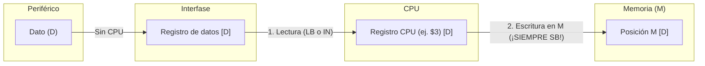
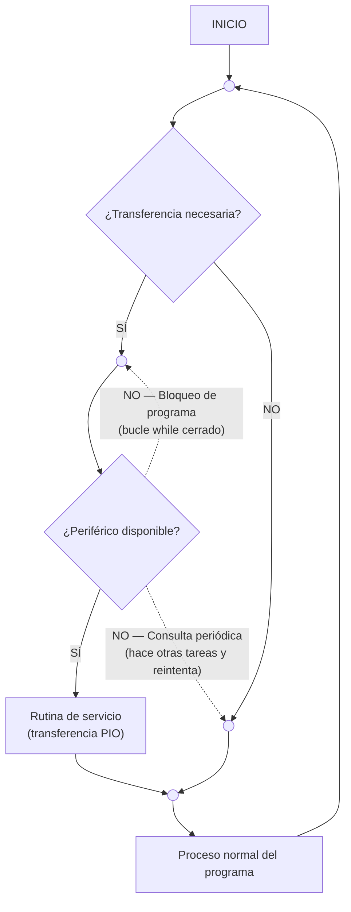
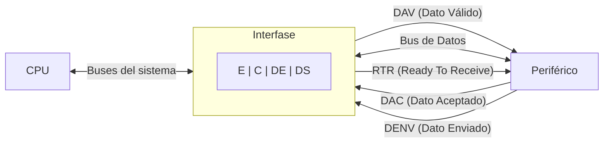
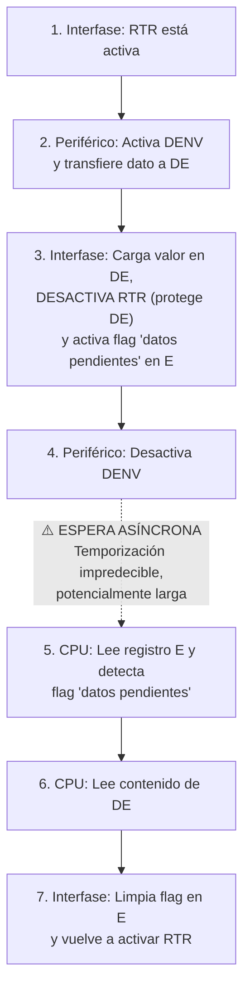
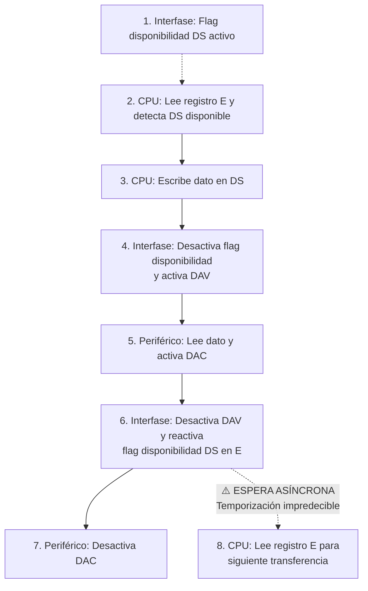

# 4.3. Métodos de E/S: PIO y Consulta de Estado (*Handshaking*)

> [!info] Ubicación en el Temario
> Corresponde al **Apartado II — Métodos de E/S (PIO y Consulta de Estado)** de `tema_4_organizaci_n_de_la_e_s.md` (Diapositivas $26$–$34$), impartido en las **Clases 18 y 19** (con repaso inicial en la **Clase 20**).
> ⬅️ Anterior: [[4.2_Direccionamiento_Interfase_Mapeada_vs_Diferenciada|4.2. Direccionamiento de la Interfase]] | [[Tema_4_Indice|Índice del Tema 4]] | Siguiente: [[4.4_Interrupciones_Hardware_Enmascaramiento_y_Vectores|4.4. Interrupciones Hardware]] ➡️

---

## 1. Métodos de Transferencia de E/S: PIO vs DMA *(Diap. 26; Clase 18)*

Una vez direccionados los registros de la interfase, existen **dos métodos** para mover los datos entre la memoria principal (`M`) y el periférico:

| Método | Papel de la CPU | Hardware extra | Cuándo utilizarlo (*Clase 18*) |
| :--- | :--- | :--- | :--- |
| **PIO** (*Programmed I/O* — E/S por programa) | **Uso explícito de la CPU** en cada movimiento (un registro de CPU actúa como intermediario). | Ninguno (sencillo de implementar). | Transferencias puntuales de **pocos datos**, o sistemas sencillos sin controlador DMA. |
| **DMA** (*Direct Memory Access*) | **Sin intervención directa de la CPU** en cada byte transferido. | Requiere hardware dedicado (**controlador DMA**). | Transferencias de **bloques largos de datos** (tarjetas de red Ethernet/Wi-Fi como ESP32, USB), evitando ralentizar la CPU. |

> [!danger] Aviso / Trampa de Examen — Exclusión del bloque DMA
> Para el **Primer Parcial** solo entra esta distinción conceptual general (Diap. 26). El estudio detallado de **DMA** (Diap. $52$–$78$: controlador DMA, arbitraje de bus, *Buffered* vs *Direct I/O*, chipsets y GDMA) está **EXCLUIDO** y pasa al Segundo Parcial (*Clases 20 y 22*).

---

## 2. E/S por Programa (PIO) y la Trampa de las 2 Instrucciones *(Diap. 27–28; Clases 18 y 19)*

En una transferencia completa de datos por **PIO**, la CPU actúa obligatoriamente como puente entre la interfase del periférico y la memoria principal `M`, por lo que **cada transferencia requiere ejecutar $2$ instrucciones en la CPU**:

*(En una transacción de **escritura** hacia el periférico se invierten el sentido y el orden: primero lectura de `M` al registro de CPU y después escritura del registro de CPU a la interfase).*

- **Ventajas de PIO (Diap. 28):** no requiere hardware especial; muy sencilla de implementar.
- **Inconvenientes de PIO:** ocupa continuamente a la CPU durante toda la transferencia; mover bloques grandes ralentiza drásticamente el sistema.

> [!danger] Aviso / Trampa de Examen — Las 2 instrucciones en PIO con E/S Diferenciada (*Clase 18*)
> **¡Error clásico donde cae todo el mundo!** Compara las $2$ instrucciones necesarias para transferir un dato en ambos tipos de direccionamiento:
>
> | Tipo de transferencia PIO | E/S Mapeada por Memoria (MIPS) | E/S Diferenciada |
> | :--- | :--- | :--- |
> | **Lectura** (Periférico $\rightarrow$ CPU $\rightarrow$ Memoria) | 1. `LB $3, dir_perif` 2. `SB $3, dir_mem` | 1. `IN $3, puerto` 2. **`SB $3, dir_mem`** *(¡NUNCA `OUT`!)* |
> | **Escritura** (Memoria $\rightarrow$ CPU $\rightarrow$ Periférico) | 1. `LB $3, dir_mem` 2. `SB $3, dir_perif` | 1. `LB $3, dir_mem` 2. `OUT puerto, $3` |
>
> **Justificación:** En la lectura diferenciada, el paso 2 escribe el dato en la **memoria principal `M`** (espacio de memoria), NO en un puerto de E/S; por eso debe usar una instrucción de escritura en memoria (`SB`), jamás `OUT`.
>
> **Finura de programación (*Clases 18 y 19*):** Si la operación es únicamente una **consulta de estado** (valor "de usar y tirar" para comprobar un bit), **basta $1$ sola instrucción** (`LB` o `IN` hacia un registro de CPU), sin necesidad de llevar el valor hasta memoria.

---

## 3. Caso Real de Libro: el ADC de $10\text{ bits}$ del PIC16F877A *(Clase 18)*

Para ilustrar por qué PIO exige **consulta de estado (*handshaking*)**, el profesor analizó el **Conversor Analógico-Digital (ADC)** del PIC16F877A:

- **Contexto hardware:** Aunque el PIC16F877A tiene $8$ pines analógicos posibles, en la placa PICGenios los pines **`RA0` y `RA1`** vienen conectados por defecto a **potenciómetros** ($0$ a $5\text{ V}$ analógicos) —esta es precisamente la razón por la que en las prácticas digitales escribimos la macro `ALL_DIGITAL` al inicio.
- **Arquitectura de registros del ADC ($10\text{ bits}$ en un micro de $8\text{ bits}$):**
  1. **Dos registros de datos (`ADRESH` y `ADRESL`):** Como la conversión produce un valor digital de **$10\text{ bits}$** y la arquitectura del PIC es de **$8\text{ bits}$**, se necesitan forzosamente **$2$ registros de datos** ($8\text{ bits}$ en uno y $2\text{ bits}$ en el otro).
  2. **Registro híbrido `ADCON0` (bit `GO/DONE`):** Mezcla funciones de **control** y de **estado** en el mismo bit:
     - **Control (escritura):** poner `GO/DONE = 1` ordena al ADC iniciar la conversión.
     - **Estado (lectura):** leer `1` indica conversión en curso; leer `0` indica conversión terminada (`DONE` activo en baja).
- **Por qué no es instantáneo:** Internamente compara la tensión analógica mediante una escalera de resistencias / comparaciones sucesivas, lo que tarda del orden de **milisegundos** (dependiendo de la frecuencia de reloj; a mayor velocidad de muestreo, menor precisión).

> [!example] Ejemplo / Problema de Clase — Protocolo completo de lectura del ADC por PIO (*Clase 18*)
> Un periférico no empieza a convertir por iniciativa propia ni entrega el resultado al instante. La secuencia obligatoria del *driver* es:
> 1. **Comprobar estado previo:** Leer `ADCON0` (bit `GO/DONE`) hasta confirmar que vale **`0`** (garantizar que no hay otra conversión en marcha).
> 2. **Ordenar inicio (Control):** Escribir **`1`** en `GO/DONE` (mediante PIO) para arrancar la conversión.
> 3. **Esperar fin de conversión (*Handshaking*):** Seguir leyendo `GO/DONE` hasta que baje a **`0`**. *(Si se lee `ADRESH:ADRESL` mientras `GO/DONE = 1`, se obtiene un dato parcial o inestable).*
> 4. **Transferir datos:** Leer `ADRESH` y `ADRESL` hacia los registros de CPU / memoria.

---

## 4. Consulta de Estado: Bloqueo de Programa vs Consulta Periódica *(Diap. 29–31; Clases 18, 19 y 20)*

Antes de realizar cualquier transferencia PIO, el *driver* debe ejecutar un protocolo de ***handshaking*** (**consulta de estado**) leyendo el registro de estado de la interfase. Cuando el periférico todavía **NO está disponible**, existen **dos estrategias**:

### Tabla comparativa con todos los casos de ingeniería vistos en clase

| Dimensión | **Bloqueo de Programa** *(Espera activa / `while`)* | **Consulta Periódica** |
| :--- | :--- | :--- |
| **Mecanismo** | El *driver* entra en un bucle cerrado leyendo continuamente el registro de estado hasta que el periférico esté listo. | Si el periférico no está listo, abandona la espera, ejecuta el resto del programa y vuelve a comprobar en la siguiente iteración. |
| **Latencia (Tiempo de respuesta)** | **Mínima garantizada:** reacciona en cuanto cambia el bit de estado. | **No garantiza mínimo y el máximo es difícil de acotar** (impredecible si hay eventos externos: ratón, bomba de mensajes de Windows, *live feed* de vídeo; solo acotable contando instrucciones exactas en ensamblador puro, *Clase 20*). |
| **Concurrencia en Monocore (ej. PIC)** | **Paraliza por completo el sistema:** no refresca displays, no parpadea LEDs y **NO permite pulsar "Cancelar"** (si el periférico falla, queda colgado salvo [[4.1_Estructura_ES_Interfase_y_Modelo_Programacion\|Watchdog Timer]]). | **Permite concurrencia:** mientras espera un botón, el PIC puede parpadear el punto decimal del display $7$-segmentos (Práctica 4) o permitir cancelar. |
| **En Multinúcleo (PC / Servidores)** | Viable lanzando un segundo **hilo (*thread*)** con `fork` en C en un núcleo dedicado, dejando otro núcleo para la GUI y el botón "Cancelar" (ej. Intel Core i5 de $6$ núcleos / $12$ hilos con *Hyper-Threading*, o servidores cloud de $128$ núcleos). *(Nota: la **GPU** acelera cálculos matemáticos pero NO ejecuta hilos del SO).* | También viable en sistemas multitarea alternados en 1 núcleo (sin riesgo de congelar el sistema entero). |
| **Consumo energético (Batería)** | **Crítico (CPU al $100\%$):** *"le pega un chupetón a la batería"*. Inaceptable en esperas largas alimentadas por batería. | Menor si se combina adecuadamente, aunque para ahorro real en microcontroladores a batería la solución correcta es **modo `sleep` + interrupción por temporizador**. |
| **Ejemplos reales de clase** | **ABS y freno regenerativo de un Toyota híbrido** (reacciona en milisegundos al sensor magnético de paso por cero frente a los $\sim 200\text{ ms}$ de reacción de un piloto de F1). | Parpadeo de punto decimal en Práctica 4; interfaces gráficas con botón "Cancelar". |

> [!example] Ejemplo / Problema de Clase — El TFG de la estación meteorológica en el monte (*Clase 19*)
> En un Trabajo de Fin de Grado de una estación meteorológica alimentada por **batería** en el monte, había que leer el sensor de humedad cada **$2\text{ minutos}$** ($120\text{ s}$). Un diseño con **bloqueo de programa** (bucle `while` de espera activa con $120\,000$ iteraciones) mantiene la CPU al $100\%$ y **agota la batería en pocas horas**.
>
> **Diseño correcto:** Poner el microcontrolador en modo de bajo consumo (**`sleep`**) y programar un temporizador hardware para que lo despierte mediante una **interrupción** al cabo de los $2\text{ minutos}$.

---

## 5. Protocolo de 4 Líneas Interfase–Periférico (`DAV`, `DAC`, `RTR`, `DENV`) *(Diap. 32–34; Clase 19)*

Para coordinar el movimiento bidireccional de datos entre la **interfase** (registros `E`, `C`, `DE`, `DS`) y el **periférico**, se emplean **$4$ líneas de señalización**:

| Línea | Sentido | Significado |
| :--- | :---: | :--- |
| **`DAV`** (*Dato Válido*) | Interfase $\rightarrow$ Periférico | La interfase avisa al periférico de que hay un dato listo en salida; se mantiene activa hasta recibir `DAC`. |
| **`DAC`** (*Dato Aceptado*) | Periférico $\rightarrow$ Interfase | El periférico confirma que ha leído y aceptado el dato. |
| **`RTR`** (*Ready To Receive*) | Interfase $\rightarrow$ Periférico | La interfase da permiso al periférico para enviar un dato nuevo al registro `DE`. |
| **`DENV`** (*Dato Enviado*) | Periférico $\rightarrow$ Interfase | El periférico indica a la interfase que está entregando un dato en `DE`. |

### 5.1. Secuencia completa de Lectura por PIO *(Diap. 33; Clase 19)*

> [!tip] Explicación de Pizarra / Intuición (¿Por qué la interfase desactiva `RTR` en el paso 3? — *Clase 19*)
> Mientras el dato recién llegado siga en `DE` esperando a que la CPU lo lea, el periférico **NO debe sobrescribir `DE`** con un dato nuevo o perderíamos el dato anterior. Al **desactivar `RTR`**, la interfase bloquea al periférico hasta que la CPU lea `DE` y libere el registro (paso 7).

### 5.2. Secuencia completa de Escritura por PIO *(Diap. 34)*

### El cuello de botella de PIO $\longrightarrow$ Puente a Interrupciones
Tanto en lectura (Diap. 33) como en escritura (Diap. 34), la flecha discontinua revela el fallo estructural de PIO: **la CPU y la interfase están desconectadas temporalmente**, existiendo una espera impredecible hasta que el programa decida consultar el registro `E`. La solución hardware a este problema son las **[[4.4_Interrupciones_Hardware_Enmascaramiento_y_Vectores|Interrupciones Hardware]]**.

> [!question] Pregunta de Clase (Justifica la respuesta) — *Clases 18 y 19*
> 1. En el ADC de $10\text{ bits}$ del PIC16F877A (arquitectura de $8\text{ bits}$), ¿cuántos registros de datos se necesitan y qué doble función tiene el bit `GO/DONE` de `ADCON0`?
> 2. En una transferencia de **lectura** por PIO con **E/S diferenciada**, ¿qué $2$ instrucciones ejecuta la CPU?
> 3. ¿Por qué no debes usar bloqueo de programa (`while`) para esperar $2\text{ minutos}$ entre lecturas de un sensor alimentado por batería?
>
> >> [!success]- Solución
> >> 1. Se necesitan **$2$ registros de datos** (`ADRESH` y `ADRESL`) porque un valor de $10\text{ bits}$ no cabe en un registro de $8\text{ bits}$. El bit `GO/DONE` es **híbrido (control y estado)**: escribir `1` ordena iniciar la conversión (**control**), mientras leerlo indica si la conversión está en progreso (`1`) o ha terminado (`0`, **estado**).
> >> 2. Primera instrucción: **`IN $reg, puerto`** (lee del espacio de E/S hacia un registro de CPU). Segunda instrucción: **`SB $reg, dir_mem`** (escribe desde el registro de CPU hacia la memoria principal; **nunca `OUT`** porque el destino es memoria).
> >> 3. Porque el bloqueo de programa mantiene la CPU ejecutando iteraciones al **$100\%$ de carga**, agotando la batería en horas (y bloqueando un monocore sin posibilidad de cancelar). La solución correcta es poner el microcontrolador en modo de bajo consumo (**`sleep`**) y despertarlo mediante una **interrupción de temporizador hardware**.
