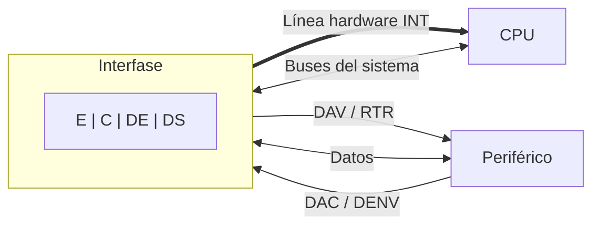
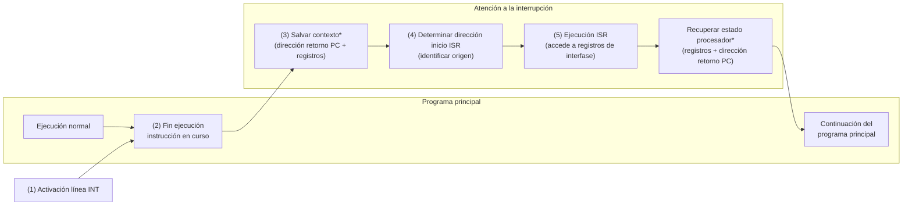
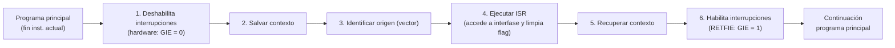
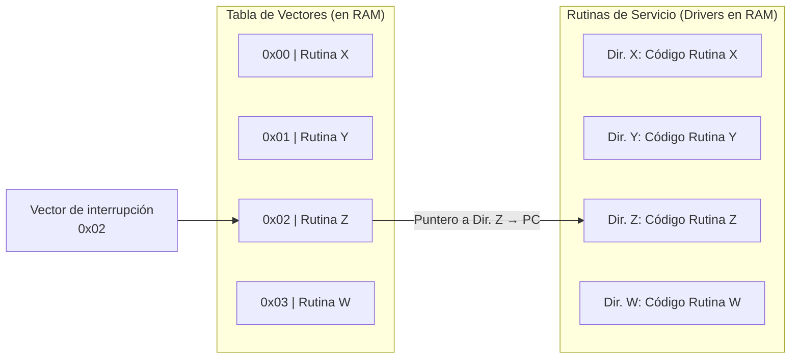
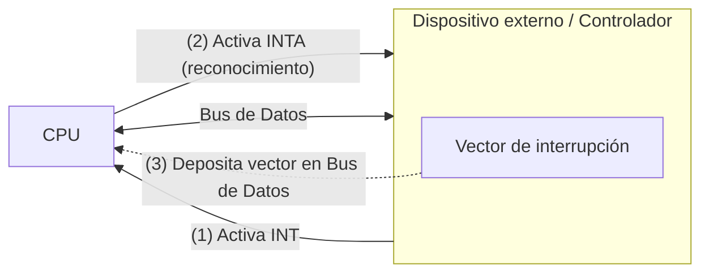

# 4.4. Interrupciones Hardware, Enmascaramiento y Vectores

> [!info] Ubicación en el Temario
> Corresponde a **Interrupciones y Vector de interrupción** en `tema_4_organizaci_n_de_la_e_s.md` (Diapositivas $35$–$44$, con apoyo de la Diap. $47$ para el vector único del PIC), impartido al final de la **Clase 19**, desarrollado completamente en la **Clase 20** y repasado al inicio de la **Clase 21**.
> ⬅️ Anterior: [[4.3_Metodos_ES_PIO_y_Consulta_de_Estado|4.3. PIO y Consulta de Estado]] | [[Tema_4_Indice|Índice del Tema 4]] | Siguiente: [[4.5_Origenes_Multiples_Polling_Timer0_y_Controlador_Interrupciones|4.5. Orígenes Múltiples, Timer0 y Controlador]] ➡️

---

## 1. Motivación y Línea Hardware `INT` *(Diap. 35–36; Clases 19 y 20)*

En PIO puro ([[4.3_Metodos_ES_PIO_y_Consulta_de_Estado]]), el periférico no puede avisar a la CPU de que necesita servicio: la CPU debe comprobar periódicamente el registro de estado, introduciendo una **temporización impredecible y potencialmente larga**.

La solución son las **interrupciones hardware**: añadir una **línea hardware física dedicada (`INT`)** entre la interfase y la CPU (en sistemas modernos con PCI Express se implementa mediante escrituras a direcciones especiales de memoria, *Clase 19*). En cuanto la interfase activa `INT`, provoca directamente que la CPU salte a ejecutar la **rutina de servicio de interrupción (ISR)**, eliminando la indeterminación temporal.



### Subrutina vs Subproceso (*Thread*) vs Interrupción *(Clase 19)*

| Mecanismo | Cómo se dispara | ¿Paralelismo real? | Uso principal |
| :--- | :--- | :---: | :--- |
| **Subrutina** (`GoSub` / `Return` en BASIC) | Por **software** (explícitamente en el código). | **No** (el `PC` salta, guarda retorno en pila y vuelve secuencialmente). | Reutilizar bloques de código (ej. rutina `calcula_display` para $4$ dígitos). |
| **Subproceso** (*Thread*, `fork` en C) | Por **software** / SO. | **Sí** (en multinúcleo) o concurrente alternado. | Ejecutar tareas independientes en paralelo (ej. espera + GUI). |
| **Interrupción** (`On Interrupt` en BASIC) | **Asíncronamente por hardware** (activación de la línea `INT`). | **No** (rompe la secuencia del `PC`, salva contexto en pila, ejecuta la ISR y retorna). | Atender eventos asíncronos de periféricos o temporizadores con baja latencia. |

---

## 2. Ciclo de Atención a una Interrupción y Cambio de Contexto *(Diap. 37; Clase 20)*

### 2.1. Esquema básico en 5 pasos (todavía incompleto) *(Diap. 37)*



*\*Nota oficial (Diap. 37): Los cambios de contexto demasiado frecuentes presentan serios problemas de eficiencia.*

> [!tip] Explicación de Pizarra / Intuición (¿Por qué la CPU espera al FIN de la instrucción en curso? — *Clase 20*)
> Cuando se activa `INT`, la CPU podría estar en mitad de la decodificación o ejecución de una instrucción (con `IR`, decodificador y ruta de datos cargados de estado temporal). Guardar todo ese estado interno intermedio sería enorme, complejo y propenso a fallos.
>
> En cambio, **justo al finalizar la instrucción en curso** (antes de iniciar el siguiente *Fetch* del [[Ciclo de Instrucción]]), todo ese estado transitorio es prescindible: **el único dato imprescindible del contexto es el Contador de Programa (`PC`)** apuntando a la siguiente instrucción a ejecutar (que se apila automáticamente) junto con los registros de trabajo que la ISR vaya a modificar.

### 2.2. Coste del cambio de contexto: ¿cuándo vence *Polling* a las Interrupciones?

> [!example] Ejemplo / Problema de Clase — TFG del Péndulo Invertido con Arduino (*Clase 20*)
> En un Trabajo de Fin de Grado para estabilizar un **péndulo invertido** con Arduino, el algoritmo de control necesitaba altísima frecuencia de muestreo y se diseñó inicialmente usando **interrupciones de temporizador**.
>
> **El fallo:** Con **decenas de miles de interrupciones por segundo**, el procesador gastaba más ciclos entrando/saliendo de la ISR y **salvando/recuperando contexto** en memoria que ejecutando el propio algoritmo de control; la respuesta llegaba tarde y **el péndulo se caía**.
>
> **Solución:** Sustituir las interrupciones por ***polling* (consulta directa)** eliminó por completo el *overhead* del cambio de contexto y el péndulo se estabilizó.
> - **Regla de ingeniería:** pocas interrupciones $\implies$ **Interrupciones**; tasa masiva de eventos por segundo $\implies$ ***Polling***.

---

## 3. La Interrupción Autointerrumpida y sus Dos Soluciones *(Diap. 38–40; Clase 20)*

El esquema básico de la Diap. 37 **NO funciona** en la realidad si la señal `INT` se evalúa por nivel alto (`1`):

```wavedrom
{
  "signal": [
    { "name": "INT (nivel)", "wave": "01.......0.", "node": ".a.b.c.d.e." }
  ],
  "edge": [
    "a (1) Detección INT",
    "b (2) Fin inst. actual",
    "c (3) Fin cambio contexto",
    "d (4) Fin id. origen",
    "e (5) Fin 1ª inst. ISR → ¡AUTOINTERRUPCIÓN!"
  ],
  "head": {
    "text": "Cronograma oficial (Diap. 38): Interrupción autointerrumpida (tiempos no a escala)"
  }
}
```

### ¿Qué ocurre en el instante `(5)`? *(Diap. 38–39; Clase 20)*
1. En `(1)` la interfase sube `INT = 1` y la mantiene activa hasta que la ISR acceda a sus registros para atenderla/limpiarla.
2. La CPU termina la instrucción actual `(2)`, salva contexto `(3)`, salta al inicio de la ISR `(4)` y ejecuta la **1ª instrucción de la ISR `(5)`**.
3. Al concluir esa 1ª instrucción de la ISR, la interfase **todavía no ha sido atendida**, por lo que `INT` sigue valiendo **`1`**. La CPU vuelve a muestrear `INT = 1`, cree que es una nueva petición, **salva contexto de nuevo (apuntando a la 2ª instrucción de la ISR) y salta otra vez al principio de la ISR**.
4. **Consecuencia fatal (Diap. 39):** Cuando finalmente la petición se atiende y la ISR retorna, regresa a la 2ª instrucción de la ISR y **vuelve a entrar una segunda vez consecutiva** en la rutina accediendo a una interfase que ya fue atendida o no tiene datos $\implies$ pérdida de control del *driver*, bloqueo hardware, **pantallazo azul de la muerte (`BSOD`) en Windows** o ***Kernel Panic* en Linux**.

### Las 2 soluciones hardware contra la autointerrupción *(Diap. 39–40; Clase 20)*

1. **Disparo por flanco:** Señalizar `INT` exclusivamente en el **flanco de subida** o en el **flanco de bajada** (en lugar de por nivel mantenido).
2. **Enmascaramiento automático de interrupciones (Diap. 40):** La Unidad de Control **deshabilita automáticamente las interrupciones globales** al comenzar a atender una interrupción y **las rehabilita** al recuperar el contexto:



> [!danger] Aviso / Trampa de Examen — Interrupción Autointerrumpida y `RETFIE` (*Clase 20*)
> - **No confundir la causa:** la autointerrupción NO se debe a un segundo evento físico del periférico, sino a que la misma petición `INT = 1` sigue activa al terminar la **1.ª instrucción de la ISR** antes de que esta haya limpiado la interfase.
> - **Las dos soluciones de examen** son **(1) disparo por flanco** y **(2) enmascaramiento global automático** (`GIE = 0` al entrar, `RETFIE` pone `GIE = 1` al salir). Olvidar limpiar el *flag* del periférico antes de `RETFIE` provoca igualmente una reentrada inmediata.

> [!tip] Explicación de Pizarra / Intuición (Enmascaramiento en el PIC16F877A: `GIE` y `RETFIE` — *Clase 20*)
> En el PIC16F877A, la máscara global de interrupciones es el bit **`GIE`** (*Global Interrupt Enable*) del registro **`INTCON`**:
> - El programador pone `GIE = 1` para habilitar el subsistema de interrupciones.
> - Cuando llega una interrupción, **el hardware pone automáticamente `GIE = 0`** al entrar (evitando la autointerrupción sin que el programador toque nada).
> - Al terminar la ISR, la instrucción especial **`RETFIE`** (*Return from Interrupt Enable*) recupera el `PC` de la pila y **vuelve a poner automáticamente `GIE = 1`**.

---

## 4. Vector de Interrupción, Tabla de Vectores (`TVI`) y Ciclo `INTA` *(Diap. 41–44; Clases 20 y 21)*

Cuando un sistema tiene múltiples periféricos, cada uno con su propia rutina de servicio en memoria, la CPU debe averiguar **a qué dirección exacta saltar**.

### 4.1. Indirección mediante Tabla de Vectores de Interrupción *(Diap. 41–42; Clase 20)*

- **Vector de interrupción:** Número entero (clásicamente de **$8\text{ bits}$**, valores $0..255$; en buses modernos PCI Express ya es de **$32\text{ bits}$** con múltiples tablas según nivel de privilegio usuario/supervisor, *Clase 20*) que identifica el origen de la interrupción.
- **Tabla de Vectores de Interrupción (TVI):** Tabla cargada por el Sistema Operativo en memoria principal donde cada índice (vector) almacena el **puntero (dirección de inicio)** de la ISR correspondiente.



### 4.2. Cómo se entrega el vector: ciclo de reconocimiento `INTA` *(Diap. 43–44)*

- **Interrupciones software y excepciones** (ej. división por cero, `INT 21h`): el vector lo genera **automáticamente la propia CPU**.
- **Interrupciones hardware externas:** el vector lo entrega el dispositivo externo (o el controlador de interrupciones) durante el **ciclo de reconocimiento de interrupción (`INTA`)** en $4$ pasos:



1. El dispositivo externo activa la línea **`INT`**.
2. Al empezar a atender la interrupción, la CPU activa la línea de reconocimiento **`INTA`**.
3. El dispositivo externo coloca el **vector de interrupción** en el **Bus de Datos**, y la CPU lo lee.
4. La CPU indexa la **TVI** con ese vector, obtiene el puntero a la ISR, lo carga en `PC` y la ejecuta.

### 4.3. El caso simplificado del PIC16F877A: Vector Único `0x0004` *(Diap. 47; Clases 20 y 21)*

El **PIC16F877A** NO tiene tabla de vectores ni ciclo `INTA`, porque solo posee **un único vector de interrupción fijo en la dirección de memoria de programa `0x0004`**:

- Al llegar cualquier interrupción, la Unidad de Control apila `PC`, pone `GIE = 0` y carga directamente **`PC = 0x0004`** (directiva ensamblador **`ORG 0x0004`**).
- **Código ensamblador real generado por PIC Simulator IDE en `0x0004` (*Clase 20*):**
  1. **$4$ instrucciones de guardado manual de contexto** (ej. guardar el acumulador `W` y `STATUS` con `movwf STATUS_TEMP`, ya que el hardware del PIC solo guarda `PC`).
  2. Salto **`GOTO on_interrupt`** hacia el código BASIC de nuestra rutina de servicio.
  3. **$4$ instrucciones de restauración de contexto** (`STATUS` y `W`).
  4. Instrucción final **`RETFIE`** (recupera `PC` de la pila y reactiva `GIE = 1`).

> [!question] Pregunta de Clase (Justifica la respuesta) — *Clase 20*
> 1. ¿Por qué la CPU espera a finalizar la instrucción en curso antes de atender una petición en `INT`?
> 2. ¿Qué es una **interrupción autointerrumpida**, qué consecuencias graves provoca y cuáles son las **dos formas hardware** de evitarla?
> 3. ¿En qué caso de ingeniería es preferible usar ***polling*** en lugar de interrupciones?
>
> >> [!success]- Solución
> >> 1. Porque a mitad de una instrucción el estado interno del procesador (`IR`, decodificador, ruta de datos) es complejo y propenso a errores al guardarlo; en cambio, justo al concluir la instrucción basta salvar el **`PC`** (dirección de la siguiente instrucción) más los registros de trabajo modificados por la ISR.
> >> 2. Ocurre cuando la línea `INT` (activa por nivel) permanece a `1` al terminar la 1ª instrucción de la ISR (antes de que esta haya atendido a la interfase), provocando que la CPU se interrumpa a sí misma y entre dos o más veces consecutivas en la misma ISR. Esto corrompe la sincronización con el periférico y puede colgar el sistema (**BSOD** en Windows / **Kernel Panic** en Linux). Se evita: **(a)** disparando `INT` solo por **flanco**, o **(b)** **enmascarando automáticamente las interrupciones globales** al entrar en la ISR (`GIE = 0`) y rehabilitándolas al salir (`RETFIE`).
> >> 3. Cuando la **tasa de interrupciones por segundo es altísima** (decenas de miles/s, como en el TFG del péndulo invertido): el *overhead* de salvar y restaurar el contexto continuamente consume más CPU que el propio algoritmo, por lo que el *polling* resulta más rápido y determinista.
