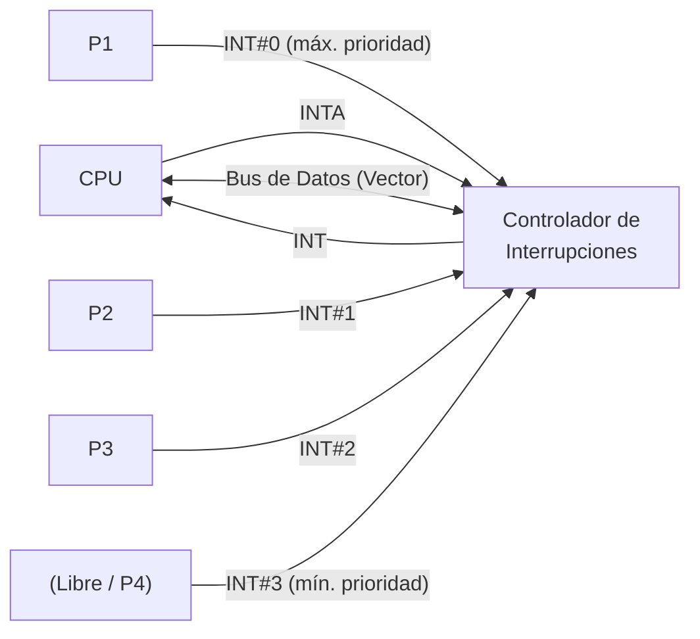
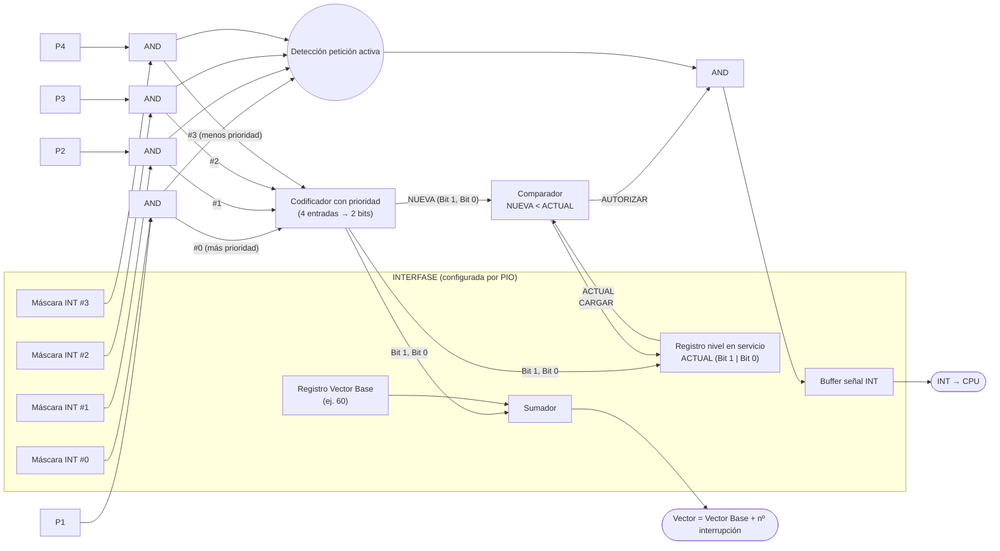

# 4.5. Orígenes Múltiples: *Polling*, `Timer0` y Controlador de Interrupciones

> [!info] Ubicación en el Temario
> Corresponde a **Gestión de orígenes múltiples: *polling*** y **Controlador de interrupciones** en `tema_4_organizaci_n_de_la_e_s.md` (Diapositivas $45$–$51$), impartido íntegramente en las **Clases 21 y 22**, junto con la programación de bases de tiempo con **`Timer0`**.
> ⬅️ Anterior: [[4.4_Interrupciones_Hardware_Enmascaramiento_y_Vectores|4.4. Interrupciones Hardware]] | [[Tema_4_Indice|Índice del Tema 4]]

---

## 1. Gestión de Orígenes Múltiples por *Polling* y OR Cableado *(Diap. 45–48; Clase 21)*

La CPU dispone normalmente de una **única línea `INT`** que deben compartir múltiples periféricos (`P1`, `P2`, `P3`...). Esto exige resolver **dos problemas**: (1) compartir eléctricamente el cable `INT` sin quemar nada, y (2) identificar qué periférico activó la petición.

### 1.1. Compartición física: el **OR cableado** y la resistencia de protección *(Diap. 45; Clase 21)*

En el esquema más sencillo, las líneas de interrupción de todos los periféricos se unen físicamente en un **OR cableado** hacia la línea `INT` (activa en alta): basta que cualquiera de ellos ponga un `1` para que `INT` suba a `1`.

> [!danger] Aviso / Trampa de Examen — ¿Qué falta en el dibujo simple del OR cableado? (*Clase 21*)
> En lógica TTL (`1` = $+5\text{ V}$, `0` = $0\text{ V}$ tierra), si `P1` pide interrupción ($+5\text{ V}$) y `P3` no ($0\text{ V}$), unir sus salidas directamente en el mismo cable provocaría un **cortocircuito** idéntico a una [[Colisión de Bus]].
>
> El diagrama simplificado de la Diap. 45 omite implícitamente **dos elementos eléctricos indispensables**:
> 1. **Referencia común a tierra (`GND`)** entre todos los dispositivos.
> 2. **Una resistencia de protección $R$** en serie a la salida de cada periférico: limita la corriente cuando un periférico pone `0 V` frente a otro en `+5 V`, evitando que se queme nada y permitiendo que el `1` prevalezca en la línea `INT`.
> *(En el interior del PIC16F877A, esta función lógica OR se implementa de forma limpia usando **puertas lógicas `OR` y `AND`**).*

```tikz
\usepackage{circuitikz}
\begin{document}
\begin{circuitikz}[scale=0.95, transform shape, font=\sffamily\footnotesize]
  % Linea INT compartida
  \draw[ultra thick, blue!70!black] (2.8,0) -- (2.8,3.6) -- (6.2,3.6);
  \node[above, blue!70!black] at (4.5,3.7) {\textbf{Linea \texttt{INT} (OR cableado)}};
  \draw[thick, fill=blue!10] (6.2,3.0) rectangle (8.0,4.2) node[pos=.5] {\textbf{CPU}};

  % Perifericos P1, P2, P3 con resistencia de proteccion R
  \draw[thick, fill=green!12] (-0.8,2.9) rectangle (0.8,3.9) node[pos=.5, align=center] {\textbf{P1}\\(\texttt{1}: $+5\text{ V}$)};
  \draw (0.8,3.4) to[R, l=$R_{\text{prot}}$] (2.8,3.4);

  \draw[thick, fill=green!12] (-0.8,1.3) rectangle (0.8,2.3) node[pos=.5, align=center] {\textbf{P2}\\(\texttt{1}: $+5\text{ V}$)};
  \draw (0.8,1.8) to[R, l=$R_{\text{prot}}$] (2.8,1.8);

  \draw[thick, fill=orange!15] (-0.8,-0.3) rectangle (0.8,0.7) node[pos=.5, align=center] {\textbf{P3}\\(\texttt{0}: $0\text{ V}$)};
  \draw (0.8,0.2) to[R, l=$R_{\text{prot}}$] (2.8,0.2);

  % Referencia comun a tierra
  \draw (0,-0.3) -- (0,-0.8) node[ground]{};
  \draw (7.1,3.0) -- (7.1,-0.8) node[ground]{};
  \node[below, gray] at (3.5,-0.9) {\scriptsize Referencia comun a tierra (\texttt{GND}) + Resistencias limitadoras $R_{\text{prot}}$};
\end{circuitikz}
\end{document}
```

### 1.2. Mecanismo de *Polling*, ventajas, inconvenientes y ejemplos reales *(Diap. 45–48; Clase 21)*

Al activarse `INT`, la CPU salta a una **única rutina de servicio genérica** compartida por todos los periféricos, la cual lee uno por uno (mediante **PIO**) los **registros de estado** de cada periférico hasta encontrar cuál tiene el *flag* de interrupción a `1`.

- **Ventajas (Diap. 46):**
  1. **No requiere hardware especializado.**
  2. **Prioridad fácilmente modificable por software:** el orden de los `if` en el muestreo fija exactamente la prioridad (`P1` $\rightarrow$ `P2` $\rightarrow$ `P3`). Cambiar la prioridad entre `P1` y `P2` es tan simple como intercambiar el orden de sus `if`.
- **Inconveniente grave:** **Latencia elevada para el último dispositivo de la cola**, porque aunque los anteriores no hayan pedido interrupción, hay que muestrearlos todos antes de llegar al último.
- **Dos ejemplos reales oficiales:**
  1. **Microcontrolador `PIC16F877A` (Diap. 47, `FIGURE 2-1`):** `0000h` (*RESET Vector*), **`0004h` (único *Interrupt Vector*)**, pila de $8$ niveles (`13-bit`), páginas de Flash `Page 0` (`0005h–07FFh`) a `Page 3` (`1800h–1FFFh`).
  2. **Compartición de `IRQ 9` en Windows XP (Diap. 48; *Clase 21*):** Incluso en ordenadores complejos (PC con buses ISA/PCI), cuando escasean los vectores hardware de interrupción, múltiples dispositivos (**ACPI, CardBus, Audio PCI, Módem, USB, gráfica Mobility Radeon y red Fast Ethernet**) comparten la misma línea **`IRQ 9`** y el SO los discrimina por *polling*.

---

## 2. Arquitectura de Interrupciones del PIC16F877A: `INTCON`, `PIE`/`PIR` y Código *(Clases 21 y 22)*

El PIC16F877A tiene una arquitectura híbrida curiosa: combina **OR + *polling* primitivo** (vector único `0x0004`) con **máscaras individuales de interrupción mediante puertas `AND`** (rasgo propio de un controlador de interrupciones):

- **Nivel 1 (orígenes más frecuentes, centralizados en `INTCON`):**
  1. **`Timer0`** (`TMR0IE` habilitación / `TMR0IF` flag).
  2. **Interrupción externa `RB0/INT`** (`INTE` / `INTF`).
  3. **Cambio en pines de `PORTB`** (`RBIE` / `RBIF`).
  - Además contiene **`GIE`** (máscara global que controla la puerta `AND` final hacia la CPU) y **`PEIE`** (habilita todo el nivel 2).
- **Nivel 2 (periféricos menos frecuentes, en registros `PIE` [control/habilitación] y `PIR` [estado/flags]):** `Timer1`, `Timer2`, comunicaciones serie y **ADC (`ADIF`, último bit de la cadena)**.

> [!danger] Aviso / Trampa de Examen — Pregunta fija sobre `INTCON` (*Clase 21*)
> **Pregunta:** *"¿El registro `INTCON` del PIC es un registro de control o un registro de estado?"*
>
> **Respuesta obligatoria:** **AMBAS COSAS A LA VEZ.** Contiene bits de **control** que se escriben para habilitar/enmascarar (`GIE`, `PEIE`, `TMR0IE`, `INTE`, `RBIE`) y *flags* de **estado** que se leen para saber qué periférico pide servicio (`TMR0IF`, `INTF`, `RBIF`). *(En nivel 2 sí se separan en `PIE` = control y `PIR` = estado).*

### Discriminación de *flags* en código y los $11$ muestreos del ADC *(Clase 21)*

- **Cómo filtrar el *flag* con rapidez en la ISR (sin bucles):**
  - En bajo nivel / C: aplicar una **máscara lógica `AND`** (ej. `(INTCON AND 00000100) != 0`). Comprobar **`!= 0`** es más seguro que `== 1` porque el bit desplazado produce un valor como `4` (y funciona con *flags* de varios bits).
  - En BASIC de *PIC Simulator IDE*: direccionamiento directo por bit (**`If INTCON.2 = 1 Then ...`**), que el compilador traduce internamente al `AND` + desplazamiento.
  - **Ojo con peticiones simultáneas:** Si `Timer0` y `RB0` piden interrupción a la vez, la ISR debe comprobar **ambos *flags*** (con `If` independientes, no excluyentes) para no dejar ninguno sin atender.
- **El problema de los $11$ muestreos hasta el ADC (`ADIF`, *Clase 21*):** En un sistema con todos los orígenes activos, comprobar los $3$ orígenes de nivel 1 + los $8$ bits de `PIR` exige **$3 + 8 = 11$ muestreos** hasta llegar a `ADIF`. Microchip lo situó al final intencionadamente porque el **ADC tarda milisegundos** y no necesita respuesta instantánea, a diferencia de **`Timer0`** que está en el nivel 1.

---

## 3. Bases de Tiempo con `Timer0` en el PIC16F877A *(Clase 21)*

> [!danger] Aviso / Trampa de Examen (Prácticas y Teoría — *Clase 21*)
> En el examen práctico de PIC está garantizado un problema de bases de tiempo con interrupciones de `Timer0` (*cronómetro*), con la regla estricta: ***"Como temporices usando `WaitMs`, el problema es un cero."***

### Funcionamiento y las 2 reglas críticas no intuitivas

`Timer0` es un registro contador de **$8\text{ bits}$** ($0$ a $255$ en [[Binario Natural]]) que incrementa $+1$ en cada ciclo de instrucción (ver [[3.4_Arquitectura_Harvard_y_Pipeline_PIC16F87XA]]):

$$f_{\text{Timer0}} = \frac{f_{\text{osc}}}{4} \qquad \Longrightarrow \qquad T_{\text{tick}} = \frac{4}{f_{\text{osc}}}$$

- Al pasar de **$255 \rightarrow 0$**, se genera un **bit de acarreo** (9.º bit) que activa automáticamente el *flag* **`TMR0IF = 1`** (generando interrupción si `GIE = 1` y `TMR0IE = 1`).
- Con el cristal de **$f_{\text{osc}} = 4\text{ MHz}$**: $f_{\text{Timer0}} = 1\text{ MHz} \implies \mathbf{1\ \mu\text{s}\text{/tick}} \implies$ empezando en `0`, desborda cada **$256\ \mu\text{s}$**.

**Las 2 reglas críticas de `Timer0` (*Clase 21*):**
1. **`Timer0` NUNCA se para:** una vez configurado el reloj externo, corre permanentemente e incluso activa `TMR0IF = 1` aunque la interrupción esté deshabilitada (`TMR0IE = 0`). Nunca sabes en qué valor está al empezar $\Rightarrow$ **reprogramarlo siempre**.
2. **`TMR0IF` NO se limpia automáticamente por hardware:** debes escribir **`TMR0IF = 0` por software** (a) **antes de habilitar interrupciones** (evita disparo inmediato espurio; de ahí también el `WaitMs 50` inicial contra la condición de carrera en `INTF`) y (b) **dentro de cada ISR** (si no, al salir con `RETFIE` vuelve a entrar inmediatamente en bucle infinito).

> [!example] Ejemplo / Problema de Clase — Bases de tiempo limpias ($250\ \mu\text{s}$, $200\ \mu\text{s}$ y $1\text{ s}$) a $4\text{ MHz}$ (*Clase 21*)
> **Problema:** $256\ \mu\text{s}$ es un número horrible para obtener múltiplos decimales exactos como $1\text{ ms}$ ($1000\ \mu\text{s}$) o $1\text{ s}$.
>
> **Solución 1 — Precarga de `Timer0` en cada ISR para saltarse los ticks sobrantes:**
> $$\text{Precarga} = 256 - N_{\text{ticks deseados}}$$
> - Para una base limpia de **$250\ \mu\text{s}$** ($4$ ticks $= 1\text{ ms}$): cargar **`Timer0 = 256 - 250 = 6`** al inicio y en cada ISR.
> - Para una base limpia de **$200\ \mu\text{s}$** ($5$ ticks $= 1\text{ ms}$): cargar **`Timer0 = 256 - 200 = 56`** al inicio y en cada ISR.
>
> **Solución 2 — Obtener $1\text{ segundo}$ (cronómetro) sin usar el *prescaler*:**
> - El *prescaler* (divisor hardware de segundo nivel) es enrevesado de programar (*"un bicho malparido"* en palabras de clase).
> - La vía limpia es incrementar una **variable contadora** dentro de la ISR: con base de **$200\ \mu\text{s}$**, necesitamos $5\text{ ticks/ms} \times 1000\text{ ms} = \mathbf{5000\text{ interrupciones}}$ para completar $1\text{ s}$ (o $4000$ si usamos base de $250\ \mu\text{s}$).
> - **Tipo de dato obligatorio:** No cabe en `Byte` (máx. $255$), exige al menos $\lceil \log_2 5000 \rceil = 13\text{ bits} \implies$ declarar la variable como **`Word` ($16\text{ bits}$)** ($0..65\,535$).

---

## 4. Controlador de Interrupciones Hardware y APIC *(Diap. 49–51; Clase 22)*

Para evitar la lentitud del *polling* software con muchos periféricos, se añade un circuito especializado intermediario: el **Controlador de Interrupciones** (*"un periférico glorificado"* o *proxy*, *Clase 22*):

- Cada periférico tiene su **propia línea de petición individual** (`INT#0`, `INT#1`, `INT#2`, `INT#3`).
- Al ser un periférico especializado, posee **interfase propia (registros de control/estado y modelo de programación)** que el SO configura al arranque mediante **PIO**.
- Realiza tres funciones hardware: (1) enmascarar y priorizar peticiones; (2) activar `INT` hacia la CPU solo si corresponde; (3) entregar el **vector de interrupción** por el Bus de Datos cuando la CPU responde con **`INTA`**.



### 4.1. Arquitectura interna completa del Controlador de Interrupciones *(Diap. 50–51; Clase 22)*



### Los 4 bloques clave y sus decisiones de ingeniería *(Diap. 50–51; Clase 22)*

1. **Etapa de enmascaramiento individual (puertas `AND`):** Igual que en el PIC (`TMR0IE`, `INTE`...), cada bit de máscara a `1` deja pasar la petición del periférico; a `0` la bloquea completamente.
2. **Codificador con prioridad ($2^n \rightarrow n\text{ bits}$, aquí $4 \rightarrow 2\text{ bits}$):**
   - Convierte la entrada activa más prioritaria (`#0` máxima prioridad $\rightarrow$ `#3` mínima) directamente en su índice binario de $2\text{ bits}$ (`00`, `01`, `10`, `11`). Si activan `#1` y `#2` a la vez, saca `01` (`1`) instantáneamente por hardware.
   - **Ventaja:** velocidad máxima, sin muestreo software.
   - **Inconveniente frente a *polling*:** la prioridad es física; para hacer a `P3` más prioritario que `P2` hay que **sacar físicamente la tarjeta del *slot* de expansión y cambiarla a otro *slot***.
3. **Comparador `NUEVA < ACTUAL` + Registro de nivel en servicio:**
   - Evita la autointerrupción y gestiona prioridades anidadas: solo autoriza (`AUTORIZAR` $\rightarrow$ actualiza `ACTUAL` vía `CARGAR` y dispara `INT`) si llega una petición **estrictamente más prioritaria** ($\text{NUEVA} < \text{ACTUAL}$) que la que se está atendiendo actualmente.
4. **Registro `Vector Base` + Sumador:**
   $$\text{Vector de interrupción} = \text{Vector Base} + \text{nº de interrupción}$$
   - **¿Por qué NO podemos usar los valores `0, 1, 2, 3` directos del codificador? (*Clase 22*):** Porque las primeras entradas de la Tabla de Vectores de Interrupción (`0, 1, 2, 3...`) están **reservadas por el hardware de la CPU para excepciones internas** (por ejemplo, una **división por cero**, `9 / 0`, que dispara automáticamente una excepción del SO para abortar el programa).
   - Escribiendo por PIO `Vector Base = 60`, el sumador desplaza los vectores de periféricos a posiciones libres de la TVI: **`60, 61, 62 y 63`**.

### Secuencia de inicialización del controlador por PIO y APIC *(Clase 22)*
Al arrancar el sistema operativo, la CPU configura el controlador mediante **PIO** en 3 pasos: (1) escribir las **máscaras individuales**; (2) escribir la dirección **`Vector Base`**; (3) habilitar la **máscara global**. En procesadores modernos, toda esta circuitería avanzada viene integrada dentro de la propia pastilla de la CPU bajo el nombre de **APIC** (*Advanced Programmable Interrupt Controller*).

---

> [!danger] Fin del Temario del Primer Parcial — DMA EXCLUIDO (Diap. 52–78)
> Tal como confirmó el profesor en las **Clases 20 y 22**, el estudio del **Controlador de DMA, Arbitración de bus (`BR`/`BG`, `HOLD`/`HLDA`), *Buffered I/O* vs *Direct I/O*, chipsets modernos y GDMA en ESP32** (Diapositivas $52$–$78$ de `tema_4_organizaci_n_de_la_e_s.md`) **NO entra en el Primer Parcial** y se evaluará en el Segundo Parcial.

> [!question] Pregunta de Clase (Justifica la respuesta) — *Clases 21 y 22*
> 1. Compara cómo se cambia la prioridad entre dos periféricos en un sistema de interrupciones por ***polling*** frente a un **Controlador de Interrupciones hardware**.
> 2. En la arquitectura interna del Controlador de Interrupciones (Diap. 51), ¿para qué sirve el **registro `Vector Base`** y el sumador si el codificador con prioridad ya entrega un número binario (`00`..`11`)?
> 3. Con un PIC16F877A a $4\text{ MHz}$, ¿qué valor debes cargar en `Timer0` en cada ISR para obtener interrupciones cada $200\ \mu\text{s}$, y qué variable necesitas para contar $1\text{ segundo}$?
>
> >> [!success]- Solución
> >> 1. En ***polling*** la prioridad la determina el orden en que el software comprueba los *flags* de estado (`if`), por lo que basta **reordenar dos líneas de código**. En un **Controlador de Interrupciones** la prioridad está cableada físicamente en las entradas `#0..#3` del codificador con prioridad, por lo que cambiarla exige **cambiar físicamente el periférico de *slot* / línea de entrada**.
> >> 2. Porque las primeras posiciones de la tabla de vectores de interrupción (`0, 1, 2, 3...`) están **reservadas por el procesador para excepciones internas** (como una **división por cero**). El registro `Vector Base` (configurado por PIO, ej. `60`) sumado al índice del codificador desplaza los vectores de periféricos a posiciones libres (`60..63`) sin colisionar con las excepciones de la CPU.
> >> 3. A $4\text{ MHz}$, `Timer0` avanza cada $T = 4/f_{\text{osc}} = 1\ \mu\text{s}$ y desborda al llegar a $256$. Para desbordar cada $200\ \mu\text{s}$ hay que precargarlo con **`256 - 200 = 56`** en cada ISR (limpiando siempre `TMR0IF = 0`). Para contar $1\text{ s}$ se necesitan $5\text{ ticks/ms} \times 1000\text{ ms} = \mathbf{5000}$ interrupciones, lo que exige una variable entera sin signo de tipo **`Word` ($16\text{ bits}$)** (no cabe en un `Byte` de máx. $255$).
